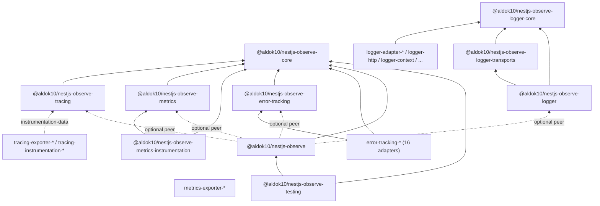

# Dependency Graph and Boundaries

Dependency boundaries across all 47 packages are statically verified by [scripts/check-architecture.mjs](../../scripts/check-architecture.mjs) and [scripts/architecture-rules.mjs](../../scripts/architecture-rules.mjs) (`pnpm run arch:check` or `pnpm run lint:arch`).

## High-Level Dependency Graph

## Domain Isolation Rules (`FORBIDDEN`)

Every workspace package must have an explicit entry in `FORBIDDEN` inside [scripts/check-architecture.mjs](../../scripts/check-architecture.mjs):

- **Shared Core (`@aldok10/nestjs-observe-core`)**: Cannot depend on or import `@nestjs/*`, `@opentelemetry/*`, any `@aldok10/*` sibling, logging backends (`pino`, `winston`, `bunyan`, `log4js`), or HTTP frameworks (`express`, `fastify`).
- **Logger Core & Pure Sub-Packages** (`logger-core`, `logger-delivery`, `logger-context`, `logger-filtering`, `logger-formatters`, `logger-redaction`, `logger-transports`, `logger-testing`): Cannot import `@nestjs/*`, `@opentelemetry/*` (except lazy optional peer in `logger-context`), logging backends, HTTP frameworks, logger adapters, `@aldok10/nestjs-observe-logger`, or any other observability domain.
- **Logger Backend Adapters** (`adapter-pino`, `adapter-winston`, `adapter-bunyan`, `adapter-log4js`): Each adapter forbids `@nestjs/*`, the other three logging backends, `@aldok10/nestjs-observe-logger`, `logger-testing`, and cross-domain packages.
- **Logger HTTP (`@aldok10/nestjs-observe-logger-http`)**: Forbids logging backends, `@aldok10/nestjs-observe-logger`, `logger-testing`, and cross-domain packages.
- **Logger NestJS (`@aldok10/nestjs-observe-logger`)**: Forbids logging backends, HTTP frameworks, logger adapters, `logger-testing`, and cross-domain packages.
- **Tracing (`packages/traces/*` excluding `error-tracking`)**: Forbids all cross-domain packages (logger, metrics, error-tracking, observer, observer-testing).
- **Metrics (`packages/metrics/*`)**: Forbids all cross-domain packages (logger, tracing, error-tracking, observer, observer-testing).
- **Error Tracking (`packages/traces/error-tracking/*`)**: Forbids all cross-domain packages. `@aldok10/nestjs-observe-error-tracking` forbids all 16 adapters and `-testing`; each provider adapter forbids all other error-tracking adapters and competing provider SDKs (e.g., `adapter-sentry` forbids `@bugsnag/js`, `rollbar`, `@honeybadger-io/js`, `@highlight-run/node`).
- **Observer (`@aldok10/nestjs-observe`)**: Forbids `@aldok10/nestjs-observe-testing`; connects to `logger`, `tracing`, `metrics`, and `error-tracking` exclusively as optional `peerDependencies`.

## Role-Based Edge Restrictions

`roleForbiddenEdge` in [scripts/architecture-rules.mjs](../../scripts/architecture-rules.mjs) blocks structural coupling within domains:

| Rule                                       | Description                                                                                                                                                   |
| ------------------------------------------ | ------------------------------------------------------------------------------------------------------------------------------------------------------------- |
| `backend-adapter-to-destination-transport` | Logger backend adapters (`adapter-pino`, `adapter-winston`, `adapter-bunyan`, `adapter-log4js`) cannot depend on `@aldok10/nestjs-observe-logger-transports`. |
| `transport-to-transport`                   | Transport packages cannot depend on other transport packages.                                                                                                 |
| `integration-to-unrelated-integration`     | Integration packages (`logger`, `logger-http`, `logger-sentry`, `logger-context`) cannot depend on each other.                                                |

## Import, Optional Peer, and Cycle Checks

1. **No Escaping Relative Imports**: Relative imports (`./` or `../`) must resolve within the same package directory.
2. **Public Exports Only**: Imports from sibling workspace packages must target a subpath declared in that sibling's `package.json` `exports`.
3. **Lazy Optional Peers**: Optional peer dependencies (such as `@opentelemetry/api`, `rotating-file-stream`, `@sentry/node`, `express`, `fastify`, `@nestjs/common`, `rxjs`, and Observer's pillar peers) must be imported only as `import type` or loaded lazily via dynamic `import()` / `OptionalPeerLoader` in non-test files.
4. **Declared Dependencies**: Non-spec source files may only import Node.js built-ins or packages declared in `dependencies`, `peerDependencies`, or `optionalDependencies`. Test-only fixture imports are scoped by `TEST_IMPORT_ALLOWANCE`.
5. **Acyclic Graph**: Depth-first traversal across workspace runtime dependencies and non-spec imports rejects any package dependency cycle.
