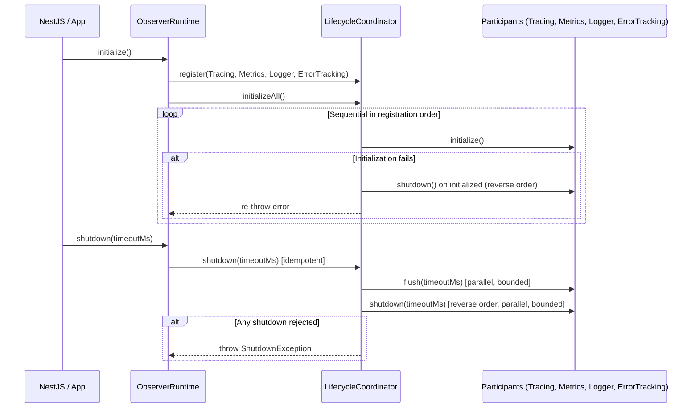

# Lifecycle Management

`nestjs-observe` coordinates startup, flushing, health reporting, and deterministic bounded shutdown through primitives in `@aldok10/nestjs-observe-core` and composition in `@aldok10/nestjs-observe`.

## Core Primitives

### `LifecycleParticipant`

Defined in [packages/core/src/lifecycle/lifecycle.contracts.ts](../../packages/core/src/lifecycle/lifecycle.contracts.ts):

```ts
export type HealthState = 'healthy' | 'degraded' | 'unhealthy' | 'stopped';

export interface ComponentHealth {
  readonly name: string;
  readonly state: HealthState;
  readonly message?: string;
  readonly details?: Readonly<Record<string, unknown>>;
}

export interface LifecycleParticipant {
  readonly name: string;
  initialize?(): Promise<void> | void;
  flush?(timeoutMs?: number): Promise<void>;
  shutdown(timeoutMs?: number): Promise<void>;
  health?(): ComponentHealth | Promise<ComponentHealth>;
}
```

`TracingRuntime`, `MetricsRuntime`, and `ErrorTrackingRuntime` implement `LifecycleParticipant` directly. `ObserverRuntime` also registers an inline `'logger'` participant wrapping `LogPipeline.flush` and `LogPipeline.close`.

### `BoundedExecution`

Defined in [packages/core/src/lifecycle/bounded-execution.ts](../../packages/core/src/lifecycle/bounded-execution.ts), `BoundedExecution.run(work, timeoutMs)` (and `withTimeout`) prevents flush or shutdown operations from hanging indefinitely:

- If `timeoutMs` is `undefined`, non-finite, or `< 0`, `work` is returned directly without creating a timer.
- Otherwise, `work` is raced against `timers/promises` `setTimeout(timeoutMs, undefined, { ref: false, signal: controller.signal })`.
- Using `ref: false` ensures the timeout timer never keeps the Node.js event loop alive, and `controller.abort()` in `finally` cleans up the timer as soon as `work` settles.

### `LifecycleCoordinator`

Defined in [packages/core/src/lifecycle/lifecycle-coordinator.ts](../../packages/core/src/lifecycle/lifecycle-coordinator.ts):

- **Registration (`register`)**: Appends unique `LifecycleParticipant` instances (deduplicated by reference).
- **Sequential Initialization & Rollback (`initializeAll`)**: Runs each participant's `initialize()` in registration order. If any participant throws during `initialize()`, previously initialized participants are shut down in reverse order (`initialized.toReversed()`) before the original error is re-thrown.
- **Bounded Flush (`flush(timeoutMs?)`)**: Invokes `participant.flush(timeoutMs)` for all participants in parallel via `Promise.allSettled`, wrapped in `BoundedExecution.run`. Timeouts are swallowed so flush remains non-blocking.
- **Idempotent Reverse-Order Shutdown (`shutdown(timeoutMs?)`)**: Caches the in-flight `shutdownInFlight` promise so repeated or concurrent `shutdown()` calls return the same promise. Teardown executes:
  1. `flush(timeoutMs)`
  2. `shutdown(timeoutMs)` in parallel across `participants.toReversed()`, wrapped in `BoundedExecution.run`
  3. Throws `ShutdownException` if any participant's `shutdown()` rejects.
- **Health Aggregation (`health()`)**: Queries `participant.health()` in parallel; participants without `health()` default to `{ name: participant.name, state: 'healthy' }`.

## Initialization and Shutdown Flow



## `ObserverRuntime` and NestJS Integration

In [packages/observer/observer/src/observer.runtime.ts](../../packages/observer/observer/src/observer.runtime.ts):

- `ObserverRuntime.initialize()` is idempotent (`if (this.initialized) return;`) and loads enabled pillars in fixed order:
  1. **Tracing** (`TracingRuntime`, `ObserveTracer`)
  2. **Metrics** (`MetricsRuntime`, `ObserveMetrics`)
  3. **Logger** (`LogContextStore`, `LogPipeline`, `UniversalLoggerImpl`, inline `'logger'` participant; falls back to `ConsoleTransport` if no `transports` are configured)
  4. **Error Tracking** (`ErrorTrackingRuntime`, `ObserveErrorTracker`)
- `ObserverRuntime.health()` aggregates component states into an `ObserverHealthReport` with overall status precedence: `'unhealthy'` > `'degraded'` > `'stopped'` (when all components are stopped) > `'healthy'`.

In [packages/observer/observer/src/observer.module.ts](../../packages/observer/observer/src/observer.module.ts):

- `OBSERVER_RUNTIME` is initialized during NestJS DI startup (`await runtime.initialize()`).
- `ObserverLifecycleService` implements both `OnModuleDestroy` and `OnApplicationShutdown`, delegating to `runtime.shutdown()` once via a cached `shutdownPromise`.
