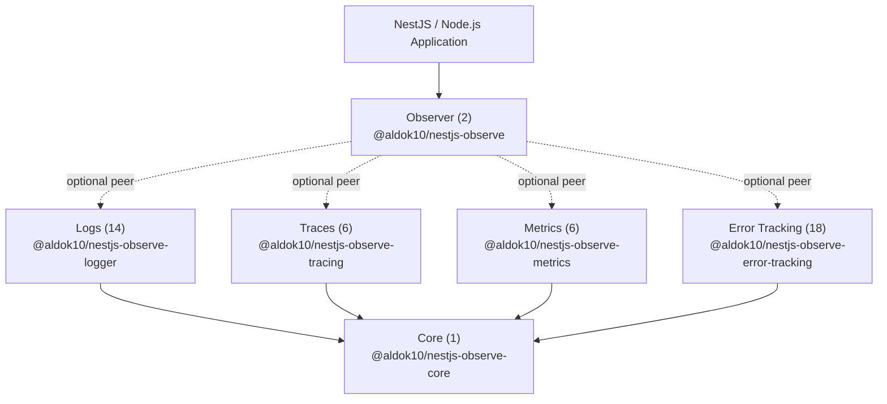

# Packages Overview

`nestjs-observe` is organized into **47 packages** across 6 groups: a shared core, 4 standalone telemetry pillars (Logs, Traces, Error Tracking, Metrics), and an optional Observer composition layer.

## Architectural Boundaries

1. **Standalone by default**: Logs, Traces, Error Tracking, and Metrics have no runtime dependencies on one another or on `@aldok10/nestjs-observe`. Each pillar can be installed, configured, and tested independently.
2. **Integrated by composition**: `@aldok10/nestjs-observe` wires enabled pillars together through optional peer dependencies (`OptionalPeerLoader`), shares `ResourceMetadata` and `DiagnosticsSink`, correlates active-span `traceId`/`spanId` into logs and error events, and coordinates bounded shutdown.

## Package Groups (47 Packages)

| Group          | Count | Primary Entry Point                                                                                       | Guide                                                        |
| -------------- | ----- | --------------------------------------------------------------------------------------------------------- | ------------------------------------------------------------ |
| Core           | 1     | [`@aldok10/nestjs-observe-core`](../../packages/core/README.md)                                           | [Core Packages](./core/README.md)                            |
| Logs           | 14    | [`@aldok10/nestjs-observe-logger`](../../packages/logs/logger/README.md)                                  | [Logger Packages](./logger/README.md)                        |
| Traces         | 6     | [`@aldok10/nestjs-observe-tracing`](../../packages/traces/tracing/README.md)                              | [Tracing Packages](./traces/README.md)                       |
| Error Tracking | 18    | [`@aldok10/nestjs-observe-error-tracking`](../../packages/traces/error-tracking/error-tracking/README.md) | [Error Tracking Packages](./traces/error-tracking/README.md) |
| Metrics        | 6     | [`@aldok10/nestjs-observe-metrics`](../../packages/metrics/metrics/README.md)                             | [Metrics Packages](./metrics/README.md)                      |
| Observer       | 2     | [`@aldok10/nestjs-observe`](../../packages/observer/observer/README.md)                                   | [Observer Packages](./observer/README.md)                    |

## Choosing an Entry Point

- **Single signal only**: Install the primary package for that pillar (for example `@aldok10/nestjs-observe-logger` or `@aldok10/nestjs-observe-tracing`) plus any exporters, transports, or adapters you need.
- **Framework-independent logging**: Use [`@aldok10/nestjs-observe-logger-core`](../../packages/logs/core/README.md) without NestJS peer dependencies.
- **Unified multi-pillar setup**: Install [`@aldok10/nestjs-observe`](../../packages/observer/observer/README.md) alongside the specific pillar packages you intend to enable in `ObserverModule.forRoot()`.

## Testing Harnesses

Each pillar and the unified observer ship an in-memory testing package for zero-I/O unit and integration tests:

| Package                                          | Role                                                                | README                                                           |
| ------------------------------------------------ | ------------------------------------------------------------------- | ---------------------------------------------------------------- |
| `@aldok10/nestjs-observe-logger-testing`         | `CaptureTransport` in-memory log capture                            | [README](../../packages/logs/testing/README.md)                  |
| `@aldok10/nestjs-observe-tracing-testing`        | `InMemoryTracingHarness` over `InMemorySpanExporter`                | [README](../../packages/traces/testing/README.md)                |
| `@aldok10/nestjs-observe-error-tracking-testing` | `MemoryErrorTrackingAdapter` and `createTestErrorTracker`           | [README](../../packages/traces/error-tracking/testing/README.md) |
| `@aldok10/nestjs-observe-metrics-testing`        | `InMemoryMetricsHarness` for metric collection assertions           | [README](../../packages/metrics/testing/README.md)               |
| `@aldok10/nestjs-observe-testing`                | `ObserverTestHarness` capturing correlated logs, spans, and metrics | [README](../../packages/observer/testing/README.md)              |
