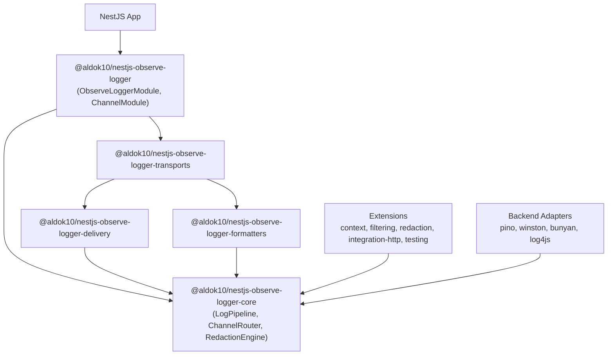

# Logger Packages (14 Packages)

Back to [Packages Overview](../README.md).

The logging pillar is split into **14 packages**: a zero-dependency framework-independent core, a NestJS integration entry point, composable pipeline extensions (context, filtering, redaction, formatters, delivery, transports, HTTP integration), 4 backend adapters, and a testing harness.

## Composition and Dependencies

- **Entry points**:
  - Use [`@aldok10/nestjs-observe-logger`](../../../packages/logs/logger/README.md) in NestJS applications (`LoggerModule` / `ObserveLoggerModule`, `ChannelModule`, `@InjectLogger`, `OBSERVE_LOGGER`, `LifecycleService`, `NestjsLoggerAdapter`). It bundles `logger-core` and `logger-transports` and re-exports `logger-core` subpaths.
  - Use [`@aldok10/nestjs-observe-logger-core`](../../../packages/logs/core/README.md) directly in non-NestJS Node.js services or libraries.
- **Extensions and adapters**: Every extension and backend adapter depends only on `@aldok10/nestjs-observe-logger-core`, so you install only the capabilities and backend bindings you use.

## Packages (14)

### Core and NestJS Integration (2)

| Package                               | Directory              | Responsibility                                                                                                                                            | README                                            |
| ------------------------------------- | ---------------------- | --------------------------------------------------------------------------------------------------------------------------------------------------------- | ------------------------------------------------- |
| `@aldok10/nestjs-observe-logger`      | `packages/logs/logger` | NestJS dynamic module (`ObserveLoggerModule` / `LoggerModule`), `ChannelModule`, `@InjectLogger`, `LifecycleService`, `NestjsLoggerAdapter`               | [README](../../../packages/logs/logger/README.md) |
| `@aldok10/nestjs-observe-logger-core` | `packages/logs/core`   | Framework-independent contracts, `LogPipeline`, `LoggerManager`, `ChannelRouter`, `RedactionEngine`, `FilterEngine`, `LogContextStore`, `AdapterResolver` | [README](../../../packages/logs/core/README.md)   |

### Pipeline Extensions, Transports, and Testing (8)

| Package                                     | Directory                        | Responsibility                                                                                                                                           | README                                                      |
| ------------------------------------------- | -------------------------------- | -------------------------------------------------------------------------------------------------------------------------------------------------------- | ----------------------------------------------------------- |
| `@aldok10/nestjs-observe-logger-context`    | `packages/logs/context`          | `createContextProvider`, `composeContextProviders`, and optional lazy OTel span readers (`fromActiveSpan`, `createActiveSpanProvider`, `withActiveSpan`) | [README](../../../packages/logs/context/README.md)          |
| `@aldok10/nestjs-observe-logger-filtering`  | `packages/logs/filtering`        | Composable filters (`levelAtLeast`, `excludeLevels`, `sample`, `channelFilter`, `byContext`, `composeFilters`)                                           | [README](../../../packages/logs/filtering/README.md)        |
| `@aldok10/nestjs-observe-logger-redaction`  | `packages/logs/redaction`        | Advanced redaction matchers (`fieldRedactor`, `headerRedactor`, `queryRedactor`, `regexRedactor`, `createAdvancedRedactor`)                              | [README](../../../packages/logs/redaction/README.md)        |
| `@aldok10/nestjs-observe-logger-formatters` | `packages/logs/formatters`       | Built-in formatters with subpath exports `./json`, `./pretty`, `./text`                                                                                  | [README](../../../packages/logs/formatters/README.md)       |
| `@aldok10/nestjs-observe-logger-delivery`   | `packages/logs/delivery`         | `BufferedRemoteTransport` (bounded queue, overflow policies, batching, jittered retries, circuit breaker, dead-letter hook)                              | [README](../../../packages/logs/delivery/README.md)         |
| `@aldok10/nestjs-observe-logger-transports` | `packages/logs/transports`       | Built-in transports with subpath exports `./console`, `./file`, `./http`, `./elasticsearch`, `./openobserve`, `./loki`, `./otlp`                         | [README](../../../packages/logs/transports/README.md)       |
| `@aldok10/nestjs-observe-logger-http`       | `packages/logs/integration-http` | HTTP request logging for Express (`createExpressRequestLogger`), Fastify (`createFastifyHooks`), and NestJS (`NestHttpRequestLogger`)                    | [README](../../../packages/logs/integration-http/README.md) |
| `@aldok10/nestjs-observe-logger-testing`    | `packages/logs/testing`          | `CaptureTransport` in-memory log capture for unit and integration tests                                                                                  | [README](../../../packages/logs/testing/README.md)          |

### Backend Adapters (4)

| Package                                          | Directory                       | Responsibility                                     | README                                                     |
| ------------------------------------------------ | ------------------------------- | -------------------------------------------------- | ---------------------------------------------------------- |
| `@aldok10/nestjs-observe-logger-adapter-pino`    | `packages/logs/adapter-pino`    | `PinoLoggerAdapter` wrapping a `pino` instance     | [README](../../../packages/logs/adapter-pino/README.md)    |
| `@aldok10/nestjs-observe-logger-adapter-winston` | `packages/logs/adapter-winston` | `WinstonLoggerAdapter` wrapping a `winston` logger | [README](../../../packages/logs/adapter-winston/README.md) |
| `@aldok10/nestjs-observe-logger-adapter-bunyan`  | `packages/logs/adapter-bunyan`  | `BunyanLoggerAdapter` wrapping a `bunyan` logger   | [README](../../../packages/logs/adapter-bunyan/README.md)  |
| `@aldok10/nestjs-observe-logger-adapter-log4js`  | `packages/logs/adapter-log4js`  | `Log4jsLoggerAdapter` wrapping a `log4js` logger   | [README](../../../packages/logs/adapter-log4js/README.md)  |

## Key Subpath Entry Points

- `@aldok10/nestjs-observe-logger`: `.`, `./nestjs`, `./channels`, `./transports`, `./contracts`, `./exceptions`, `./context`, `./pipeline`, `./resolver`, `./lifecycle`, `./record`, `./redaction`, `./formatters`
- `@aldok10/nestjs-observe-logger-core`: `.`, `./contracts`, `./exceptions`, `./redaction`, `./formatters`, `./context`
- `@aldok10/nestjs-observe-logger-formatters`: `.`, `./json`, `./pretty`, `./text`
- `@aldok10/nestjs-observe-logger-transports`: `.`, `./console`, `./file`, `./http`, `./elasticsearch`, `./openobserve`, `./loki`, `./otlp`
