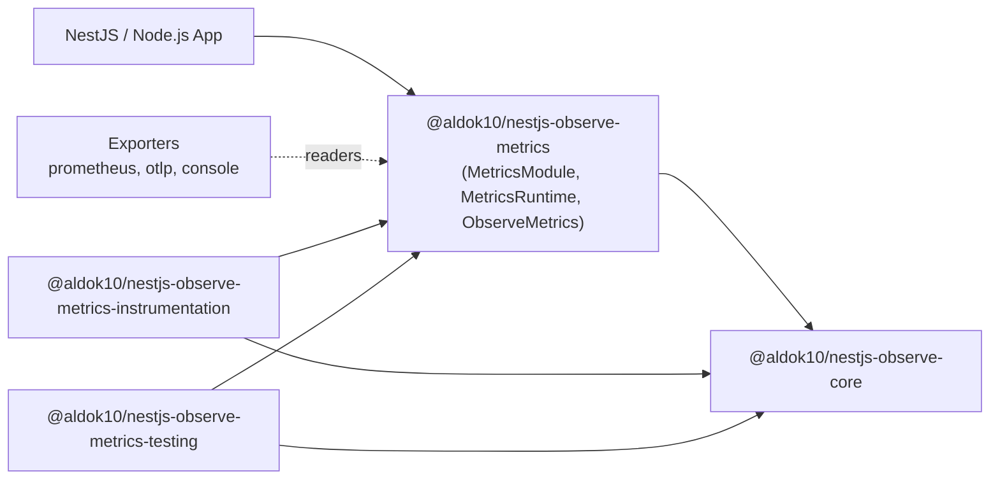

# Metrics Packages (6 Packages)

Back to [Packages Overview](../README.md).

The metrics pillar contains **6 packages** built on `@opentelemetry/sdk-metrics` and `@opentelemetry/api`.

## Composition and Dependencies

- **Entry point**: [`@aldok10/nestjs-observe-metrics`](../../../packages/metrics/metrics/README.md) owns `MetricsRuntime`, `bootstrapMetrics()`, `MetricsModule.forRoot/forRootAsync`, `ObserveMetrics`, `CardinalityGuard`, `@MetricCounter()`, and `@MetricHistogram()`.
- **Exporters**: `exporter-prometheus`, `exporter-otlp`, and `exporter-console` have zero internal workspace dependencies and provide `IMetricReader` / exporter factories passed into `MetricsOptions.readers`.
- **Instrumentation and testing**: `instrumentation` and `testing` depend on `@aldok10/nestjs-observe-core` and `@aldok10/nestjs-observe-metrics`.

## Packages (6)

| Package                                               | Directory                              | Responsibility                                                                                                                    | README                                                            |
| ----------------------------------------------------- | -------------------------------------- | --------------------------------------------------------------------------------------------------------------------------------- | ----------------------------------------------------------------- |
| `@aldok10/nestjs-observe-metrics`                     | `packages/metrics/metrics`             | `MetricsRuntime`, `bootstrapMetrics`, `ObserveMetrics`, `CardinalityGuard`, `@MetricCounter`, `@MetricHistogram`, `MetricsModule` | [README](../../../packages/metrics/metrics/README.md)             |
| `@aldok10/nestjs-observe-metrics-exporter-prometheus` | `packages/metrics/exporter-prometheus` | `createPrometheusMetricReader`, `getPrometheusMetricsText`                                                                        | [README](../../../packages/metrics/exporter-prometheus/README.md) |
| `@aldok10/nestjs-observe-metrics-exporter-otlp`       | `packages/metrics/exporter-otlp`       | `createOtlpMetricExporter`, `createOtlpMetricReader`                                                                              | [README](../../../packages/metrics/exporter-otlp/README.md)       |
| `@aldok10/nestjs-observe-metrics-exporter-console`    | `packages/metrics/exporter-console`    | `createConsoleMetricExporter`, `createConsoleMetricReader`                                                                        | [README](../../../packages/metrics/exporter-console/README.md)    |
| `@aldok10/nestjs-observe-metrics-instrumentation`     | `packages/metrics/instrumentation`     | `HttpMetricsCollector` (RED), `RuntimeMetricsCollector` (memory/CPU/event loop), `DataMetricsCollector` (DB/Redis/Queue/Worker)   | [README](../../../packages/metrics/instrumentation/README.md)     |
| `@aldok10/nestjs-observe-metrics-testing`             | `packages/metrics/testing`             | `InMemoryMetricsHarness` for in-memory metric assertions                                                                          | [README](../../../packages/metrics/testing/README.md)             |
