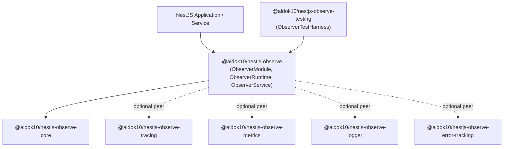

# Observer Packages (2 Packages)

Back to [Packages Overview](../README.md).

The Observer layer contains **2 packages** that compose the standalone Logger, Tracing, Metrics, and Error Tracking pillars under a single NestJS module, shared resource metadata, coordinated lifecycle, and cross-signal correlation.

## Composition and Dependencies

- **Optional peer loading**: `@aldok10/nestjs-observe` declares the 4 pillar packages as optional peer dependencies (`peerDependenciesMeta`). `ObserverRuntime` loads each pillar via `OptionalPeerLoader` only when enabled in `ObserverOptions`; disabled pillars are never loaded or initialized.
- **Initialization sequence & correlation**:
  1. **Tracing**: Initializes `TracingRuntime` and `ObserveTracer`.
  2. **Metrics**: Initializes `MetricsRuntime` and `ObserveMetrics`.
  3. **Logger**: Initializes `LogContextStore`, `LogPipeline`, and `UniversalLoggerImpl` (falling back to `ConsoleTransport` from `@aldok10/nestjs-observe-logger/transports` if no transports are configured). When tracing is enabled, active-span `traceId` and `spanId` are automatically injected into log records.
  4. **Error Tracking**: Initializes `ErrorTrackingRuntime` and `ObserveErrorTracker`. When tracing is enabled, `createTraceContextEnricher` is attached automatically.
- **DI tokens**: Exports `ObserverService` along with `OBSERVER_OPTIONS`, `OBSERVER_RUNTIME`, `OBSERVER_CONTEXT`, `OBSERVE_LOGGER`, `OBSERVE_TRACER`, `OBSERVE_METRICS`, and `OBSERVE_ERROR_TRACKER`.
- **Lifecycle**: `LifecycleCoordinator` initializes enabled runtimes in order with rollback on failure and flushes/shuts them down in reverse order on NestJS `OnModuleDestroy` / `OnApplicationShutdown`.

## Packages (2)

| Package                           | Directory                    | Responsibility                                                                                                             | README                                                  |
| --------------------------------- | ---------------------------- | -------------------------------------------------------------------------------------------------------------------------- | ------------------------------------------------------- |
| `@aldok10/nestjs-observe`         | `packages/observer/observer` | `ObserverModule.forRoot/forRootAsync`, `ObserverRuntime`, `ObserverService`, unified DI tokens, and `ObserverHealthReport` | [README](../../../packages/observer/observer/README.md) |
| `@aldok10/nestjs-observe-testing` | `packages/observer/testing`  | `ObserverTestHarness` capturing correlated logs, spans, and metrics in memory                                              | [README](../../../packages/observer/testing/README.md)  |
