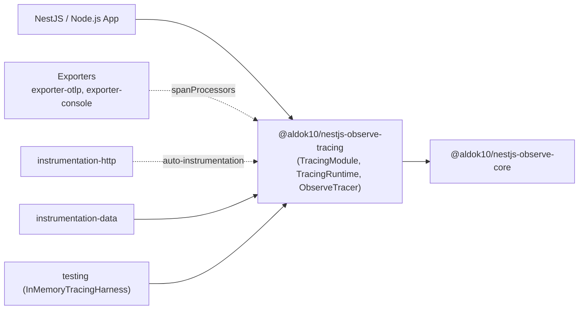

# Tracing Packages (6 Packages)

Back to [Packages Overview](../README.md).

The distributed tracing pillar contains **6 packages** built on `@opentelemetry/sdk-trace` and `@opentelemetry/api`. The 18-package Error Tracking sub-ecosystem under `packages/traces/error-tracking/` is documented in [Error Tracking Packages](./error-tracking/README.md).

## Composition and Dependencies

- **Entry point**: [`@aldok10/nestjs-observe-tracing`](../../../packages/traces/tracing/README.md) owns `TracingRuntime`, `bootstrapTracing()`, `TracingModule.forRoot/forRootAsync`, `ObserveTracer`, `@Trace()`, and `TracingInterceptor`.
- **Exporters**: `exporter-otlp` and `exporter-console` have zero internal workspace dependencies and return OpenTelemetry `SpanProcessor` / `SpanExporter` instances passed to `TracingOptions.spanProcessors`.
- **Instrumentations**:
  - `instrumentation-http` has zero internal workspace dependencies and registers Node.js HTTP auto-instrumentation with a duplicate-registration guard.
  - `instrumentation-data` depends on `@aldok10/nestjs-observe-tracing` and provides semantic-convention span helpers (`traceDbQuery`, `traceRedisCommand`, `traceQueueProducer`, `traceQueueConsumer`, `traceWorkerJob`).

## Packages (6)

| Package                                                | Directory                              | Responsibility                                                                                           | README                                                            |
| ------------------------------------------------------ | -------------------------------------- | -------------------------------------------------------------------------------------------------------- | ----------------------------------------------------------------- |
| `@aldok10/nestjs-observe-tracing`                      | `packages/traces/tracing`              | `TracingRuntime`, `bootstrapTracing`, `ObserveTracer`, `@Trace()`, `TracingInterceptor`, `TracingModule` | [README](../../../packages/traces/tracing/README.md)              |
| `@aldok10/nestjs-observe-tracing-exporter-otlp`        | `packages/traces/exporter-otlp`        | `createOtlpTraceExporter`, `createOtlpTraceSpanProcessor`                                                | [README](../../../packages/traces/exporter-otlp/README.md)        |
| `@aldok10/nestjs-observe-tracing-exporter-console`     | `packages/traces/exporter-console`     | `createConsoleTraceExporter`, `createConsoleSpanProcessor`                                               | [README](../../../packages/traces/exporter-console/README.md)     |
| `@aldok10/nestjs-observe-tracing-instrumentation-http` | `packages/traces/instrumentation-http` | `createHttpTracingInstrumentation`, `registerHttpTracingInstrumentation`                                 | [README](../../../packages/traces/instrumentation-http/README.md) |
| `@aldok10/nestjs-observe-tracing-instrumentation-data` | `packages/traces/instrumentation-data` | `traceDbQuery`, `traceRedisCommand`, `traceQueueProducer`, `traceQueueConsumer`, `traceWorkerJob`        | [README](../../../packages/traces/instrumentation-data/README.md) |
| `@aldok10/nestjs-observe-tracing-testing`              | `packages/traces/testing`              | `InMemoryTracingHarness` wrapping `InMemorySpanExporter`                                                 | [README](../../../packages/traces/testing/README.md)              |
