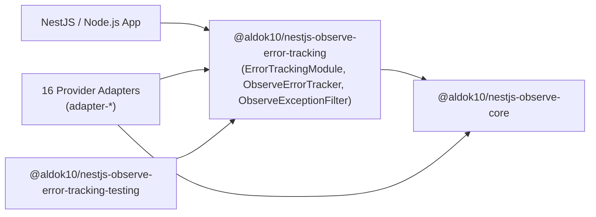

# Error Tracking Packages (18 Packages)

Back to [Packages Overview](../../README.md) | [Tracing Packages](../README.md).

The error tracking sub-ecosystem consists of **18 packages**: 1 vendor-neutral runtime and NestJS integration package, 1 in-memory testing package, and 16 provider adapters.

## Composition and Dependencies

- **Entry point**: [`@aldok10/nestjs-observe-error-tracking`](../../../../packages/traces/error-tracking/error-tracking/README.md) normalizes errors into `ObserveErrorEvent`, runs enrichers (`createApplicationEnricher`, `createDeploymentEnricher`, `createContextEnricher`, `createTraceContextEnricher`), applies filtering, deduplication, sampling, and secret redaction, and fans out to isolated per-destination queues.
- **Bridges subpath**: `@aldok10/nestjs-observe-error-tracking/bridges` provides log transport and OpenTelemetry span exception bridges.
- **Adapters**: All 16 `adapter-*` packages depend on `@aldok10/nestjs-observe-core` and `@aldok10/nestjs-observe-error-tracking`, implementing `ErrorTrackingAdapter` for their respective vendor SDKs or OTLP endpoints.

## Packages (18)

### Runtime and Testing (2)

| Package                                          | Directory                                       | Responsibility                                                                                                                                                        | README                                                                        |
| ------------------------------------------------ | ----------------------------------------------- | --------------------------------------------------------------------------------------------------------------------------------------------------------------------- | ----------------------------------------------------------------------------- |
| `@aldok10/nestjs-observe-error-tracking`         | `packages/traces/error-tracking/error-tracking` | Vendor-neutral runtime, `ErrorTrackingModule`, `ObserveErrorTracker`, `ObserveExceptionFilter`, `ErrorTrackingInterceptor`, redaction, deduplication, and `./bridges` | [README](../../../../packages/traces/error-tracking/error-tracking/README.md) |
| `@aldok10/nestjs-observe-error-tracking-testing` | `packages/traces/error-tracking/testing`        | `MemoryErrorTrackingAdapter` and `createTestErrorTracker`                                                                                                             | [README](../../../../packages/traces/error-tracking/testing/README.md)        |

### Error Platform Adapters (9)

| Package                                              | Directory                                            | Backend / SDK                        | README                                                                             |
| ---------------------------------------------------- | ---------------------------------------------------- | ------------------------------------ | ---------------------------------------------------------------------------------- |
| `@aldok10/nestjs-observe-error-tracking-sentry`      | `packages/traces/error-tracking/adapter-sentry`      | Sentry (`@sentry/node`)              | [README](../../../../packages/traces/error-tracking/adapter-sentry/README.md)      |
| `@aldok10/nestjs-observe-error-tracking-glitchtip`   | `packages/traces/error-tracking/adapter-glitchtip`   | GlitchTip (Sentry DSN compatible)    | [README](../../../../packages/traces/error-tracking/adapter-glitchtip/README.md)   |
| `@aldok10/nestjs-observe-error-tracking-bugsink`     | `packages/traces/error-tracking/adapter-bugsink`     | Bugsink (Sentry DSN compatible)      | [README](../../../../packages/traces/error-tracking/adapter-bugsink/README.md)     |
| `@aldok10/nestjs-observe-error-tracking-highlight`   | `packages/traces/error-tracking/adapter-highlight`   | Highlight.io (`@highlight-run/node`) | [README](../../../../packages/traces/error-tracking/adapter-highlight/README.md)   |
| `@aldok10/nestjs-observe-error-tracking-bugsnag`     | `packages/traces/error-tracking/adapter-bugsnag`     | Bugsnag (`@bugsnag/js`)              | [README](../../../../packages/traces/error-tracking/adapter-bugsnag/README.md)     |
| `@aldok10/nestjs-observe-error-tracking-rollbar`     | `packages/traces/error-tracking/adapter-rollbar`     | Rollbar (`rollbar`)                  | [README](../../../../packages/traces/error-tracking/adapter-rollbar/README.md)     |
| `@aldok10/nestjs-observe-error-tracking-honeybadger` | `packages/traces/error-tracking/adapter-honeybadger` | Honeybadger (`@honeybadger-io/js`)   | [README](../../../../packages/traces/error-tracking/adapter-honeybadger/README.md) |
| `@aldok10/nestjs-observe-error-tracking-airbrake`    | `packages/traces/error-tracking/adapter-airbrake`    | Airbrake (`@airbrake/node`)          | [README](../../../../packages/traces/error-tracking/adapter-airbrake/README.md)    |
| `@aldok10/nestjs-observe-error-tracking-raygun`      | `packages/traces/error-tracking/adapter-raygun`      | Raygun (`raygun`)                    | [README](../../../../packages/traces/error-tracking/adapter-raygun/README.md)      |

### APM and OTLP Adapters (7)

| Package                                              | Directory                                            | Backend / Protocol                                               | README                                                                             |
| ---------------------------------------------------- | ---------------------------------------------------- | ---------------------------------------------------------------- | ---------------------------------------------------------------------------------- |
| `@aldok10/nestjs-observe-error-tracking-otlp`        | `packages/traces/error-tracking/adapter-otlp`        | OpenTelemetry OTLP/HTTP `/v1/logs` and active-span exceptions    | [README](../../../../packages/traces/error-tracking/adapter-otlp/README.md)        |
| `@aldok10/nestjs-observe-error-tracking-new-relic`   | `packages/traces/error-tracking/adapter-new-relic`   | New Relic Node.js agent (`newrelic.noticeError`)                 | [README](../../../../packages/traces/error-tracking/adapter-new-relic/README.md)   |
| `@aldok10/nestjs-observe-error-tracking-datadog`     | `packages/traces/error-tracking/adapter-datadog`     | Datadog `dd-trace` span error tagging                            | [README](../../../../packages/traces/error-tracking/adapter-datadog/README.md)     |
| `@aldok10/nestjs-observe-error-tracking-dynatrace`   | `packages/traces/error-tracking/adapter-dynatrace`   | Dynatrace OTLP (`/api/v2/otlp/v1/logs`) and OneAgent Span Sensor | [README](../../../../packages/traces/error-tracking/adapter-dynatrace/README.md)   |
| `@aldok10/nestjs-observe-error-tracking-elastic-apm` | `packages/traces/error-tracking/adapter-elastic-apm` | Elastic APM (`elastic-apm-node`)                                 | [README](../../../../packages/traces/error-tracking/adapter-elastic-apm/README.md) |
| `@aldok10/nestjs-observe-error-tracking-splunk`      | `packages/traces/error-tracking/adapter-splunk`      | Splunk Observability Cloud OTLP (`X-SF-Token`)                   | [README](../../../../packages/traces/error-tracking/adapter-splunk/README.md)      |
| `@aldok10/nestjs-observe-error-tracking-appdynamics` | `packages/traces/error-tracking/adapter-appdynamics` | Cisco AppDynamics (`getTransaction` / `markError`)               | [README](../../../../packages/traces/error-tracking/adapter-appdynamics/README.md) |
