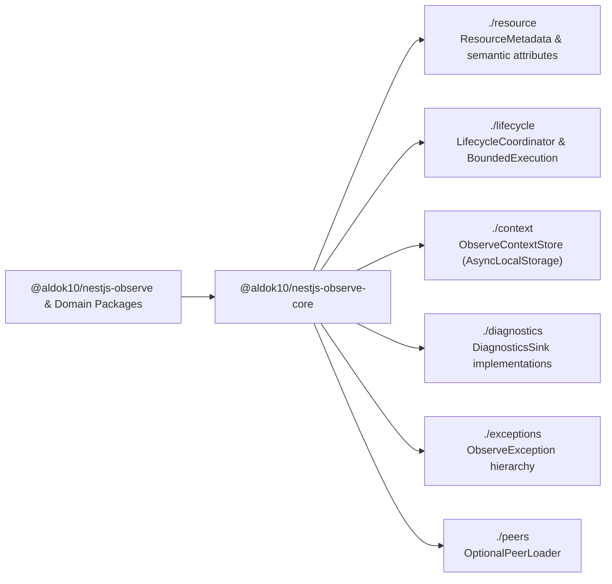

# `@aldok10/nestjs-observe-core`

Minimal, zero-dependency shared primitives for resource metadata, lifecycle coordination, async context propagation, diagnostics, exceptions, and optional peer loading across the `nestjs-observe` ecosystem.

## Overview

`@aldok10/nestjs-observe-core` provides the domain-neutral foundation shared by the logger, tracing, metrics, error-tracking, and unified observer packages. It has zero runtime dependencies and uses only Node.js built-in modules (`node:async_hooks`, `node:module`, `node:timers/promises`).

The package is published with dual ESM/CJS entrypoints and subpath exports so consumers and sibling packages can import only the primitives they need.

## Why This Package?

- **Shared contracts without coupling**: Logger, tracing, metrics, and error-tracking packages can share `ResourceMetadata`, `LifecycleParticipant`, `DiagnosticsSink`, and `ObserveException` without depending on each other.
- **Deterministic lifecycle management**: `LifecycleCoordinator` standardizes ordered initialization with automatic rollback on failure, bounded flushes, reverse-order shutdown, and aggregated `ShutdownException` reporting.
- **Safe optional peer resolution**: `OptionalPeerLoader` caches module lookups and raises `OptionalPeerMissingException` with actionable install guidance when an optional integration is absent.
- **Zero external runtime dependencies**: Keeps the core footprint minimal and avoids version conflicts in host applications.

## Features

- **Resource Metadata**: `createResourceMetadata`, `mergeResourceMetadata`, and `toSemanticResourceAttributes` mapping `serviceName`, `serviceVersion`, `serviceNamespace`, `serviceInstanceId`, `environment`, `application`, and custom attributes to OpenTelemetry semantic attribute keys.
- **Lifecycle Coordination**: `LifecycleCoordinator`, `BoundedExecution`, and `withTimeout` for ordered startup with rollback, bounded flush/shutdown, and aggregated `ComponentHealth` reporting.
- **Async Context Store**: `ObserveContextStore` backed by `AsyncLocalStorage` with nested `run()` context merging (including shallow merging of `attributes`) and `enterWith()`.
- **Diagnostics Sinks**: `NoopDiagnosticsSink` and `StderrDiagnosticsSink` with level filtering (`debug`, `info`, `warn`, `error`) and configurable output stream.
- **Typed Exceptions**: `ObserveException`, `InvalidConfigurationException`, `OptionalPeerMissingException`, and `ShutdownException`.
- **Optional Peer Loading**: `OptionalPeerLoader`, `loadOptionalPeer`, and `tryLoadOptionalPeer` with per-loader caching.
- **Subpath Exports**: Dedicated entrypoints for `.`, `./resource`, `./lifecycle`, `./exceptions`, `./diagnostics`, `./peers`, and `./context`.

## Architecture and Responsibilities



`@aldok10/nestjs-observe-core` owns only domain-neutral primitives. It does not implement log pipelines, OpenTelemetry SDK setup, metrics collection, or NestJS module wiring.

## Installation

```sh
pnpm add @aldok10/nestjs-observe-core
```

```sh
npm install @aldok10/nestjs-observe-core
```

```sh
yarn add @aldok10/nestjs-observe-core
```

## Requirements

- **Node.js**: `>=22` (from `engines.node` in `package.json`)
- **Module Formats**: ESM (`import`), CommonJS (`require`), and TypeScript type definitions (`.d.ts`)
- **Peer Dependencies**: None

## Quick Start

```ts
import {
  LifecycleCoordinator,
  ObserveContextStore,
  StderrDiagnosticsSink,
  createResourceMetadata,
  toSemanticResourceAttributes,
} from '@aldok10/nestjs-observe-core';

const resource = createResourceMetadata({
  serviceName: 'billing-api',
  environment: 'production',
  attributes: { region: 'ap-southeast-1' },
});

const semanticAttributes = toSemanticResourceAttributes(resource);
// { 'service.name': 'billing-api', 'deployment.environment.name': 'production', region: 'ap-southeast-1' }

const contextStore = new ObserveContextStore();
const diagnostics = new StderrDiagnosticsSink({ minLevel: 'warn' });
const coordinator = new LifecycleCoordinator();

coordinator.register({
  name: 'worker',
  initialize: () => {
    diagnostics.emit({ domain: 'core', level: 'info', message: 'worker ready' });
  },
  shutdown: async () => {
    // release resources
  },
});

await coordinator.initializeAll();
await contextStore.run({ requestId: 'req-123' }, async () => {
  // contextStore.get().requestId === 'req-123'
});
await coordinator.shutdown(5000);
```

## Configuration

`@aldok10/nestjs-observe-core` has no global module configuration object. Its configurable primitives accept the following options:

### `ResourceMetadata`

| Property            | Type                                               | Required | Default     | Description                                                   |
| ------------------- | -------------------------------------------------- | -------- | ----------- | ------------------------------------------------------------- |
| `serviceName`       | `string`                                           | No       | `undefined` | Logical service name; maps to `service.name`                  |
| `serviceVersion`    | `string`                                           | No       | `undefined` | Service version; maps to `service.version`                    |
| `serviceNamespace`  | `string`                                           | No       | `undefined` | Service namespace; maps to `service.namespace`                |
| `serviceInstanceId` | `string`                                           | No       | `undefined` | Instance identifier; maps to `service.instance.id`            |
| `environment`       | `string`                                           | No       | `undefined` | Deployment environment; maps to `deployment.environment.name` |
| `application`       | `string`                                           | No       | `undefined` | Application name; maps to `app.name`                          |
| `attributes`        | `Readonly<Record<string, ResourceAttributeValue>>` | No       | `undefined` | Additional scalar attributes (`string \| number \| boolean`)  |

### `StderrDiagnosticsSink` Constructor Options

| Property   | Type                                     | Required | Default          | Description                                           |
| ---------- | ---------------------------------------- | -------- | ---------------- | ----------------------------------------------------- |
| `minLevel` | `'debug' \| 'info' \| 'warn' \| 'error'` | No       | `'warn'`         | Minimum severity level emitted to the stream          |
| `stream`   | `Pick<NodeJS.WriteStream, 'write'>`      | No       | `process.stderr` | Target writable stream for formatted diagnostic lines |

## Usage

### Subpath Imports

Every domain can be imported from the root entrypoint or its dedicated subpath:

```ts
import {
  createResourceMetadata,
  mergeResourceMetadata,
} from '@aldok10/nestjs-observe-core/resource';
import { LifecycleCoordinator, withTimeout } from '@aldok10/nestjs-observe-core/lifecycle';
import { ObserveContextStore } from '@aldok10/nestjs-observe-core/context';
import { StderrDiagnosticsSink } from '@aldok10/nestjs-observe-core/diagnostics';
import { OptionalPeerLoader } from '@aldok10/nestjs-observe-core/peers';
import { ShutdownException } from '@aldok10/nestjs-observe-core/exceptions';
```

### Merging Resource Metadata

```ts
import {
  createResourceMetadata,
  mergeResourceMetadata,
  toSemanticResourceAttributes,
} from '@aldok10/nestjs-observe-core/resource';

const base = createResourceMetadata({
  serviceName: 'orders',
  environment: 'staging',
  attributes: { region: 'ap-southeast-1' },
});

const merged = mergeResourceMetadata(base, {
  serviceVersion: '1.2.3',
  attributes: { zone: 'az1' },
});

const attrs = toSemanticResourceAttributes(merged);
```

### Propagating Async Context

```ts
import { ObserveContextStore } from '@aldok10/nestjs-observe-core/context';

const store = new ObserveContextStore();

await store.run({ requestId: 'req-1', attributes: { a: 1 } }, async () => {
  await store.run({ tenantId: 't-1', attributes: { b: 2 } }, async () => {
    // store.get() => { requestId: 'req-1', tenantId: 't-1', attributes: { a: 1, b: 2 } }
  });
  // store.get().tenantId === undefined
});
```

## Advanced Usage

### Bounded Execution and Timeouts

`BoundedExecution` and `withTimeout` race a promise against an unreferenced `node:timers/promises` delay (`ref: false`), aborting the timer in `finally` so it does not keep the Node.js event loop alive. If `timeoutMs` is `undefined`, non-finite, or `< 0`, the original promise is returned directly.

```ts
import { BoundedExecution, withTimeout } from '@aldok10/nestjs-observe-core/lifecycle';

const bounded = new BoundedExecution();
await bounded.run(someAsyncWork(), 2000);
// or using the shared default instance:
await withTimeout(someAsyncWork(), 2000);
```

### Custom `OptionalPeerLoader` Resolution Base

Create an `OptionalPeerLoader` with a custom `importMetaUrl` when resolving peers relative to a specific package or module path:

```ts
import { OptionalPeerLoader } from '@aldok10/nestjs-observe-core/peers';

const loader = new OptionalPeerLoader(import.meta.url);
const maybeMod = loader.tryLoad('some-optional-pkg');
```

## API Reference

### `./resource`

- `ResourceAttributeValue`: `string | number | boolean`
- `ResourceMetadata`: Interface for service, environment, application, and custom attributes.
- `createResourceMetadata(input?: ResourceMetadata): ResourceMetadata`: Normalizes metadata and strips `undefined` entries from `attributes`.
- `mergeResourceMetadata(base, override): ResourceMetadata`: Shallowly merges top-level fields and `attributes`, with `override` taking precedence.
- `toSemanticResourceAttributes(metadata): Readonly<Record<string, ResourceAttributeValue>>`: Converts metadata to OpenTelemetry semantic attribute names (`service.name`, `service.version`, `service.namespace`, `service.instance.id`, `deployment.environment.name`, `app.name`).

### `./lifecycle`

- `HealthState`: `'healthy' | 'degraded' | 'unhealthy' | 'stopped'`
- `ComponentHealth`: `{ name: string; state: HealthState; message?: string; details?: Readonly<Record<string, unknown>> }`
- `LifecycleParticipant`: `{ name: string; initialize?(): Promise<void> | void; flush?(timeoutMs?: number): Promise<void>; shutdown(timeoutMs?: number): Promise<void>; health?(): ComponentHealth | Promise<ComponentHealth> }`
- `LifecycleCoordinator`:
  - `register(...participants)`: Registers unique participants in insertion order.
  - `initializeAll()`: Initializes participants sequentially; rolls back previously initialized participants in reverse order if any `initialize()` throws.
  - `flush(timeoutMs?)`: Flushes all participants with `flush` concurrently, bounded by `timeoutMs` without throwing on timeout.
  - `shutdown(timeoutMs?)`: Idempotent (returns existing `shutdownPromise` if in flight); flushes, then shuts down participants in reverse registration order, throwing `ShutdownException` if any fail.
  - `shutdownPromise`: Readonly getter returning the active shutdown promise if started.
  - `health()`: Collects `ComponentHealth` from all participants (defaulting to `{ name, state: 'healthy' }` when `health()` is omitted).
- `BoundedExecution` / `withTimeout(work, timeoutMs?)`: Races `work` against a non-blocking timer.

### `./context`

- `ObserveContextData`: `{ requestId?: string; correlationId?: string; tenantId?: string; jobId?: string; workerId?: string; traceId?: string; spanId?: string; attributes?: Readonly<Record<string, unknown>> }`
- `ObserveContextStore`:
  - `get(): ObserveContextData` (returns `{}` outside an active store)
  - `run<T>(context, fn): T` (merges with current context and shallowly merges `attributes`)
  - `enterWith(context): void` (transitions current async execution context)

### `./diagnostics`

- `DiagnosticLevel`: `'debug' | 'info' | 'warn' | 'error'`
- `DiagnosticEvent`: `{ domain: string; level: DiagnosticLevel; message: string; error?: unknown; attributes?: Readonly<Record<string, unknown>> }`
- `DiagnosticsSink`: `{ emit(event: DiagnosticEvent): void }`
- `NoopDiagnosticsSink`: Discards all diagnostic events.
- `StderrDiagnosticsSink`: Writes `[nestjs-observe:<domain>] [<LEVEL>] <message>` (plus formatted error suffix) to `stream` when `level >= minLevel`.

### `./exceptions`

- `ObserveException`: Base `Error` subclass setting `this.name = new.target.name`.
- `InvalidConfigurationException`: Subclass of `ObserveException`.
- `OptionalPeerMissingException`: Subclass of `ObserveException` exposing `peerPackage` and `featureName`.
- `ShutdownException`: Subclass of `ObserveException` exposing `failures: readonly string[]`.

### `./peers`

- `OptionalPeerLoader`: `constructor(importMetaUrl?: string)`, `load(packageName, featureName)`, `tryLoad(packageName)`.
- `loadOptionalPeer(packageName, featureName)`: Uses default shared `OptionalPeerLoader`.
- `tryLoadOptionalPeer(packageName)`: Uses default shared `OptionalPeerLoader`, returning `undefined` on failure.

## Integration with Other Packages

`@aldok10/nestjs-observe-core` is consumed directly by `@aldok10/nestjs-observe` (`ObserverRuntime` and `ObserverModule`), `@aldok10/nestjs-observe-testing`, and the domain packages for logging, tracing, metrics, and error tracking.

## Dependencies and Optional Integrations

- **Runtime dependencies**: None.
- **Peer dependencies**: None.
- **Node.js built-ins**: `node:async_hooks`, `node:module`, `node:timers/promises`.

## Lifecycle and Resource Management

- `LifecycleCoordinator.initializeAll()` initializes participants in registration order and rolls back already-initialized participants in reverse order if an `initialize()` call fails.
- `LifecycleCoordinator.shutdown(timeoutMs?)` deduplicates concurrent calls via `shutdownInFlight`, runs `flush(timeoutMs)` first, and then calls `shutdown(timeoutMs)` on participants in reverse order.
- `BoundedExecution` uses `{ ref: false }` timers with `AbortController` cleanup in `finally` so timeouts never leak open handles.

## Error Handling

- `OptionalPeerLoader.load()` throws `OptionalPeerMissingException` with the missing package name, feature name, and original `cause`.
- `LifecycleCoordinator.shutdown()` collects rejected participant shutdowns and throws `ShutdownException` containing each failing participant name and error message.
- `LifecycleCoordinator.flush()` and bounded `shutdown()` timeouts catch timeout rejections so teardown does not hang indefinitely.

## Performance Considerations

- `OptionalPeerLoader` caches resolved modules in an internal `Map` by package name so `require` resolution runs at most once per loader instance.
- `NoopDiagnosticsSink.emit()` is an empty method for zero-overhead default diagnostics when no sink is configured.
- `BoundedExecution` skips timer allocation entirely when `timeoutMs` is omitted, negative, or non-finite.

## Security Considerations

- `StderrDiagnosticsSink` formats `event.error` (`Error.message`, string, or `JSON.stringify` fallback) directly to the configured stream; avoid passing raw secrets in `DiagnosticEvent.message` or `error`.
- `ObserveContextStore` isolates context per async execution chain via `AsyncLocalStorage`, preventing cross-request leakage when used with `run()`.

## Testing

Run the full monorepo test suite or target only `@aldok10/nestjs-observe-core`:

```sh
pnpm test
```

```sh
pnpm exec vitest run packages/core
```

## Troubleshooting

- **`OptionalPeerMissingException` thrown at runtime**: Install the reported `peerPackage` in the consuming application and ensure it is resolvable from the `OptionalPeerLoader` base URL.
- **Context lost across async boundaries**: Prefer `store.run(ctx, fn)` over `store.enterWith(ctx)` and ensure callback-based APIs preserve Node.js `AsyncLocalStorage` context.

## Limitations

- `OptionalPeerLoader` uses `createRequire` (`NodeRequire`) under the hood, which resolves CommonJS/dual-package entrypoints synchronously and does not perform async ESM-only `import()`.
- `mergeResourceMetadata` performs a shallow merge of `attributes`; nested objects are not supported because `ResourceAttributeValue` is restricted to `string | number | boolean`.

## Related Packages

- [`@aldok10/nestjs-observe`](../observer/observer/README.md) — Unified NestJS observability integration composing logger, tracing, metrics, and error tracking
- [`@aldok10/nestjs-observe-testing`](../observer/testing/README.md) — Unified in-memory test harness for `@aldok10/nestjs-observe`
- [`@aldok10/nestjs-observe-logger`](../logs/logger/README.md) — Extensible multi-backend logging module for NestJS
- [`@aldok10/nestjs-observe-tracing`](../traces/tracing/README.md) — OpenTelemetry tracing runtime and NestJS integration
- [`@aldok10/nestjs-observe-metrics`](../metrics/metrics/README.md) — OpenTelemetry metrics runtime and NestJS integration
- [`@aldok10/nestjs-observe-error-tracking`](../traces/error-tracking/error-tracking/README.md) — Error tracking runtime and adapters

## Documentation

- [Public API Docs](../../docs/packages/core/README.md)
- [Architecture Overview](../../docs/architecture/overview.md)
- [Dependencies Overview](../../docs/architecture/dependency-graph.md)
- [Compatibility Overview](../../docs/development/workflow.md)
- [Verification Report](../../docs/development/workflow.md)

## Contributing

See [CONTRIBUTING.md](../../CONTRIBUTING.md).

## License

MIT — see [LICENSE](../../LICENSE).
