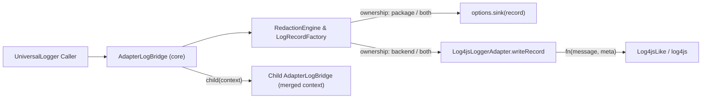

# `@aldok10/nestjs-observe-logger-adapter-log4js`

Independent Log4js backend adapter that bridges a `log4js` logger instance to the `@aldok10/nestjs-observe-logger-core` universal logger contract.

## Overview

`@aldok10/nestjs-observe-logger-adapter-log4js` adapts any Log4js-compatible logger (`Log4jsLike`) into a `UniversalLogger` with structured metadata merging, recursive redaction, error serialization, context-bound child loggers, configurable level mapping, and dual-ownership routing between your Log4js instance and a package-level sink.

## Why This Package?

- **Decoupled peer dependency**: Keeps `log4js` (`^6.0.0`) as a peer dependency and never imports `log4js` at module load time, using the structural `Log4jsLike` interface instead.
- **Universal contract**: Exposes all 8 universal log levels (`trace`, `debug`, `verbose`, `info`, `log`, `warn`, `error`, `fatal`) and maps them onto Log4js levels (including `mark` as a valid `levelMap` target).
- **Context-bound child loggers**: Even though Log4js has no native `child()` method (`childLoggers: false`), `AdapterLogBridge` still provides `.child(context)` by merging inherited context into emitted `LogRecord`s.

## Features

- Maps universal log levels to Log4js methods (`verbose` -> `debug`, `log` -> `info`) while preserving `record.level` in metadata.
- Supports custom `levelMap` overrides validated at `create()` time (throws `InvalidLoggerConfigurationException` on invalid keys or unsupported Log4js levels).
- Falls back to `info` (or any callable supported method) if a mapped method is missing on the `Log4jsLike` instance.
- Supports `ownership` modes (`'backend'`, `'package'`, `'both'`) to route records to Log4js, a custom `sink`, or both without duplicate delivery.
- Passes `(message, meta)` to Log4js where `meta` is the normalized `LogRecord` without `message`.

## Architecture and Responsibilities



- `Log4jsLoggerAdapter` (aliased as `Log4jsAdapter`) implements `LoggerAdapter<Log4jsLike>`.
- `LevelMappingResolver` validates `levelMap` against `['trace', 'debug', 'info', 'warn', 'error', 'fatal', 'mark']`.
- `AdapterLogBridge` handles argument parsing, context merging, redaction, error serialization, ownership routing, and child context inheritance.

## Installation

```bash
pnpm add @aldok10/nestjs-observe-logger-adapter-log4js @aldok10/nestjs-observe-logger-core log4js
```

```bash
npm install @aldok10/nestjs-observe-logger-adapter-log4js @aldok10/nestjs-observe-logger-core log4js
```

```bash
yarn add @aldok10/nestjs-observe-logger-adapter-log4js @aldok10/nestjs-observe-logger-core log4js
```

## Requirements

- **Node.js**: `>=22`
- **Peer dependencies**: `log4js` (`^6.0.0`)
- **Module formats**: ESM (`import`), CJS (`require`), and TypeScript type definitions (`.d.ts`)

## Quick Start

```ts
import log4js from 'log4js';
import { Log4jsLoggerAdapter } from '@aldok10/nestjs-observe-logger-adapter-log4js';

const log4jsInstance = log4js.getLogger('app');
log4jsInstance.level = 'trace';

const logger = new Log4jsLoggerAdapter().create(log4jsInstance, {
  level: 'trace',
});

logger.info('Application started', {
  context: 'Bootstrap',
  metadata: { port: 3000 },
});
```

## Configuration

`Log4jsAdapterOptions` (aliased as `AdapterOptions`) extends `LoggerAdapterOptions`:

| Property    | Type                                           | Required | Default                                                                                                                         | Description                                                                           |
| ----------- | ---------------------------------------------- | -------- | ------------------------------------------------------------------------------------------------------------------------------- | ------------------------------------------------------------------------------------- |
| `level`     | `LogLevel`                                     | Yes      | —                                                                                                                               | Minimum universal log level configured on the adapter options.                        |
| `context`   | `LogContext`                                   | No       | `undefined`                                                                                                                     | Base context merged into every emitted `LogRecord`.                                   |
| `redaction` | `RedactionOptions`                             | No       | Core defaults                                                                                                                   | Redaction rules applied to records via `RedactionEngine`.                             |
| `format`    | `FormatterType \| LogFormatter`                | No       | `undefined`                                                                                                                     | Formatter option inherited from `LoggerAdapterOptions`.                               |
| `sink`      | `(record: LogRecord) => void \| Promise<void>` | No       | `undefined`                                                                                                                     | Optional package-level sink callback receiving normalized `LogRecord`s.               |
| `ownership` | `'backend' \| 'package' \| 'both'`             | No       | `'package'` if `sink` is set, else `'backend'`                                                                                  | Controls whether records go to `sink`, the Log4js backend, or both.                   |
| `levelMap`  | `Partial<Record<LogLevel, string>>`            | No       | `{ trace: 'trace', debug: 'debug', verbose: 'debug', info: 'info', log: 'info', warn: 'warn', error: 'error', fatal: 'fatal' }` | Custom mapping from universal `LogLevel` to Log4js method names (including `'mark'`). |

## Usage

### Context-Bound Child Loggers and Error Serialization

```ts
import log4js from 'log4js';
import { Log4jsLoggerAdapter } from '@aldok10/nestjs-observe-logger-adapter-log4js';

const instance = log4js.getLogger('app');
instance.level = 'info';

const logger = new Log4jsLoggerAdapter().create(instance, {
  level: 'info',
  context: { context: 'App' },
});

const child = logger.child?.({ context: 'Worker', traceId: 'trace-99' });
child?.error(new Error('Job failed'));
```

## Advanced Usage

### Mapping to `mark` and Dual Ownership

```ts
import log4js from 'log4js';
import { Log4jsLoggerAdapter } from '@aldok10/nestjs-observe-logger-adapter-log4js';

const instance = log4js.getLogger('audit');
instance.level = 'all';

const logger = new Log4jsLoggerAdapter().create(instance, {
  level: 'trace',
  ownership: 'both',
  levelMap: { fatal: 'mark' },
  sink: async (record) => {
    // Forward normalized LogRecord to an external pipeline or transport
  },
});
```

## API Reference

- `Log4jsLoggerAdapter` / `Log4jsAdapter` — Class implementing `LoggerAdapter<Log4jsLike>` with `name = 'log4js'` and `create(logger: Log4jsLike, options: Log4jsAdapterOptions): UniversalLogger`.
- `LOG4JS_ADAPTER_CAPABILITIES` — `AdapterCapabilities` constant (`structuredMetadata: true`, `childLoggers: false`, `contextBinding: true`, `dynamicLogLevels: false`, `nativeTransports: true`, `redaction: true`, `serialization: true`, `flush: false`, `gracefulShutdown: false`).
- `Log4jsAdapterOptions` / `AdapterOptions` — Options interface extending `LoggerAdapterOptions`.
- `Log4jsLike` — Structural interface describing the required Log4js logger methods (`trace`, `debug`, `info`, `warn`, `error`, `fatal`, `mark`, `level`).

## Integration with Other Packages

- Uses `@aldok10/nestjs-observe-logger-core` (`AdapterLogBridge`, `LevelMappingResolver`, and core contracts).
- Works with `@aldok10/nestjs-observe-logger` when registering a Log4js backend adapter, or standalone in any Node.js/NestJS service.

## Dependencies and Optional Integrations

- **Runtime dependency**: `@aldok10/nestjs-observe-logger-core` (`^0.1.1`)
- **Peer dependency**: `log4js` (`^6.0.0`)

## Lifecycle and Resource Management

`LOG4JS_ADAPTER_CAPABILITIES.flush` and `LOG4JS_ADAPTER_CAPABILITIES.gracefulShutdown` are `false`. Calling `log4js.shutdown()` remains the responsibility of the caller managing `log4js`.

## Error Handling

- Passing an unknown universal level or unsupported Log4js level in `levelMap` throws `InvalidLoggerConfigurationException` synchronously during `create()`.
- Async errors returned by `options.sink` are caught internally by `AdapterLogBridge`.
- If a mapped level method is absent on `Log4jsLike`, `AdapterLogBridge.resolveMethod` falls back to `'info'` and then any supported method present on the backend.

## Performance Considerations

- `log4js` is not imported by the adapter, avoiding startup overhead if you supply a custom or pre-configured `Log4jsLike` instance.
- `RedactionEngine` sanitizes metadata on each log call.

## Security Considerations

- Default core redaction masks sensitive fields (such as `password` and `secret`) with `'[REDACTED]'` before records are passed to Log4js or `sink`.
- Error instances in the first argument or in `metadata` are serialized into plain objects.

## Testing

```bash
pnpm test
pnpm exec vitest run packages/logs/adapter-log4js
```

## Troubleshooting

- **`InvalidLoggerConfigurationException` on `create()`**: Verify `levelMap` keys are valid universal `LogLevel`s and values are one of `'trace' | 'debug' | 'info' | 'warn' | 'error' | 'fatal' | 'mark'`.
- **Logs not appearing in Log4js when `sink` is set**: When `sink` is provided, `ownership` defaults to `'package'`. Set `ownership: 'both'` to emit to both `sink` and Log4js.

## Limitations

- `childLoggers`, `dynamicLogLevels`, `flush`, and `gracefulShutdown` are `false` in `LOG4JS_ADAPTER_CAPABILITIES` (Log4js does not expose a native `child()` logger, so child context is merged at the adapter bridge level instead).

## Related Packages

- [`@aldok10/nestjs-observe-logger-core`](../core/README.md)
- [`@aldok10/nestjs-observe-logger`](../logger/README.md)
- [`@aldok10/nestjs-observe-logger-adapter-pino`](../adapter-pino/README.md)
- [`@aldok10/nestjs-observe-logger-adapter-winston`](../adapter-winston/README.md)
- [`@aldok10/nestjs-observe-logger-adapter-bunyan`](../adapter-bunyan/README.md)

## Documentation

- [Logs Ecosystem Overview](../../../docs/packages/logger/README.md)

## Contributing

See [CONTRIBUTING.md](../../../CONTRIBUTING.md).

## License

MIT — see [LICENSE](../../../LICENSE).
