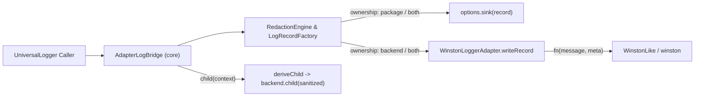

# `@aldok10/nestjs-observe-logger-adapter-winston`

Independent Winston backend adapter that bridges a `winston` logger instance to the `@aldok10/nestjs-observe-logger-core` universal logger contract.

## Overview

`@aldok10/nestjs-observe-logger-adapter-winston` adapts any Winston-compatible logger (`WinstonLike`) into a `UniversalLogger` with structured metadata merging, recursive redaction, error serialization, child logger derivation, configurable level mapping, and dual-ownership routing between your Winston instance and a package-level sink.

## Why This Package?

- **Decoupled peer dependency**: Keeps `winston` (`^3.0.0`) as a peer dependency and never imports `winston` at module load time, using the structural `WinstonLike` interface instead.
- **Universal contract**: Exposes all 8 universal log levels (`trace`, `debug`, `verbose`, `info`, `log`, `warn`, `error`, `fatal`) and maps them onto Winston's npm levels.
- **Built-in safety**: Sanitizes context, metadata, and `child()` bindings via `RedactionEngine` and serializes `Error` instances before forwarding to Winston or a sink.

## Features

- Maps universal log levels to Winston methods (`trace` -> `debug`, `log` -> `info`, `fatal` -> `error`) while preserving `record.level` in metadata.
- Supports custom `levelMap` overrides validated at `create()` time (throws `InvalidLoggerConfigurationException` on invalid keys or unsupported Winston levels).
- Falls back to `info` (or any callable supported method) if a mapped method is missing on the `WinstonLike` instance.
- Derives native Winston child loggers via `backend.child()` with redacted bindings.
- Supports `ownership` modes (`'backend'`, `'package'`, `'both'`) to route records to Winston, a custom `sink`, or both without duplicate delivery.
- Passes `(message, meta)` to Winston where `meta` is the normalized `LogRecord` without `message`.

## Architecture and Responsibilities



- `WinstonLoggerAdapter` (aliased as `WinstonAdapter`) implements `LoggerAdapter<WinstonLike>`.
- `LevelMappingResolver` validates `levelMap` against `['error', 'warn', 'info', 'http', 'verbose', 'debug', 'silly']`.
- `AdapterLogBridge` handles argument parsing, context merging, redaction, error serialization, ownership routing, and child logger creation.

## Installation

```bash
pnpm add @aldok10/nestjs-observe-logger-adapter-winston @aldok10/nestjs-observe-logger-core winston
```

```bash
npm install @aldok10/nestjs-observe-logger-adapter-winston @aldok10/nestjs-observe-logger-core winston
```

```bash
yarn add @aldok10/nestjs-observe-logger-adapter-winston @aldok10/nestjs-observe-logger-core winston
```

## Requirements

- **Node.js**: `>=22`
- **Peer dependencies**: `winston` (`^3.0.0`)
- **Module formats**: ESM (`import`), CJS (`require`), and TypeScript type definitions (`.d.ts`)

## Quick Start

```ts
import winston from 'winston';
import { WinstonLoggerAdapter } from '@aldok10/nestjs-observe-logger-adapter-winston';

const winstonInstance = winston.createLogger({
  level: 'debug',
  format: winston.format.json(),
  transports: [new winston.transports.Console()],
});

const logger = new WinstonLoggerAdapter().create(winstonInstance, {
  level: 'trace',
});

logger.info('Application started', {
  context: 'Bootstrap',
  metadata: { port: 3000 },
});
```

## Configuration

`WinstonAdapterOptions` (aliased as `AdapterOptions`) extends `LoggerAdapterOptions`:

| Property    | Type                                           | Required | Default                                                                                                                           | Description                                                                      |
| ----------- | ---------------------------------------------- | -------- | --------------------------------------------------------------------------------------------------------------------------------- | -------------------------------------------------------------------------------- |
| `level`     | `LogLevel`                                     | Yes      | —                                                                                                                                 | Minimum universal log level configured on the adapter options.                   |
| `context`   | `LogContext`                                   | No       | `undefined`                                                                                                                       | Base context merged into every emitted `LogRecord`.                              |
| `redaction` | `RedactionOptions`                             | No       | Core defaults                                                                                                                     | Redaction rules applied to records and `child()` bindings via `RedactionEngine`. |
| `format`    | `FormatterType \| LogFormatter`                | No       | `undefined`                                                                                                                       | Formatter option inherited from `LoggerAdapterOptions`.                          |
| `sink`      | `(record: LogRecord) => void \| Promise<void>` | No       | `undefined`                                                                                                                       | Optional package-level sink callback receiving normalized `LogRecord`s.          |
| `ownership` | `'backend' \| 'package' \| 'both'`             | No       | `'package'` if `sink` is set, else `'backend'`                                                                                    | Controls whether records go to `sink`, the Winston backend, or both.             |
| `levelMap`  | `Partial<Record<LogLevel, string>>`            | No       | `{ trace: 'debug', debug: 'debug', verbose: 'verbose', info: 'info', log: 'info', warn: 'warn', error: 'error', fatal: 'error' }` | Custom mapping from universal `LogLevel` to Winston method names.                |

## Usage

### Child Loggers and Error Serialization

```ts
import winston from 'winston';
import { WinstonLoggerAdapter } from '@aldok10/nestjs-observe-logger-adapter-winston';

const instance = winston.createLogger({
  level: 'info',
  transports: [new winston.transports.Console()],
});

const logger = new WinstonLoggerAdapter().create(instance, {
  level: 'info',
  context: { context: 'App' },
});

const billingLogger = logger.child?.({ context: 'Billing' });
billingLogger?.warn('Invoice retry scheduled', { metadata: { apiKey: 'secret-key' } });
```

## Advanced Usage

### Custom Level Mapping and Dual Ownership

```ts
import winston from 'winston';
import { WinstonLoggerAdapter } from '@aldok10/nestjs-observe-logger-adapter-winston';

const instance = winston.createLogger({
  level: 'silly',
  transports: [new winston.transports.Console()],
});

const logger = new WinstonLoggerAdapter().create(instance, {
  level: 'trace',
  ownership: 'both',
  levelMap: { trace: 'silly', verbose: 'http' },
  sink: async (record) => {
    // Forward normalized LogRecord to an external pipeline or transport
  },
});
```

## API Reference

- `WinstonLoggerAdapter` / `WinstonAdapter` — Class implementing `LoggerAdapter<WinstonLike>` with `name = 'winston'` and `create(logger: WinstonLike, options: WinstonAdapterOptions): UniversalLogger`.
- `WINSTON_ADAPTER_CAPABILITIES` — `AdapterCapabilities` constant (`structuredMetadata: true`, `childLoggers: true`, `contextBinding: true`, `dynamicLogLevels: false`, `nativeTransports: true`, `redaction: true`, `serialization: true`, `flush: false`, `gracefulShutdown: false`).
- `WinstonAdapterOptions` / `AdapterOptions` — Options interface extending `LoggerAdapterOptions`.
- `WinstonLike` — Structural interface describing the required Winston logger methods (`error`, `warn`, `info`, `http`, `verbose`, `debug`, `silly`, `child`, `level`).

## Integration with Other Packages

- Uses `@aldok10/nestjs-observe-logger-core` (`AdapterLogBridge`, `LevelMappingResolver`, `RedactionEngine`, and core contracts).
- Works with `@aldok10/nestjs-observe-logger` when registering a Winston backend adapter, or standalone in any Node.js/NestJS service.

## Dependencies and Optional Integrations

- **Runtime dependency**: `@aldok10/nestjs-observe-logger-core` (`^0.1.0`)
- **Peer dependency**: `winston` (`^3.0.0`)

## Lifecycle and Resource Management

`WINSTON_ADAPTER_CAPABILITIES.flush` and `WINSTON_ADAPTER_CAPABILITIES.gracefulShutdown` are `false`. Flushing or closing Winston transports remains the responsibility of the caller managing the `winston` logger.

## Error Handling

- Passing an unknown universal level or unsupported Winston level (such as `'fatal'`, which is not in Winston's supported level list) in `levelMap` throws `InvalidLoggerConfigurationException` synchronously during `create()`.
- Async errors returned by `options.sink` are caught internally by `AdapterLogBridge`.
- If a mapped level method is absent on `WinstonLike`, `AdapterLogBridge.resolveMethod` falls back to `'info'` and then any supported method present on the backend.

## Performance Considerations

- `winston` is not imported by the adapter, avoiding startup overhead if you supply a custom or pre-configured `WinstonLike` instance.
- `RedactionEngine` sanitizes `context` bindings on `child()` calls and metadata on each log call.

## Security Considerations

- Default core redaction masks sensitive fields (such as `apiKey` and `password`) with `'[REDACTED]'` in both log records and `child()` bindings before they reach Winston.
- Error instances in the first argument or in `metadata` are serialized into plain objects.

## Testing

```bash
pnpm test
pnpm exec vitest run packages/logs/adapter-winston
```

## Troubleshooting

- **`InvalidLoggerConfigurationException` on `create()`**: Verify `levelMap` keys are valid universal `LogLevel`s and values are one of `'error' | 'warn' | 'info' | 'http' | 'verbose' | 'debug' | 'silly'`.
- **Logs not appearing in Winston when `sink` is set**: When `sink` is provided, `ownership` defaults to `'package'`. Set `ownership: 'both'` to emit to both `sink` and Winston.

## Limitations

- `dynamicLogLevels`, `flush`, and `gracefulShutdown` are not supported (`false` in `WINSTON_ADAPTER_CAPABILITIES`).

## Related Packages

- [`@aldok10/nestjs-observe-logger-core`](../core/README.md)
- [`@aldok10/nestjs-observe-logger`](../logger/README.md)
- [`@aldok10/nestjs-observe-logger-adapter-pino`](../adapter-pino/README.md)
- [`@aldok10/nestjs-observe-logger-adapter-bunyan`](../adapter-bunyan/README.md)
- [`@aldok10/nestjs-observe-logger-adapter-log4js`](../adapter-log4js/README.md)

## Documentation

- [Logs Ecosystem Overview](../../../docs/packages/logger/README.md)

## Contributing

See [CONTRIBUTING.md](../../../CONTRIBUTING.md).

## License

MIT — see [LICENSE](../../../LICENSE).
