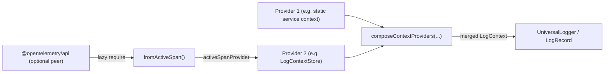

# `@aldok10/nestjs-observe-logger-context`

Optional composable context providers and OpenTelemetry active-span trace correlation helpers for `@aldok10/nestjs-observe-logger`.

## Overview

`@aldok10/nestjs-observe-logger-context` extends `@aldok10/nestjs-observe-logger-core` with helpers to wrap plain getter functions as `LogContextProvider`s, compose multiple providers deterministically, and extract `traceId` / `spanId` from an active OpenTelemetry span without requiring `@opentelemetry/api` at import time.

## Why This Package?

- **Deterministic provider composition**: Combine `LogContextStore` with custom request/tenant/environment providers where later providers override earlier ones and `metadata` merges cleanly.
- **Fault-tolerant reads**: A throwing provider in `composeContextProviders()` is skipped so it never blocks logging or drops other providers' context.
- **Zero-cost optional OpenTelemetry**: `@opentelemetry/api` is loaded lazily via `createRequire` only when `fromActiveSpan()` is called, returning `{}` when absent.

## Features

- **`createContextProvider(getContext)`**: Wraps a synchronous getter into a `LogContextProvider` without allocating a second `AsyncLocalStorage` store.
- **`composeContextProviders(...providers)`**: Merges contexts left-to-right using `mergeContexts()`, skipping throwing providers, and delegates `runWithContext()` to the first provider that implements it.
- **`fromActiveSpan()`**: Reads `traceId` and `spanId` from `api.trace.getSpan(api.context.active())`.
- **`createActiveSpanProvider()`**: Returns a `() => LogContext` function suitable for `new LogContextStore({ activeSpanProvider })`.
- **`withActiveSpan(context?)`**: Merges `fromActiveSpan()` beneath explicit caller fields (`{ ...fromActiveSpan(), ...context }`).

## Architecture and Responsibilities



## Installation

```sh
pnpm add @aldok10/nestjs-observe-logger-context
```

```sh
npm install @aldok10/nestjs-observe-logger-context
```

```sh
yarn add @aldok10/nestjs-observe-logger-context
```

To enable OpenTelemetry span correlation, also install the optional peer dependency:

```sh
pnpm add @opentelemetry/api
```

## Requirements

- **Node.js**: `>=22`
- **Module formats**: ESM (`import`), CommonJS (`require`), and TypeScript type declarations
- **Peer dependencies**:
  - `@opentelemetry/api`: `^1.0.0` (optional)
- **Dependencies**: `@aldok10/nestjs-observe-logger-core`

## Quick Start

```ts
import { LogContextStore } from '@aldok10/nestjs-observe-logger-core/context';
import {
  composeContextProviders,
  createActiveSpanProvider,
  createContextProvider,
} from '@aldok10/nestjs-observe-logger-context';

const store = new LogContextStore({
  activeSpanProvider: createActiveSpanProvider(),
});

const provider = composeContextProviders(
  createContextProvider(() => ({ context: 'BillingService' })),
  store,
);

provider.runWithContext?.({ requestId: 'req-42' }, () => {
  console.log(provider.getContext());
});
```

## Configuration

This package exposes pure factory functions without a separate configuration object. `createActiveSpanProvider()` and `fromActiveSpan()` require no options and automatically detect `@opentelemetry/api` at runtime if installed.

| Function                   | Parameters                                    | Default | Description                                              |
| -------------------------- | --------------------------------------------- | ------- | -------------------------------------------------------- |
| `createContextProvider`    | `getContext: () => LogContext \| undefined`   | —       | Wraps a getter into a `LogContextProvider`               |
| `composeContextProviders`  | `...providers: readonly LogContextProvider[]` | `[]`    | Composes providers (later wins)                          |
| `fromActiveSpan`           | None                                          | —       | Returns `{ traceId?, spanId? }` from active span or `{}` |
| `createActiveSpanProvider` | None                                          | —       | Returns `fromActiveSpan` for `LogContextStore`           |
| `withActiveSpan`           | `context?: LogContext`                        | `{}`    | Merges active span fields under explicit `context`       |

## Usage

### Enriching Explicit Context with Active Span IDs

```ts
import { withActiveSpan } from '@aldok10/nestjs-observe-logger-context';

const ctx = withActiveSpan({ requestId: 'req-1' });
// ctx includes traceId and spanId if an OpenTelemetry span is active;
// explicit fields in the argument take precedence.
```

### Integrating with `LogContextStore`

```ts
import { LogContextStore } from '@aldok10/nestjs-observe-logger-core/context';
import { createActiveSpanProvider } from '@aldok10/nestjs-observe-logger-context';

const store = new LogContextStore({
  activeSpanProvider: createActiveSpanProvider(),
});

const spanFields = store.fromActiveSpan();
```

## Advanced Usage

- **Precedence**: In `composeContextProviders(a, b)`, `b` overrides `a` for scalar fields (`context`, `requestId`, `correlationId`, `traceId`, `spanId`), while `metadata` objects are shallow-merged via `mergeContexts`.
- **Scope Delegation**: `composed.runWithContext(context, fn)` delegates to the first provider in `providers` that defines `runWithContext`; if none define it, `fn()` runs directly.

## API Reference

- `createContextProvider(getContext: () => LogContext | undefined): LogContextProvider`
- `composeContextProviders(...providers: readonly LogContextProvider[]): LogContextProvider`
- `fromActiveSpan(): LogContext`
- `createActiveSpanProvider(): () => LogContext`
- `withActiveSpan(context?: LogContext): LogContext`

## Integration with Other Packages

- [`@aldok10/nestjs-observe-logger-core`](../core/README.md): Supplies `LogContextStore`, `mergeContexts`, and `LogContextProvider`.
- [`@aldok10/nestjs-observe-logger`](../logger/README.md): Accepts `LogContext` / `LogContextStore` in NestJS DI.

## Dependencies and Optional Integrations

- **Direct dependency**: `@aldok10/nestjs-observe-logger-core`
- **Optional peer**: `@opentelemetry/api` (`^1.0.0`). This package only reads active span context; it never starts spans or registers an OpenTelemetry SDK.

## Lifecycle and Resource Management

- Stateless helpers; `loadOtelApi()` caches the resolved `@opentelemetry/api` module reference after first load and allocates no timers or background handles.

## Error Handling

- `composeContextProviders()` catches and skips any provider whose `getContext()` throws.
- `fromActiveSpan()` catches any `@opentelemetry/api` load or span lookup errors and returns `{}`.

## Performance Considerations

- Lazy `createRequire` avoids loading `@opentelemetry/api` until `fromActiveSpan()` is actually invoked, and caches the module reference thereafter.

## Security Considerations

- Context providers should avoid placing unredacted secrets in `LogContext.metadata`; downstream `LogPipeline` redaction still applies to emitted records.

## Testing

```sh
pnpm test
pnpm exec vitest run packages/logs/context
```

## Troubleshooting

- **`fromActiveSpan()` returns `{}`**: Verify `@opentelemetry/api` `^1.0.0` is installed and an active OpenTelemetry context manager and span are set.

## Limitations

- `composeContextProviders().runWithContext` delegates only to the first provider that implements `runWithContext`, not multiple nested stores.

## Related Packages

- [`@aldok10/nestjs-observe-logger-core`](../core/README.md)
- [`@aldok10/nestjs-observe-logger`](../logger/README.md)
- [`@aldok10/nestjs-observe-traces-tracing`](../../traces/tracing/README.md)

## Documentation

- [Logs Ecosystem Overview](../../../docs/packages/logger/README.md)

## Contributing

See [CONTRIBUTING.md](../../../CONTRIBUTING.md) and [CODE_STANDARDS.md](../../../CODE_STANDARDS.md).

## License

[MIT](../../../LICENSE)
