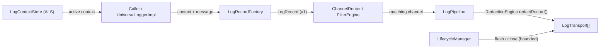

# `@aldok10/nestjs-observe-logger-core`

Framework-independent universal logging contracts, redaction engine, formatter registry, channel routing, `AsyncLocalStorage` context store, pipeline delivery, and lifecycle management.

## Overview

`@aldok10/nestjs-observe-logger-core` is the zero-dependency foundation of the `@aldok10/nestjs-observe-logger*` ecosystem. It defines canonical log contracts (`LogRecord`, `LogLevel`, `LogTransport`, `LoggerAdapter`, `LogContext`), implements fail-closed redaction (`RedactionEngine`), manages multi-channel routing (`LoggerManager`, `ChannelRouter`), propagates async request context (`LogContextStore`), and coordinates bounded transport flushing and shutdown (`LogPipeline`, `LifecycleManager`).

## Why This Package?

- **Framework-independent core**: Use structured logging, channels, redaction, and context propagation in plain Node.js services, libraries, or NestJS without coupling to `@nestjs/common`.
- **Zero runtime dependencies**: Only Node.js built-ins (`node:async_hooks`, `node:crypto`, `node:os`) are used, keeping install size and supply-chain surface minimal.
- **Fail-closed safety by default**: `RedactionEngine` masks sensitive keys and patterns even when custom matchers or `RegExp` instances throw, and `FilterEngine` drops records if a predicate throws.
- **Subpath tree-shaking**: Import only what you need from `.`, `./contracts`, `./exceptions`, `./redaction`, `./formatters`, or `./context`.

## Features

- **Canonical Contracts**: `LOG_LEVELS` (`trace`, `debug`, `verbose`, `info`, `log`, `warn`, `error`, `fatal`), `LogRecord` (schema v1), `UniversalLogger`, `LogTransport`, `RemoteLogTransport`, `LoggerAdapter`, and `LifecycleManaged`.
- **Fail-Closed Redaction**: `RedactionEngine` and `sanitize()` with 13 built-in sensitive key patterns, `allowlist`/`denylist`, custom `RedactionMatcher`s, circular-reference detection, and depth/key/string truncation limits.
- **Async Context & Correlation**: `LogContextStore` backed by `AsyncLocalStorage`, `mergeContexts()`, and ID generators (`generateRequestId`, `generateCorrelationId`, `generateTraceId`, `generateSpanId`).
- **Channel Routing & Management**: `LoggerManager`, `LoggerFactory`, `ChannelRegistry`, `ChannelRouter`, `ChannelLogger`, and `UnknownChannelPolicy` (`throw` | `drop` | `create`).
- **Pipeline & Lifecycle**: `LogPipeline` with per-transport health counters, `FilterEngine`, `LifecycleManager`, and `BoundedExecution` / `withTimeout`.
- **Environment Configuration**: `resolveLoggerConfig()`, `readLoggerConfigFromEnv()`, and `readProcessEnvelope()`.
- **Error & Record Normalization**: `LogRecordFactory`, `ErrorSerializer`, and `LogRecordNormalizer`.

## Architecture and Responsibilities



| Subpath                                          | Responsibility                                                                                                     |
| ------------------------------------------------ | ------------------------------------------------------------------------------------------------------------------ |
| `@aldok10/nestjs-observe-logger-core`            | Full curated public API (contracts, exceptions, logger, channels, pipeline, config, lifecycle, adapters, resolver) |
| `@aldok10/nestjs-observe-logger-core/contracts`  | TypeScript interfaces, `LOG_LEVELS`, `isLogLevel`, `normalizeLogLevel`, `levelIndex`                               |
| `@aldok10/nestjs-observe-logger-core/exceptions` | Typed `LoggerException` hierarchy                                                                                  |
| `@aldok10/nestjs-observe-logger-core/redaction`  | `RedactionEngine`, `sanitize`, `safeString`, `markSanitized`, `isSanitized`                                        |
| `@aldok10/nestjs-observe-logger-core/formatters` | `LogRecordNormalizer`, `defaultFormatter`, `registerFormatter`, `resolveFormatter`, `stringField`                  |
| `@aldok10/nestjs-observe-logger-core/context`    | `LogContextStore`, `mergeContexts`, correlation ID generators                                                      |

## Installation

```sh
pnpm add @aldok10/nestjs-observe-logger-core
```

```sh
npm install @aldok10/nestjs-observe-logger-core
```

```sh
yarn add @aldok10/nestjs-observe-logger-core
```

## Requirements

- **Node.js**: `>=22`
- **Module formats**: ESM (`import`), CommonJS (`require`), and TypeScript type declarations (`.d.ts` / `.d.cts`)
- **Peer dependencies**: None

## Quick Start

```ts
import {
  LogContextStore,
  LogPipeline,
  UniversalLoggerImpl,
  defaultFormatter,
} from '@aldok10/nestjs-observe-logger-core';

const store = new LogContextStore();
const pipeline = new LogPipeline({
  transports: [
    {
      name: 'stdout',
      write(record) {
        process.stdout.write(`${defaultFormatter.format(record)}\n`);
      },
    },
  ],
});

const logger = new UniversalLoggerImpl({
  level: 'info',
  pipeline,
  context: store,
});

store.run({ requestId: 'req-123' }, () => {
  logger.info('Order created', { metadata: { orderId: 'ord-42', password: 'secret' } });
});

await pipeline.close();
```

## Configuration

### `resolveLoggerConfig(options?)` & `LoggerConfig`

Precedence order is `LOGGER_CONFIG_DEFAULTS` < `defaults` < environment (`CISEA_LOG_*`) < `programmatic`.

| Property      | Type       | Required | Default     | Description                                      |
| ------------- | ---------- | -------- | ----------- | ------------------------------------------------ |
| `level`       | `LogLevel` | No       | `'info'`    | Minimum severity (`CISEA_LOG_LEVEL`)             |
| `service`     | `string`   | No       | `undefined` | Service name (`CISEA_LOG_SERVICE`)               |
| `application` | `string`   | No       | `undefined` | Application name (`CISEA_LOG_APPLICATION`)       |
| `environment` | `string`   | No       | `undefined` | Deployment environment (`CISEA_LOG_ENVIRONMENT`) |
| `instanceId`  | `string`   | No       | `undefined` | Instance identifier (`CISEA_LOG_INSTANCE_ID`)    |

### `RedactionOptions`

| Property          | Type                            | Required | Default              | Description                                        |
| ----------------- | ------------------------------- | -------- | -------------------- | -------------------------------------------------- |
| `patterns`        | `readonly (string \| RegExp)[]` | No       | 13 built-in patterns | Additional key/value patterns appended to defaults |
| `allowlist`       | `readonly string[]`             | No       | `[]`                 | Lowercase key names exempted from pattern matching |
| `denylist`        | `readonly string[]`             | No       | `[]`                 | Lowercase key names always masked                  |
| `matchers`        | `readonly RedactionMatcher[]`   | No       | `[]`                 | Custom `(key, value) => boolean` matchers          |
| `replacement`     | `string`                        | No       | `'[REDACTED]'`       | Replacement string for masked values               |
| `maxDepth`        | `number`                        | No       | `6`                  | Maximum object traversal depth                     |
| `maxKeys`         | `number`                        | No       | `64`                 | Maximum keys/items visited per object or array     |
| `maxStringLength` | `number`                        | No       | `4096`               | Maximum string length before `...[truncated]`      |

### `LogPipelineOptions`

| Property           | Type                                              | Required | Default     | Description                                            |
| ------------------ | ------------------------------------------------- | -------- | ----------- | ------------------------------------------------------ |
| `transports`       | `readonly LogTransport[]`                         | Yes      | —           | Target transports receiving redacted `LogRecord`s      |
| `redaction`        | `RedactionOptions`                                | No       | `{}`        | Redaction policy applied before `transport.write`      |
| `format`           | `FormatterType \| LogFormatter`                   | No       | `undefined` | Optional formatter hint                                |
| `onTransportError` | `(transportName: string, error: unknown) => void` | No       | `undefined` | Callback invoked when a transport write throws/rejects |

### `ChannelsOptions`

| Property            | Type                                                  | Required | Default     | Description                                                                    |
| ------------------- | ----------------------------------------------------- | -------- | ----------- | ------------------------------------------------------------------------------ |
| `channels`          | `readonly ChannelConfiguration[]`                     | Yes      | —           | Channel definitions (`name`, `transports`, `level`, `routes`, `filters`, etc.) |
| `defaultChannel`    | `string`                                              | No       | `undefined` | Default channel name                                                           |
| `unknownChannel`    | `'throw' \| 'drop' \| 'create'`                       | No       | `undefined` | Policy when requesting an unregistered channel                                 |
| `onUnknownChannel`  | `(name: string) => ChannelConfiguration \| undefined` | No       | `undefined` | Dynamic factory for `'create'` unknown-channel policy                          |
| `shutdownTimeoutMs` | `number`                                              | No       | `undefined` | Bounded timeout applied during `LoggerManager.shutdown()`                      |

## Usage

### Multi-Channel Routing with `createLoggerManager`

```ts
import { createLoggerManager } from '@aldok10/nestjs-observe-logger-core';

const manager = createLoggerManager({
  defaultChannel: 'app',
  unknownChannel: 'throw',
  channels: [
    {
      name: 'app',
      level: 'info',
      transports: [{ name: 'console', write: (r) => console.log(r.message) }],
      routes: [{ to: 'audit', when: (record) => record.level === 'error' }],
    },
    {
      name: 'audit',
      transports: [{ name: 'audit-sink', write: (r) => console.error(r.message) }],
    },
  ],
});

manager.getLogger('app').error('Payment failed');
await manager.shutdown();
```

### Subpath Imports

```ts
import { LOG_LEVELS, normalizeLogLevel } from '@aldok10/nestjs-observe-logger-core/contracts';
import { ChannelNotFoundException } from '@aldok10/nestjs-observe-logger-core/exceptions';
import { sanitize } from '@aldok10/nestjs-observe-logger-core/redaction';
import { LogContextStore, generateRequestId } from '@aldok10/nestjs-observe-logger-core/context';
import { defaultFormatter, resolveFormatter } from '@aldok10/nestjs-observe-logger-core/formatters';
```

## Advanced Usage

- **Custom Backend Adapters**: Implement `LoggerAdapter<TLogger>` and register it with `AdapterResolver`, or wrap a backend logger using `AdapterLogBridge` and `LevelMappingResolver`.
- **Active Span Correlation**: Pass `activeSpanProvider` to `new LogContextStore({ activeSpanProvider })` (for example from `@aldok10/nestjs-observe-logger-context`).
- **Process Envelope**: `LogRecordFactory` caches `hostname()`, `process.pid`, and `readProcessEnvelope()` (`SERVICE_NAME` / `APP_NAME`, `APPLICATION_NAME`, `NODE_ENV`, `INSTANCE_ID`).

## API Reference

- **Logger & Pipeline**: `UniversalLoggerImpl`, `LogPipeline`, `FilterEngine`, `LogRecordFactory`, `createLogRecord`, `ErrorSerializer`, `serializeError`
- **Channels**: `LoggerManager`, `createLoggerManager`, `LoggerFactory`, `ChannelLogger`
- **Context**: `LogContextStore`, `mergeContexts`, `createCorrelationContext`, `generateRequestId`, `generateCorrelationId`, `generateTraceId`, `generateSpanId`
- **Redaction**: `RedactionEngine`, `sanitize`, `safeString`, `markSanitized`, `isSanitized`
- **Formatters**: `LogRecordNormalizer`, `defaultFormatter`, `registerFormatter`, `resolveFormatter`, `stringField`
- **Adapters & Lifecycle**: `AdapterResolver`, `AdapterLogBridge`, `LevelMappingResolver`, `LifecycleManager`, `BoundedExecution`
- **Config**: `LOGGER_CONFIG_DEFAULTS`, `resolveLoggerConfig`, `normalizeLoggerConfig`, `readLoggerConfigFromEnv`, `readEnv`, `readProcessEnvelope`
- **Exceptions**: `LoggerException`, `ChannelNotFoundException`, `UnknownChannelError`, `DuplicateChannelException`, `AdapterNotFoundException`, `DuplicateAdapterException`, `InvalidLoggerConfigurationException`, `OptionalPeerMissingException`, `TransportShutdownException`

## Integration with Other Packages

- [`@aldok10/nestjs-observe-logger`](../logger/README.md) re-exports this package and wires it into NestJS DI.
- [`@aldok10/nestjs-observe-logger-transports`](../transports/README.md) provides `ConsoleTransport`, file, HTTP, and remote transports implementing `LogTransport`.
- [`@aldok10/nestjs-observe-logger-formatters`](../formatters/README.md) registers `'json'`, `'prettyJson'`, and `'text'` into `registerFormatter`.

## Dependencies and Optional Integrations

- **Runtime dependencies**: None.
- **Optional integrations**: All transports, formatters, NestJS bindings, and backend adapters live in separate packages.

## Lifecycle and Resource Management

- `LogPipeline.close()` is idempotent, waits up to `5000ms` for in-flight `emit()` calls, and closes all transports with bounded waiting.
- `LifecycleManager.shutdown(signal?, timeoutMs?)` flushes then closes registered transports, throwing `TransportShutdownException` if any transport `close()` rejects.
- `BoundedExecution.run(work, timeoutMs)` unrefs timeout timers (`timer.unref?.()`) so shutdown timers never keep the Node.js event loop alive.

## Error Handling

- `LogPipeline.emit()` catches transport write failures per transport, updates health counters (`failed`, `consecutiveFailures`, `lastError`), and invokes `onTransportError` without failing other transports.
- `RedactionEngine.redactRecord()` catches matcher/pattern errors and falls back to a minimal redacted error record rather than leaking raw data.
- Configuration and registry errors throw typed subclasses of `LoggerException`.

## Performance Considerations

- `LogRecordFactory` caches the process envelope (`hostname`, `pid`, env metadata) once per instance.
- `RedactionEngine` enforces `maxDepth` (`6`), `maxKeys` (`64`), and `maxStringLength` (`4096`) by default, and `LogRecordNormalizer` skips re-sanitizing records already marked via `markSanitized()`.

## Security Considerations

- Built-in redaction patterns (`password`, `authorization`, `accesstoken`, `refreshtoken`, `apikey`, `secret`, `clientsecret`, `cookie`, `session`, `privatekey`, `credentials`, `cardnumber`, `cvv`) are always prepended and cannot be disabled.
- `RedactionEngine` handles circular references (`[Circular]`), buffers (`[Buffer N bytes]`), and throwing property getters (`[Unreadable]`).

## Testing

```sh
pnpm test
pnpm exec vitest run packages/logs/core
```

## Troubleshooting

- **`AdapterNotFoundException` or `ChannelNotFoundException`**: Ensure the adapter or channel is registered before calling `resolve()` or `getLogger()`.
- **`InvalidLoggerConfigurationException` on `resolveLoggerConfig`**: Verify `CISEA_LOG_LEVEL` or `level` is one of `LOG_LEVELS`.

## Limitations

- Core does not ship concrete I/O transports (such as file or HTTP transports) or NestJS decorators; install `@aldok10/nestjs-observe-logger-transports` or `@aldok10/nestjs-observe-logger` for those.

## Related Packages

- [`@aldok10/nestjs-observe-logger`](../logger/README.md)
- [`@aldok10/nestjs-observe-logger-context`](../context/README.md)
- [`@aldok10/nestjs-observe-logger-filtering`](../filtering/README.md)
- [`@aldok10/nestjs-observe-logger-redaction`](../redaction/README.md)
- [`@aldok10/nestjs-observe-logger-formatters`](../formatters/README.md)
- [`@aldok10/nestjs-observe-logger-testing`](../testing/README.md)

## Documentation

- [Logs Ecosystem Overview](../../../docs/packages/logger/README.md)
- [Custom Adapter Guide](../../../docs/guides/custom-adapters-and-transports.md)
- [Migration Guide](../../../docs/guides/migration.md)

## Contributing

See [CONTRIBUTING.md](../../../CONTRIBUTING.md) and [CODE_STANDARDS.md](../../../CODE_STANDARDS.md).

## License

[MIT](../../../LICENSE)
