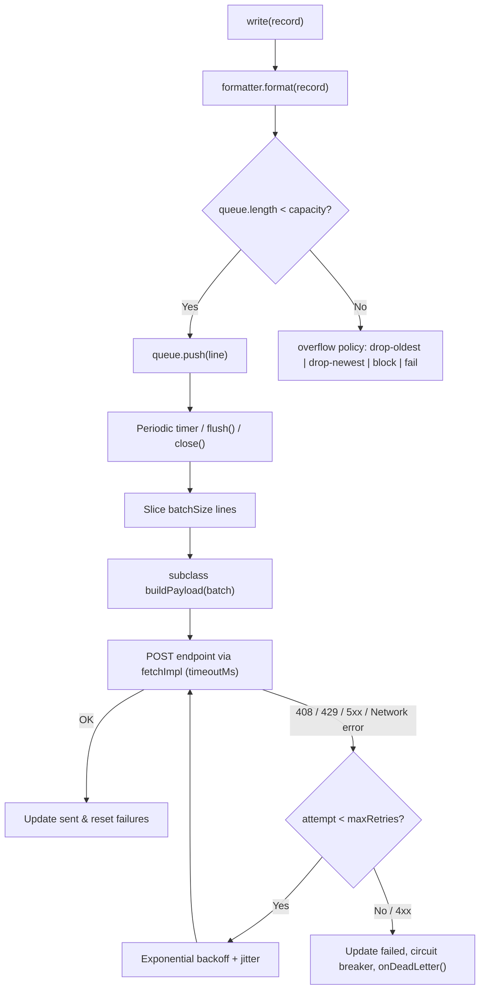

# `@aldok10/nestjs-observe-logger-delivery`

Optional bounded buffering, batching, retry, circuit-breaker, and dead-letter delivery primitives for `@aldok10/nestjs-observe-logger`.

## Overview

`@aldok10/nestjs-observe-logger-delivery` provides `BufferedRemoteTransport`, an abstract `LogTransport` base class for building reliable HTTP-based remote log transports, along with `parseRecordFields` and `joinEndpoint` helpers. It is used internally by remote transports in `@aldok10/nestjs-observe-logger-transports` and can be subclassed for custom remote log endpoints.

## Why This Package?

- **Bounded memory**: Enforces a configurable `queueCapacity` with explicit `overflow` policies so slow or unreachable endpoints cannot cause unbounded memory growth.
- **Resilient delivery**: Combines batching, per-request timeouts (`AbortSignal.timeout`), exponential backoff with jitter, a circuit breaker, and dead-letter callbacks.
- **Redaction before wire**: `parseRecordFields` applies core `RedactionEngine` sanitization to parsed JSON log lines before payload serialization.

## Features

- Bounded in-memory queue with four overflow policies: `'drop-oldest'`, `'drop-newest'`, `'block'`, and `'fail'`.
- Periodic background flushing (`setInterval` with `.unref?.()`) plus explicit `flush(timeoutMs)` and idempotent `close()`.
- Automatic retries with exponential backoff and jitter for network errors, HTTP `408`, `429`, and `5xx` responses.
- Immediate permanent failure and dead-lettering (`onDeadLetter`) for non-retryable `4xx` responses or exhausted retries.
- Circuit breaker that opens for `30_000` ms after `5` consecutive permanent batch failures.
- Live `health()` reporting (`status`: `'healthy' | 'degraded' | 'down'`, `queued`, `capacity`, `dropped`, `sent`, `failed`, `lastSuccessAt`, `lastErrorAt`, `lastError`).

## Architecture and Responsibilities



## Installation

```bash
pnpm add @aldok10/nestjs-observe-logger-delivery @aldok10/nestjs-observe-logger-core
```

```bash
npm install @aldok10/nestjs-observe-logger-delivery @aldok10/nestjs-observe-logger-core
```

```bash
yarn add @aldok10/nestjs-observe-logger-delivery @aldok10/nestjs-observe-logger-core
```

## Requirements

- **Node.js**: `>=22`
- **Module formats**: ESM (`import`), CJS (`require`), and TypeScript type definitions (`.d.ts`)

## Quick Start

```ts
import {
  BufferedRemoteTransport,
  joinEndpoint,
  parseRecordFields,
  type RemotePayload,
} from '@aldok10/nestjs-observe-logger-delivery';

class CustomJsonTransport extends BufferedRemoteTransport {
  constructor(baseUrl: string) {
    super({
      name: 'custom-json',
      endpoint: joinEndpoint(baseUrl, '/ingest'),
      batchSize: 50,
      flushIntervalMs: 1000,
    });
  }

  protected buildPayload(batch: readonly string[]): RemotePayload {
    return {
      body: JSON.stringify(batch.map((line) => parseRecordFields(line))),
      headers: { 'Content-Type': 'application/json' },
    };
  }
}
```

## Configuration

`BufferedRemoteTransportOptions`:

| Property          | Type                                                                  | Required | Default            | Description                                                                          |
| ----------------- | --------------------------------------------------------------------- | -------- | ------------------ | ------------------------------------------------------------------------------------ |
| `endpoint`        | `string`                                                              | Yes      | —                  | Target URL passed to `fetchImpl` (`POST`).                                           |
| `name`            | `string`                                                              | No       | `'remote'`         | Transport name reported in `health()` and overflow errors.                           |
| `formatter`       | `FormatterType \| LogFormatter`                                       | No       | `defaultFormatter` | Formatter used to serialize each `LogRecord` before queuing.                         |
| `batchSize`       | `number`                                                              | No       | `100`              | Maximum number of formatted lines per HTTP request (clamped to `>= 1`).              |
| `flushIntervalMs` | `number`                                                              | No       | `1000`             | Interval in milliseconds for background queue draining (clamped to `>= 1`).          |
| `queueCapacity`   | `number`                                                              | No       | `1000`             | Maximum number of queued lines before `overflow` policy applies (clamped to `>= 1`). |
| `overflow`        | `'drop-oldest' \| 'drop-newest' \| 'block' \| 'fail'`                 | No       | `'drop-oldest'`    | Behavior when `queue.length >= queueCapacity`.                                       |
| `maxRetries`      | `number`                                                              | No       | `3`                | Maximum retry attempts for retryable failures (clamped to `>= 0`).                   |
| `baseDelayMs`     | `number`                                                              | No       | `100`              | Base delay in milliseconds for exponential backoff (clamped to `>= 0`).              |
| `timeoutMs`       | `number`                                                              | No       | `5000`             | Per-request timeout in milliseconds via `AbortSignal.timeout` (clamped to `>= 1`).   |
| `headers`         | `Record<string, string>`                                              | No       | `{}`               | Default HTTP headers merged with `RemotePayload.headers`.                            |
| `fetchImpl`       | `typeof fetch`                                                        | No       | `globalThis.fetch` | Custom `fetch` implementation for testing or custom HTTP clients.                    |
| `onError`         | `(error: unknown) => void`                                            | No       | `undefined`        | Diagnostic callback invoked on formatting, overflow, HTTP, or dead-letter errors.    |
| `onDeadLetter`    | `(batch: readonly string[], error: unknown) => void \| Promise<void>` | No       | `undefined`        | Callback invoked when a batch permanently fails delivery.                            |

## Usage

### Inspecting Health and Flushing

```ts
const health = transport.health();
// { name, status: 'healthy' | 'degraded' | 'down', healthy, queued, capacity, dropped, sent, failed, ... }

await transport.flush(5000);
await transport.close();
```

## Advanced Usage

### Custom Overflow and Dead-Letter Handling

```ts
import {
  BufferedRemoteTransport,
  type RemotePayload,
} from '@aldok10/nestjs-observe-logger-delivery';

class NdjsonTransport extends BufferedRemoteTransport {
  protected buildPayload(batch: readonly string[]): RemotePayload {
    return {
      body: `${batch.join('\n')}\n`,
      headers: { 'Content-Type': 'application/x-ndjson' },
    };
  }
}

const transport = new NdjsonTransport({
  endpoint: 'https://logs.example.com/ndjson',
  queueCapacity: 500,
  overflow: 'drop-newest',
  maxRetries: 2,
  onDeadLetter: async (batch, error) => {
    console.error(`Dead-lettered ${batch.length} records:`, error);
  },
});
```

## API Reference

- `BufferedRemoteTransport` — Abstract class implementing `LogTransport` (`write`, `flush`, `close`, `health`) and requiring subclasses to implement `protected abstract buildPayload(batch: readonly string[]): RemotePayload`.
- `joinEndpoint(endpoint: string, path: string): string` — Strips trailing slashes from `endpoint` and concatenates `path`.
- `parseRecordFields(line: string): Readonly<Record<string, unknown>>` — Parses a JSON object line (falling back to `{ message: line }`) and sanitizes it with `RedactionEngine`.
- `BufferedRemoteTransportOptions` — Constructor options interface.
- `RemotePayload` — `{ readonly body: string | Buffer; readonly headers?: Record<string, string> }`.

## Integration with Other Packages

- Depends on `@aldok10/nestjs-observe-logger-core` (`BoundedExecution`, `RedactionEngine`, `defaultFormatter`, `resolveFormatter`, and contracts).
- Extended by `HttpTransport`, `ElasticsearchTransport`, `OpenObserveTransport`, `LokiTransport`, and `OtlpLogTransport` in `@aldok10/nestjs-observe-logger-transports`.

## Dependencies and Optional Integrations

- **Runtime dependency**: `@aldok10/nestjs-observe-logger-core` (`^0.1.1`)

## Lifecycle and Resource Management

- The constructor starts an unref'd `setInterval` timer (`flushIntervalMs`) so it does not keep the Node.js event loop alive by itself.
- `close()` is idempotent (returns the same `Promise`), stops the interval timer, aborts any in-flight retry backoff sleep, sets `forceDrain` to bypass circuit-breaker cooldown, and calls `flush()`.
- `write()` calls after `close()` are ignored.

## Error Handling

- `overflow: 'fail'` throws an `Error` synchronously from `write()` when the queue is full.
- All other errors (formatter failures, `overflow: 'drop-oldest'`/`'drop-newest'`, HTTP errors, and `onDeadLetter` exceptions) are reported to `onError` without throwing from `write()`, `flush()`, or `close()`.
- HTTP `408`, `429`, and `>= 500` responses are retried; other `4xx` responses fail permanently and trigger `onDeadLetter` immediately.

## Performance Considerations

- Batching reduces HTTP round-trips (`batchSize` defaults to `100`, `flushIntervalMs` defaults to `1000`).
- `overflow: 'block'` defers enqueueing by `50` ms via `setTimeout` (unref'd); if the queue is still full or the transport closes, the deferred record is counted as `dropped`.

## Security Considerations

- `parseRecordFields()` runs `RedactionEngine.sanitize()` on parsed JSON records before `buildPayload` sends them over the network.
- `LogPipeline` also redacts records before calling `transport.write()`, ensuring secrets are masked before queuing.

## Testing

```bash
pnpm test
pnpm exec vitest run packages/logs/delivery
```

## Troubleshooting

- **`health().status === 'down'`**: Five consecutive permanent batch failures trigger a `30_000` ms circuit-breaker cooldown. Calling `close()` forces a final drain attempt regardless of cooldown.
- **`TypeError: buildPayload must return an object with a body`**: Ensure your subclass returns `{ body: string | Buffer, headers?: Record<string, string> }`.

## Limitations

- `OverflowPolicy` is defined in `buffered-remote.transport.ts` and referenced by `BufferedRemoteTransportOptions.overflow`, but is not directly re-exported from the package root `src/index.ts`.
- HTTP requests always use `POST` unless wrapped via `fetchImpl` (as done by `HttpTransport`).

## Related Packages

- [`@aldok10/nestjs-observe-logger-core`](../core/README.md)
- [`@aldok10/nestjs-observe-logger-transports`](../transports/README.md)
- [`@aldok10/nestjs-observe-logger`](../logger/README.md)

## Documentation

- [Logs Ecosystem Overview](../../../docs/packages/logger/README.md)

## Contributing

See [CONTRIBUTING.md](../../../CONTRIBUTING.md).

## License

MIT — see [LICENSE](../../../LICENSE).
