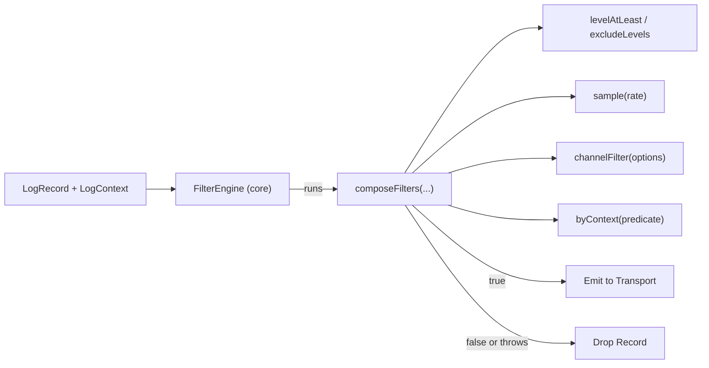

# `@aldok10/nestjs-observe-logger-filtering`

Optional composable log filtering predicates, channel filters, and sampling rules for `@aldok10/nestjs-observe-logger`.

## Overview

`@aldok10/nestjs-observe-logger-filtering` provides ready-to-use `LogFilter` factories for `@aldok10/nestjs-observe-logger-core`'s `FilterEngine` and `ChannelConfiguration.filters`. It includes severity thresholds, level exclusion, probabilistic sampling, channel allow/exclude rules, context predicates, and fail-closed filter composition.

## Why This Package?

- **Composable `LogFilter` primitives**: Build reusable filtering policies without writing boilerplate predicates.
- **Fail-closed safety**: `byContext()` and `composeFilters()` catch exceptions from user predicates and return `false` instead of leaking unfiltered records or crashing callers.
- **Zero extra runtime dependencies**: Depends only on `@aldok10/nestjs-observe-logger-core`.

## Features

- **`levelAtLeast(minimum)`**: Accepts records at or above a `LogLevel` using `levelIndex()`.
- **`excludeLevels(levels)`**: Drops records whose `level` is in the excluded set.
- **`sample(rate)`**: Deterministic at boundaries (`rate <= 0` returns `false`, `rate >= 1` returns `true`), probabilistic (`Math.random() < rate`) in between.
- **`channelFilter(options)`**: Filters by `record.channel` with `include` (fail-closed when `record.channel` is `undefined`) and `exclude` lists.
- **`byContext(predicate)`**: Evaluates a predicate against `{ ...context, ...pickRecordContext(record) }`.
- **`composeFilters(...filters)`**: Short-circuit AND composition of multiple `LogFilter`s.

## Architecture and Responsibilities



## Installation

```sh
pnpm add @aldok10/nestjs-observe-logger-filtering
```

```sh
npm install @aldok10/nestjs-observe-logger-filtering
```

```sh
yarn add @aldok10/nestjs-observe-logger-filtering
```

## Requirements

- **Node.js**: `>=22`
- **Module formats**: ESM (`import`), CommonJS (`require`), and TypeScript type declarations
- **Peer dependencies**: None
- **Dependencies**: `@aldok10/nestjs-observe-logger-core`

## Quick Start

```ts
import { FilterEngine, createLogRecord } from '@aldok10/nestjs-observe-logger-core';
import { composeFilters, levelAtLeast, sample } from '@aldok10/nestjs-observe-logger-filtering';

const engine = new FilterEngine();
const policy = composeFilters(levelAtLeast('warn'), sample(1));

const record = createLogRecord({ level: 'warn', message: 'Slow query' });
const shouldEmit = engine.shouldEmit(record, [policy]); // true
```

## Configuration

### `ChannelFilterOptions`

| Property  | Type                | Required | Default | Description                                                     |
| --------- | ------------------- | -------- | ------- | --------------------------------------------------------------- |
| `include` | `readonly string[]` | No       | `[]`    | If non-empty, only records whose `channel` is in this list pass |
| `exclude` | `readonly string[]` | No       | `[]`    | Records whose `channel` is in this list are dropped             |

## Usage

### Filtering by Context and Channel

```ts
import { FilterEngine, createLogRecord } from '@aldok10/nestjs-observe-logger-core';
import {
  byContext,
  channelFilter,
  composeFilters,
  excludeLevels,
} from '@aldok10/nestjs-observe-logger-filtering';

const engine = new FilterEngine();
const filter = composeFilters(
  excludeLevels(['trace', 'debug']),
  channelFilter({ include: ['audit', 'payments'] }),
  byContext((ctx) => ctx.requestId !== undefined),
);

const record = createLogRecord({
  level: 'info',
  channel: 'audit',
  message: 'User login',
  context: { requestId: 'req-1' },
});

engine.shouldEmit(record, [filter]); // true
```

## Advanced Usage

- **`byContext` Precedence**: `byContext` merges the supplied `context` argument with `record.context`, `record.requestId`, `record.traceId`, and `record.correlationId` (record fields take precedence if defined).
- **Deterministic Boundary Sampling**: `sample(0)` never calls `Math.random()` and always returns `false`; `sample(1)` always returns `true`.

## API Reference

- `levelAtLeast(minimum: LogLevel): LogFilter`
- `excludeLevels(levels: readonly LogLevel[]): LogFilter`
- `sample(rate: number): LogFilter`
- `channelFilter(options: ChannelFilterOptions): LogFilter`
- `byContext(predicate: (context: LogContext) => boolean): LogFilter`
- `composeFilters(...filters: readonly LogFilter[]): LogFilter`
- `ChannelFilterOptions` (interface)

## Integration with Other Packages

- [`@aldok10/nestjs-observe-logger-core`](../core/README.md): Consumed by `FilterEngine` and `ChannelConfiguration.filters`.

## Dependencies and Optional Integrations

- **Direct dependency**: `@aldok10/nestjs-observe-logger-core`

## Lifecycle and Resource Management

- Pure, stateless filter factories; no timers, handles, or cleanup required.

## Error Handling

- `byContext()` and `composeFilters()` catch any error thrown by predicates/filters and fail closed (`return false`).

## Performance Considerations

- `levelAtLeast()` precomputes `levelIndex(minimum)` once at construction time.
- `excludeLevels()` and `channelFilter()` prebuild `Set`s for O(1) lookups.

## Security Considerations

- Fail-closed behavior ensures broken predicates never accidentally allow restricted or noisy records through.

## Testing

```sh
pnpm test
pnpm exec vitest run packages/logs/filtering
```

## Troubleshooting

- **Records with `channel: undefined` dropped by `channelFilter({ include: [...] })`**: When `include` is non-empty, `channelFilter` intentionally fails closed if `record.channel` is `undefined`.

## Limitations

- `sample(rate)` uses `Math.random()` and is stateless (not trace-ID-hashed).

## Related Packages

- [`@aldok10/nestjs-observe-logger-core`](../core/README.md)
- [`@aldok10/nestjs-observe-logger-redaction`](../redaction/README.md)

## Documentation

- [Logs Ecosystem Overview](../../../docs/packages/logger/README.md)

## Contributing

See [CONTRIBUTING.md](../../../CONTRIBUTING.md) and [CODE_STANDARDS.md](../../../CODE_STANDARDS.md).

## License

[MIT](../../../LICENSE)
