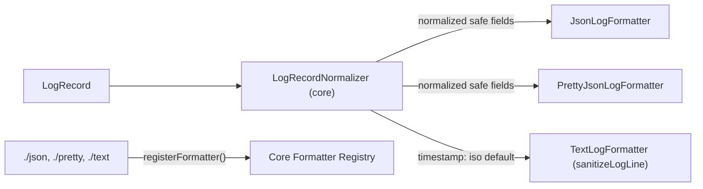

# `@aldok10/nestjs-observe-logger-formatters`

Built-in JSON, pretty JSON, and plain-text log formatters for `@aldok10/nestjs-observe-logger`.

## Overview

`@aldok10/nestjs-observe-logger-formatters` implements `LogFormatter` for single-line JSON (`JsonLogFormatter`), indented JSON (`PrettyJsonLogFormatter`), and human-readable log lines (`TextLogFormatter`). It also registers `'json'`, `'prettyJson'`, and `'text'` in `@aldok10/nestjs-observe-logger-core`'s formatter registry when imported.

## Why This Package?

- **Deterministic field ordering**: Delegates record normalization to `LogRecordNormalizer` so fields appear in canonical order.
- **Log-injection defense in text output**: `TextLogFormatter` escapes control characters (`\n`, `\r`, `\t`, C0/C1 controls, `\u2028`, `\u2029`) in timestamps, levels, channels, contexts, messages, IDs, and serialized metadata.
- **Auto-registration via subpaths**: Import `@aldok10/nestjs-observe-logger-formatters/json`, `./pretty`, or `./text` (or the root entrypoint) to register formatters with `resolveFormatter()`.

## Features

- **`JsonLogFormatter`** (`'json'`): Compact `JSON.stringify` output of normalized `LogRecord` fields.
- **`PrettyJsonLogFormatter`** (`'prettyJson'`): 2-space indented `JSON.stringify(..., null, 2)` output.
- **`TextLogFormatter`** (`'text'`): Single-line `TIMESTAMP LEVEL [channel] [context] message requestId=... traceId=... metadata=...` format with ISO timestamps by default and control-character escaping.
- **Subpath exports**: `.`, `./json`, `./pretty`, `./text`.

## Architecture and Responsibilities



## Installation

```sh
pnpm add @aldok10/nestjs-observe-logger-formatters
```

```sh
npm install @aldok10/nestjs-observe-logger-formatters
```

```sh
yarn add @aldok10/nestjs-observe-logger-formatters
```

## Requirements

- **Node.js**: `>=22`
- **Module formats**: ESM (`import`), CommonJS (`require`), and TypeScript type declarations
- **Peer dependencies**: None
- **Dependencies**: `@aldok10/nestjs-observe-logger-core`

## Quick Start

```ts
import { createLogRecord } from '@aldok10/nestjs-observe-logger-core';
import {
  createJsonFormatter,
  createTextFormatter,
} from '@aldok10/nestjs-observe-logger-formatters';

const record = createLogRecord({
  level: 'info',
  message: 'Server started',
  context: { context: 'Bootstrap', requestId: 'req-1' },
});

console.log(createJsonFormatter({ timestamp: 'iso' }).format(record));
console.log(createTextFormatter().format(record));
```

## Configuration

### `FormatterOptions` (from `@aldok10/nestjs-observe-logger-core/contracts`)

| Property          | Type               | Required | Default                                                   | Description                                          |
| ----------------- | ------------------ | -------- | --------------------------------------------------------- | ---------------------------------------------------- |
| `timestamp`       | `'iso' \| 'epoch'` | No       | `'epoch'` for JSON/Pretty; `'iso'` for `TextLogFormatter` | Timestamp serialization format                       |
| `includeMetadata` | `boolean`          | No       | `true`                                                    | Set `false` to omit `metadata` from formatted output |

## Usage

### Subpath Imports and Auto-Registration

Importing a subpath registers that formatter with core's `registerFormatter()` (note `package.json` marks these entrypoints in `sideEffects` for bundlers):

```ts
import '@aldok10/nestjs-observe-logger-formatters/json';
import { resolveFormatter } from '@aldok10/nestjs-observe-logger-core/formatters';

const formatter = resolveFormatter('json', { timestamp: 'iso' });
```

### Prebuilt Singleton Instances

```ts
import {
  jsonFormatter,
  prettyJsonFormatter,
  textFormatter,
} from '@aldok10/nestjs-observe-logger-formatters';
```

## Advanced Usage

- **Custom `LogRecordNormalizer`**: Pass a custom `LogRecordNormalizer` as the second constructor argument to `new JsonLogFormatter(options, normalizer)`, `new PrettyJsonLogFormatter(options, normalizer)`, or `new TextLogFormatter(options, normalizer)`.
- **Explicit Registration**: Call `registerJsonFormatter()`, `registerPrettyJsonFormatter()`, or `registerTextFormatter()` if you need to re-register after clearing or customizing the core registry.

## API Reference

- **Classes**: `JsonLogFormatter`, `PrettyJsonLogFormatter`, `TextLogFormatter`
- **Factories**: `createJsonFormatter(options?)`, `createPrettyJsonFormatter(options?)`, `createTextFormatter(options?)`
- **Singletons**: `jsonFormatter`, `prettyJsonFormatter`, `textFormatter`
- **Registration**: `registerJsonFormatter()`, `registerPrettyJsonFormatter()`, `registerTextFormatter()`

## Integration with Other Packages

- [`@aldok10/nestjs-observe-logger-core`](../core/README.md): Provides `LogRecordNormalizer`, `FormatterOptions`, `LogFormatter`, and `registerFormatter()`.
- [`@aldok10/nestjs-observe-logger-transports`](../transports/README.md): Transports accept `FormatterType | LogFormatter`.

## Dependencies and Optional Integrations

- **Direct dependency**: `@aldok10/nestjs-observe-logger-core`

## Lifecycle and Resource Management

- Synchronous, stateless string formatters; no timers or resources to dispose.

## Error Handling

- `LogRecordNormalizer` ensures records are sanitized before serialization so circular references or throwing getters do not break `JSON.stringify()`.

## Performance Considerations

- `JsonLogFormatter` and `PrettyJsonLogFormatter` skip re-sanitizing records already marked by `RedactionEngine.markSanitized()`.
- `TextLogFormatter` omits empty `metadata` objects and escapes control characters in a single regex pass.

## Security Considerations

- `TextLogFormatter` escapes `\n`, `\r`, `\t`, `[\u0000-\u001f\u007f-\u009f\u2028\u2029]` to prevent terminal or log-line injection attacks.

## Testing

```sh
pnpm test
pnpm exec vitest run packages/logs/formatters
```

## Troubleshooting

- **`resolveFormatter('prettyJson')` returns default formatter**: Ensure `@aldok10/nestjs-observe-logger-formatters` or `@aldok10/nestjs-observe-logger-formatters/pretty` is imported at least once so registration side effects execute.

## Limitations

- Formatters return `string` only (not `Buffer`).

## Related Packages

- [`@aldok10/nestjs-observe-logger-core`](../core/README.md)
- [`@aldok10/nestjs-observe-logger-transports`](../transports/README.md)

## Documentation

- [Logs Ecosystem Overview](../../../docs/packages/logger/README.md)

## Contributing

See [CONTRIBUTING.md](../../../CONTRIBUTING.md) and [CODE_STANDARDS.md](../../../CODE_STANDARDS.md).

## License

[MIT](../../../LICENSE)
