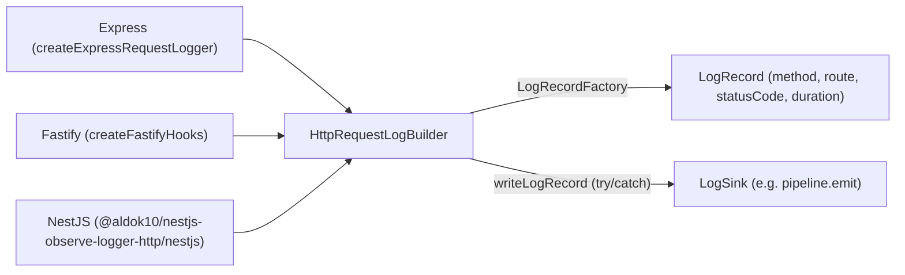

# `@aldok10/nestjs-observe-logger-http`

Independent Express, Fastify, and NestJS HTTP request logging integration for `@aldok10/nestjs-observe-logger`.

## Overview

`@aldok10/nestjs-observe-logger-http` (located in `packages/logs/integration-http`) provides framework bindings and a shared `HttpRequestLogBuilder` to log inbound HTTP requests with duration, status-based log levels, W3C `traceparent` / `x-request-id` / `x-correlation-id` extraction, route include/exclude filtering, sampling, allowlisted headers, and client-disconnect detection.

## Why This Package?

- **Framework-specific bindings without bloat**: Express, Fastify, NestJS, and `rxjs` are all optional peer dependencies.
- **Safe header allowlisting**: Only `DEFAULT_HEADER_ALLOWLIST` (`accept`, `content-type`, `user-agent`, `x-request-id`, `x-correlation-id`, `traceparent`) is captured by default, avoiding accidental `authorization` or `cookie` leaks.
- **Request-path isolation**: Sink errors (sync throws or async rejections) are caught and routed to `onError` so logging failures never break HTTP responses.

## Features

- **`ExpressRequestLogger`**: `createMiddleware()` and `createErrorMiddleware()` (`createExpressRequestLogger`, `createExpressErrorLogger`).
- **`FastifyRequestLogger`**: `createHooks()` returning `{ onRequest, onResponse, onError }` (`createFastifyHooks`).
- **`NestHttpRequestLogger`** (`@aldok10/nestjs-observe-logger-http/nestjs`): `NestInterceptor` for HTTP execution contexts (`createNestHttpRequestLogger`).
- **`HttpRequestLogBuilder`**: Shared record builder (`buildRequestLogRecord`, `isExcluded`, `shouldSample`, `writeLogRecord`).

## Architecture and Responsibilities



## Installation

```sh
pnpm add @aldok10/nestjs-observe-logger-http
```

```sh
npm install @aldok10/nestjs-observe-logger-http
```

```sh
yarn add @aldok10/nestjs-observe-logger-http
```

Install the peer dependencies for your chosen framework (for example, `express`, `fastify`, or `@nestjs/common` + `rxjs`).

## Requirements

- **Node.js**: `>=22`
- **Module formats**: ESM (`import`), CommonJS (`require`), and TypeScript type declarations
- **Peer dependencies (all optional)**:
  - `@nestjs/common`: `^10.0.0 || ^11.0.0 || ^12.0.0`
  - `express`: `^4.0.0 || ^5.0.0`
  - `fastify`: `^4.0.0 || ^5.0.0`
  - `rxjs`: `^7.0.0`
- **Dependencies**: `@aldok10/nestjs-observe-logger-core`

## Quick Start

### Express

```ts
import express from 'express';
import { LogPipeline } from '@aldok10/nestjs-observe-logger-core';
import {
  createExpressErrorLogger,
  createExpressRequestLogger,
} from '@aldok10/nestjs-observe-logger-http';

const pipeline = new LogPipeline({ transports: [] });
const app = express();

app.use(createExpressRequestLogger({ sink: (record) => pipeline.emit(record) }));
app.get('/health', (_req, res) => res.sendStatus(200));
app.use(createExpressErrorLogger());
```

## Configuration

### `HttpRequestLoggerOptions` (extends `RequestLoggingOptions`)

| Property                 | Type                                                            | Required | Default                                                          | Description                                                                                   |
| ------------------------ | --------------------------------------------------------------- | -------- | ---------------------------------------------------------------- | --------------------------------------------------------------------------------------------- |
| `sink`                   | `LogSink`                                                       | Yes      | —                                                                | Destination callback receiving each `LogRecord`                                               |
| `requestId`              | `RequestIdOptions`                                              | No       | `{ enabled: true, header: 'x-request-id', trustIncoming: true }` | Request ID extraction/generation (`randomUUID()` fallback)                                    |
| `include`                | `readonly (string \| RegExp)[]`                                 | No       | `undefined`                                                      | When non-empty, only matching routes are logged                                               |
| `exclude`                | `readonly (string \| RegExp)[]`                                 | No       | `undefined`                                                      | Matching routes are skipped                                                                   |
| `levels`                 | `HttpLogLevels`                                                 | No       | `{ success: 'info', clientError: 'warn', serverError: 'error' }` | Severity mapping (`>=500` -> `serverError`, `>=400` -> `clientError`, disconnect -> `'warn'`) |
| `slowRequestMs`          | `number`                                                        | No       | `undefined`                                                      | Adds `metadata.slowRequest = true` when `duration >= slowRequestMs`                           |
| `sampleRate`             | `number`                                                        | No       | `1`                                                              | Sampling rate (`<= 0` drops all, `>= 1` logs all)                                             |
| `includeRequestHeaders`  | `boolean`                                                       | No       | `true`                                                           | Include allowlisted request headers in `metadata.headers`                                     |
| `includeResponseHeaders` | `boolean`                                                       | No       | `false`                                                          | Include allowlisted response headers in `metadata.responseHeaders`                            |
| `redactHeaders`          | `readonly string[]`                                             | No       | `[]`                                                             | Header names to omit from allowlisted headers                                                 |
| `serializeHeaders`       | `(headers: Record<string, unknown>) => Record<string, unknown>` | No       | `undefined`                                                      | Custom serializer for selected headers                                                        |
| `logErrors`              | `boolean`                                                       | No       | `true`                                                           | Attach serialized `error` when present                                                        |
| `onError`                | `(error: unknown, record: LogRecord) => void`                   | No       | `undefined`                                                      | Diagnostic callback if `sink` throws or rejects                                               |

## Usage

### Fastify Hooks

```ts
import Fastify from 'fastify';
import { createFastifyHooks } from '@aldok10/nestjs-observe-logger-http';

const app = Fastify();
const hooks = createFastifyHooks({ sink: (record) => console.log(record.message) });

app.addHook('onRequest', hooks.onRequest);
app.addHook('onResponse', hooks.onResponse);
app.addHook('onError', hooks.onError);
```

### NestJS Interceptor (`./nestjs`)

```ts
import { NestHttpRequestLogger } from '@aldok10/nestjs-observe-logger-http/nestjs';

const interceptor = new NestHttpRequestLogger({
  sink: (record) => console.log(record.message),
  exclude: ['/health'],
});
```

## Advanced Usage

- **W3C Trace Context**: Incoming `traceparent` headers matching `<version>-<32-hex-traceId>-<16-hex-spanId>` automatically populate `record.traceId` and `record.spanId` unless overridden in `RequestLogInput`.
- **Untrusted Request IDs**: Set `requestId: { enabled: true, trustIncoming: false }` to ignore client-supplied `x-request-id` headers and always generate a fresh ID.

## API Reference

- **Main (`.`)**: `ExpressRequestLogger`, `createExpressRequestLogger`, `createExpressErrorLogger`, `FastifyRequestLogger`, `createFastifyHooks`, `HttpRequestLogBuilder`, `DEFAULT_HEADER_ALLOWLIST`, `buildRequestLogRecord`, `isExcluded`, `shouldSample`, `writeLogRecord`
- **NestJS (`./nestjs`)**: `NestHttpRequestLogger`, `createNestHttpRequestLogger`
- **Types**: `HttpRequestLoggerOptions`, `RequestLoggingOptions`, `RequestIdOptions`, `HttpLogLevels`, `RequestLogInput`, `FastifyRequestHooks`

## Integration with Other Packages

- [`@aldok10/nestjs-observe-logger-core`](../core/README.md): Provides `LogRecordFactory`, `LogSink`, and `LogRecord`.
- [`@aldok10/nestjs-observe-logger`](../logger/README.md): Wire `pipeline.emit.bind(pipeline)` or `logger` sink into `HttpRequestLoggerOptions.sink`.

## Dependencies and Optional Integrations

- **Direct dependency**: `@aldok10/nestjs-observe-logger-core`
- **Optional peers**: `express`, `fastify`, `@nestjs/common`, `rxjs` (`rxjs` is loaded lazily via `createRequire` only when `NestHttpRequestLogger.intercept()` instruments an HTTP request).

## Lifecycle and Resource Management

- Express and Fastify loggers track per-request state in `WeakMap`s keyed by `Response` / `FastifyReply['raw']`, preventing duplicate instrumentation and releasing memory automatically when requests complete.

## Error Handling

- `HttpRequestLogBuilder.write()` wraps both synchronous `sink(record)` calls and returned Promises, forwarding errors to `options.onError` and swallowing any error thrown by `onError` itself.
- `NestHttpRequestLogger` throws a clear error if `rxjs` (`^7.0.0`) is missing when intercepting an HTTP request.

## Performance Considerations

- Route filtering (`include`/`exclude`) and `sampleRate` checks run before `performance.now()` timing and record construction.

## Security Considerations

- Only `DEFAULT_HEADER_ALLOWLIST` headers are read (`accept`, `content-type`, `user-agent`, `x-request-id`, `x-correlation-id`, `traceparent`); sensitive headers like `authorization` and `cookie` are never selected.

## Testing

```sh
pnpm test
pnpm exec vitest run packages/logs/integration-http
```

## Troubleshooting

- **`rxjs is required for NestHttpRequestLogger`**: Install `rxjs@^7.0.0` when using `@aldok10/nestjs-observe-logger-http/nestjs`.
- **Express error not attached to log**: Register `createExpressErrorLogger()` after routes so `state.error` is captured before the response finishes.

## Limitations

- `NestHttpRequestLogger` only instruments `context.getType() === 'http'` requests; non-HTTP contexts (e.g., RPC/WS) pass through via `next.handle()`.

## Related Packages

- [`@aldok10/nestjs-observe-logger-core`](../core/README.md)
- [`@aldok10/nestjs-observe-logger`](../logger/README.md)

## Documentation

- [Logs Ecosystem Overview](../../../docs/packages/logger/README.md)

## Contributing

See [CONTRIBUTING.md](../../../CONTRIBUTING.md) and [CODE_STANDARDS.md](../../../CODE_STANDARDS.md).

## License

[MIT](../../../LICENSE)
