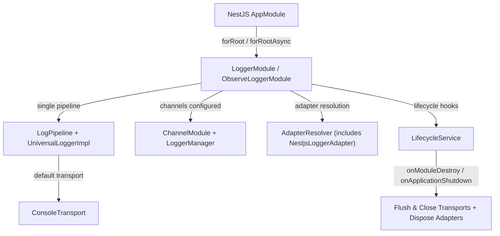

# `@aldok10/nestjs-observe-logger`

Extensible, multi-backend universal logging module for NestJS with channels, transports, redaction, and lifecycle management.

## Overview

`@aldok10/nestjs-observe-logger` is the primary NestJS integration package for the `@aldok10/nestjs-observe-logger*` ecosystem. It provides `LoggerModule` (aliased as `ObserveLoggerModule` and `DevLoggerModule`), `ChannelModule`, `InjectLogger`, `LifecycleService`, and `NestjsLoggerAdapter`, while re-exporting `@aldok10/nestjs-observe-logger-core` across convenient subpath entrypoints.

## Why This Package?

- **Drop-in NestJS `LoggerService` compatibility**: Registers NestJS `Logger` alongside `OBSERVE_LOGGER` / `DEV_LOGGER` tokens.
- **Multi-backend & multi-channel**: Route logs to console, custom `LogTransport`s, or pluggable adapters (Pino, Winston, Bunyan, Log4js, or custom `LoggerAdapter`s).
- **Sync and async DI configuration**: Supports `forRoot()`, `forRootAsync()` (`useFactory`, `useClass`, `useExisting`), and `forFeature()`.
- **Graceful NestJS lifecycle**: `LifecycleService` initializes adapters on `onModuleInit` (with rollback on failure) and flushes/closes transports and adapters on `onModuleDestroy` / `onApplicationShutdown`.

## Features

- **`LoggerModule` / `ObserveLoggerModule` / `DevLoggerModule`**: Global-by-default dynamic module (`global: true`) for single-pipeline or multi-channel logging.
- **`ChannelModule` & `@InjectLogger(name)`**: Per-channel logger injection tokens (`LOGGER_CHANNEL:<name>`) and `forFeature(channels)` scoping.
- **`NestjsLoggerAdapter`**: Built-in adapter (`name: 'nestjs'`) bridging any `LoggerServiceLike` backend into `UniversalLogger`.
- **Adapter Registration**: Register adapters by instance, class, `{ useValue }`, `{ useClass }`, or `{ useFactory }` via `adapters`.
- **13 Subpath Exports**: `.`, `./nestjs`, `./channels`, `./transports`, `./contracts`, `./exceptions`, `./context`, `./pipeline`, `./resolver`, `./lifecycle`, `./record`, `./redaction`, `./formatters`.

## Architecture and Responsibilities



## Installation

```sh
pnpm add @aldok10/nestjs-observe-logger @nestjs/common @nestjs/core reflect-metadata
```

```sh
npm install @aldok10/nestjs-observe-logger @nestjs/common @nestjs/core reflect-metadata
```

```sh
yarn add @aldok10/nestjs-observe-logger @nestjs/common @nestjs/core reflect-metadata
```

## Requirements

- **Node.js**: `>=22`
- **Module formats**: ESM (`import`), CommonJS (`require`), and TypeScript type declarations
- **Peer dependencies**:
  - `@nestjs/common`: `^10.0.0 || ^11.0.0 || ^12.0.0`
  - `@nestjs/core`: `^10.0.0 || ^11.0.0 || ^12.0.0`
  - `reflect-metadata`: `^0.1.12 || ^0.2.0`
- **Bundled dependencies**: `@aldok10/nestjs-observe-logger-core`, `@aldok10/nestjs-observe-logger-transports`

## Quick Start

```ts
import { Module, Injectable, Inject } from '@nestjs/common';
import {
  ObserveLoggerModule,
  OBSERVE_LOGGER,
  type UniversalLogger,
} from '@aldok10/nestjs-observe-logger';

@Injectable()
export class OrdersService {
  constructor(@Inject(OBSERVE_LOGGER) private readonly logger: UniversalLogger) {}

  createOrder(id: string) {
    this.logger.info('Order created', { metadata: { id } });
  }
}

@Module({
  imports: [ObserveLoggerModule.forRoot({ level: 'info' })],
  providers: [OrdersService],
})
export class AppModule {}
```

## Configuration

### `ObserveLoggerOptions` (`DevLoggerOptions`)

| Property         | Type                             | Required | Default                                                      | Description                                                  |
| ---------------- | -------------------------------- | -------- | ------------------------------------------------------------ | ------------------------------------------------------------ |
| `level`          | `LogLevel`                       | No       | `'info'` (or `'trace'` when backend configured)              | Minimum log level                                            |
| `format`         | `FormatterType`                  | No       | `undefined`                                                  | Output format (`'json' \| 'prettyJson' \| 'text'`)           |
| `redaction`      | `RedactionOptions`               | No       | `undefined`                                                  | Redaction policy passed to `LogPipeline`                     |
| `transports`     | `readonly LogTransport[]`        | No       | `[new ConsoleTransport()]` (or `[]` when backend configured) | Target transports                                            |
| `context`        | `LogContext`                     | No       | `undefined`                                                  | Initial context stored in `LogContextStore`                  |
| `adapters`       | `readonly AdapterRegistration[]` | No       | `[]`                                                         | Custom backend adapter registrations                         |
| `defaultAdapter` | `string`                         | No       | `undefined`                                                  | Registered adapter name used as default logger               |
| `backend`        | `BackendConfig`                  | No       | `undefined`                                                  | External backend configuration (`type`, `logger`, `adapter`) |
| `channels`       | `ObserveLoggerChannels`          | No       | `undefined`                                                  | Channel array, `ChannelsOptions`, or record map              |
| `global`         | `boolean`                        | No       | `true`                                                       | Whether `LoggerModule` is registered globally                |

### `ObserveLoggerAsyncOptions` (`DevLoggerAsyncOptions`)

| Property      | Type                                                                    | Required | Default     | Description                                                    |
| ------------- | ----------------------------------------------------------------------- | -------- | ----------- | -------------------------------------------------------------- |
| `imports`     | `ModuleMetadata['imports']`                                             | No       | `[]`        | Modules imported for factory dependencies                      |
| `useFactory`  | `(...args: unknown[]) => DevLoggerOptions \| Promise<DevLoggerOptions>` | One of 3 | —           | Async or sync factory returning options                        |
| `useClass`    | `Type<DevLoggerOptionsFactory>`                                         | One of 3 | —           | Class implementing `createDevLoggerOptions()`                  |
| `useExisting` | `InjectionToken`                                                        | One of 3 | —           | Existing provider token implementing `DevLoggerOptionsFactory` |
| `inject`      | `readonly InjectionToken[]`                                             | No       | `[]`        | Tokens injected into `useFactory`                              |
| `adapters`    | `readonly AdapterRegistration[]`                                        | No       | `[]`        | Static adapter registrations                                   |
| `channels`    | `readonly string[]`                                                     | No       | `undefined` | Channel names to pre-declare for DI tokens                     |
| `global`      | `boolean`                                                               | No       | `true`      | Whether `LoggerModule` is registered globally                  |

## Usage

### Multi-Channel Setup & `@InjectLogger`

```ts
import { Module, Injectable } from '@nestjs/common';
import {
  ObserveLoggerModule,
  InjectLogger,
  type UniversalLogger,
} from '@aldok10/nestjs-observe-logger';
import { ConsoleTransport } from '@aldok10/nestjs-observe-logger/transports';

@Injectable()
export class AuditService {
  constructor(@InjectLogger('audit') private readonly auditLogger: UniversalLogger) {}

  record(event: string) {
    this.auditLogger.log(event);
  }
}

@Module({
  imports: [
    ObserveLoggerModule.forRoot({
      channels: {
        app: { default: true, level: 'info', transports: [new ConsoleTransport()] },
        audit: { level: 'log', transports: [new ConsoleTransport()] },
      },
    }),
  ],
  providers: [AuditService],
})
export class AppModule {}
```

### Async Configuration (`forRootAsync`)

```ts
ObserveLoggerModule.forRootAsync({
  useFactory: () => ({
    level: 'debug',
    context: { context: 'HttpApi' },
  }),
});
```

## Advanced Usage

- **Feature Channel Scoping**: Import `LoggerModule.forFeature(['audit'])` in feature modules to expose `LOGGER_CHANNEL:audit` providers.
- **Standalone `ChannelModule`**: Import `ChannelModule.forRoot(options, resolver?)` or `ChannelModule.forRootAsync(options)` directly from `@aldok10/nestjs-observe-logger` or `@aldok10/nestjs-observe-logger/channels`.
- **Custom NestJS `LoggerService` Wrapping**: Use `NestjsLoggerAdapter` to wrap any `LoggerServiceLike` instance into a `UniversalLogger`.

## API Reference

- **Modules & Decorators**: `LoggerModule`, `ObserveLoggerModule`, `DevLoggerModule`, `ChannelModule`, `InjectLogger`, `createLoggerToken`
- **DI Tokens**: `OBSERVE_LOGGER`, `DEV_LOGGER`, `LOGGER_OPTIONS`, `LOG_TRANSPORTS`, `ADAPTER_REGISTRY`, `LoggerAdapterRegistry`, `LOGGER_MANAGER`, `LOGGER_CONTEXT`, `CHANNEL_REGISTRY`, `CHANNEL_ROUTER`, `TRANSPORT_MANAGER`, `LOGGER_FACTORY`
- **Lifecycle & Adapters**: `LifecycleService`, `NestjsLoggerAdapter`, `NestjsAdapter` (deprecated alias), `NESTJS_ADAPTER_CAPABILITIES`
- **Re-exports**: All exports from `@aldok10/nestjs-observe-logger-core` (root and matching subpaths) plus `ConsoleTransport` from `./transports`.

## Integration with Other Packages

- [`@aldok10/nestjs-observe-logger-core`](../core/README.md) provides the underlying pipeline, redaction, channels, and contracts.
- [`@aldok10/nestjs-observe-logger-transports`](../transports/README.md) provides `ConsoleTransport` (used as default when no `transports` or `backend` is specified) and remote transports.
- [`@aldok10/nestjs-observe-logger-http`](../integration-http/README.md) provides `NestHttpRequestLogger` for NestJS HTTP request logging.

## Dependencies and Optional Integrations

- **Direct dependencies**: `@aldok10/nestjs-observe-logger-core`, `@aldok10/nestjs-observe-logger-transports`.
- **Optional backend adapters**: `@aldok10/nestjs-observe-logger-adapter-pino`, `@aldok10/nestjs-observe-logger-adapter-winston`, `@aldok10/nestjs-observe-logger-adapter-bunyan`, `@aldok10/nestjs-observe-logger-adapter-log4js`.

## Lifecycle and Resource Management

- `LifecycleService.onModuleInit()` initializes registered adapters sequentially and rolls back (`dispose()`) any already-initialized adapters if a later one fails.
- `LifecycleService.onModuleDestroy()` and `onApplicationShutdown(signal?)` share a single idempotent `shutdownPromise`, calling `manager.shutdown(signal)` and `adapter.dispose()` on all adapters.

## Error Handling

- Missing or invalid `forRootAsync` strategies (e.g., omitting all of `useFactory`/`useClass`/`useExisting` or providing more than one) throw `InvalidLoggerConfigurationException`.
- Shutdown/dispose errors are aggregated into `TransportShutdownException`.

## Performance Considerations

- When `useFactory` has no `inject` dependencies and returns a synchronous options object, `LoggerModule.forRootAsync()` resolves options eagerly at module registration time.
- When `transports` is omitted and no `backend`/`defaultAdapter` is set, a single `ConsoleTransport` instance is created.

## Security Considerations

- `LogPipeline` always runs `RedactionEngine` before delivering records to transports, even when `redaction` is omitted.

## Testing

```sh
pnpm test
pnpm exec vitest run packages/logs/logger
```

## Troubleshooting

- **Missing `reflect-metadata` or NestJS DI errors**: Ensure `reflect-metadata` is installed and imported at application startup, and `@nestjs/common` / `@nestjs/core` match `^10.0.0 || ^11.0.0 || ^12.0.0`.
- **Async channel tokens not injectable**: Pass `channels: ['my-channel']` to `forRootAsync()` so NestJS registers the `LOGGER_CHANNEL:<name>` providers statically.

## Limitations

- `NestjsLoggerAdapter` has `structuredMetadata: false`, `nativeTransports: false`, `serialization: false`, `flush: false`, and `gracefulShutdown: false` in `NESTJS_ADAPTER_CAPABILITIES` because standard NestJS `LoggerService` accepts message/context/stack arguments only.

## Related Packages

- [`@aldok10/nestjs-observe-logger-core`](../core/README.md)
- [`@aldok10/nestjs-observe-logger-transports`](../transports/README.md)
- [`@aldok10/nestjs-observe-logger-http`](../integration-http/README.md)
- [`@aldok10/nestjs-observe-logger-testing`](../testing/README.md)

## Documentation

- [Logs Ecosystem Overview](../../../docs/packages/logger/README.md)
- [Migration Guide](../../../docs/guides/migration.md)

## Contributing

See [CONTRIBUTING.md](../../../CONTRIBUTING.md) and [CODE_STANDARDS.md](../../../CODE_STANDARDS.md).

## License

[MIT](../../../LICENSE)
