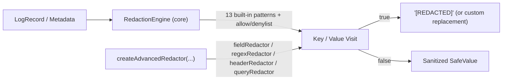

# `@aldok10/nestjs-observe-logger-redaction`

Optional field, regex, HTTP header, and URL query parameter redaction matchers for `@aldok10/nestjs-observe-logger`.

## Overview

`@aldok10/nestjs-observe-logger-redaction` provides composable `RedactionMatcher` factories that plug into `RedactionOptions.matchers` on `@aldok10/nestjs-observe-logger-core`'s `RedactionEngine`, `sanitize()`, `LogPipeline`, or `ChannelConfiguration`. Core's 13 built-in redaction patterns remain active regardless of which matchers you add.

## Why This Package?

- **Targeted matching beyond core defaults**: Mask custom domain fields (`sessionId`), regex patterns on keys or string values, HTTP headers via allow/deny lists, and sensitive query parameters in URLs.
- **Safe `RegExp` handling**: `regexRedactor()` strips stateful `g` and `y` flags so repeated `.test()` calls never suffer from `lastIndex` drift.
- **Single-call composition**: `createAdvancedRedactor()` bundles field, regex, header, and query matchers into a `readonly RedactionMatcher[]` array.

## Features

- **`fieldRedactor(options)`**: Case-insensitive substring matching on leaf key names with `deny` (default) or `allow` mode.
- **`regexRedactor(patterns)`**: Matches keys or string values against `RegExp[]` with `g`/`y` flags stripped.
- **`headerRedactor(options)`**: Case-insensitive exact key matching with `allow` (mask everything else) and `deny` (always mask) sets.
- **`queryRedactor(options)`**: Masks keys matching `params` and string values containing `param=...` query tokens (or non-allowlisted query params when `allow` is provided).
- **`createAdvancedRedactor(options)`**: Composes any combination of the four matchers into `readonly RedactionMatcher[]`.

## Architecture and Responsibilities



## Installation

```sh
pnpm add @aldok10/nestjs-observe-logger-redaction
```

```sh
npm install @aldok10/nestjs-observe-logger-redaction
```

```sh
yarn add @aldok10/nestjs-observe-logger-redaction
```

## Requirements

- **Node.js**: `>=22`
- **Module formats**: ESM (`import`), CommonJS (`require`), and TypeScript type declarations
- **Peer dependencies**: None
- **Dependencies**: `@aldok10/nestjs-observe-logger-core`

## Quick Start

```ts
import { LogPipeline, createLogRecord } from '@aldok10/nestjs-observe-logger-core';
import { createAdvancedRedactor } from '@aldok10/nestjs-observe-logger-redaction';

const pipeline = new LogPipeline({
  transports: [{ name: 'stdout', write: (r) => console.log(JSON.stringify(r)) }],
  redaction: {
    matchers: createAdvancedRedactor({
      fields: { fields: ['sessionid'] },
      headers: { deny: ['x-internal-token'] },
      query: { params: ['token', 'password'] },
    }),
  },
});

await pipeline.emit(
  createLogRecord({
    level: 'info',
    message: 'Auth callback',
    context: {
      metadata: {
        sessionId: 'secret-session',
        url: 'https://example.com/cb?token=abc&page=1',
      },
    },
  }),
);
```

## Configuration

### `FieldRedactionOptions`

| Property | Type                | Required | Default  | Description                                                             |
| -------- | ------------------- | -------- | -------- | ----------------------------------------------------------------------- |
| `fields` | `readonly string[]` | Yes      | —        | Leaf key names to match (case-insensitive substring)                    |
| `mode`   | `'deny' \| 'allow'` | No       | `'deny'` | `'deny'` masks listed keys; `'allow'` masks all keys except listed ones |

### `HeaderRedactionOptions`

| Property | Type                | Required | Default | Description                                                               |
| -------- | ------------------- | -------- | ------- | ------------------------------------------------------------------------- |
| `allow`  | `readonly string[]` | No       | `[]`    | Header names allowed when non-empty (all other non-empty keys are masked) |
| `deny`   | `readonly string[]` | No       | `[]`    | Header names that are always masked                                       |

### `QueryRedactionOptions`

| Property | Type                | Required | Default | Description                                  |
| -------- | ------------------- | -------- | ------- | -------------------------------------------- |
| `params` | `readonly string[]` | Yes      | —       | Query parameter names to mask                |
| `allow`  | `readonly string[]` | No       | `[]`    | Query parameter names allowed when non-empty |

### `AdvancedRedactionOptions`

| Property  | Type                     | Required | Default     | Description              |
| --------- | ------------------------ | -------- | ----------- | ------------------------ |
| `fields`  | `FieldRedactionOptions`  | No       | `undefined` | Enables `fieldRedactor`  |
| `regex`   | `readonly RegExp[]`      | No       | `undefined` | Enables `regexRedactor`  |
| `headers` | `HeaderRedactionOptions` | No       | `undefined` | Enables `headerRedactor` |
| `query`   | `QueryRedactionOptions`  | No       | `undefined` | Enables `queryRedactor`  |

## Usage

### Using Individual Matchers with `sanitize()`

```ts
import { sanitize } from '@aldok10/nestjs-observe-logger-core/redaction';
import {
  fieldRedactor,
  headerRedactor,
  queryRedactor,
  regexRedactor,
} from '@aldok10/nestjs-observe-logger-redaction';

const safe = sanitize(
  {
    user: { sessionId: 'abc', name: 'Aldo' },
    headers: { authorization: 'Bearer xyz', 'content-type': 'application/json' },
    redirect: 'https://example.com?token=123',
  },
  {
    matchers: [
      fieldRedactor({ fields: ['sessionid'] }),
      headerRedactor({ allow: ['content-type', 'user'] }),
      queryRedactor({ params: ['token'] }),
      regexRedactor([/Bearer\s+\S+/i]),
    ],
  },
);
```

## Advanced Usage

- **Matcher Scope**: `RedactionMatcher`s run on every visited key/value pair in `RedactionEngine`, so `headerRedactor({ allow: [...] })` with an allowlist will also mask non-header keys unless used on a dedicated header-sanitizing pass.
- **Combining with Core Defaults**: Custom matchers run alongside core's `DEFAULT_PATTERNS` (`password`, `authorization`, `accesstoken`, `apikey`, `secret`, etc.).

## API Reference

- `fieldRedactor(options: FieldRedactionOptions): RedactionMatcher`
- `regexRedactor(patterns: readonly RegExp[]): RedactionMatcher`
- `headerRedactor(options?: HeaderRedactionOptions): RedactionMatcher`
- `queryRedactor(options: QueryRedactionOptions): RedactionMatcher`
- `createAdvancedRedactor(options: AdvancedRedactionOptions): readonly RedactionMatcher[]`
- Types: `FieldRedactionOptions`, `HeaderRedactionOptions`, `QueryRedactionOptions`, `AdvancedRedactionOptions`

## Integration with Other Packages

- [`@aldok10/nestjs-observe-logger-core`](../core/README.md): Consumes `RedactionMatcher[]` in `RedactionOptions.matchers`.
- [`@aldok10/nestjs-observe-logger`](../logger/README.md): Pass `matchers` inside `ObserveLoggerOptions.redaction`.

## Dependencies and Optional Integrations

- **Direct dependency**: `@aldok10/nestjs-observe-logger-core`

## Lifecycle and Resource Management

- Stateless matcher factories; no timers, background handles, or cleanup needed.

## Error Handling

- When used inside `RedactionEngine`, any exception thrown by a matcher fails closed (the value is masked rather than leaked).

## Performance Considerations

- `regexRedactor()` normalizes `RegExp` flags once at construction time; `headerRedactor()` and `queryRedactor()` precompute lowercase `Set`s.

## Security Considerations

- Stripping `g` and `y` flags in `regexRedactor()` prevents alternating false negatives caused by `RegExp.lastIndex` state across consecutive log records.

## Testing

```sh
pnpm test
pnpm exec vitest run packages/logs/redaction
```

## Troubleshooting

- **`headerRedactor({ allow: [...] })` masks unexpected keys**: `RedactionMatcher` receives every key in the object tree; use `deny` for global `RedactionOptions.matchers` or apply `allow` when sanitizing headers specifically.

## Limitations

- `queryRedactor()` masks the entire string value containing a sensitive `param=...` token rather than rewriting only the query value substring.

## Related Packages

- [`@aldok10/nestjs-observe-logger-core`](../core/README.md)
- [`@aldok10/nestjs-observe-logger-filtering`](../filtering/README.md)

## Documentation

- [Logs Ecosystem Overview](../../../docs/packages/logger/README.md)

## Contributing

See [CONTRIBUTING.md](../../../CONTRIBUTING.md) and [CODE_STANDARDS.md](../../../CODE_STANDARDS.md).

## License

[MIT](../../../LICENSE)
