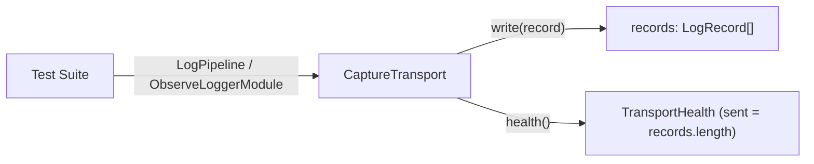

# `@aldok10/nestjs-observe-logger-testing`

In-memory test transport (`CaptureTransport`) and test helpers for `@aldok10/nestjs-observe-logger`.

## Overview

`@aldok10/nestjs-observe-logger-testing` provides `CaptureTransport`, an in-memory `LogTransport` implementation that stores every written `LogRecord` in an array for deterministic assertions in unit and integration tests.

## Why This Package?

- **Zero I/O in tests**: Assert on structured `LogRecord` fields without writing to stdout, files, or network endpoints.
- **Full `LogTransport` contract**: Implements `write()`, `flush()`, `health()`, and `close()` so it works with `LogPipeline`, `LoggerManager`, `LifecycleManager`, and `ObserveLoggerModule`.

## Features

- **`CaptureTransport`**: Stores emitted `LogRecord`s in `readonly records: LogRecord[]` and reports `TransportHealth` with `sent: this.records.length`.

## Architecture and Responsibilities



## Installation

```sh
pnpm add -D @aldok10/nestjs-observe-logger-testing
```

```sh
npm install -D @aldok10/nestjs-observe-logger-testing
```

```sh
yarn add -D @aldok10/nestjs-observe-logger-testing
```

## Requirements

- **Node.js**: `>=22`
- **Module formats**: ESM (`import`), CommonJS (`require`), and TypeScript type declarations
- **Peer dependencies**: None
- **Dependencies**: `@aldok10/nestjs-observe-logger-core`

## Quick Start

```ts
import { LogPipeline, createLogRecord } from '@aldok10/nestjs-observe-logger-core';
import { CaptureTransport } from '@aldok10/nestjs-observe-logger-testing';

const capture = new CaptureTransport('test');
const pipeline = new LogPipeline({ transports: [capture] });

await pipeline.emit(createLogRecord({ level: 'info', message: 'hello' }));
console.log(capture.records[0]?.message); // 'hello'
```

## Configuration

### `new CaptureTransport(name?)`

| Parameter | Type     | Required | Default     | Description                                                     |
| --------- | -------- | -------- | ----------- | --------------------------------------------------------------- |
| `name`    | `string` | No       | `'capture'` | Transport name reported by `transport.name` and `health().name` |

## Usage

### Inspecting Health and Flushing

```ts
import { CaptureTransport } from '@aldok10/nestjs-observe-logger-testing';

const transport = new CaptureTransport('audit-capture');
await transport.flush();
const health = transport.health();
// { name: 'audit-capture', status: 'healthy', healthy: true, queued: 0, capacity: 0, dropped: 0, sent: 0, failed: 0 }
await transport.close();
```

## Advanced Usage

- Pass `new CaptureTransport()` into `ObserveLoggerModule.forRoot({ transports: [capture] })` to assert on NestJS application logs in integration tests without console output.

## API Reference

- `CaptureTransport`:
  - `readonly name: string`
  - `readonly records: LogRecord[]`
  - `write(record: LogRecord): void`
  - `flush(): Promise<void>`
  - `health(): TransportHealth`
  - `close(): Promise<void>`

## Integration with Other Packages

- [`@aldok10/nestjs-observe-logger-core`](../core/README.md): Implements `LogTransport` and stores `LogRecord`s.
- [`@aldok10/nestjs-observe-logger`](../logger/README.md): Drop-in `transports` replacement for NestJS tests.

## Dependencies and Optional Integrations

- **Direct dependency**: `@aldok10/nestjs-observe-logger-core`

## Lifecycle and Resource Management

- `flush()` and `close()` are no-op async methods; `records` remains inspectable after `close()` for post-shutdown assertions.

## Error Handling

- Synchronous `write()` pushes directly to `records` without throwing.

## Performance Considerations

- Intended for test suites only; `records` grows unbounded in memory as logs are written.

## Security Considerations

- When used via `LogPipeline`, records are redacted before `CaptureTransport.write()` is called; calling `transport.write(record)` directly stores the passed record as-is.

## Testing

```sh
pnpm test
pnpm exec vitest run packages/logs/testing
```

## Troubleshooting

- **`records` is empty in NestJS tests**: Ensure `CaptureTransport` is passed in `ObserveLoggerModule.forRoot({ transports: [capture] })` and the log level meets the configured `level` threshold.

## Limitations

- Not intended for production use (unbounded in-memory array).

## Related Packages

- [`@aldok10/nestjs-observe-logger-core`](../core/README.md)
- [`@aldok10/nestjs-observe-logger`](../logger/README.md)

## Documentation

- [Logs Ecosystem Overview](../../../docs/packages/logger/README.md)

## Contributing

See [CONTRIBUTING.md](../../../CONTRIBUTING.md) and [CODE_STANDARDS.md](../../../CODE_STANDARDS.md).

## License

[MIT](../../../LICENSE)
