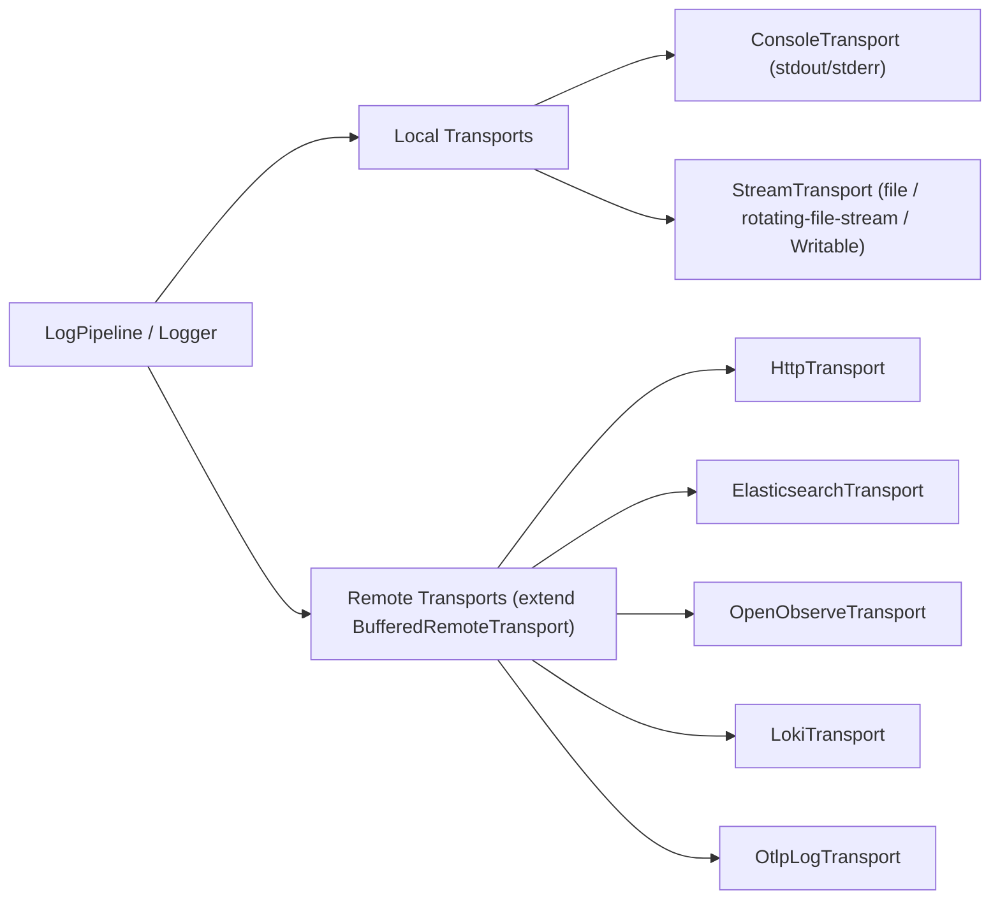

# `@aldok10/nestjs-observe-logger-transports`

Consolidated log transports (**Console**, **File / Rotating Stream**, **HTTP**, **Elasticsearch**, **OpenObserve**, **Loki**, and **OTLP**) for `@aldok10/nestjs-observe-logger` and `@aldok10/nestjs-observe-logger-core`.

## Overview

`@aldok10/nestjs-observe-logger-transports` provides seven tree-shakeable log transports with dedicated subpath entrypoints. Local transports (`ConsoleTransport`, `StreamTransport`) write directly to Node.js streams or files, while remote transports (`HttpTransport`, `ElasticsearchTransport`, `OpenObserveTransport`, `LokiTransport`, `OtlpLogTransport`) extend `BufferedRemoteTransport` from `@aldok10/nestjs-observe-logger-delivery` for bounded queuing, batching, retries, circuit breaking, and dead-letter handling.

## Why This Package?

- **Single package, subpath entrypoints**: Import only the transport(s) you need (`./console`, `./file`, `./http`, `./elasticsearch`, `./openobserve`, `./loki`, `./otlp`) or import from the root entrypoint.
- **Zero mandatory external HTTP clients**: All remote transports use Node.js `fetch` (`globalThis.fetch` by default, or a custom `fetchImpl`).
- **Optional file rotation**: File rotation is supported via the optional peer dependency `rotating-file-stream`, loaded lazily only when `rotation` is configured.

## Features

| Subpath           | Exported Transport       | Default Formatter  | Delivery Model                                                         |
| ----------------- | ------------------------ | ------------------ | ---------------------------------------------------------------------- |
| `.`               | All 7 transports         | Per transport      | Local + Remote                                                         |
| `./console`       | `ConsoleTransport`       | `textFormatter`    | `stdout` / `stderr` (`warn`, `error`, `fatal` -> `stderr`)             |
| `./file`          | `StreamTransport`        | `jsonFormatter`    | File (`fs.createWriteStream` / `rotating-file-stream`) or `Writable`   |
| `./http`          | `HttpTransport`          | `defaultFormatter` | Buffered JSON array (`POST`/`PUT`/`PATCH`)                             |
| `./elasticsearch` | `ElasticsearchTransport` | `defaultFormatter` | Buffered NDJSON to `/_bulk`                                            |
| `./openobserve`   | `OpenObserveTransport`   | `defaultFormatter` | Buffered JSON array to `/api/<org>/<stream>/_json`                     |
| `./loki`          | `LokiTransport`          | `defaultFormatter` | Buffered Loki streams (gzip enabled by default) to `/loki/api/v1/push` |
| `./otlp`          | `OtlpLogTransport`       | `defaultFormatter` | Buffered OTLP/HTTP JSON (`ExportLogsServiceRequest`) to `/v1/logs`     |

## Architecture and Responsibilities



## Installation

```bash
pnpm add @aldok10/nestjs-observe-logger-transports @aldok10/nestjs-observe-logger-core
```

```bash
npm install @aldok10/nestjs-observe-logger-transports @aldok10/nestjs-observe-logger-core
```

```bash
yarn add @aldok10/nestjs-observe-logger-transports @aldok10/nestjs-observe-logger-core
```

If using `StreamTransport` with `rotation` enabled, also install the optional peer dependency:

```bash
pnpm add rotating-file-stream
```

## Requirements

- **Node.js**: `>=22`
- **Optional peer dependency**: `rotating-file-stream` (`^4.0.0`) — required only when `StreamTransport` is constructed with `rotation`
- **Module formats**: ESM (`import`), CJS (`require`), and TypeScript type definitions (`.d.ts`)

## Quick Start

### Console and File Transports

```ts
import { ConsoleTransport } from '@aldok10/nestjs-observe-logger-transports/console';
import { StreamTransport } from '@aldok10/nestjs-observe-logger-transports/file';

const consoleTransport = new ConsoleTransport({ color: true });

const fileTransport = new StreamTransport({
  path: './logs/app-{pid}.log',
  rotation: { size: '10M', interval: '1d', maxFiles: 7, compress: true },
});
```

### OTLP Transport

```ts
import { OtlpLogTransport } from '@aldok10/nestjs-observe-logger-transports/otlp';

const otlp = new OtlpLogTransport({
  endpoint: 'http://localhost:4318',
  serviceName: 'orders',
  environment: 'production',
});
```

## Configuration

### `ConsoleTransportOptions` (`./console`)

| Property    | Type                            | Required | Default          | Description                                                            |
| ----------- | ------------------------------- | -------- | ---------------- | ---------------------------------------------------------------------- |
| `formatter` | `FormatterType \| LogFormatter` | No       | `textFormatter`  | Formatter used to render each `LogRecord`.                             |
| `stdout`    | `Writable`                      | No       | `process.stdout` | Destination stream for `trace`, `debug`, `verbose`, `info`, and `log`. |
| `stderr`    | `Writable`                      | No       | `process.stderr` | Destination stream for `warn`, `error`, and `fatal`.                   |
| `color`     | `boolean`                       | No       | `false`          | Wraps non-ANSI lines in level-based ANSI color codes.                  |
| `onError`   | `(error: unknown) => void`      | No       | `undefined`      | Diagnostic callback for formatting or stream errors.                   |

### `StreamTransportOptions` (`./file`)

`StreamTransportOptions` is a union of file-path options and injected-stream options:

| Property      | Type                            | Required          | Default         | Description                                                                                            |
| ------------- | ------------------------------- | ----------------- | --------------- | ------------------------------------------------------------------------------------------------------ |
| `path`        | `string`                        | Yes (file mode)   | —               | File path; `{pid}` is replaced with `String(process.pid)`. Parent directories are created recursively. |
| `rotation`    | `StreamRotationOptions`         | No (file mode)    | `undefined`     | Enables `rotating-file-stream` (`size`, `interval`, `maxFiles`, `compress`, `dateFormat`).             |
| `mode`        | `number`                        | No (file mode)    | `0o600`         | File permission mode passed to `createWriteStream` or `rotating-file-stream`.                          |
| `stream`      | `Writable`                      | Yes (stream mode) | —               | Pre-existing `Writable` stream to write formatted lines to.                                            |
| `closeStream` | `boolean`                       | No (stream mode)  | `false`         | Whether `close()` should end the injected `stream`.                                                    |
| `formatter`   | `FormatterType \| LogFormatter` | No                | `jsonFormatter` | Formatter used to serialize each `LogRecord`.                                                          |
| `onError`     | `(error: unknown) => void`      | No                | `undefined`     | Diagnostic callback for formatting or stream errors.                                                   |

### `HttpTransportOptions` (`./http`)

Extends [`BufferedRemoteTransportOptions`](../delivery/README.md#configuration) (where `endpoint` is required and `name` defaults to `'http'`):

| Property        | Type                         | Required | Default     | Description                                               |
| --------------- | ---------------------------- | -------- | ----------- | --------------------------------------------------------- |
| `endpoint`      | `string`                     | Yes      | —           | Target HTTP URL.                                          |
| `method`        | `'POST' \| 'PUT' \| 'PATCH'` | No       | `'POST'`    | HTTP method used to send JSON array batches.              |
| `authorization` | `string`                     | No       | `undefined` | Convenience value merged into `headers['Authorization']`. |

### `ElasticsearchTransportOptions` (`./elasticsearch`)

Extends `Omit<BufferedRemoteTransportOptions, 'endpoint'>` (`name` defaults to `'elasticsearch'`):

| Property        | Type     | Required | Default                        | Description                                                                    |
| --------------- | -------- | -------- | ------------------------------ | ------------------------------------------------------------------------------ |
| `endpoint`      | `string` | No       | `'http://localhost:9200'`      | Base Elasticsearch URL; `/_bulk` is appended.                                  |
| `index`         | `string` | No       | `'logs-{level}-{environment}'` | Target index template supporting `{level}` and `{environment}` placeholders.   |
| `apiKey`        | `string` | No       | `undefined`                    | Sets `Authorization: ApiKey <apiKey>` (takes precedence over `authorization`). |
| `authorization` | `string` | No       | `undefined`                    | Sets `Authorization` header when `apiKey` is not provided.                     |

### `OpenObserveTransportOptions` (`./openobserve`)

Extends `Omit<BufferedRemoteTransportOptions, 'endpoint'>` (`name` defaults to `'openobserve'`):

| Property       | Type     | Required | Default                   | Description                                                             |
| -------------- | -------- | -------- | ------------------------- | ----------------------------------------------------------------------- |
| `endpoint`     | `string` | No       | `'http://localhost:5080'` | Base OpenObserve URL; `/api/<organization>/<stream>/_json` is appended. |
| `organization` | `string` | No       | `'default'`               | OpenObserve organization name.                                          |
| `stream`       | `string` | No       | `'logs'`                  | OpenObserve stream name.                                                |
| `username`     | `string` | No       | `undefined`               | Username for Basic auth (used when `token` is not set).                 |
| `password`     | `string` | No       | `undefined`               | Password for Basic auth.                                                |
| `token`        | `string` | No       | `undefined`               | Access token for Basic auth (`tokenName:token`).                        |
| `tokenName`    | `string` | No       | `'default'`               | Username paired with `token` for Basic auth.                            |

### `LokiTransportOptions` (`./loki`)

Extends `Omit<BufferedRemoteTransportOptions, 'endpoint'>` (`name` defaults to `'loki'`):

| Property              | Type                                                              | Required | Default                   | Description                                                               |
| --------------------- | ----------------------------------------------------------------- | -------- | ------------------------- | ------------------------------------------------------------------------- |
| `endpoint`            | `string`                                                          | No       | `'http://localhost:3100'` | Base Loki URL; `/loki/api/v1/push` is appended.                           |
| `tenantId`            | `string`                                                          | No       | `undefined`               | Sets `X-Scope-OrgID` header.                                              |
| `authorization`       | `string`                                                          | No       | `undefined`               | Sets `Authorization` header.                                              |
| `gzip`                | `boolean`                                                         | No       | `true`                    | Gzip-compresses request bodies and sets `Content-Encoding: gzip`.         |
| `extraLabels`         | `Readonly<Record<string, string \| number>> \| readonly string[]` | No       | `undefined`               | Static label map or record field keys to promote into Loki stream labels. |
| `extraLabelAllowlist` | `readonly string[]`                                               | No       | `undefined`               | Optional allowlist restricting which `extraLabels` keys are emitted.      |

### `OtlpLogTransportOptions` (`./otlp`)

Extends `Omit<BufferedRemoteTransportOptions, 'endpoint'>` (`name` defaults to `'otlp'`):

| Property             | Type                                                    | Required | Default                                       | Description                                            |
| -------------------- | ------------------------------------------------------- | -------- | --------------------------------------------- | ------------------------------------------------------ |
| `endpoint`           | `string`                                                | No       | `'http://localhost:4318'`                     | Base OTLP/HTTP collector URL.                          |
| `path`               | `string`                                                | No       | `'/v1/logs'`                                  | Path appended to `endpoint`.                           |
| `serviceName`        | `string`                                                | No       | `undefined`                                   | Sets resource attribute `service.name`.                |
| `serviceVersion`     | `string`                                                | No       | `undefined`                                   | Sets resource attribute `service.version`.             |
| `environment`        | `string`                                                | No       | `undefined`                                   | Sets resource attribute `deployment.environment.name`. |
| `resourceAttributes` | `Readonly<Record<string, string \| number \| boolean>>` | No       | `undefined`                                   | Additional OTLP resource attributes.                   |
| `scopeName`          | `string`                                                | No       | `'@aldok10/nestjs-observe-logger-transports'` | Instrumentation scope name in `scopeLogs`.             |
| `scopeVersion`       | `string`                                                | No       | `undefined`                                   | Instrumentation scope version in `scopeLogs`.          |

## Usage

### Elasticsearch, OpenObserve, and Loki

```ts
import { ElasticsearchTransport } from '@aldok10/nestjs-observe-logger-transports/elasticsearch';
import { LokiTransport } from '@aldok10/nestjs-observe-logger-transports/loki';
import { OpenObserveTransport } from '@aldok10/nestjs-observe-logger-transports/openobserve';

const es = new ElasticsearchTransport({
  endpoint: 'http://localhost:9200',
  index: 'app-{level}-{environment}',
  apiKey: process.env['ES_API_KEY'],
});

const oo = new OpenObserveTransport({
  endpoint: 'http://localhost:5080',
  organization: 'default',
  stream: 'api-logs',
  username: 'root@example.com',
  password: process.env['OO_PASSWORD'],
});

const loki = new LokiTransport({
  endpoint: 'http://localhost:3100',
  tenantId: 'tenant-1',
  extraLabels: { team: 'platform' },
});
```

## Advanced Usage

### Loki Labels vs. Structured Metadata

`LokiTransport` automatically promotes stable fields (`application`, `environment`, `service`, `level`, `region`, `instance`) to Loki stream labels, while placing high-cardinality IDs (`requestId`, `traceId`, `spanId`, `correlationId`) into Loki structured metadata and blocking them from `extraLabels`.

### OTLP Severity Mapping

`OtlpLogTransport` maps universal levels to OTLP `severityNumber`: `trace` -> `1`, `debug`/`verbose` -> `5`, `info`/`log` -> `9`, `warn` -> `13`, `error` -> `17`, `fatal` -> `21`, and extracts `traceId`/`spanId` (or `trace_id`/`span_id`) onto each OTLP `logRecord`.

## API Reference

- **Root (`.`)**: Exports all 7 transport classes and their `*Options` interfaces (plus `StreamRotationOptions`).
- **`./console`**: `ConsoleTransport`, `ConsoleTransportOptions`
- **`./file`**: `StreamTransport`, `StreamTransportOptions`, `StreamRotationOptions`
- **`./http`**: `HttpTransport`, `HttpTransportOptions`
- **`./elasticsearch`**: `ElasticsearchTransport`, `ElasticsearchTransportOptions`
- **`./openobserve`**: `OpenObserveTransport`, `OpenObserveTransportOptions`
- **`./loki`**: `LokiTransport`, `LokiTransportOptions`
- **`./otlp`**: `OtlpLogTransport`, `OtlpLogTransportOptions`

## Integration with Other Packages

- Built on `@aldok10/nestjs-observe-logger-core`, `@aldok10/nestjs-observe-logger-delivery`, and `@aldok10/nestjs-observe-logger-formatters`.
- Designed to be passed into `LogPipeline` or `ObserveLoggerModule` from `@aldok10/nestjs-observe-logger`.

## Dependencies and Optional Integrations

- **Runtime dependencies**: `@aldok10/nestjs-observe-logger-core`, `@aldok10/nestjs-observe-logger-delivery`, `@aldok10/nestjs-observe-logger-formatters` (`^0.1.0`)
- **Optional peer dependency**: `rotating-file-stream` (`^4.0.0`)

## Lifecycle and Resource Management

- `ConsoleTransport.close()` flushes pending writes and detaches `stdout`/`stderr` error listeners without ending `process.stdout`/`process.stderr`.
- `StreamTransport.close()` flushes pending writes (5000 ms timeout), ends owned file streams (`closeStream: true` or file-path mode), and detaches its `error` listener.
- All remote transports inherit `BufferedRemoteTransport.flush()` and `close()`.

## Error Handling

- `StreamTransport` with `rotation` throws `OptionalPeerMissingException` if `rotating-file-stream` is not installed.
- `ConsoleTransport` and `StreamTransport` forward formatter and stream errors to `onError` (if provided) without crashing writes.
- Remote transports inherit `BufferedRemoteTransport` retry, circuit-breaker, `onError`, and `onDeadLetter` handling.

## Performance Considerations

- `StreamTransport` serializes writes sequentially through a promise chain and handles stream backpressure (`drain`).
- `LokiTransport` enables `gzip: true` by default (`zlib.gzipSync`) to reduce payload size.
- Remote transports batch records (`batchSize: 100`, `flushIntervalMs: 1000` by default) via `BufferedRemoteTransport`.

## Security Considerations

- `StreamTransport` creates files with mode `0o600` by default.
- Remote transports parse and sanitize JSON lines with `parseRecordFields()` (`RedactionEngine`) before sending payloads.
- `ElasticsearchTransport` normalizes `{level}` and `{environment}` index segments to `[a-z0-9_-]`.

## Testing

```bash
pnpm test
pnpm exec vitest run packages/logs/transports
```

## Troubleshooting

- **`OptionalPeerMissingException` for `rotating-file-stream`**: Install `rotating-file-stream` (`^4.0.0`) when using `StreamTransport` with `rotation`.
- **Multiple processes rotating the same log file**: Include `{pid}` in `StreamTransportOptions.path` (e.g., `./logs/app-{pid}.log`) so each process writes to its own file.

## Limitations

- `StreamRotationOptions.dateFormat` is present on the type for compatibility, but `rotating-file-stream` v4 replaced `dateFormat` with a filename generator, so `dateFormat` is ignored at runtime.
- Remote transports inherit `BufferedRemoteTransport` defaults and constraints (`POST` only except `HttpTransport`, which supports `POST | PUT | PATCH`).

## Related Packages

- [`@aldok10/nestjs-observe-logger-core`](../core/README.md)
- [`@aldok10/nestjs-observe-logger-delivery`](../delivery/README.md)
- [`@aldok10/nestjs-observe-logger-formatters`](../formatters/README.md)
- [`@aldok10/nestjs-observe-logger`](../logger/README.md)

## Documentation

- [Logs Ecosystem Overview](../../../docs/packages/logger/README.md)

## Contributing

See [CONTRIBUTING.md](../../../CONTRIBUTING.md).

## License

MIT — see [LICENSE](../../../LICENSE).
