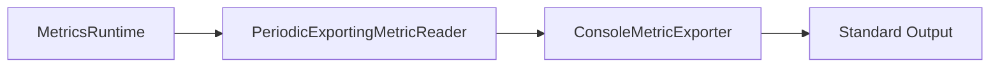

# `@aldok10/nestjs-observe-metrics-exporter-console`

Console metric exporter and `PeriodicExportingMetricReader` factory for `@aldok10/nestjs-observe-metrics`.

## Overview

`@aldok10/nestjs-observe-metrics-exporter-console` wraps `@opentelemetry/sdk-metrics`'s `ConsoleMetricExporter` and `PeriodicExportingMetricReader` for local development and debugging.

## Why This Package?

- **Zero-infrastructure metric inspection**: Print aggregated metrics periodically to stdout without running Prometheus or an OpenTelemetry Collector.

## Features

- `createConsoleMetricExporter()` returning a `ConsoleMetricExporter`.
- `createConsoleMetricReader(options?)` returning a `PeriodicExportingMetricReader` backed by `ConsoleMetricExporter`.

## Architecture and Responsibilities



## Installation

```bash
pnpm add @aldok10/nestjs-observe-metrics-exporter-console @aldok10/nestjs-observe-metrics
```

```bash
npm install @aldok10/nestjs-observe-metrics-exporter-console @aldok10/nestjs-observe-metrics
```

```bash
yarn add @aldok10/nestjs-observe-metrics-exporter-console @aldok10/nestjs-observe-metrics
```

## Requirements

- **Node.js**: `>=22`
- **Peer Dependencies**: None
- **Module Formats**: ESM (`import`), CJS (`require`), and TypeScript declarations (`.d.ts`).

## Quick Start

```ts
import { ObserveMetrics, bootstrapMetrics } from '@aldok10/nestjs-observe-metrics';
import { createConsoleMetricReader } from '@aldok10/nestjs-observe-metrics-exporter-console';

const runtime = bootstrapMetrics({
  resource: { serviceName: 'local-dev' },
  readers: [createConsoleMetricReader({ exportIntervalMillis: 10_000 })],
});

const metrics = new ObserveMetrics(runtime);
metrics.counter('requests.total').add(1);

await runtime.shutdown();
```

## Configuration

### `ConsoleMetricReaderOptions`

| Property               | Type     | Required | Default                | Description                                       |
| ---------------------- | -------- | -------- | ---------------------- | ------------------------------------------------- |
| `exportIntervalMillis` | `number` | No       | OTel default (`60000`) | Interval in milliseconds between console exports. |
| `exportTimeoutMillis`  | `number` | No       | OTel default (`30000`) | Timeout in milliseconds for each export cycle.    |

## Usage

### With NestJS `MetricsModule`

```ts
import { Module } from '@nestjs/common';
import { MetricsModule } from '@aldok10/nestjs-observe-metrics';
import { createConsoleMetricReader } from '@aldok10/nestjs-observe-metrics-exporter-console';

@Module({
  imports: [
    MetricsModule.forRoot({
      resource: { serviceName: 'orders-api' },
      readers: [createConsoleMetricReader({ exportIntervalMillis: 5_000 })],
    }),
  ],
})
export class AppModule {}
```

## Advanced Usage

Use `createConsoleMetricExporter()` directly if you want to pass it to a custom `MetricReader` implementation.

## API Reference

- `createConsoleMetricExporter(): ConsoleMetricExporter`
- `createConsoleMetricReader(options?: ConsoleMetricReaderOptions): PeriodicExportingMetricReader`
- `ConsoleMetricReaderOptions` (interface)

## Integration with Other Packages

Pass the returned `PeriodicExportingMetricReader` to `readers` in [`@aldok10/nestjs-observe-metrics`](../metrics/README.md).

## Dependencies and Optional Integrations

- **Runtime dependencies**: `@opentelemetry/sdk-metrics`.

## Lifecycle and Resource Management

- When attached to `MetricsRuntime`, `MetricsRuntime.shutdown()` flushes and stops the `PeriodicExportingMetricReader` timer.
- If instantiated standalone, call `await reader.shutdown()` and `await exporter.shutdown()` before exiting.

## Error Handling

- Delegates directly to OpenTelemetry's `ConsoleMetricExporter` and `PeriodicExportingMetricReader`.

## Performance Considerations

- Intended for local development and debugging. Use [`@aldok10/nestjs-observe-metrics-exporter-prometheus`](../exporter-prometheus/README.md) or [`@aldok10/nestjs-observe-metrics-exporter-otlp`](../exporter-otlp/README.md) in production.

## Security Considerations

- Console output writes metric names and attributes to stdout; rely on `CardinalityGuard` in `ObserveMetrics` to prevent sensitive keys from being recorded.

## Testing

```bash
pnpm test
```

```bash
pnpm exec vitest run packages/metrics/exporter-console
```

## Troubleshooting

- **No output before short script exits**: Call `await runtime.flush()` or `await runtime.shutdown()` so `PeriodicExportingMetricReader` performs a final export before exit.

## Limitations

- Outputs using OpenTelemetry's default `ConsoleMetricExporter` format with no custom formatting options.

## Related Packages

- [`@aldok10/nestjs-observe-metrics`](../metrics/README.md)
- [`@aldok10/nestjs-observe-metrics-exporter-otlp`](../exporter-otlp/README.md)
- [`@aldok10/nestjs-observe-tracing-exporter-console`](../../traces/exporter-console/README.md)

## Documentation

- [Metrics Domain Guide](../../../docs/packages/metrics/README.md)
- [Architecture Overview](../../../docs/architecture/overview.md)

## Contributing

See [CONTRIBUTING.md](../../../CONTRIBUTING.md).

## License

MIT — see [LICENSE](../../../LICENSE).
