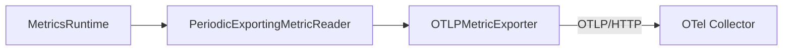

# `@aldok10/nestjs-observe-metrics-exporter-otlp`

OTLP/HTTP metric exporter and `PeriodicExportingMetricReader` factory for `@aldok10/nestjs-observe-metrics`.

## Overview

`@aldok10/nestjs-observe-metrics-exporter-otlp` wraps `@opentelemetry/exporter-metrics-otlp-http` and `@opentelemetry/sdk-metrics` with factory functions for creating an `OTLPMetricExporter` and a `PeriodicExportingMetricReader`.

## Why This Package?

- **One-call periodic reader setup**: `createOtlpMetricReader()` combines `OTLPMetricExporter` creation and `PeriodicExportingMetricReader` scheduling into a single options object.
- **Typed configuration**: Extends `OTLPMetricExporterOptions` with `exportIntervalMillis` and `exportTimeoutMillis`.

## Features

- `createOtlpMetricExporter(options?)` returning an `OTLPMetricExporter`.
- `createOtlpMetricReader(options?)` returning a `PeriodicExportingMetricReader`.

## Architecture and Responsibilities



## Installation

```bash
pnpm add @aldok10/nestjs-observe-metrics-exporter-otlp @aldok10/nestjs-observe-metrics
```

```bash
npm install @aldok10/nestjs-observe-metrics-exporter-otlp @aldok10/nestjs-observe-metrics
```

```bash
yarn add @aldok10/nestjs-observe-metrics-exporter-otlp @aldok10/nestjs-observe-metrics
```

## Requirements

- **Node.js**: `>=22`
- **Peer Dependencies**: None
- **Module Formats**: ESM (`import`), CJS (`require`), and TypeScript declarations (`.d.ts`).

## Quick Start

```ts
import { Module } from '@nestjs/common';
import { MetricsModule } from '@aldok10/nestjs-observe-metrics';
import { createOtlpMetricReader } from '@aldok10/nestjs-observe-metrics-exporter-otlp';

@Module({
  imports: [
    MetricsModule.forRoot({
      resource: { serviceName: 'billing-api' },
      readers: [
        createOtlpMetricReader({
          url: 'http://localhost:4318/v1/metrics',
          exportIntervalMillis: 60_000,
        }),
      ],
    }),
  ],
})
export class AppModule {}
```

## Configuration

### `OtlpMetricReaderOptions` (extends `OTLPMetricExporterOptions`)

| Property                       | Type                        | Required | Default                | Description                                                                        |
| ------------------------------ | --------------------------- | -------- | ---------------------- | ---------------------------------------------------------------------------------- |
| `exportIntervalMillis`         | `number`                    | No       | OTel default (`60000`) | Interval in milliseconds between metric exports.                                   |
| `exportTimeoutMillis`          | `number`                    | No       | OTel default (`30000`) | Timeout in milliseconds for each export cycle.                                     |
| `...OTLPMetricExporterOptions` | `OTLPMetricExporterOptions` | No       | OTel defaults          | Options such as `url`, `headers`, `concurrencyLimit`, and `temporalityPreference`. |

## Usage

```ts
import { bootstrapMetrics } from '@aldok10/nestjs-observe-metrics';
import { createOtlpMetricReader } from '@aldok10/nestjs-observe-metrics-exporter-otlp';

const runtime = bootstrapMetrics({
  resource: { serviceName: 'worker' },
  readers: [
    createOtlpMetricReader({
      url: 'http://collector:4318/v1/metrics',
      headers: { authorization: 'Bearer token' },
      exportIntervalMillis: 15_000,
      exportTimeoutMillis: 5_000,
    }),
  ],
});
```

## Advanced Usage

Instantiate `OTLPMetricExporter` directly with `createOtlpMetricExporter(options)` if you need to wire it into a custom `MetricReader`.

## API Reference

- `createOtlpMetricExporter(options?: OTLPMetricExporterOptions): OTLPMetricExporter`
- `createOtlpMetricReader(options?: OtlpMetricReaderOptions): PeriodicExportingMetricReader`
- `OtlpMetricReaderOptions` (interface)

## Integration with Other Packages

Pass the returned `PeriodicExportingMetricReader` to `readers` in [`@aldok10/nestjs-observe-metrics`](../metrics/README.md).

## Dependencies and Optional Integrations

- **Runtime dependencies**: `@opentelemetry/exporter-metrics-otlp-http`, `@opentelemetry/sdk-metrics`.

## Lifecycle and Resource Management

- When attached to `MetricsRuntime`, `MetricsRuntime.shutdown()` shuts down the `PeriodicExportingMetricReader` and flushes pending metrics.
- If created standalone, call `await reader.shutdown()` and `await exporter.shutdown()` to stop the periodic timer.

## Error Handling

- Export transport errors are handled internally by OpenTelemetry's `PeriodicExportingMetricReader` and `OTLPMetricExporter`.

## Performance Considerations

- Choose `exportIntervalMillis` based on your collector ingestion budget and process lifetime.

## Security Considerations

- Use HTTPS endpoints and pass authentication tokens via `headers` when exporting to remote collectors.

## Testing

```bash
pnpm test
```

```bash
pnpm exec vitest run packages/metrics/exporter-otlp
```

## Troubleshooting

- **Process hangs on exit**: Ensure `MetricsRuntime.shutdown()` (or `reader.shutdown()`) is awaited so the `PeriodicExportingMetricReader` interval timer is cleared.

## Limitations

- Supports OTLP/HTTP only (`@opentelemetry/exporter-metrics-otlp-http`); gRPC is not included.

## Related Packages

- [`@aldok10/nestjs-observe-metrics`](../metrics/README.md)
- [`@aldok10/nestjs-observe-metrics-exporter-prometheus`](../exporter-prometheus/README.md)
- [`@aldok10/nestjs-observe-tracing-exporter-otlp`](../../traces/exporter-otlp/README.md)

## Documentation

- [Metrics Domain Guide](../../../docs/packages/metrics/README.md)
- [Architecture Overview](../../../docs/architecture/overview.md)

## Contributing

See [CONTRIBUTING.md](../../../CONTRIBUTING.md).

## License

MIT — see [LICENSE](../../../LICENSE).
