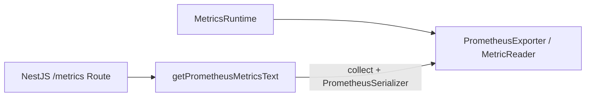

# `@aldok10/nestjs-observe-metrics-exporter-prometheus`

Prometheus `MetricReader` and text exposition scrape helper for `@aldok10/nestjs-observe-metrics`.

## Overview

`@aldok10/nestjs-observe-metrics-exporter-prometheus` wraps `@opentelemetry/exporter-prometheus` (`PrometheusExporter` and `PrometheusSerializer`) to provide a pull-based `MetricReader` and a helper for rendering Prometheus text exposition format on demand.

## Why This Package?

- **Safe NestJS route integration**: `createPrometheusMetricReader()` defaults `preventServerStart` to `true` so you can expose `/metrics` through your existing NestJS HTTP server without opening a second port.
- **One-line text serialization**: `getPrometheusMetricsText()` collects from the `PrometheusExporter` and serializes `resourceMetrics` using `PrometheusSerializer`.

## Features

- `createPrometheusMetricReader(options?)` returning a `PrometheusExporter` (with `preventServerStart` defaulting to `true`).
- `getPrometheusMetricsText(exporter)` returning a `Promise<string>` in Prometheus text exposition format.

## Architecture and Responsibilities



## Installation

```bash
pnpm add @aldok10/nestjs-observe-metrics-exporter-prometheus @aldok10/nestjs-observe-metrics
```

```bash
npm install @aldok10/nestjs-observe-metrics-exporter-prometheus @aldok10/nestjs-observe-metrics
```

```bash
yarn add @aldok10/nestjs-observe-metrics-exporter-prometheus @aldok10/nestjs-observe-metrics
```

## Requirements

- **Node.js**: `>=22`
- **Peer Dependencies**: None
- **Module Formats**: ESM (`import`), CJS (`require`), and TypeScript declarations (`.d.ts`).

## Quick Start

```ts
import { MetricsRuntime, ObserveMetrics } from '@aldok10/nestjs-observe-metrics';
import {
  createPrometheusMetricReader,
  getPrometheusMetricsText,
} from '@aldok10/nestjs-observe-metrics-exporter-prometheus';

const reader = createPrometheusMetricReader();
const runtime = new MetricsRuntime({ readers: [reader] });
runtime.initialize();

const metrics = new ObserveMetrics(runtime);
metrics.counter('http_requests_total').add(1, { method: 'GET' });

const body = await getPrometheusMetricsText(reader);
```

## Configuration

### `PrometheusMetricReaderOptions` (extends `@opentelemetry/exporter-prometheus` `ExporterConfig`)

| Property             | Type             | Required | Default       | Description                                                                                                           |
| -------------------- | ---------------- | -------- | ------------- | --------------------------------------------------------------------------------------------------------------------- |
| `preventServerStart` | `boolean`        | No       | `true`        | Prevents `PrometheusExporter` from starting its own standalone HTTP server.                                           |
| `...ExporterConfig`  | `ExporterConfig` | No       | OTel defaults | Additional options from `@opentelemetry/exporter-prometheus` (e.g., `port`, `endpoint`, `prefix`, `appendTimestamp`). |

## Usage

### Exposing `/metrics` in a NestJS Controller

```ts
import { Controller, Get, Header } from '@nestjs/common';
import type { PrometheusExporter } from '@opentelemetry/exporter-prometheus';
import { getPrometheusMetricsText } from '@aldok10/nestjs-observe-metrics-exporter-prometheus';

@Controller()
export class MetricsController {
  constructor(private readonly prometheusReader: PrometheusExporter) {}

  @Get('metrics')
  @Header('Content-Type', 'text/plain; version=0.0.4; charset=utf-8')
  async scrape(): Promise<string> {
    return getPrometheusMetricsText(this.prometheusReader);
  }
}
```

## Advanced Usage

To let `PrometheusExporter` manage its own standalone HTTP scrape server instead of using a NestJS controller, pass `{ preventServerStart: false }` to `createPrometheusMetricReader()`.

## API Reference

- `createPrometheusMetricReader(options?: PrometheusMetricReaderOptions): PrometheusExporter`
- `getPrometheusMetricsText(exporter: PrometheusExporter): Promise<string>`
- `PrometheusMetricReaderOptions` (interface extending `ExporterConfig`)

## Integration with Other Packages

Pass the `PrometheusExporter` returned by `createPrometheusMetricReader()` into `readers` on [`@aldok10/nestjs-observe-metrics`](../metrics/README.md).

## Dependencies and Optional Integrations

- **Runtime dependencies**: `@opentelemetry/exporter-prometheus`.

## Lifecycle and Resource Management

- When registered in `MetricsRuntime`'s `readers`, `MetricsRuntime.shutdown()` shuts down the `PrometheusExporter` (and stops its HTTP server if `preventServerStart: false` was used).

## Error Handling

- Errors from `exporter.collect()` or `PrometheusSerializer.serialize()` propagate from `getPrometheusMetricsText()`.

## Performance Considerations

- Metrics are collected on scrape (`getPrometheusMetricsText`) rather than on a background push timer, keeping idle overhead low.

## Security Considerations

- Protect `/metrics` endpoints from unauthenticated public access if metric labels or names expose internal operational details.

## Testing

```bash
pnpm test
```

```bash
pnpm exec vitest run packages/metrics/exporter-prometheus
```

## Troubleshooting

- **Port conflict on startup**: Ensure `preventServerStart` is `true` (the default) when serving metrics via NestJS, or configure a distinct `port` when `preventServerStart: false`.

## Limitations

- Uses `@opentelemetry/exporter-prometheus` pull-based exposition; remote-write push is not included (use [`@aldok10/nestjs-observe-metrics-exporter-otlp`](../exporter-otlp/README.md) for push-based export).

## Related Packages

- [`@aldok10/nestjs-observe-metrics`](../metrics/README.md)
- [`@aldok10/nestjs-observe-metrics-exporter-otlp`](../exporter-otlp/README.md)
- [`@aldok10/nestjs-observe-metrics-exporter-console`](../exporter-console/README.md)

## Documentation

- [Metrics Domain Guide](../../../docs/packages/metrics/README.md)
- [Architecture Overview](../../../docs/architecture/overview.md)

## Contributing

See [CONTRIBUTING.md](../../../CONTRIBUTING.md).

## License

MIT — see [LICENSE](../../../LICENSE).
