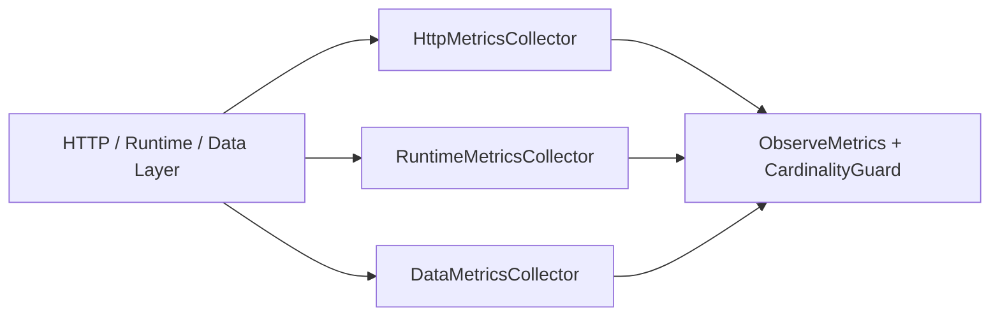

# `@aldok10/nestjs-observe-metrics-instrumentation`

Built-in HTTP RED, Node.js runtime, and data-layer metrics collectors for `@aldok10/nestjs-observe-metrics`.

## Overview

`@aldok10/nestjs-observe-metrics-instrumentation` provides three collector classes built on `ObserveMetrics`: `HttpMetricsCollector` (HTTP Rate/Errors/Duration + active requests), `RuntimeMetricsCollector` (Node.js memory, CPU, event-loop utilization, and p99 event-loop delay), and `DataMetricsCollector` (database, Redis, queue, and worker metrics).

## Why This Package?

- **Standardized metric names & attributes**: Consistent OpenTelemetry-style instrument names, units, and attributes across HTTP, runtime, and data layers.
- **Cardinality-safe by default**: All instruments are created via `ObserveMetrics`, automatically applying `CardinalityGuard`.

## Features

- `HttpMetricsCollector`: Tracks `http.server.request.count`, `http.server.request.duration` (`ms`), `http.server.error.count` (for `statusCode >= 500`), and `http.server.active_requests`.
- `RuntimeMetricsCollector`: Tracks `process.runtime.nodejs.memory.rss`, `process.runtime.nodejs.memory.heap_used`, `process.runtime.nodejs.cpu.usage_us`, `process.runtime.nodejs.eventloop.utilization`, and `process.runtime.nodejs.eventloop.delay_p99_ms`.
- `DataMetricsCollector`: Tracks `db.client.operation.duration`, `redis.client.operation.duration`, `queue.depth`, `queue.processing.duration`, and `worker.job.count`.

## Architecture and Responsibilities



## Installation

```bash
pnpm add @aldok10/nestjs-observe-metrics-instrumentation @aldok10/nestjs-observe-metrics
```

```bash
npm install @aldok10/nestjs-observe-metrics-instrumentation @aldok10/nestjs-observe-metrics
```

```bash
yarn add @aldok10/nestjs-observe-metrics-instrumentation @aldok10/nestjs-observe-metrics
```

## Requirements

- **Node.js**: `>=22`
- **Peer Dependencies**:
  - `@nestjs/common`: `^10.0.0 || ^11.0.0 || ^12.0.0` (optional)
- **Module Formats**: ESM (`import`), CJS (`require`), and TypeScript declarations (`.d.ts`).

## Quick Start

```ts
import { ObserveMetrics, bootstrapMetrics } from '@aldok10/nestjs-observe-metrics';
import {
  DataMetricsCollector,
  HttpMetricsCollector,
  RuntimeMetricsCollector,
} from '@aldok10/nestjs-observe-metrics-instrumentation';

const runtime = bootstrapMetrics({ resource: { serviceName: 'orders-api' } });
const metrics = new ObserveMetrics(runtime);

const httpMetrics = new HttpMetricsCollector(metrics);
httpMetrics.startRequest('GET', '/orders/:id');
httpMetrics.finishRequest({ method: 'GET', route: '/orders/:id', statusCode: 200, durationMs: 12 });

const runtimeMetrics = new RuntimeMetricsCollector(metrics);
runtimeMetrics.start();
```

## Configuration

None of the collectors take a separate options object; they accept an `ObserveMetrics` instance in their constructor.

### `HttpRequestMetricInput`

| Property     | Type     | Required | Default | Description                                              |
| ------------ | -------- | -------- | ------- | -------------------------------------------------------- |
| `method`     | `string` | Yes      | —       | HTTP request method (`http.request.method`).             |
| `route`      | `string` | Yes      | —       | Parameterized route pattern (`http.route`).              |
| `statusCode` | `number` | Yes      | —       | HTTP response status code (`http.response.status_code`). |
| `durationMs` | `number` | Yes      | —       | Request duration in milliseconds.                        |

## Usage

### `DataMetricsCollector`

```ts
const dataMetrics = new DataMetricsCollector(metrics);
dataMetrics.recordDbOperation('postgresql', 'SELECT', 4.2, true);
dataMetrics.recordRedisOperation('GET', 0.8, true);
dataMetrics.adjustQueueDepth('emails', 1);
dataMetrics.recordQueueProcessing('emails', 15, true);
dataMetrics.recordWorkerJob('invoice-pdf', true);
```

## Advanced Usage

### Stopping `RuntimeMetricsCollector`

`RuntimeMetricsCollector.start()` is idempotent and enables `monitorEventLoopDelay({ resolution: 20 })`. Call `runtimeMetrics.stop()` during application shutdown to disable the event-loop delay monitor.

## API Reference

- **`HttpMetricsCollector`**:
  - `startRequest(method: string, route: string): void`
  - `finishRequest(input: HttpRequestMetricInput): void`
- **`RuntimeMetricsCollector`**:
  - `start(): void`
  - `stop(): void`
- **`DataMetricsCollector`**:
  - `recordDbOperation(system: string, operation: string, durationMs: number, ok?: boolean): void`
  - `recordRedisOperation(command: string, durationMs: number, ok?: boolean): void`
  - `adjustQueueDepth(queueName: string, delta: number): void`
  - `recordQueueProcessing(queueName: string, durationMs: number, ok?: boolean): void`
  - `recordWorkerJob(jobName: string, ok?: boolean): void`
- **Types**: `HttpRequestMetricInput`

## Integration with Other Packages

- Requires [`@aldok10/nestjs-observe-metrics`](../metrics/README.md) (`ObserveMetrics`).
- Pair `DataMetricsCollector` with [`@aldok10/nestjs-observe-tracing-instrumentation-data`](../../traces/instrumentation-data/README.md) for matching trace spans.

## Dependencies and Optional Integrations

- **Runtime dependencies**: `@aldok10/nestjs-observe-core`, `@aldok10/nestjs-observe-metrics`, `@opentelemetry/api`, `@opentelemetry/semantic-conventions`.
- **Optional peer dependency**: `@nestjs/common`.

## Lifecycle and Resource Management

- `RuntimeMetricsCollector.start()` enables Node's `monitorEventLoopDelay({ resolution: 20 })` and registers observable gauge callbacks. Always call `stop()` on teardown (especially in tests).

## Error Handling

- `HttpMetricsCollector.finishRequest()` increments `http.server.error.count` when `statusCode >= 500`.
- `DataMetricsCollector` methods accept an `ok = true` boolean and record `status: ok ? 'ok' : 'error'`.

## Performance Considerations

- Always pass parameterized route templates (e.g., `'/orders/:id'`) rather than raw request URLs to `HttpMetricsCollector` to keep label cardinality bounded.

## Security Considerations

- Do not pass raw user IDs, tokens, or unparameterized paths in `route`, `operation`, or `queueName`.

## Testing

```bash
pnpm test
```

```bash
pnpm exec vitest run packages/metrics/instrumentation
```

## Troubleshooting

- **Event-loop delay gauge stays `0` or stops updating**: Ensure `RuntimeMetricsCollector.start()` was called and `stop()` has not been called yet.

## Limitations

- `HttpMetricsCollector` and `DataMetricsCollector` are explicit recording helpers rather than automatic framework middleware/monkey-patches.

## Related Packages

- [`@aldok10/nestjs-observe-metrics`](../metrics/README.md)
- [`@aldok10/nestjs-observe-tracing-instrumentation-data`](../../traces/instrumentation-data/README.md)

## Documentation

- [Metrics Domain Guide](../../../docs/packages/metrics/README.md)
- [Architecture Overview](../../../docs/architecture/overview.md)

## Contributing

See [CONTRIBUTING.md](../../../CONTRIBUTING.md).

## License

MIT — see [LICENSE](../../../LICENSE).
