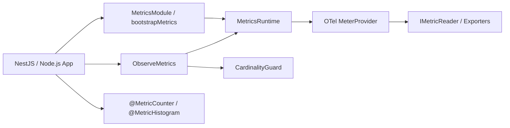

# `@aldok10/nestjs-observe-metrics`

Standalone OpenTelemetry metrics runtime, cardinality guard, cached instrument service, decorators, and NestJS dynamic module.

## Overview

`@aldok10/nestjs-observe-metrics` provides a metrics layer built on `@opentelemetry/sdk-metrics` and `@opentelemetry/api`. It supports standalone bootstrap via `bootstrapMetrics()` as well as NestJS dependency injection via `MetricsModule.forRoot()` and `MetricsModule.forRootAsync()`, with built-in attribute cardinality protection via `CardinalityGuard`.

## Why This Package?

- **Built-in cardinality protection**: `ObserveMetrics` automatically sanitizes attributes through `CardinalityGuard`, stripping high-cardinality keys (such as `userId`, `requestId`, `traceId`, `email`, `ip`) and bounding distinct values per key.
- **Cached instrument handles**: `ObserveMetrics` caches `Counter`, `UpDownCounter`, `Histogram`, `Gauge`, and observable instruments by name to avoid repeated instrument allocation.
- **Standalone or NestJS-native**: Run `MetricsRuntime` in workers/CLIs or integrate with NestJS lifecycle hooks via `MetricsModule`.

## Features

- `MetricsRuntime` and `bootstrapMetrics()` for configuring `MeterProvider`, `readers`, `views`, and global meter registration.
- `MetricsModule` (`forRoot` and `forRootAsync` with `useFactory`, `useClass`, or `useExisting`) and `MetricsLifecycleService`.
- `ObserveMetrics` injectable service with `counter`, `upDownCounter`, `histogram`, `gauge`, `observableCounter`, `observableGauge`, `observableUpDownCounter`, and `sanitizeAttributes`.
- `CardinalityGuard` with configurable forbidden keys, per-key distinct value limits, and overflow bucketing.
- `@MetricCounter()` and `@MetricHistogram()` method decorators for synchronous and async methods.

## Architecture and Responsibilities



- **`MetricsRuntime`**: Owns `MeterProvider`, global registration, bounded `flush()`, `shutdown()`, and `health()`.
- **`MetricsModule` & `MetricsLifecycleService`**: Provides `METRICS_OPTIONS`, `METRICS_RUNTIME`, and `ObserveMetrics`, and invokes `runtime.shutdown()` once on teardown.
- **`ObserveMetrics` & `CardinalityGuard`**: Caches OpenTelemetry instruments and sanitizes attributes before recording.
- **`@MetricCounter()` & `@MetricHistogram()`**: Method decorators that record call counts and execution duration (`ms`) with `{ status: 'ok' | 'error' }`.

## Installation

```bash
pnpm add @aldok10/nestjs-observe-metrics @nestjs/common @nestjs/core reflect-metadata
```

```bash
npm install @aldok10/nestjs-observe-metrics @nestjs/common @nestjs/core reflect-metadata
```

```bash
yarn add @aldok10/nestjs-observe-metrics @nestjs/common @nestjs/core reflect-metadata
```

## Requirements

- **Node.js**: `>=22`
- **Peer Dependencies**:
  - `@nestjs/common`: `^10.0.0 || ^11.0.0 || ^12.0.0`
  - `@nestjs/core`: `^10.0.0 || ^11.0.0 || ^12.0.0`
  - `reflect-metadata`: `^0.1.12 || ^0.2.0`
- **Module Formats**: ESM (`import`), CJS (`require`), and TypeScript declarations (`.d.ts`).

## Quick Start

```ts
import { Module } from '@nestjs/common';
import { MetricsModule } from '@aldok10/nestjs-observe-metrics';
import { createConsoleMetricReader } from '@aldok10/nestjs-observe-metrics-exporter-console';

@Module({
  imports: [
    MetricsModule.forRoot({
      resource: { serviceName: 'billing-api', environment: 'development' },
      readers: [createConsoleMetricReader({ exportIntervalMillis: 10_000 })],
    }),
  ],
})
export class AppModule {}
```

## Configuration

### `MetricsOptions`

| Property            | Type                       | Required | Default               | Description                                                                           |
| ------------------- | -------------------------- | -------- | --------------------- | ------------------------------------------------------------------------------------- |
| `resource`          | `ResourceMetadata`         | No       | `undefined`           | Service resource metadata converted via `toSemanticResourceAttributes`.               |
| `readers`           | `readonly IMetricReader[]` | No       | `[]`                  | OpenTelemetry metric readers (Prometheus, OTLP, Console, etc.).                       |
| `views`             | `readonly ViewOptions[]`   | No       | `undefined`           | OpenTelemetry `MeterProvider` views.                                                  |
| `cardinality`       | `CardinalityGuardOptions`  | No       | `undefined`           | Cardinality protection settings passed to `ObserveMetrics`.                           |
| `registerGlobal`    | `boolean`                  | No       | `true`                | Registers `MeterProvider` with `@opentelemetry/api`'s global `metrics`.               |
| `shutdownTimeoutMs` | `number`                   | No       | `undefined`           | Default timeout (ms) applied to `flush()` and `shutdown()` via `BoundedExecution`.    |
| `diagnostics`       | `DiagnosticsSink`          | No       | `NoopDiagnosticsSink` | Sink for internal lifecycle/warn/error diagnostic events.                             |
| `global`            | `boolean`                  | No       | `true`                | Whether `MetricsModule.forRoot` / `forRootAsync` registers as a NestJS global module. |

### `CardinalityGuardOptions`

| Property                  | Type                | Required | Default                                                                                                                                                                                                             | Description                                                                       |
| ------------------------- | ------------------- | -------- | ------------------------------------------------------------------------------------------------------------------------------------------------------------------------------------------------------------------- | --------------------------------------------------------------------------------- |
| `forbiddenKeys`           | `readonly string[]` | No       | 16 built-in keys (`userId`, `user_id`, `requestId`, `request_id`, `correlationId`, `correlation_id`, `traceId`, `trace_id`, `spanId`, `span_id`, `sessionId`, `session_id`, `email`, `ip`, `clientIp`, `client_ip`) | Attribute keys stripped before recording.                                         |
| `maxDistinctValuesPerKey` | `number`            | No       | `100`                                                                                                                                                                                                               | Maximum distinct serialized values tracked per attribute key (clamped to `>= 1`). |
| `overflowValue`           | `string`            | No       | `'__overflow__'`                                                                                                                                                                                                    | Replacement value used once `maxDistinctValuesPerKey` is exceeded for a key.      |

### `MetricDecoratorOptions`

| Property      | Type     | Required | Default                                                                        | Description                                     |
| ------------- | -------- | -------- | ------------------------------------------------------------------------------ | ----------------------------------------------- |
| `name`        | `string` | No       | `'<ClassName>.<methodName>.calls'` or `'<ClassName>.<methodName>.duration_ms'` | Custom instrument name.                         |
| `description` | `string` | No       | `undefined`                                                                    | Instrument description passed to OpenTelemetry. |
| `unit`        | `string` | No       | `undefined` (`'ms'` for `@MetricHistogram`)                                    | Measurement unit.                               |

## Usage

### Injecting `ObserveMetrics`

```ts
import { Injectable } from '@nestjs/common';
import { ObserveMetrics } from '@aldok10/nestjs-observe-metrics';

@Injectable()
export class OrdersService {
  constructor(private readonly metrics: ObserveMetrics) {}

  recordOrder(region: string, amount: number): void {
    this.metrics.counter('orders.created').add(1, { region });
    this.metrics.histogram('orders.amount').record(amount, { region });
  }
}
```

### Using `@MetricCounter()` and `@MetricHistogram()`

```ts
import { Injectable } from '@nestjs/common';
import { MetricCounter, MetricHistogram } from '@aldok10/nestjs-observe-metrics';

@Injectable()
export class CheckoutService {
  @MetricCounter('checkout.calls')
  @MetricHistogram('checkout.duration')
  async process(): Promise<string> {
    return 'ok';
  }
}
```

### Standalone Bootstrap

```ts
import { ObserveMetrics, bootstrapMetrics } from '@aldok10/nestjs-observe-metrics';

const runtime = bootstrapMetrics({ resource: { serviceName: 'worker' } });
const metrics = new ObserveMetrics(runtime);
metrics.counter('jobs.completed').add(1);

await runtime.shutdown();
```

## Advanced Usage

### Async NestJS Configuration (`forRootAsync`)

```ts
import { Module } from '@nestjs/common';
import { MetricsModule } from '@aldok10/nestjs-observe-metrics';
import { createOtlpMetricReader } from '@aldok10/nestjs-observe-metrics-exporter-otlp';

@Module({
  imports: [
    MetricsModule.forRootAsync({
      useFactory: () => ({
        resource: { serviceName: 'billing-api' },
        readers: [createOtlpMetricReader({ url: 'http://localhost:4318/v1/metrics' })],
        cardinality: { maxDistinctValuesPerKey: 50 },
      }),
    }),
  ],
})
export class AppModule {}
```

### Using `CardinalityGuard` Directly

```ts
import { CardinalityGuard } from '@aldok10/nestjs-observe-metrics';

const guard = new CardinalityGuard({ maxDistinctValuesPerKey: 2 });
guard.sanitize({ userId: 'u-1', route: '/orders' }); // { route: '/orders' }
```

## API Reference

- **Classes**: `MetricsRuntime`, `ObserveMetrics`, `CardinalityGuard`, `MetricsModule`, `MetricsLifecycleService`
- **Functions**: `bootstrapMetrics(options?)`, `MetricCounter(nameOrOptions?)`, `MetricHistogram(nameOrOptions?)`
- **DI Tokens**: `METRICS_OPTIONS`, `METRICS_RUNTIME`, `OBSERVE_METRICS` (alias for `ObserveMetrics`)
- **Types**: `MetricsOptions`, `CardinalityGuardOptions`, `MetricDecoratorOptions`, `MetricsAsyncOptions`, `MetricsOptionsFactory`, `CounterHandle`, `HistogramHandle`, `GaugeHandle`

## Integration with Other Packages

- Export metrics with [`@aldok10/nestjs-observe-metrics-exporter-prometheus`](../exporter-prometheus/README.md), [`@aldok10/nestjs-observe-metrics-exporter-otlp`](../exporter-otlp/README.md), or [`@aldok10/nestjs-observe-metrics-exporter-console`](../exporter-console/README.md).
- Add pre-built HTTP RED, Node.js runtime, and data-layer collectors via [`@aldok10/nestjs-observe-metrics-instrumentation`](../instrumentation/README.md).
- For unified logs, metrics, and traces setup, see [`@aldok10/nestjs-observe`](../../observer/observer/README.md).

## Dependencies and Optional Integrations

- **Runtime dependencies**: `@aldok10/nestjs-observe-core`, `@opentelemetry/api`, `@opentelemetry/resources`, `@opentelemetry/sdk-metrics`.

## Lifecycle and Resource Management

- Calling `MetricsRuntime.initialize()` more than once is a safe no-op that emits a `warn` diagnostic event.
- `MetricsRuntime.shutdown(timeoutMs?)` is idempotent, runs `provider.shutdown()` through `BoundedExecution`, and disables global `metrics` when `registerGlobal !== false`.
- `MetricsLifecycleService` calls `runtime.shutdown()` once across `onModuleDestroy` and `onApplicationShutdown`.

## Error Handling

- `MetricsModule.forRootAsync` throws `InvalidConfigurationException` (from `@aldok10/nestjs-observe-core`) if none of `useFactory`, `useClass`, or `useExisting` is provided.
- `@MetricCounter()` and `@MetricHistogram()` record `{ status: 'error' }` on thrown/rejected errors and rethrow the original error.

## Performance Considerations

- `ObserveMetrics` caches instruments in `Map` instances keyed by instrument name.
- `CardinalityGuard` keeps a `Set<string>` of up to `maxDistinctValuesPerKey` entries per attribute key, bounding memory growth from unbounded label values.

## Security Considerations

- `CardinalityGuard`'s default `forbiddenKeys` list strips common PII and identifier keys (`email`, `ip`, `clientIp`, `userId`, `sessionId`, etc.) before attributes reach metric readers.

## Testing

```bash
pnpm test
```

```bash
pnpm exec vitest run packages/metrics/metrics
```

For in-memory metric assertions in your own test suites, see [`@aldok10/nestjs-observe-metrics-testing`](../testing/README.md).

## Troubleshooting

- **`@MetricCounter` or `@MetricHistogram` records nothing**: Both decorators use `metrics.getMeter('@aldok10/nestjs-observe-metrics')` from the global OpenTelemetry `metrics` API. Ensure `registerGlobal` is not `false` and `MetricsRuntime` is initialized.

## Limitations

- `@MetricCounter()` and `@MetricHistogram()` bypass `ObserveMetrics` and `CardinalityGuard`, attaching only `{ status: 'ok' | 'error' }`.

## Related Packages

- [`@aldok10/nestjs-observe-core`](../../core/README.md)
- [`@aldok10/nestjs-observe-metrics-exporter-prometheus`](../exporter-prometheus/README.md)
- [`@aldok10/nestjs-observe-metrics-exporter-otlp`](../exporter-otlp/README.md)
- [`@aldok10/nestjs-observe-metrics-exporter-console`](../exporter-console/README.md)
- [`@aldok10/nestjs-observe-metrics-instrumentation`](../instrumentation/README.md)
- [`@aldok10/nestjs-observe-metrics-testing`](../testing/README.md)
- [`@aldok10/nestjs-observe`](../../observer/observer/README.md)

## Documentation

- [Metrics Domain Guide](../../../docs/packages/metrics/README.md)
- [Architecture Overview](../../../docs/architecture/overview.md)
- [Dependencies](../../../docs/architecture/dependency-graph.md)

## Contributing

See [CONTRIBUTING.md](../../../CONTRIBUTING.md).

## License

MIT — see [LICENSE](../../../LICENSE).
