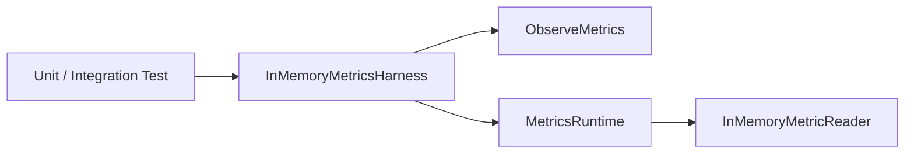

# `@aldok10/nestjs-observe-metrics-testing`

In-memory metrics test harness for `@aldok10/nestjs-observe-metrics`.

## Overview

`@aldok10/nestjs-observe-metrics-testing` provides `InMemoryMetricsHarness`, a test utility that wires `MetricsRuntime` and `ObserveMetrics` to an internal pull-based `MetricReader` so tests can collect and assert on recorded metrics deterministically.

## Why This Package?

- **Zero boilerplate in tests**: Pre-configures an in-memory `MetricReader`, `MetricsRuntime`, and `ObserveMetrics` in one call.
- **Direct metric lookup**: `findMetric(name)` collects metrics and searches across all `scopeMetrics` by descriptor name.

## Features

- `InMemoryMetricsHarness` exposing `reader`, `runtime`, and `metrics`.
- `collect()` returning `Promise<ResourceMetrics>`.
- `findMetric(name)` returning `Promise<MetricData | undefined>`.
- `shutdown()` for clean runtime teardown.

## Architecture and Responsibilities



## Installation

```bash
pnpm add -D @aldok10/nestjs-observe-metrics-testing
```

```bash
npm install -D @aldok10/nestjs-observe-metrics-testing
```

```bash
yarn add -D @aldok10/nestjs-observe-metrics-testing
```

## Requirements

- **Node.js**: `>=22`
- **Peer Dependencies**: None
- **Module Formats**: ESM (`import`), CJS (`require`), and TypeScript declarations (`.d.ts`).

## Quick Start

```ts
import { afterEach, describe, expect, it } from 'vitest';
import { InMemoryMetricsHarness } from '@aldok10/nestjs-observe-metrics-testing';

describe('Jobs', () => {
  let harness: InMemoryMetricsHarness | undefined;

  afterEach(async () => {
    await harness?.shutdown();
    harness = undefined;
  });

  it('records jobs.completed counter', async () => {
    harness = new InMemoryMetricsHarness({ resource: { serviceName: 'jobs-test' } });
    harness.metrics.counter('jobs.completed').add(4, { queue: 'default' });

    const metric = await harness.findMetric('jobs.completed');
    expect(metric?.dataPoints[0]?.value).toBe(4);
  });
});
```

## Configuration

### `InMemoryMetricsHarness` Constructor Options

| Property         | Type               | Required | Default     | Description                                                  |
| ---------------- | ------------------ | -------- | ----------- | ------------------------------------------------------------ |
| `resource`       | `ResourceMetadata` | No       | `undefined` | Optional resource metadata passed to `MetricsRuntime`.       |
| `registerGlobal` | `boolean`          | No       | `true`      | Whether `MetricsRuntime` registers `MeterProvider` globally. |

## Usage

```ts
const harness = new InMemoryMetricsHarness({ registerGlobal: false });
harness.metrics.histogram('request.duration').record(15);

const resourceMetrics = await harness.collect();
expect(resourceMetrics.scopeMetrics.length).toBeGreaterThan(0);

await harness.shutdown();
```

## Advanced Usage

Use `harness.runtime` to test `flush()`, `health()`, or pass `harness.reader` into custom `MetricsRuntime` setups.

## API Reference

- `InMemoryMetricsHarness`:
  - `readonly reader: MetricReader`
  - `readonly runtime: MetricsRuntime`
  - `readonly metrics: ObserveMetrics`
  - `collect(): Promise<ResourceMetrics>`
  - `findMetric(name: string): Promise<MetricData | undefined>`
  - `shutdown(): Promise<void>`

## Integration with Other Packages

- Built on [`@aldok10/nestjs-observe-core`](../../core/README.md) and [`@aldok10/nestjs-observe-metrics`](../metrics/README.md).

## Dependencies and Optional Integrations

- **Runtime dependencies**: `@aldok10/nestjs-observe-core`, `@aldok10/nestjs-observe-metrics`, `@opentelemetry/sdk-metrics`.

## Lifecycle and Resource Management

- `new InMemoryMetricsHarness()` calls `this.runtime.initialize()` immediately.
- Always call `await harness.shutdown()` in `afterEach` to clean up `MeterProvider` and global registration.

## Error Handling

- Propagates any errors from `reader.collect()` or `MetricsRuntime.shutdown()`.

## Performance Considerations

- Pull-based `InMemoryMetricReader` performs no background timers or network I/O; intended for tests only.

## Security Considerations

- Intended for test environments; do not use `InMemoryMetricsHarness` in production code.

## Testing

```bash
pnpm test
```

```bash
pnpm exec vitest run packages/metrics/testing
```

## Troubleshooting

- **`findMetric()` returns `undefined`**: Confirm at least one measurement was recorded before calling `findMetric(name)` and that the instrument name matches exactly.

## Limitations

- Captures metrics in memory only; does not test OTLP or Prometheus wire serialization.

## Related Packages

- [`@aldok10/nestjs-observe-metrics`](../metrics/README.md)
- [`@aldok10/nestjs-observe-tracing-testing`](../../traces/testing/README.md)

## Documentation

- [Metrics Domain Guide](../../../docs/packages/metrics/README.md)

## Contributing

See [CONTRIBUTING.md](../../../CONTRIBUTING.md).

## License

MIT — see [LICENSE](../../../LICENSE).
