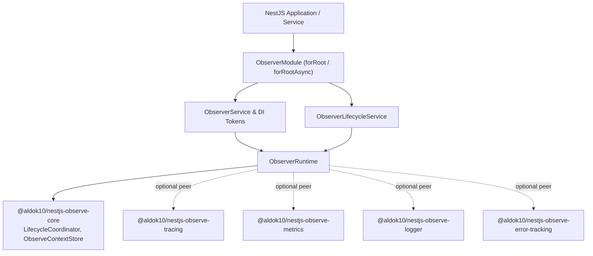

# `@aldok10/nestjs-observe`

Unified NestJS observability integration composing standalone Logger, Tracing, Metrics, and Error Tracking packages through optional peer dependencies.

## Overview

`@aldok10/nestjs-observe` provides `ObserverModule`, `ObserverRuntime`, and `ObserverService` to wire together logging, OpenTelemetry tracing, OpenTelemetry metrics, and error tracking under a single lifecycle and resource configuration.

Each observability domain is an optional peer dependency. Disabled domains are never loaded or initialized, and enabled domains share merged `ResourceMetadata`, `DiagnosticsSink`, `shutdownTimeoutMs`, and trace-context correlation automatically.

## Why This Package?

- **Single NestJS entrypoint**: Configure `resource`, `logger`, `tracing`, `metrics`, and `errorTracking` in one `ObserverModule.forRoot()` or `ObserverModule.forRootAsync()` call.
- **Pay only for what you enable**: Domain packages are loaded dynamically via `OptionalPeerLoader` only when enabled.
- **Automatic cross-signal correlation**: When `tracing` is enabled alongside `logger` or `errorTracking`, active span `traceId` and `spanId` are automatically injected into log records and captured error events.
- **Coordinated lifecycle**: `LifecycleCoordinator` initializes enabled runtimes in order with rollback on failure and shuts them down cleanly on NestJS `OnModuleDestroy` / `OnApplicationShutdown`.

## Features

- **NestJS Dynamic Module**: `ObserverModule.forRoot(options?)` and `ObserverModule.forRootAsync(options)` supporting `useFactory`, `useClass`, and `useExisting` (global by default).
- **DI Tokens & Service**: Exports `ObserverService` plus `OBSERVER_OPTIONS`, `OBSERVER_RUNTIME`, `OBSERVER_CONTEXT`, `OBSERVE_LOGGER`, `OBSERVE_TRACER`, `OBSERVE_METRICS`, and `OBSERVE_ERROR_TRACKER`.
- **Standalone Runtime**: `ObserverRuntime` can be used directly outside NestJS with `initialize()`, `flush()`, `shutdown()`, `health()`, and `isInitialized()`.
- **Unified Health Reporting**: `health()` aggregates component health into `ObserverHealthReport` (`'healthy' | 'degraded' | 'unhealthy' | 'stopped'`).
- **Default Console Transport Fallback**: When `logger` is enabled without `transports`, `ObserverRuntime` automatically loads `ConsoleTransport` from `@aldok10/nestjs-observe-logger/transports`.

## Architecture and Responsibilities



`ObserverRuntime` initializes enabled domains in sequence:

1. Tracing (`TracingRuntime` + `ObserveTracer`)
2. Metrics (`MetricsRuntime` + `ObserveMetrics`)
3. Logger (`LogContextStore` + `LogPipeline` + `UniversalLoggerImpl`, correlated with `ObserveTracer.getTraceContext()` if tracing is enabled)
4. Error Tracking (`ErrorTrackingRuntime` + `ObserveErrorTracker`, enriched with `createTraceContextEnricher` if tracing is enabled)

## Installation

Install `@aldok10/nestjs-observe` with NestJS peers and only the observability domain packages you intend to enable:

```sh
pnpm add @aldok10/nestjs-observe @nestjs/common @nestjs/core reflect-metadata
# Optional domain packages (install the ones you enable):
pnpm add @aldok10/nestjs-observe-logger @aldok10/nestjs-observe-tracing @aldok10/nestjs-observe-metrics @aldok10/nestjs-observe-error-tracking
```

```sh
npm install @aldok10/nestjs-observe @nestjs/common @nestjs/core reflect-metadata
# Optional domain packages (install the ones you enable):
npm install @aldok10/nestjs-observe-logger @aldok10/nestjs-observe-tracing @aldok10/nestjs-observe-metrics @aldok10/nestjs-observe-error-tracking
```

```sh
yarn add @aldok10/nestjs-observe @nestjs/common @nestjs/core reflect-metadata
# Optional domain packages (install the ones you enable):
yarn add @aldok10/nestjs-observe-logger @aldok10/nestjs-observe-tracing @aldok10/nestjs-observe-metrics @aldok10/nestjs-observe-error-tracking
```

## Requirements

- **Node.js**: `>=22` (from `engines.node` in `package.json`)
- **Required Peer Dependencies** (from `package.json`):
  - `@nestjs/common`: `^10.0.0 || ^11.0.0 || ^12.0.0`
  - `@nestjs/core`: `^10.0.0 || ^11.0.0 || ^12.0.0`
  - `reflect-metadata`: `^0.1.12 || ^0.2.0`
- **Optional Peer Dependencies** (from `package.json`, marked optional in `peerDependenciesMeta`):
  - `@aldok10/nestjs-observe-logger`: `^0.1.1`
  - `@aldok10/nestjs-observe-tracing`: `^0.1.1`
  - `@aldok10/nestjs-observe-metrics`: `^0.1.1`
  - `@aldok10/nestjs-observe-error-tracking`: `^0.1.1`
- **Module Formats**: ESM (`import`), CommonJS (`require`), and TypeScript type definitions (`.d.ts`)

## Quick Start

```ts
import { Injectable, Module } from '@nestjs/common';
import { NestFactory } from '@nestjs/core';
import { ObserverModule, ObserverService } from '@aldok10/nestjs-observe';

@Injectable()
class AppService {
  constructor(private readonly observer: ObserverService) {}

  async run(): Promise<void> {
    await this.observer.tracer?.withSpan('checkout.process', async () => {
      this.observer.logger?.info('order processed', { metadata: { orderId: 'ord-1' } });
    });
  }
}

@Module({
  imports: [
    ObserverModule.forRoot({
      resource: { serviceName: 'checkout', environment: 'production' },
      logger: { enabled: true },
      tracing: { enabled: true },
      metrics: { enabled: true },
    }),
  ],
  providers: [AppService],
})
class AppModule {}

const app = await NestFactory.createApplicationContext(AppModule, { logger: false });
await app.get(AppService).run();
await app.close();
```

## Configuration

### `ObserverOptions`

| Property            | Type                                     | Required | Default               | Description                                                                                          |
| ------------------- | ---------------------------------------- | -------- | --------------------- | ---------------------------------------------------------------------------------------------------- |
| `resource`          | `ResourceMetadata`                       | No       | `undefined`           | Shared service/environment resource metadata merged with per-domain `resource`                       |
| `logger`            | `boolean \| ObserverLoggerConfig`        | No       | `undefined`           | Enables logging when `true` or `{ enabled: true, ... }`; `false` or `{ enabled: false }` disables it |
| `tracing`           | `boolean \| ObserverTracingConfig`       | No       | `undefined`           | Enables tracing when `true` or `{ enabled: true, ... }`                                              |
| `metrics`           | `boolean \| ObserverMetricsConfig`       | No       | `undefined`           | Enables metrics when `true` or `{ enabled: true, ... }`                                              |
| `errorTracking`     | `boolean \| ObserverErrorTrackingConfig` | No       | `undefined`           | Enables error tracking when `true` or `{ enabled: true, ... }`                                       |
| `shutdownTimeoutMs` | `number`                                 | No       | `undefined`           | Default flush/shutdown timeout forwarded to domains when not overridden per domain                   |
| `diagnostics`       | `DiagnosticsSink`                        | No       | `NoopDiagnosticsSink` | Shared diagnostics sink forwarded to domains when not overridden per domain                          |
| `global`            | `boolean`                                | No       | `true`                | Registers `ObserverModule` as a global NestJS module                                                 |

### `ObserverAsyncOptions`

| Property      | Type                                                                           | Required | Default     | Description                                                        |
| ------------- | ------------------------------------------------------------------------------ | -------- | ----------- | ------------------------------------------------------------------ |
| `imports`     | `ModuleMetadata['imports']`                                                    | No       | `[]`        | Modules imported into `ObserverModule` for async option resolution |
| `inject`      | `readonly InjectionToken[]`                                                    | No       | `[]`        | Provider tokens injected into `useFactory`                         |
| `global`      | `boolean`                                                                      | No       | `true`      | Registers `ObserverModule` as a global NestJS module               |
| `useFactory`  | `(...args: readonly unknown[]) => ObserverOptions \| Promise<ObserverOptions>` | No*      | `undefined` | Factory returning `ObserverOptions`                                |
| `useClass`    | `Type<ObserverOptionsFactory>`                                                 | No*      | `undefined` | Class implementing `createObserverOptions()`                       |
| `useExisting` | `InjectionToken`                                                               | No*      | `undefined` | Existing provider implementing `ObserverOptionsFactory`            |

\* One of `useFactory`, `useClass`, or `useExisting` is required; otherwise `ObserverModule.forRootAsync()` throws `InvalidConfigurationException`.

## Usage

### Injecting Individual Signal Tokens

```ts
import { Inject, Injectable } from '@nestjs/common';
import {
  OBSERVER_CONTEXT,
  OBSERVE_ERROR_TRACKER,
  OBSERVE_LOGGER,
  OBSERVE_METRICS,
  OBSERVE_TRACER,
} from '@aldok10/nestjs-observe';
import type { ObserveContextStore } from '@aldok10/nestjs-observe-core';
import type { ObserveErrorTracker } from '@aldok10/nestjs-observe-error-tracking';
import type { UniversalLogger } from '@aldok10/nestjs-observe-logger';
import type { ObserveMetrics } from '@aldok10/nestjs-observe-metrics';
import type { ObserveTracer } from '@aldok10/nestjs-observe-tracing';

@Injectable()
export class OrdersService {
  constructor(
    @Inject(OBSERVE_LOGGER) private readonly logger?: UniversalLogger,
    @Inject(OBSERVE_TRACER) private readonly tracer?: ObserveTracer,
    @Inject(OBSERVE_METRICS) private readonly metrics?: ObserveMetrics,
    @Inject(OBSERVE_ERROR_TRACKER) private readonly errorTracker?: ObserveErrorTracker,
    @Inject(OBSERVER_CONTEXT) private readonly context?: ObserveContextStore,
  ) {}
}
```

### Async Configuration (`forRootAsync`)

```ts
import { Module } from '@nestjs/common';
import { ObserverModule } from '@aldok10/nestjs-observe';

@Module({
  imports: [
    ObserverModule.forRootAsync({
      useFactory: async () => ({
        resource: { serviceName: 'async-svc', environment: 'staging' },
        logger: { enabled: true },
      }),
    }),
  ],
})
export class AppModule {}
```

## Advanced Usage

### Standalone `ObserverRuntime` (Without NestJS)

```ts
import { ObserverRuntime } from '@aldok10/nestjs-observe';

const runtime = new ObserverRuntime({
  resource: { serviceName: 'worker', environment: 'production' },
  logger: { enabled: true },
  tracing: { enabled: true },
});

await runtime.initialize();
const report = await runtime.health();
await runtime.flush(3000);
await runtime.shutdown(5000);
```

## API Reference

- `ObserverModule`:
  - `ObserverModule.forRoot(options?: ObserverOptions): DynamicModule`
  - `ObserverModule.forRootAsync(options: ObserverAsyncOptions): DynamicModule`
- `ObserverService`:
  - Getters: `logger`, `tracer`, `metrics`, `errorTracker`, `context`
  - Methods: `flush(timeoutMs?)`, `shutdown(timeoutMs?)`, `health()`
- `ObserverRuntime`:
  - `contextStore`: `ObserveContextStore`
  - Getters: `logger`, `loggerManager`, `tracer`, `tracingRuntime`, `metrics`, `metricsRuntime`, `errorTracker`, `errorTrackingRuntime`
  - Methods: `initialize()`, `isInitialized()`, `flush(timeoutMs?)`, `shutdown(timeoutMs?)`, `health()`
- `ObserverLifecycleService`: Implements `OnModuleDestroy` and `OnApplicationShutdown` to call `runtime.shutdown()` once.
- Injection Tokens: `OBSERVER_OPTIONS`, `OBSERVER_RUNTIME`, `OBSERVER_CONTEXT`, `OBSERVE_LOGGER`, `OBSERVE_TRACER`, `OBSERVE_METRICS`, `OBSERVE_ERROR_TRACKER`.
- Types: `ObserverOptions`, `ObserverAsyncOptions`, `ObserverOptionsFactory`, `ObserverLoggerConfig`, `ObserverTracingConfig`, `ObserverMetricsConfig`, `ObserverErrorTrackingConfig`, `ObserverHealthReport`.

## Integration with Other Packages

- Uses `@aldok10/nestjs-observe-core` (`LifecycleCoordinator`, `ObserveContextStore`, `OptionalPeerLoader`, `mergeResourceMetadata`, `NoopDiagnosticsSink`, `InvalidConfigurationException`).
- Composes `@aldok10/nestjs-observe-logger`, `@aldok10/nestjs-observe-tracing`, `@aldok10/nestjs-observe-metrics`, and `@aldok10/nestjs-observe-error-tracking` when enabled.

## Dependencies and Optional Integrations

- **Direct dependency**: `@aldok10/nestjs-observe-core` (`^0.1.1`).
- **Required peer dependencies**: `@nestjs/common`, `@nestjs/core`, `reflect-metadata`.
- **Optional peer dependencies**: `@aldok10/nestjs-observe-logger`, `@aldok10/nestjs-observe-tracing`, `@aldok10/nestjs-observe-metrics`, `@aldok10/nestjs-observe-error-tracking`.

## Lifecycle and Resource Management

- `ObserverModule` initializes `ObserverRuntime` asynchronously during DI container bootstrap (`useFactory`).
- `ObserverLifecycleService` hooks into both `OnModuleDestroy` and `OnApplicationShutdown` and deduplicates shutdown so `runtime.shutdown()` executes once.
- `ObserverRuntime.initialize()` is idempotent once `isInitialized()` is `true`; `shutdown()` resets `isInitialized()` to `false`.

## Error Handling

- Enabling a domain without installing its optional peer throws `OptionalPeerMissingException` from `@aldok10/nestjs-observe-core`.
- Calling `ObserverModule.forRootAsync()` without `useFactory`, `useClass`, or `useExisting` throws `InvalidConfigurationException`.
- Participant shutdown failures are aggregated by `LifecycleCoordinator` into `ShutdownException`.

## Performance Considerations

- Disabled domains (`undefined`, `false`, or `{ enabled: false }`) are never `require`d or instantiated.
- `ObserverRuntime.initialize()` guards against duplicate initialization with an `initialized` flag.

## Security Considerations

- Resource metadata and context attributes should not store secrets or unredacted credentials.
- Configure `logger.redaction` or `errorTracking` redaction options when sensitive fields may appear in logs or error payloads.

## Testing

Run the full monorepo test suite or target `@aldok10/nestjs-observe`:

```sh
pnpm test
```

```sh
pnpm exec vitest run packages/observer/observer
```

## Troubleshooting

- **`OptionalPeerMissingException` when enabling a domain**: Install the corresponding `@aldok10/nestjs-observe-*` peer package.
- **Injected `OBSERVE_LOGGER` / `OBSERVE_TRACER` / `OBSERVE_METRICS` / `OBSERVE_ERROR_TRACKER` is `undefined`**: That domain was not enabled in `ObserverOptions` (e.g., pass `logger: { enabled: true }` or `logger: true`).

## Limitations

- `ObserverRuntime.loggerManager` is declared as a getter on `ObserverRuntime` but is not populated during `initialize()` (it currently returns `undefined`; use `runtime.logger` instead).
- When `logger` is enabled without custom `transports`, `@aldok10/nestjs-observe-logger/transports` must be resolvable to load `ConsoleTransport`.

## Related Packages

- [`@aldok10/nestjs-observe-core`](../../core/README.md) — Shared primitives for lifecycle, resource metadata, context, and diagnostics
- [`@aldok10/nestjs-observe-testing`](../testing/README.md) — Unified in-memory test harness for `@aldok10/nestjs-observe`
- [`@aldok10/nestjs-observe-logger`](../../logs/logger/README.md) — Extensible multi-backend logging module
- [`@aldok10/nestjs-observe-tracing`](../../traces/tracing/README.md) — OpenTelemetry tracing integration
- [`@aldok10/nestjs-observe-metrics`](../../metrics/metrics/README.md) — OpenTelemetry metrics integration
- [`@aldok10/nestjs-observe-error-tracking`](../../traces/error-tracking/error-tracking/README.md) — Error tracking integration

## Documentation

- [Observer Integration Guide](../../../docs/packages/observer/README.md)
- [Architecture Overview](../../../docs/architecture/overview.md)
- [Dependencies Overview](../../../docs/architecture/dependency-graph.md)
- [Compatibility Overview](../../../docs/development/workflow.md)
- [Verification Report](../../../docs/development/workflow.md)

## Contributing

See [CONTRIBUTING.md](../../../CONTRIBUTING.md).

## License

MIT — see [LICENSE](../../../LICENSE).
