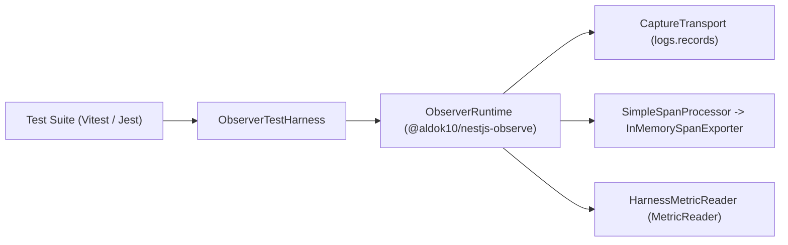

# `@aldok10/nestjs-observe-testing`

Unified in-memory observability test harness composing Logger, Tracing, and Metrics test doubles for `@aldok10/nestjs-observe`.

## Overview

`@aldok10/nestjs-observe-testing` exports `ObserverTestHarness`, which initializes an `ObserverRuntime` preconfigured with in-memory capture sinks for logs (`CaptureTransport`), spans (`InMemorySpanExporter` with `SimpleSpanProcessor`), and metrics (`MetricReader`).

It enables deterministic, zero-I/O assertions on correlated logs, spans, and metrics in unit and integration tests.

## Why This Package?

- **One-call test setup**: `ObserverTestHarness.create()` wires `ObserverRuntime` with in-memory log, span, and metric collectors.
- **Immediate span availability**: Uses `SimpleSpanProcessor` so finished spans are immediately readable via `getSpans()`.
- **Unified metric inspection**: Provides `collectMetrics()` and `findMetric(name)` helpers over `@opentelemetry/sdk-metrics`.

## Features

- **In-memory log capture**: `harness.logs` (`CaptureTransport` from `@aldok10/nestjs-observe-logger-testing`).
- **In-memory span capture**: `harness.spanExporter` (`InMemorySpanExporter`) and `harness.getSpans()`.
- **In-memory metric collection**: `harness.metricReader` (`MetricReader`), `harness.collectMetrics()`, and `harness.findMetric(name)`.
- **Correlated telemetry**: Inherits `ObserverRuntime` trace-to-log correlation out of the box.

## Architecture and Responsibilities



## Installation

```sh
pnpm add -D @aldok10/nestjs-observe-testing
```

```sh
npm install --save-dev @aldok10/nestjs-observe-testing
```

```sh
yarn add --dev @aldok10/nestjs-observe-testing
```

## Requirements

- **Node.js**: `>=22` (from `engines.node` in `package.json`)
- **Optional Peer Dependencies** (from `package.json`, marked optional in `peerDependenciesMeta`):
  - `@aldok10/nestjs-observe-logger`: `^0.1.0`
  - `@aldok10/nestjs-observe-logger-testing`: `^0.1.0`
  - `@aldok10/nestjs-observe-metrics`: `^0.1.0`
  - `@aldok10/nestjs-observe-metrics-testing`: `^0.1.0`
  - `@aldok10/nestjs-observe-tracing`: `^0.1.0`
  - `@aldok10/nestjs-observe-tracing-testing`: `^0.1.0`
- **Module Formats**: ESM (`import`), CommonJS (`require`), and TypeScript type definitions (`.d.ts`)

## Quick Start

```ts
import { describe, expect, it } from 'vitest';
import { ObserverTestHarness } from '@aldok10/nestjs-observe-testing';

describe('checkout observability', () => {
  it('captures correlated logs and spans in memory', async () => {
    const harness = await ObserverTestHarness.create({
      resource: { serviceName: 'checkout-test' },
    });

    await harness.runtime.tracer?.withSpan('checkout.run', async (span) => {
      harness.runtime.logger?.info('started');
      const expected = span.spanContext();
      expect(harness.logs.records).toHaveLength(1);
      expect(harness.logs.records[0]?.traceId).toBe(expected.traceId);
    });

    expect(harness.getSpans()).toHaveLength(1);
    await harness.shutdown();
  });
});
```

## Configuration

### `ObserverTestHarness.create(options?)`

| Property   | Type               | Required | Default     | Description                                            |
| ---------- | ------------------ | -------- | ----------- | ------------------------------------------------------ |
| `resource` | `ResourceMetadata` | No       | `undefined` | Optional resource metadata passed to `ObserverRuntime` |

## Usage

### Inspecting Recorded Metrics

```ts
const harness = await ObserverTestHarness.create({ resource: { serviceName: 'metrics-test' } });

const counter = harness.runtime.metrics?.createCounter('orders_total');
counter?.add(1);

const metric = await harness.findMetric('orders_total');
const allMetrics = await harness.collectMetrics();

await harness.shutdown();
```

## Advanced Usage

Access the underlying `ObserverRuntime`, `CaptureTransport`, `InMemorySpanExporter`, or `MetricReader` properties directly on the `ObserverTestHarness` instance (`harness.runtime`, `harness.logs`, `harness.spanExporter`, `harness.metricReader`) when custom assertions or direct SDK inspection are required.

## API Reference

- `ObserverTestHarness.create(options?: { readonly resource?: ResourceMetadata }): Promise<ObserverTestHarness>`
- `logs: CaptureTransport`
- `spanExporter: InMemorySpanExporter`
- `metricReader: MetricReader`
- `runtime: ObserverRuntime`
- `getSpans(): readonly ReadableSpan[]`
- `collectMetrics(): Promise<ResourceMetrics>`
- `findMetric(name: string): Promise<MetricData | undefined>`
- `shutdown(): Promise<void>`

## Integration with Other Packages

`ObserverTestHarness.create()` enables `logger`, `tracing`, and `metrics` on `ObserverRuntime`, so `@aldok10/nestjs-observe-logger`, `@aldok10/nestjs-observe-tracing`, and `@aldok10/nestjs-observe-metrics` must be installed in the test environment for `initialize()` to load them.

## Dependencies and Optional Integrations

- **Direct dependencies**: `@aldok10/nestjs-observe`, `@aldok10/nestjs-observe-core`, `@aldok10/nestjs-observe-logger-testing`, `@opentelemetry/sdk-metrics`, `@opentelemetry/sdk-trace`.
- **Optional peer dependencies**: `@aldok10/nestjs-observe-logger`, `@aldok10/nestjs-observe-logger-testing`, `@aldok10/nestjs-observe-metrics`, `@aldok10/nestjs-observe-metrics-testing`, `@aldok10/nestjs-observe-tracing`, `@aldok10/nestjs-observe-tracing-testing`.

## Lifecycle and Resource Management

Always call `await harness.shutdown()` (for example in `afterEach` or at the end of a test) to flush and shut down the underlying `ObserverRuntime` and OpenTelemetry providers.

## Error Handling

If any of the required runtime packages for `logger`, `tracing`, or `metrics` are not installed, `ObserverTestHarness.create()` propagates `OptionalPeerMissingException` from `ObserverRuntime.initialize()`.

## Performance Considerations

All telemetry is kept in memory using `CaptureTransport`, `InMemorySpanExporter`, and a no-op `MetricReader` (`HarnessMetricReader`), avoiding network or disk I/O during tests.

## Security Considerations

Test records remain in process memory for the lifetime of the `ObserverTestHarness` instance; avoid feeding production secrets into test fixtures.

## Testing

Run the full monorepo test suite or target `@aldok10/nestjs-observe-testing`:

```sh
pnpm test
```

```sh
pnpm exec vitest run packages/observer/testing
```

## Troubleshooting

- **Missing peer error during `ObserverTestHarness.create()`**: Ensure `@aldok10/nestjs-observe-logger`, `@aldok10/nestjs-observe-tracing`, and `@aldok10/nestjs-observe-metrics` are installed in your workspace/devDependencies.
- **Empty spans list**: Ensure `getSpans()` is called after the span has ended (`withSpan(...)` completes or `span.end()` is called).

## Limitations

- `ObserverTestHarness.create()` always enables `logger`, `tracing`, and `metrics` together and does not expose options to enable `errorTracking` or disable individual signals.

## Related Packages

- [`@aldok10/nestjs-observe`](../observer/README.md) — Unified NestJS observability integration
- [`@aldok10/nestjs-observe-core`](../../core/README.md) — Shared core primitives
- [`@aldok10/nestjs-observe-logger-testing`](../../logs/testing/README.md) — Standalone logger test utilities

## Documentation

- [Observer Integration Guide](../../../docs/packages/observer/README.md)
- [Verification Report](../../../docs/development/workflow.md)

## Contributing

See [CONTRIBUTING.md](../../../CONTRIBUTING.md).

## License

MIT — see [LICENSE](../../../LICENSE).
