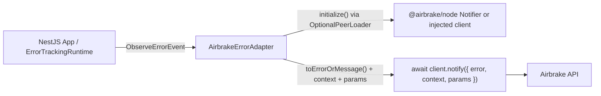

# `@aldok10/nestjs-observe-error-tracking-airbrake`

Airbrake `@airbrake/node` adapter for `@aldok10/nestjs-observe-error-tracking`, sending normalized errors, context, and params via `Notifier.notify()`.

## Overview

`@aldok10/nestjs-observe-error-tracking-airbrake` integrates `@aldok10/nestjs-observe-error-tracking` with Airbrake (`@airbrake/node`). It constructs or wraps an Airbrake `Notifier` client, maps `ObserveErrorEvent` metadata into Airbrake `context` (`severity`, `environment`, `version`, `component`, `action`, `user`) and `params` (`context`, `trace`, `tags`, `attributes`), and awaits `client.notify()`.

## Why This Package?

- **Managed Airbrake Notifier**: Instantiates `@airbrake/node`'s `Notifier` from `projectId`, `projectKey`, and `environment`, or accepts an existing `AirbrakeClientLike` instance.
- **Rich notice mapping**: Preserves severity, release/version, module/operation (`component`/`action`), user context, trace IDs, tags, and custom attributes.
- **Graceful shutdown**: Implements `shutdown()` by awaiting `client.close?.()`.

## Features

- Implements `ErrorTrackingAdapter` (`name: 'airbrake'`) with `deliveryMode: 'sdk-managed'`.
- Capabilities: `exceptions`, `messages`, `tags`, `userContext`, `traceCorrelation` (`breadcrumbs`, `fingerprinting`, `transactions`, `sessions`, and `profiling` are `false`).
- Supports `@airbrake/node` `^2.0.0 || ^3.0.0` as an optional peer dependency.
- Preserves string messages when `event.name === 'Message'` and constructs `Error` instances otherwise.

## Architecture and Responsibilities



- **Adapter (`AirbrakeErrorAdapter`)**: Owns `@airbrake/node` peer loading/instantiation, Airbrake notice formatting, `notify()` delivery, and `close()` on shutdown.
- **Core Runtime (`@aldok10/nestjs-observe-error-tracking`)**: Owns NestJS exception capture, enrichment, redaction, deduplication, and retry/queue orchestration.

## Installation

```bash
pnpm add @aldok10/nestjs-observe-error-tracking-airbrake @aldok10/nestjs-observe-error-tracking @aldok10/nestjs-observe-core
```

```bash
npm install @aldok10/nestjs-observe-error-tracking-airbrake @aldok10/nestjs-observe-error-tracking @aldok10/nestjs-observe-core
```

```bash
yarn add @aldok10/nestjs-observe-error-tracking-airbrake @aldok10/nestjs-observe-error-tracking @aldok10/nestjs-observe-core
```

Install the optional peer dependency when using `@airbrake/node`:

```bash
pnpm add @airbrake/node
```

## Requirements

- **Node.js**: `>=22`
- **Peer dependencies**: `@airbrake/node` (`^2.0.0 || ^3.0.0`, optional)
- **Module formats**: Dual ESM (`dist/index.js`) and CommonJS (`dist/index.cjs`) with TypeScript declarations (`dist/index.d.ts`)

## Quick Start

```ts
import { Module } from '@nestjs/common';
import { ErrorTrackingModule } from '@aldok10/nestjs-observe-error-tracking';
import { createAirbrakeAdapter } from '@aldok10/nestjs-observe-error-tracking-airbrake';

@Module({
  imports: [
    ErrorTrackingModule.forRoot({
      resource: {
        serviceName: 'orders-api',
        environment: 'production',
        release: '1.0.0',
      },
      destinations: [
        {
          name: 'airbrake',
          adapter: createAirbrakeAdapter({
            projectId: Number(process.env.AIRBRAKE_PROJECT_ID),
            projectKey: process.env.AIRBRAKE_PROJECT_KEY,
            environment: 'production',
          }),
        },
      ],
    }),
  ],
})
export class AppModule {}
```

## Configuration

`AirbrakeAdapterOptions`:

| Property      | Type                 | Required | Default     | Description                                                                                                           |
| ------------- | -------------------- | -------- | ----------- | --------------------------------------------------------------------------------------------------------------------- |
| `client`      | `AirbrakeClientLike` | No       | `undefined` | Pre-configured Airbrake `Notifier` or test double; skips `OptionalPeerLoader` when provided.                          |
| `projectId`   | `number`             | No       | `undefined` | Airbrake project ID passed to `new Notifier({ projectId, projectKey, environment? })` when `client` is not provided.  |
| `projectKey`  | `string`             | No       | `undefined` | Airbrake project key passed to `new Notifier({ projectId, projectKey, environment? })` when `client` is not provided. |
| `environment` | `string`             | No       | `undefined` | Optional environment name passed to `new Notifier(...)` during `initialize()`.                                        |

## Usage

### Direct Adapter Usage

```ts
import { normalizeError } from '@aldok10/nestjs-observe-error-tracking';
import { createAirbrakeAdapter } from '@aldok10/nestjs-observe-error-tracking-airbrake';

const adapter = createAirbrakeAdapter({
  projectId: Number(process.env.AIRBRAKE_PROJECT_ID),
  projectKey: process.env.AIRBRAKE_PROJECT_KEY,
});
adapter.initialize();

await adapter.capture(
  normalizeError(new Error('Charge declined'), {
    severity: 'error',
    trace: { traceId: 't-1' },
    tags: { gateway: 'stripe' },
  }),
);

await adapter.shutdown();
```

### Notice Mapping

`capture(event)` calls `client.notify(...)` with:

- `error`: `Error` instance (or `event.message` string when `event.name === 'Message'`)
- `context`: `severity`, `environment` (if defined), `version` (`event.release`), `component` (`event.source.module`), `action` (`event.source.operation`), `user`
- `params`: `context` (`event.context`), `trace` (`event.trace`), `tags` (`event.tags`), `attributes` (`event.attributes`)

## Advanced Usage

### Injecting a Pre-Configured Notifier

```ts
import { Notifier } from '@airbrake/node';
import { createAirbrakeAdapter } from '@aldok10/nestjs-observe-error-tracking-airbrake';

const notifier = new Notifier({
  projectId: Number(process.env.AIRBRAKE_PROJECT_ID),
  projectKey: process.env.AIRBRAKE_PROJECT_KEY,
});

const adapter = createAirbrakeAdapter({ client: notifier });
```

## API Reference

- `AirbrakeErrorAdapter` — Class implementing `ErrorTrackingAdapter` (`name = 'airbrake'`).
  - `constructor(options: AirbrakeAdapterOptions)`
  - `initialize(): void`
  - `capture(event: ObserveErrorEvent): Promise<void>`
  - `shutdown(): Promise<void>`
- `createAirbrakeAdapter(options: AirbrakeAdapterOptions): AirbrakeErrorAdapter` — Factory helper returning an `AirbrakeErrorAdapter` instance.
- `AirbrakeAdapterOptions` — Configuration interface (`client?`, `projectId?`, `projectKey?`, `environment?`).
- `AirbrakeClientLike` — Structural interface for `@airbrake/node` (`notify`, optional `close`).

## Integration with Other Packages

- `@aldok10/nestjs-observe-error-tracking`: Hosts `AirbrakeErrorAdapter` in `ErrorTrackingModule` / `ErrorTrackingRuntime`.
- `@aldok10/nestjs-observe-core`: Provides `OptionalPeerLoader` for lazy resolution of `@airbrake/node`.

## Dependencies and Optional Integrations

- **Runtime dependencies**: `@aldok10/nestjs-observe-core`, `@aldok10/nestjs-observe-error-tracking`
- **Optional peer dependency**: `@airbrake/node` (`^2.0.0 || ^3.0.0`)

## Lifecycle and Resource Management

1. `initialize()` skips peer loading if `options.client` is provided; otherwise it loads `@airbrake/node` via `OptionalPeerLoader`, extracts `Notifier` (or uses the module directly if it already implements `notify`), and instantiates `new Notifier(...)`.
2. `capture(event)` awaits `client.notify(...)`.
3. `shutdown()` awaits `client.close?.()` to release Airbrake client resources.

## Error Handling

- Calling `capture()` before `initialize()` throws `Error('airbrake adapter is not initialized')`.
- If `@airbrake/node` is missing during `initialize()`, `OptionalPeerLoader` throws a missing-peer error.
- If the loaded module does not expose a `Notifier` constructor or `notify` method, `initialize()` throws `Error('Invalid @airbrake/node exports: missing Notifier')`.

## Performance Considerations

- Delivery is asynchronous via `client.notify()`, which performs HTTP notice submission managed by `@airbrake/node`.

## Security Considerations

- Supply `projectKey` via environment variables or secret managers; never hardcode keys in source control.
- Configure redaction in `@aldok10/nestjs-observe-error-tracking` before events reach the adapter so sensitive values in `user`, `context`, `tags`, and `attributes` are redacted.

## Testing

Run the workspace test suite or target this package directly with Vitest:

```bash
pnpm test
pnpm exec vitest run packages/traces/error-tracking/adapter-airbrake
```

## Troubleshooting

- **`airbrake adapter is not initialized`**: Ensure `ErrorTrackingModule` has initialized or call `adapter.initialize()` before `capture()`.
- **Invalid project credentials**: When not injecting `client`, ensure both `projectId` and `projectKey` are provided.

## Limitations

- `breadcrumbs`, `fingerprinting`, `transactions`, `sessions`, and `profiling` are not supported (`false` in `capabilities`).
- Does not implement `flush()` separately from `shutdown()`.

## Related Packages

- [`@aldok10/nestjs-observe-error-tracking`](../error-tracking/README.md)
- [`@aldok10/nestjs-observe-error-tracking-testing`](../testing/README.md)
- [`@aldok10/nestjs-observe-core`](../../../core/README.md)
- [`@aldok10/nestjs-observe-tracing`](../../tracing/README.md)
- [`@aldok10/nestjs-observe`](../../../observer/observer/README.md)

## Documentation

- [Other Error Tracking Providers](../../../../docs/integrations/error-tracking-providers.md)
- [Error Tracking Overview](../../../../docs/packages/traces/error-tracking/README.md)
- [Installation Guide](../../../../docs/packages/traces/error-tracking/README.md)
- [Configuration Guide](../../../../docs/packages/traces/error-tracking/README.md)
- [Troubleshooting Guide](../../../../docs/operations/troubleshooting.md)

## Contributing

See [CONTRIBUTING.md](../../../../CONTRIBUTING.md).

## License

[MIT](../../../../LICENSE)
