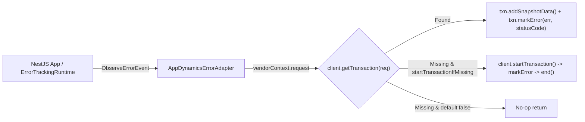

# `@aldok10/nestjs-observe-error-tracking-appdynamics`

Cisco AppDynamics Node.js agent adapter for `@aldok10/nestjs-observe-error-tracking`, recording errors and snapshot data on Business Transactions.

## Overview

`@aldok10/nestjs-observe-error-tracking-appdynamics` connects `@aldok10/nestjs-observe-error-tracking` to the Cisco AppDynamics Node.js agent (`appdynamics`). During `capture()`, it resolves the active Business Transaction from `event.vendorContext.request` via `client.getTransaction(request)` (or optionally starts a synthetic transaction when `startTransactionIfMissing: true`), attaches snapshot data (`traceId`, `requestId`, and `event.tags`), and calls `txn.markError(error, statusCode)`.

## Why This Package?

- **Business Transaction correlation**: Marks errors directly on AppDynamics Business Transactions with HTTP status codes and snapshot metadata.
- **Optional fallback transactions**: Supports `startTransactionIfMissing: true` for background or non-HTTP errors where no request object is present.
- **Optional peer loading**: Lazily resolves `appdynamics` at `initialize()` time or accepts an injected `AppDynamicsAgentLike` client for unit testing.

## Features

- Implements `ErrorTrackingAdapter` (`name: 'appdynamics'`) with `deliveryMode: 'sdk-managed'`.
- Capabilities: `exceptions`, `tags`, `traceCorrelation`, `transactions` (`messages`, `breadcrumbs`, `fingerprinting`, `userContext`, `sessions`, and `profiling` are `false`).
- Supports `appdynamics` `^23.0.0 || ^24.0.0` as an optional peer dependency.
- Attaches `traceId`, `requestId`, and `event.tags` via `txn.addSnapshotData?.(key, value)`.
- Passes `event.request?.statusCode` to `txn.markError(error, statusCode)`.

## Architecture and Responsibilities



- **Adapter (`AppDynamicsErrorAdapter`)**: Owns `appdynamics` peer resolution, Business Transaction lookup/fallback, snapshot data attachment, and `markError()` invocation.
- **Core Runtime (`@aldok10/nestjs-observe-error-tracking`)**: Owns NestJS exception capture, enrichment, redaction, deduplication, and delivery orchestration.

## Installation

```bash
pnpm add @aldok10/nestjs-observe-error-tracking-appdynamics @aldok10/nestjs-observe-error-tracking @aldok10/nestjs-observe-core
```

```bash
npm install @aldok10/nestjs-observe-error-tracking-appdynamics @aldok10/nestjs-observe-error-tracking @aldok10/nestjs-observe-core
```

```bash
yarn add @aldok10/nestjs-observe-error-tracking-appdynamics @aldok10/nestjs-observe-error-tracking @aldok10/nestjs-observe-core
```

Install the optional peer dependency when using the AppDynamics Node.js agent:

```bash
pnpm add appdynamics
```

## Requirements

- **Node.js**: `>=22`
- **Peer dependencies**: `appdynamics` (`^23.0.0 || ^24.0.0`, optional)
- **Module formats**: Dual ESM (`dist/index.js`) and CommonJS (`dist/index.cjs`) with TypeScript declarations (`dist/index.d.ts`)

## Quick Start

Initialize `appdynamics.profile(...)` at the very top of your application entry point before importing NestJS, then register the adapter:

```ts
import { Module } from '@nestjs/common';
import { ErrorTrackingModule } from '@aldok10/nestjs-observe-error-tracking';
import { createAppDynamicsAdapter } from '@aldok10/nestjs-observe-error-tracking-appdynamics';

@Module({
  imports: [
    ErrorTrackingModule.forRoot({
      resource: {
        serviceName: 'orders-api',
        environment: 'production',
      },
      destinations: [
        {
          name: 'appdynamics',
          adapter: createAppDynamicsAdapter(),
        },
      ],
    }),
  ],
})
export class AppModule {}
```

## Configuration

`AppDynamicsAdapterOptions`:

| Property                    | Type                   | Required | Default     | Description                                                                                                                                                           |
| --------------------------- | ---------------------- | -------- | ----------- | --------------------------------------------------------------------------------------------------------------------------------------------------------------------- |
| `client`                    | `AppDynamicsAgentLike` | No       | `undefined` | Pre-configured AppDynamics agent or test double; skips `OptionalPeerLoader` when provided.                                                                            |
| `startTransactionIfMissing` | `boolean`              | No       | `false`     | When `true`, calls `client.startTransaction?.(event.source?.operation ?? event.name)` and ends it after marking the error if no active Business Transaction is found. |

## Usage

### Capturing with Request Context

Pass the incoming HTTP request via `vendorContext.request` so `client.getTransaction(request)` can locate the active Business Transaction:

```ts
import { normalizeError } from '@aldok10/nestjs-observe-error-tracking';
import { createAppDynamicsAdapter } from '@aldok10/nestjs-observe-error-tracking-appdynamics';

const adapter = createAppDynamicsAdapter();
adapter.initialize();

adapter.capture(
  normalizeError(new Error('Upstream 503'), {
    request: { statusCode: 503 },
    trace: { traceId: 't-1' },
    vendorContext: { request: req },
  }),
);
```

## Advanced Usage

### Enabling Synthetic Transactions for Background Errors

```ts
import { createAppDynamicsAdapter } from '@aldok10/nestjs-observe-error-tracking-appdynamics';

const adapter = createAppDynamicsAdapter({
  startTransactionIfMissing: true,
});
```

When `startTransactionIfMissing` is `true` and `getTransaction()` returns `false` or `undefined` (or `vendorContext.request` is omitted), the adapter starts a transaction named `event.source?.operation ?? event.name`, attaches snapshot data, calls `markError()`, and calls `started.end?.()`.

## API Reference

- `AppDynamicsErrorAdapter` — Class implementing `ErrorTrackingAdapter` (`name = 'appdynamics'`).
  - `constructor(options?: AppDynamicsAdapterOptions)`
  - `initialize(): void`
  - `capture(event: ObserveErrorEvent): void`
- `createAppDynamicsAdapter(options?: AppDynamicsAdapterOptions): AppDynamicsErrorAdapter` — Factory helper returning an `AppDynamicsErrorAdapter` instance.
- `AppDynamicsAdapterOptions` — Configuration interface (`client?`, `startTransactionIfMissing?`).
- `AppDynamicsAgentLike` — Structural interface for `appdynamics` (`getTransaction`, optional `startTransaction`).
- `AppDynamicsTransactionLike` — Structural interface for a Business Transaction (`markError`, optional `addSnapshotData`, optional `end`).

## Integration with Other Packages

- `@aldok10/nestjs-observe-error-tracking`: Hosts `AppDynamicsErrorAdapter` in `ErrorTrackingModule` / `ErrorTrackingRuntime`.
- `@aldok10/nestjs-observe-core`: Provides `OptionalPeerLoader` for lazy resolution of `appdynamics`.

## Dependencies and Optional Integrations

- **Runtime dependencies**: `@aldok10/nestjs-observe-core`, `@aldok10/nestjs-observe-error-tracking`
- **Optional peer dependency**: `appdynamics` (`^23.0.0 || ^24.0.0`)

## Lifecycle and Resource Management

1. `initialize()` skips peer loading if `options.client` is provided; otherwise it loads `appdynamics` via `OptionalPeerLoader` (unwrapping `.default` if present) and validates `getTransaction`.
2. `capture(event)` is synchronous (`void`).
3. The adapter does not implement `flush()` or `shutdown()`; agent lifecycle is managed by `appdynamics`.

## Error Handling

- Calling `capture()` before `initialize()` throws `Error('appdynamics adapter is not initialized')`.
- If `appdynamics` is missing during `initialize()`, `OptionalPeerLoader` throws a missing-peer error.
- If the loaded module does not expose `getTransaction`, `initialize()` throws `Error('Invalid appdynamics agent exports: missing getTransaction')`.

## Performance Considerations

- Recording errors on an existing Business Transaction is synchronous in-memory work; the AppDynamics agent reports metrics and snapshots asynchronously.
- When `startTransactionIfMissing` is `false` (default) and no Business Transaction is found, `capture()` returns immediately as a no-op.

## Security Considerations

- Configure redaction in `@aldok10/nestjs-observe-error-tracking` before events reach the adapter so sensitive values in `tags` or error messages are stripped before `addSnapshotData` and `markError`.
- User PII (`event.user`) is not forwarded (`capabilities.userContext` is `false`).

## Testing

Run the workspace test suite or target this package directly with Vitest:

```bash
pnpm test
pnpm exec vitest run packages/traces/error-tracking/adapter-appdynamics
```

## Troubleshooting

- **Errors silently dropped**: Ensure `event.vendorContext.request` is populated with the raw HTTP request object, or enable `startTransactionIfMissing: true`.
- **`appdynamics adapter is not initialized`**: Ensure `ErrorTrackingModule` has initialized or call `adapter.initialize()` before `capture()`.

## Limitations

- `messages`, `breadcrumbs`, `fingerprinting`, `userContext`, `sessions`, and `profiling` are not supported (`false` in `capabilities`).
- Does not implement `flush()` or `shutdown()`.

## Related Packages

- [`@aldok10/nestjs-observe-error-tracking`](../error-tracking/README.md)
- [`@aldok10/nestjs-observe-error-tracking-testing`](../testing/README.md)
- [`@aldok10/nestjs-observe-core`](../../../core/README.md)
- [`@aldok10/nestjs-observe-tracing`](../../tracing/README.md)
- [`@aldok10/nestjs-observe`](../../../observer/observer/README.md)

## Documentation

- [Other Error Tracking Providers](../../../../docs/integrations/error-tracking-providers.md)
- [Error Tracking Overview](../../../../docs/packages/traces/error-tracking/README.md)
- [Installation Guide](../../../../docs/packages/traces/error-tracking/README.md)
- [Configuration Guide](../../../../docs/packages/traces/error-tracking/README.md)
- [Troubleshooting Guide](../../../../docs/operations/troubleshooting.md)

## Contributing

See [CONTRIBUTING.md](../../../../CONTRIBUTING.md).

## License

[MIT](../../../../LICENSE)
