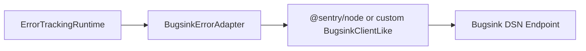

# `@aldok10/nestjs-observe-error-tracking-bugsink`

Bugsink adapter (Sentry-compatible error ingestion) for `@aldok10/nestjs-observe-error-tracking`.

## Overview

`@aldok10/nestjs-observe-error-tracking-bugsink` integrates `@aldok10/nestjs-observe-error-tracking` with Bugsink via `@sentry/node` (or a compatible `BugsinkClientLike`). It initializes the SDK with error-only defaults (`tracesSampleRate: 0`, `autoSessionTracking: false`, `sendDefaultPii: false`) matching Bugsink's error-focused ingestion model.

## Why This Package?

- **Error-only defaults:** Disables Sentry transactions (`tracesSampleRate: 0`), session tracking, and default PII collection out of the box.
- **Accurate capabilities:** Reports `transactions: false`, `sessions: false`, and `profiling: false`.
- **Swappable backend:** Uses the same `ObserveErrorEvent` pipeline as all other adapters.

## Features

- Dynamic loading of `@sentry/node` (`^8.0.0 || ^9.0.0 || ^10.0.0`) or custom `BugsinkClientLike` injection.
- Error-only `client.init(...)` configuration when `dsn` is provided.
- Scoped capture (`withScope`) mapping `severity`, `tags`, `attributes` (extras), `user`, `fingerprint`, `trace`, `context` (`observe`), and `breadcrumbs`.
- Uses `captureMessage` for `Message` events without an `exception`, and `captureException` otherwise.
- `flush(timeoutMs)` and `shutdown(timeoutMs)` support.

## Architecture and Responsibilities



## Installation

```bash
pnpm add @aldok10/nestjs-observe-error-tracking-bugsink @aldok10/nestjs-observe-error-tracking @sentry/node
```

```bash
npm install @aldok10/nestjs-observe-error-tracking-bugsink @aldok10/nestjs-observe-error-tracking @sentry/node
```

```bash
yarn add @aldok10/nestjs-observe-error-tracking-bugsink @aldok10/nestjs-observe-error-tracking @sentry/node
```

## Requirements

- **Node.js:** `>=22`
- **Module Formats:** ESM (`import`) and CJS (`require`) with TypeScript declarations (`.d.ts`)
- **Optional Peer Dependencies:**
  - `@sentry/node`: `^8.0.0 || ^9.0.0 || ^10.0.0`

## Quick Start

```ts
import { ErrorTrackingModule } from '@aldok10/nestjs-observe-error-tracking';
import { createBugsinkAdapter } from '@aldok10/nestjs-observe-error-tracking-bugsink';

ErrorTrackingModule.forRoot({
  destinations: [
    {
      name: 'bugsink',
      adapter: createBugsinkAdapter({
        dsn: process.env.BUGSINK_DSN,
        environment: process.env.NODE_ENV,
        release: '1.0.0',
      }),
    },
  ],
});
```

## Configuration

### `BugsinkAdapterOptions`

| Property      | Type                | Required | Default     | Description                                                                                                                                             |
| ------------- | ------------------- | -------- | ----------- | ------------------------------------------------------------------------------------------------------------------------------------------------------- |
| `client`      | `BugsinkClientLike` | No       | `undefined` | Custom or pre-loaded client. If omitted, `@sentry/node` is loaded during `initialize()`.                                                                |
| `dsn`         | `string`            | No       | `undefined` | Bugsink DSN. When provided and `client.init` exists, initializes with `tracesSampleRate: 0`, `autoSessionTracking: false`, and `sendDefaultPii: false`. |
| `environment` | `string`            | No       | `undefined` | Environment name passed to `client.init()`.                                                                                                             |
| `release`     | `string`            | No       | `undefined` | Release identifier passed to `client.init()`.                                                                                                           |
| `sampleRate`  | `number`            | No       | `undefined` | Error sample rate passed to `client.init()`.                                                                                                            |
| `closeClient` | `boolean`           | No       | `true`      | Calls `client.close(timeoutMs)` during `shutdown()` unless set to `false`.                                                                              |

## Usage

```ts
import { createBugsinkAdapter } from '@aldok10/nestjs-observe-error-tracking-bugsink';

const adapter = createBugsinkAdapter({
  dsn: 'https://key@bugsink.example.com/1',
  environment: 'production',
  release: '2.1.0',
});
```

## Advanced Usage

Provide a custom `BugsinkClientLike` in `options.client` for unit tests or when sharing a pre-initialized `@sentry/node` client (with `closeClient: false`).

## API Reference

- `BugsinkErrorAdapter` (implements `ErrorTrackingAdapter`, `name = 'bugsink'`, `deliveryMode: 'sdk-managed'`)
  - `constructor(options: BugsinkAdapterOptions)`
  - `initialize(): void`
  - `capture(event: ObserveErrorEvent): void`
  - `flush(timeoutMs?: number): Promise<void>` (default `timeoutMs = 2000`)
  - `shutdown(timeoutMs?: number): Promise<void>` (default `timeoutMs = 2000`)
- `createBugsinkAdapter(options: BugsinkAdapterOptions): BugsinkErrorAdapter`
- `BugsinkClientLike`
- `BugsinkScopeLike`
- `BugsinkAdapterOptions`

## Integration with Other Packages

- Requires `@aldok10/nestjs-observe-core` and `@aldok10/nestjs-observe-error-tracking`.
- Uses `deliveryMode: 'sdk-managed'`, so `ErrorTrackingRuntime` defaults destination `maxRetries` to `0`.

## Dependencies and Optional Integrations

- **Direct dependencies:** `@aldok10/nestjs-observe-core` (`^0.1.0`), `@aldok10/nestjs-observe-error-tracking` (`^0.1.0`).
- **Optional peer dependency:** `@sentry/node` (`^8.0.0 || ^9.0.0 || ^10.0.0`).

## Lifecycle and Resource Management

- `initialize()` loads `@sentry/node` if `client` is omitted and calls `client.init(...)` when `dsn` is provided.
- `flush(timeoutMs = 2000)` calls `client.flush?.(timeoutMs)`.
- `shutdown(timeoutMs = 2000)` flushes and calls `client.close?.(timeoutMs)` unless `closeClient === false`.

## Error Handling

- Throws if `@sentry/node` exports are missing `captureException`.
- Throws `bugsink adapter is not initialized` if `capture()` is called before `initialize()`.

## Performance Considerations

- Disables Sentry transaction tracing (`tracesSampleRate: 0`) and session tracking by default to minimize SDK overhead.

## Security Considerations

- Sets `sendDefaultPii: false` in `client.init()` and receives events already sanitized by `ErrorTrackingRuntime`.

## Testing

```bash
pnpm test
```

```bash
pnpm exec vitest run packages/traces/error-tracking/adapter-bugsink
```

## Troubleshooting

- **Transactions or sessions not recorded:** Bugsink is error-only; this adapter intentionally sets `tracesSampleRate: 0` and `autoSessionTracking: false`.

## Limitations

- `transactions`, `sessions`, and `profiling` capabilities are `false`.
- Breadcrumbs forwarded by this adapter include `message`, `category`, and `level` (not `data` or `timestamp`).

## Related Packages

- [`@aldok10/nestjs-observe-error-tracking`](../error-tracking/README.md)
- [`@aldok10/nestjs-observe-error-tracking-sentry`](../adapter-sentry/README.md)
- [`@aldok10/nestjs-observe-error-tracking-glitchtip`](../adapter-glitchtip/README.md)

## Documentation

- [Bugsink Guide](../../../../docs/integrations/error-tracking-providers.md)
- [Configuration](../../../../docs/packages/traces/error-tracking/README.md)

## Contributing

See [CONTRIBUTING.md](../../../../CONTRIBUTING.md).

## License

MIT — see [LICENSE](../../../../LICENSE).
