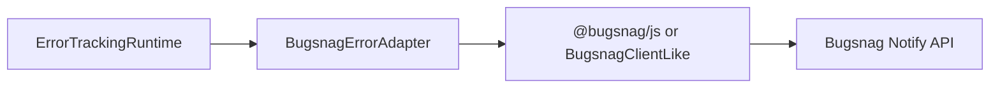

# `@aldok10/nestjs-observe-error-tracking-bugsnag`

Bugsnag adapter for `@aldok10/nestjs-observe-error-tracking`.

## Overview

`@aldok10/nestjs-observe-error-tracking-bugsnag` adapts `ObserveErrorEvent` payloads from `@aldok10/nestjs-observe-error-tracking` to `@bugsnag/js` (or a compatible `BugsnagClientLike`). It maps severity levels, breadcrumbs, grouping hashes, user identity, and structured metadata sections (`tags`, `trace`, `observe`, `attributes`) onto Bugsnag events.

## Why This Package?

- **Callback-to-Promise bridging:** Wraps Bugsnag's callback-based `notify(error, onError, callback)` in a `Promise<void>` so `ErrorTrackingRuntime` tracks delivery latency and failures accurately.
- **Structured metadata:** Organizes `tags`, `trace`, `observe` (`event.context`), and `attributes` into dedicated Bugsnag metadata tabs.
- **Optional peer dependency:** Loads `@bugsnag/js` dynamically via `OptionalPeerLoader` or accepts a pre-started `client`.

## Features

- Dynamic loading of `@bugsnag/js` (`^7.0.0 || ^8.0.0`, unwrapping `.default` if present) or custom `BugsnagClientLike` injection.
- Optional `client.start(...)` initialization when `apiKey` is provided.
- Maps `ObserveErrorEvent['severity']` (`'fatal' | 'error'` -> `'error'`, `'warning'` -> `'warning'`, `'info'` -> `'info'`).
- Maps `fingerprint` to `bsEvent.groupingHash` (joined with `':'`), `source.operation` to `bsEvent.context`, `user` to `bsEvent.setUser(id, email, username)`, and `breadcrumbs` to `client.leaveBreadcrumb(...)`.

## Architecture and Responsibilities



## Installation

```bash
pnpm add @aldok10/nestjs-observe-error-tracking-bugsnag @aldok10/nestjs-observe-error-tracking @bugsnag/js
```

```bash
npm install @aldok10/nestjs-observe-error-tracking-bugsnag @aldok10/nestjs-observe-error-tracking @bugsnag/js
```

```bash
yarn add @aldok10/nestjs-observe-error-tracking-bugsnag @aldok10/nestjs-observe-error-tracking @bugsnag/js
```

## Requirements

- **Node.js:** `>=22`
- **Module Formats:** ESM (`import`) and CJS (`require`) with TypeScript declarations (`.d.ts`)
- **Optional Peer Dependencies:**
  - `@bugsnag/js`: `^7.0.0 || ^8.0.0`

## Quick Start

```ts
import { ErrorTrackingModule } from '@aldok10/nestjs-observe-error-tracking';
import { createBugsnagAdapter } from '@aldok10/nestjs-observe-error-tracking-bugsnag';

ErrorTrackingModule.forRoot({
  destinations: [
    {
      name: 'bugsnag',
      adapter: createBugsnagAdapter({
        apiKey: process.env.BUGSNAG_API_KEY,
        releaseStage: process.env.NODE_ENV,
        appVersion: '1.0.0',
      }),
    },
  ],
});
```

## Configuration

### `BugsnagAdapterOptions`

| Property       | Type                | Required | Default     | Description                                                                                                    |
| -------------- | ------------------- | -------- | ----------- | -------------------------------------------------------------------------------------------------------------- |
| `client`       | `BugsnagClientLike` | No       | `undefined` | Custom or pre-started Bugsnag client. If omitted, `@bugsnag/js` is loaded during `initialize()`.               |
| `apiKey`       | `string`            | No       | `undefined` | Bugsnag API key. When provided and `client.start` exists, `client.start(...)` is called during `initialize()`. |
| `releaseStage` | `string`            | No       | `undefined` | Release stage passed to `client.start()`.                                                                      |
| `appVersion`   | `string`            | No       | `undefined` | Application version passed to `client.start()`.                                                                |

## Usage

```ts
import Bugsnag from '@bugsnag/js';
import { createBugsnagAdapter } from '@aldok10/nestjs-observe-error-tracking-bugsnag';

Bugsnag.start({ apiKey: process.env.BUGSNAG_API_KEY! });

const adapter = createBugsnagAdapter({
  client: Bugsnag,
});
```

## Advanced Usage

Inject a `BugsnagClientLike` mock in tests to assert `bsEvent.severity`, `bsEvent.groupingHash`, and `addMetadata` sections without network calls.

## API Reference

- `BugsnagErrorAdapter` (implements `ErrorTrackingAdapter`, `name = 'bugsnag'`, `deliveryMode: 'sdk-managed'`)
  - `constructor(options: BugsnagAdapterOptions)`
  - `initialize(): void`
  - `capture(event: ObserveErrorEvent): Promise<void>`
- `createBugsnagAdapter(options: BugsnagAdapterOptions): BugsnagErrorAdapter`
- `BugsnagClientLike`
- `BugsnagEventLike`
- `BugsnagAdapterOptions`

## Integration with Other Packages

- Requires `@aldok10/nestjs-observe-core` and `@aldok10/nestjs-observe-error-tracking`.
- Uses `deliveryMode: 'sdk-managed'`, so `ErrorTrackingRuntime` defaults destination `maxRetries` to `0`.

## Dependencies and Optional Integrations

- **Direct dependencies:** `@aldok10/nestjs-observe-core` (`^0.1.0`), `@aldok10/nestjs-observe-error-tracking` (`^0.1.0`).
- **Optional peer dependency:** `@bugsnag/js` (`^7.0.0 || ^8.0.0`).

## Lifecycle and Resource Management

- `initialize()` loads `@bugsnag/js` (if `client` is omitted) and calls `client.start(...)` when `apiKey` is provided.
- `BugsnagErrorAdapter` does not implement `flush()` or `shutdown()`; `capture()` awaits the `notify` completion callback.

## Error Handling

- Throws `Invalid @bugsnag/js exports` if the loaded module lacks `notify`.
- Throws `bugsnag adapter is not initialized` if `capture()` is called before `initialize()`.
- Rejects the returned `Promise` if Bugsnag's `notify` callback receives an error.

## Performance Considerations

- `capture()` awaits Bugsnag's `notify` callback; `ErrorTrackingRuntime` enforces per-destination `timeoutMs` (default `3000` ms) and `maxConcurrent` (default `8`).

## Security Considerations

- Sensitive fields in `attributes`, `tags`, and `context` are redacted by `ErrorTrackingRuntime` before `addMetadata` is called.

## Testing

```bash
pnpm test
```

```bash
pnpm exec vitest run packages/traces/error-tracking/adapter-bugsnag
```

## Troubleshooting

- **`Invalid @bugsnag/js exports`:** Verify `@bugsnag/js` (`^7.0.0 || ^8.0.0`) is installed and resolvable from your application root.

## Limitations

- Bugsnag's `notify` severity supports `'error' | 'warning' | 'info'`, so `'fatal'` events are mapped to `'error'`.
- `transactions` and `profiling` capabilities are `false`.
- Does not implement `flush()` or `shutdown()` hooks.

## Related Packages

- [`@aldok10/nestjs-observe-error-tracking`](../error-tracking/README.md)
- [`@aldok10/nestjs-observe-error-tracking-rollbar`](../adapter-rollbar/README.md)
- [`@aldok10/nestjs-observe-error-tracking-honeybadger`](../adapter-honeybadger/README.md)

## Documentation

- [Bugsnag Guide](../../../../docs/integrations/error-tracking-providers.md)
- [Configuration](../../../../docs/packages/traces/error-tracking/README.md)

## Contributing

See [CONTRIBUTING.md](../../../../CONTRIBUTING.md).

## License

MIT — see [LICENSE](../../../../LICENSE).
