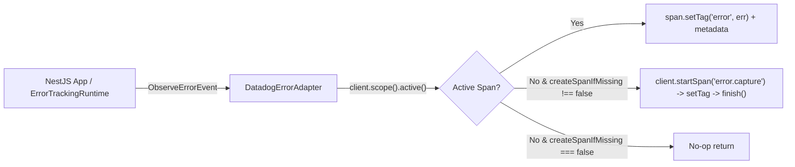

# `@aldok10/nestjs-observe-error-tracking-datadog`

Datadog `dd-trace` adapter for `@aldok10/nestjs-observe-error-tracking`, tagging active or fallback spans with Datadog Error Tracking attributes.

## Overview

`@aldok10/nestjs-observe-error-tracking-datadog` integrates `@aldok10/nestjs-observe-error-tracking` with Datadog APM (`dd-trace`). During `capture()`, it retrieves the active span from `tracer.scope().active()`—or creates and finishes a fallback `error.capture` span if enabled—and attaches Datadog Error Tracking tags (`error`, `error.type`, `error.msg`, `error.stack`, user, request, and custom tags).

## Why This Package?

- **Active span enrichment**: Attaches errors directly to the in-flight `dd-trace` span so Datadog Error Tracking correlates exceptions with distributed traces.
- **Background error support**: Optionally creates and finishes an `error.capture` span when no active span exists (such as in background workers or startup hooks).
- **Optional peer loading**: Lazily loads `dd-trace` at `initialize()` time or accepts an injected `DatadogTracerLike` client for unit testing.

## Features

- Implements `ErrorTrackingAdapter` (`name: 'datadog'`) with `deliveryMode: 'sdk-managed'`.
- Capabilities: `exceptions`, `messages`, `tags`, `userContext`, `traceCorrelation`, `transactions` (`breadcrumbs`, `fingerprinting`, `sessions`, and `profiling` are `false`).
- Supports `dd-trace` `^4.0.0 || ^5.0.0` as an optional peer dependency.
- Maps `serviceName`, `environment`, `release`, `context.requestId`, `user.id`, `job.queueName`, `database.system`, and `event.tags` onto span tags.

## Architecture and Responsibilities



- **Adapter (`DatadogErrorAdapter`)**: Owns `dd-trace` peer loading, span resolution/fallback creation, and Datadog error tag mapping.
- **Core Runtime (`@aldok10/nestjs-observe-error-tracking`)**: Owns NestJS exception capture, enrichment, redaction, deduplication, and delivery orchestration.

## Installation

```bash
pnpm add @aldok10/nestjs-observe-error-tracking-datadog @aldok10/nestjs-observe-error-tracking @aldok10/nestjs-observe-core
```

```bash
npm install @aldok10/nestjs-observe-error-tracking-datadog @aldok10/nestjs-observe-error-tracking @aldok10/nestjs-observe-core
```

```bash
yarn add @aldok10/nestjs-observe-error-tracking-datadog @aldok10/nestjs-observe-error-tracking @aldok10/nestjs-observe-core
```

Install the optional peer dependency when using `dd-trace`:

```bash
pnpm add dd-trace
```

## Requirements

- **Node.js**: `>=22`
- **Peer dependencies**: `dd-trace` (`^4.0.0 || ^5.0.0`, optional)
- **Module formats**: Dual ESM (`dist/index.js`) and CommonJS (`dist/index.cjs`) with TypeScript declarations (`dist/index.d.ts`)

## Quick Start

Preload `dd-trace/init` before importing NestJS:

```bash
DD_SERVICE=orders-api DD_ENV=production DD_LOGS_INJECTION=true node -r dd-trace/init dist/main.js
```

Register the adapter in `ErrorTrackingModule.forRoot()`:

```ts
import { Module } from '@nestjs/common';
import { ErrorTrackingModule } from '@aldok10/nestjs-observe-error-tracking';
import { createDatadogAdapter } from '@aldok10/nestjs-observe-error-tracking-datadog';

@Module({
  imports: [
    ErrorTrackingModule.forRoot({
      resource: {
        serviceName: 'orders-api',
        environment: 'production',
        release: '1.0.0',
      },
      destinations: [
        {
          name: 'datadog',
          adapter: createDatadogAdapter(),
        },
      ],
    }),
  ],
})
export class AppModule {}
```

## Configuration

`DatadogAdapterOptions`:

| Property              | Type                | Required | Default     | Description                                                                                                                   |
| --------------------- | ------------------- | -------- | ----------- | ----------------------------------------------------------------------------------------------------------------------------- |
| `client`              | `DatadogTracerLike` | No       | `undefined` | Pre-configured `dd-trace` tracer or test double; skips `OptionalPeerLoader` when provided.                                    |
| `createSpanIfMissing` | `boolean`           | No       | `true`      | When not `false`, calls `client.startSpan?.('error.capture')` and finishes it if `scope().active()` is `null` or `undefined`. |

## Usage

### Direct Adapter Usage

```ts
import { normalizeError } from '@aldok10/nestjs-observe-error-tracking';
import { createDatadogAdapter } from '@aldok10/nestjs-observe-error-tracking-datadog';

const adapter = createDatadogAdapter();
adapter.initialize();

adapter.capture(
  normalizeError(new Error('Checkout failed'), {
    user: { id: 'usr_123' },
    tags: { team: 'payments' },
  }),
);
```

### Span Tag Mapping

`capture(event)` sets the following tags on the target span:

- Error fields: `error` (`Error` instance), `error.type` (`event.name`), `error.msg` (`event.message`), `error.stack` (when defined), `error.handled`, `error.severity`
- Resource & context fields (when defined): `service` (`event.serviceName`), `env` (`event.environment`), `version` (`event.release`), `request.id` (`event.context.requestId`), `usr.id` (`event.user.id`), `job.queue` (`event.job.queueName`), `db.system` (`event.database.system`)
- Custom tags: Each `[key, value]` entry in `event.tags` via `span.setTag(key, value)`

## Advanced Usage

### Disabling Fallback Span Creation

If you only want to attach errors to already-active spans and ignore errors outside a trace:

```ts
import { createDatadogAdapter } from '@aldok10/nestjs-observe-error-tracking-datadog';

const adapter = createDatadogAdapter({
  createSpanIfMissing: false,
});
```

## API Reference

- `DatadogErrorAdapter` — Class implementing `ErrorTrackingAdapter` (`name = 'datadog'`).
  - `constructor(options?: DatadogAdapterOptions)`
  - `initialize(): void`
  - `capture(event: ObserveErrorEvent): void`
- `createDatadogAdapter(options?: DatadogAdapterOptions): DatadogErrorAdapter` — Factory helper returning a `DatadogErrorAdapter` instance.
- `DatadogAdapterOptions` — Configuration interface (`client?`, `createSpanIfMissing?`).
- `DatadogTracerLike` — Structural interface for `dd-trace` (`scope().active()`, optional `startSpan()`).
- `DatadogSpanLike` — Structural interface for a Datadog span (`setTag()`, optional `finish()`).

## Integration with Other Packages

- `@aldok10/nestjs-observe-error-tracking`: Hosts `DatadogErrorAdapter` inside `ErrorTrackingModule` / `ErrorTrackingRuntime`.
- `@aldok10/nestjs-observe-core`: Provides `OptionalPeerLoader` for lazy resolution of `dd-trace`.

## Dependencies and Optional Integrations

- **Runtime dependencies**: `@aldok10/nestjs-observe-core`, `@aldok10/nestjs-observe-error-tracking`
- **Optional peer dependency**: `dd-trace` (`^4.0.0 || ^5.0.0`)

## Lifecycle and Resource Management

1. `initialize()` skips peer loading if `options.client` is provided; otherwise it loads `dd-trace` via `OptionalPeerLoader` (unwrapping `.default` if present) and validates `scope`.
2. `capture(event)` is synchronous (`void`). If no active span exists and `createSpanIfMissing` is `false` (or `client.startSpan` is unavailable), `capture()` returns without error.
3. The adapter does not implement `flush()` or `shutdown()`; span flushing is managed by `dd-trace`.

## Error Handling

- Calling `capture()` before `initialize()` throws `Error('datadog adapter is not initialized')`.
- If `dd-trace` is missing during `initialize()`, `OptionalPeerLoader` throws a missing-peer error.
- If the loaded module does not expose `scope()`, `initialize()` throws `Error('Invalid dd-trace exports: missing scope()')`.

## Performance Considerations

- Tagging an active span adds minimal in-memory overhead; `dd-trace` batches and flushes spans to the Datadog Agent asynchronously.
- When `createSpanIfMissing` is enabled and no span is active, a short-lived `error.capture` span is created and immediately finished.

## Security Considerations

- Configure redaction in `@aldok10/nestjs-observe-error-tracking` before events reach the adapter so sensitive data is stripped from `error.msg`, `error.stack`, and `tags`.
- Only `event.user.id` is mapped (`usr.id`); `email` and `username` are not tagged by this adapter.

## Testing

Run the workspace test suite or target this package directly with Vitest:

```bash
pnpm test
pnpm exec vitest run packages/traces/error-tracking/adapter-datadog
```

## Troubleshooting

- **Errors not appearing in Datadog**: Ensure `dd-trace/init` is preloaded before NestJS modules, and verify the Datadog Agent is reachable (or agentless env vars are configured).
- **Missing spans for background errors**: Confirm `createSpanIfMissing` is not set to `false` and that `client.startSpan` is available on the tracer.

## Limitations

- `breadcrumbs`, `fingerprinting`, `sessions`, and `profiling` are not supported (`false` in `capabilities`).
- Does not implement `flush()` or `shutdown()`.

## Related Packages

- [`@aldok10/nestjs-observe-error-tracking`](../error-tracking/README.md)
- [`@aldok10/nestjs-observe-error-tracking-testing`](../testing/README.md)
- [`@aldok10/nestjs-observe-core`](../../../core/README.md)
- [`@aldok10/nestjs-observe-tracing`](../../tracing/README.md)
- [`@aldok10/nestjs-observe`](../../../observer/observer/README.md)

## Documentation

- [Datadog Adapter Guide](../../../../docs/integrations/error-tracking-providers.md)
- [Error Tracking Overview](../../../../docs/packages/traces/error-tracking/README.md)
- [Installation Guide](../../../../docs/packages/traces/error-tracking/README.md)
- [Configuration Guide](../../../../docs/packages/traces/error-tracking/README.md)
- [Troubleshooting Guide](../../../../docs/operations/troubleshooting.md)

## Contributing

See [CONTRIBUTING.md](../../../../CONTRIBUTING.md).

## License

[MIT](../../../../LICENSE)
