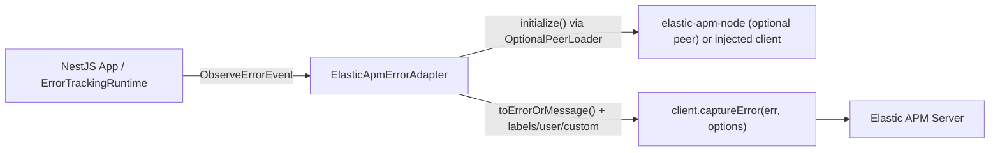

# `@aldok10/nestjs-observe-error-tracking-elastic-apm`

Elastic APM Node.js agent adapter for `@aldok10/nestjs-observe-error-tracking`, forwarding normalized errors, labels, user context, and custom metadata to `elastic-apm-node`.

## Overview

`@aldok10/nestjs-observe-error-tracking-elastic-apm` bridges `@aldok10/nestjs-observe-error-tracking` with the Elastic APM Node.js agent (`elastic-apm-node`). It translates `ObserveErrorEvent` fields into `captureError(errorOrMessage, options)` calls with `handled`, `labels`, `user`, and `custom` context, and supports flushing buffered events via `flush()`.

## Why This Package?

- **Native Elastic APM integration**: Correlates captured exceptions and messages with active Elastic APM transactions and traces.
- **Structured context mapping**: Maps `severity`, `tags`, `traceId`, `spanId` to `labels`, `user` (`id`, `username`, `email`) to `user`, and `context`/`job`/`database`/`attributes` to `custom`.
- **Optional peer loading**: Lazily resolves `elastic-apm-node` at `initialize()` time or accepts an injected `ElasticApmAgentLike` client for testing.

## Features

- Implements `ErrorTrackingAdapter` (`name: 'elastic-apm'`) with `deliveryMode: 'sdk-managed'`.
- Capabilities: `exceptions`, `messages`, `tags`, `userContext`, `traceCorrelation`, `transactions` (`breadcrumbs`, `fingerprinting`, `sessions`, and `profiling` are `false`).
- Supports `elastic-apm-node` `^4.0.0` as an optional peer dependency.
- Preserves string messages when `event.name === 'Message'` and constructs `Error` instances otherwise.
- Exposes `flush()` delegating to `client.flush()`.

## Architecture and Responsibilities



- **Adapter (`ElasticApmErrorAdapter`)**: Owns `elastic-apm-node` peer loading, event-to-Elastic-APM mapping, and `flush()` delegation.
- **Core Runtime (`@aldok10/nestjs-observe-error-tracking`)**: Owns NestJS exception capture, enrichment, redaction, deduplication, and delivery orchestration.

## Installation

```bash
pnpm add @aldok10/nestjs-observe-error-tracking-elastic-apm @aldok10/nestjs-observe-error-tracking @aldok10/nestjs-observe-core
```

```bash
npm install @aldok10/nestjs-observe-error-tracking-elastic-apm @aldok10/nestjs-observe-error-tracking @aldok10/nestjs-observe-core
```

```bash
yarn add @aldok10/nestjs-observe-error-tracking-elastic-apm @aldok10/nestjs-observe-error-tracking @aldok10/nestjs-observe-core
```

Install the optional peer dependency when using the Elastic APM agent:

```bash
pnpm add elastic-apm-node
```

## Requirements

- **Node.js**: `>=22`
- **Peer dependencies**: `elastic-apm-node` (`^4.0.0`, optional)
- **Module formats**: Dual ESM (`dist/index.js`) and CommonJS (`dist/index.cjs`) with TypeScript declarations (`dist/index.d.ts`)

## Quick Start

Start `elastic-apm-node` before importing NestJS (for example via `-r elastic-apm-node/start`), then register the adapter:

```ts
import { Module } from '@nestjs/common';
import { ErrorTrackingModule } from '@aldok10/nestjs-observe-error-tracking';
import { createElasticApmAdapter } from '@aldok10/nestjs-observe-error-tracking-elastic-apm';

@Module({
  imports: [
    ErrorTrackingModule.forRoot({
      resource: {
        serviceName: 'orders-api',
        environment: 'production',
      },
      destinations: [
        {
          name: 'elastic-apm',
          adapter: createElasticApmAdapter(),
        },
      ],
    }),
  ],
})
export class AppModule {}
```

## Configuration

`ElasticApmAdapterOptions`:

| Property | Type                  | Required | Default     | Description                                                                                |
| -------- | --------------------- | -------- | ----------- | ------------------------------------------------------------------------------------------ |
| `client` | `ElasticApmAgentLike` | No       | `undefined` | Pre-configured Elastic APM agent or test double; skips `OptionalPeerLoader` when provided. |

## Usage

### Direct Adapter Usage

```ts
import { normalizeError } from '@aldok10/nestjs-observe-error-tracking';
import { createElasticApmAdapter } from '@aldok10/nestjs-observe-error-tracking-elastic-apm';

const adapter = createElasticApmAdapter();
adapter.initialize();

adapter.capture(
  normalizeError(new Error('Database connection lost'), {
    tags: { service: 'api' },
    user: { id: 'u1', email: 'user@example.com' },
  }),
);

await adapter.flush();
```

### Event Field Mapping

`capture(event)` passes the following to `client.captureError(errorOrMessage, options)`:

- `handled`: `event.handled`
- `labels`: `{ severity: event.severity, ...event.tags }`, plus `traceId` and `spanId` when defined on `event.trace`
- `user`: `{ id, username, email }` (omitting `undefined` fields) when `event.user` is defined
- `custom`: `{ context, job, database, attributes }` (including each field when defined)

## Advanced Usage

### Injecting a Custom Agent Instance

```ts
import {
  createElasticApmAdapter,
  type ElasticApmAgentLike,
} from '@aldok10/nestjs-observe-error-tracking-elastic-apm';

const client: ElasticApmAgentLike = {
  captureError(error, options, callback) {
    // Custom forwarding
    callback?.();
  },
  flush(callback) {
    callback?.();
  },
};

const adapter = createElasticApmAdapter({ client });
```

## API Reference

- `ElasticApmErrorAdapter` — Class implementing `ErrorTrackingAdapter` (`name = 'elastic-apm'`).
  - `constructor(options?: ElasticApmAdapterOptions)`
  - `initialize(): void`
  - `capture(event: ObserveErrorEvent): void`
  - `flush(): Promise<void>`
- `createElasticApmAdapter(options?: ElasticApmAdapterOptions): ElasticApmErrorAdapter` — Factory helper returning an `ElasticApmErrorAdapter` instance.
- `ElasticApmAdapterOptions` — Configuration interface (`client?`).
- `ElasticApmAgentLike` — Structural interface for `elastic-apm-node` (`captureError`, optional `flush`).

## Integration with Other Packages

- `@aldok10/nestjs-observe-error-tracking`: Hosts `ElasticApmErrorAdapter` in `ErrorTrackingModule` / `ErrorTrackingRuntime`.
- `@aldok10/nestjs-observe-core`: Provides `OptionalPeerLoader` for lazy resolution of `elastic-apm-node`.

## Dependencies and Optional Integrations

- **Runtime dependencies**: `@aldok10/nestjs-observe-core`, `@aldok10/nestjs-observe-error-tracking`
- **Optional peer dependency**: `elastic-apm-node` (`^4.0.0`)

## Lifecycle and Resource Management

1. `initialize()` skips peer loading if `options.client` is provided; otherwise it loads `elastic-apm-node` via `OptionalPeerLoader` (unwrapping `.default` if present) and validates `captureError`.
2. `capture(event)` is synchronous (`void`).
3. `flush()` awaits `client.flush(cb)` if `client.flush` is defined, or resolves immediately otherwise. The adapter does not implement `shutdown()`.

## Error Handling

- Calling `capture()` before `initialize()` throws `Error('elastic-apm adapter is not initialized')`.
- If `elastic-apm-node` is missing during `initialize()`, `OptionalPeerLoader` throws a missing-peer error.
- If the loaded module does not expose `captureError`, `initialize()` throws `Error('Invalid elastic-apm-node exports: missing captureError')`.

## Performance Considerations

- `captureError()` is non-blocking; `elastic-apm-node` queues and transmits error payloads asynchronously to the Elastic APM Server.

## Security Considerations

- Configure redaction in `@aldok10/nestjs-observe-error-tracking` before events reach the adapter to prevent sensitive values in `custom`, `user`, or `labels` from being transmitted.

## Testing

Run the workspace test suite or target this package directly with Vitest:

```bash
pnpm test
pnpm exec vitest run packages/traces/error-tracking/adapter-elastic-apm
```

## Troubleshooting

- **`elastic-apm adapter is not initialized`**: Ensure `ErrorTrackingModule` has initialized or call `adapter.initialize()` before `capture()`.
- **Transactions not linked**: Start `elastic-apm-node` before importing NestJS (`node -r elastic-apm-node/start dist/main.js`).

## Limitations

- `breadcrumbs`, `fingerprinting`, `sessions`, and `profiling` are not supported (`false` in `capabilities`).
- Does not implement `shutdown()`.

## Related Packages

- [`@aldok10/nestjs-observe-error-tracking`](../error-tracking/README.md)
- [`@aldok10/nestjs-observe-error-tracking-testing`](../testing/README.md)
- [`@aldok10/nestjs-observe-core`](../../../core/README.md)
- [`@aldok10/nestjs-observe-tracing`](../../tracing/README.md)
- [`@aldok10/nestjs-observe`](../../../observer/observer/README.md)

## Documentation

- [Other Error Tracking Providers](../../../../docs/integrations/error-tracking-providers.md)
- [Error Tracking Overview](../../../../docs/packages/traces/error-tracking/README.md)
- [Installation Guide](../../../../docs/packages/traces/error-tracking/README.md)
- [Configuration Guide](../../../../docs/packages/traces/error-tracking/README.md)
- [Troubleshooting Guide](../../../../docs/operations/troubleshooting.md)

## Contributing

See [CONTRIBUTING.md](../../../../CONTRIBUTING.md).

## License

[MIT](../../../../LICENSE)
