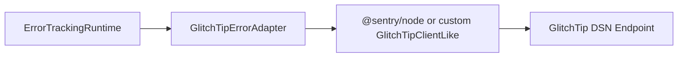

# `@aldok10/nestjs-observe-error-tracking-glitchtip`

GlitchTip adapter (Sentry-compatible DSN ingestion) for `@aldok10/nestjs-observe-error-tracking`.

## Overview

`@aldok10/nestjs-observe-error-tracking-glitchtip` connects `@aldok10/nestjs-observe-error-tracking` to GlitchTip using `@sentry/node` (or a compatible `GlitchTipClientLike` client). It configures Sentry-compatible DSN ingestion with GlitchTip-appropriate defaults (`autoSessionTracking: false` and `sendDefaultPii: false`) and advertises `sessions: false` and `profiling: false`.

## Why This Package?

- **GlitchTip-safe defaults:** Automatically disables Sentry session tracking and default PII collection when initializing via DSN.
- **Accurate capability reporting:** Declares `transactions: true`, `sessions: false`, and `profiling: false`.
- **Vendor-neutral portability:** Switch between GlitchTip, Sentry, or Bugsink without changing application error-capture calls.

## Features

- Dynamic loading of `@sentry/node` (`^8.0.0 || ^9.0.0 || ^10.0.0`) via `OptionalPeerLoader` or injection of a custom `GlitchTipClientLike`.
- Automatic `client.init(...)` with `autoSessionTracking: false` and `sendDefaultPii: false` when `dsn` is provided.
- Scoped capture (`withScope`) mapping `severity`, `tags`, `attributes` (extras), `user`, `fingerprint`, `trace` context, `context` (`observe`), and `breadcrumbs`.
- Uses `captureMessage` for `Message` events without an `exception`, and `captureException` otherwise.
- `flush(timeoutMs)` and `shutdown(timeoutMs)` lifecycle support.

## Architecture and Responsibilities



## Installation

```bash
pnpm add @aldok10/nestjs-observe-error-tracking-glitchtip @aldok10/nestjs-observe-error-tracking @sentry/node
```

```bash
npm install @aldok10/nestjs-observe-error-tracking-glitchtip @aldok10/nestjs-observe-error-tracking @sentry/node
```

```bash
yarn add @aldok10/nestjs-observe-error-tracking-glitchtip @aldok10/nestjs-observe-error-tracking @sentry/node
```

## Requirements

- **Node.js:** `>=22`
- **Module Formats:** ESM (`import`) and CJS (`require`) with TypeScript declarations (`.d.ts`)
- **Optional Peer Dependencies:**
  - `@sentry/node`: `^8.0.0 || ^9.0.0 || ^10.0.0`

## Quick Start

```ts
import { ErrorTrackingModule } from '@aldok10/nestjs-observe-error-tracking';
import { createGlitchTipAdapter } from '@aldok10/nestjs-observe-error-tracking-glitchtip';

ErrorTrackingModule.forRoot({
  destinations: [
    {
      name: 'glitchtip',
      adapter: createGlitchTipAdapter({
        dsn: process.env.GLITCHTIP_DSN,
        environment: process.env.NODE_ENV,
        release: '1.0.0',
      }),
    },
  ],
});
```

## Configuration

### `GlitchTipAdapterOptions`

| Property           | Type                  | Required | Default     | Description                                                                                                                                  |
| ------------------ | --------------------- | -------- | ----------- | -------------------------------------------------------------------------------------------------------------------------------------------- |
| `client`           | `GlitchTipClientLike` | No       | `undefined` | Custom or pre-loaded client. If omitted, `@sentry/node` is loaded during `initialize()`.                                                     |
| `dsn`              | `string`              | No       | `undefined` | GlitchTip DSN. When provided and `client.init` exists, initializes the client with `autoSessionTracking: false` and `sendDefaultPii: false`. |
| `environment`      | `string`              | No       | `undefined` | Environment name passed to `client.init()`.                                                                                                  |
| `release`          | `string`              | No       | `undefined` | Release identifier passed to `client.init()`.                                                                                                |
| `sampleRate`       | `number`              | No       | `undefined` | Error sample rate passed to `client.init()`.                                                                                                 |
| `tracesSampleRate` | `number`              | No       | `undefined` | Trace sample rate passed to `client.init()`.                                                                                                 |
| `closeClient`      | `boolean`             | No       | `true`      | Calls `client.close(timeoutMs)` during `shutdown()` unless set to `false`.                                                                   |

## Usage

```ts
import { createGlitchTipAdapter } from '@aldok10/nestjs-observe-error-tracking-glitchtip';

const adapter = createGlitchTipAdapter({
  dsn: 'https://key@glitchtip.example.com/1',
  environment: 'staging',
  sampleRate: 1.0,
});
```

## Advanced Usage

Inject a mock or pre-configured `GlitchTipClientLike` via `options.client` for unit testing or shared `@sentry/node` client lifecycles (with `closeClient: false`).

## API Reference

- `GlitchTipErrorAdapter` (implements `ErrorTrackingAdapter`, `name = 'glitchtip'`, `deliveryMode: 'sdk-managed'`)
  - `constructor(options: GlitchTipAdapterOptions)`
  - `initialize(): void`
  - `capture(event: ObserveErrorEvent): void`
  - `flush(timeoutMs?: number): Promise<void>` (default `timeoutMs = 2000`)
  - `shutdown(timeoutMs?: number): Promise<void>` (default `timeoutMs = 2000`)
- `createGlitchTipAdapter(options: GlitchTipAdapterOptions): GlitchTipErrorAdapter`
- `GlitchTipClientLike`
- `GlitchTipScopeLike`
- `GlitchTipAdapterOptions`

## Integration with Other Packages

- Requires `@aldok10/nestjs-observe-core` and `@aldok10/nestjs-observe-error-tracking`.
- Because `deliveryMode` is `'sdk-managed'`, `ErrorTrackingRuntime` defaults destination `maxRetries` to `0`.

## Dependencies and Optional Integrations

- **Direct dependencies:** `@aldok10/nestjs-observe-core` (`^0.1.1`), `@aldok10/nestjs-observe-error-tracking` (`^0.1.1`).
- **Optional peer dependency:** `@sentry/node` (`^8.0.0 || ^9.0.0 || ^10.0.0`).

## Lifecycle and Resource Management

- `initialize()` loads `@sentry/node` (if no `client` was provided) and calls `client.init(...)` when `dsn` is set.
- `flush(timeoutMs = 2000)` calls `client.flush?.(timeoutMs)`.
- `shutdown(timeoutMs = 2000)` flushes and calls `client.close?.(timeoutMs)` unless `closeClient === false`.

## Error Handling

- Throws if `@sentry/node` exports are invalid or missing `captureException`.
- Throws `glitchtip adapter is not initialized` if `capture()` is called before `initialize()`.

## Performance Considerations

- `capture()` delegates to `@sentry/node`'s async transport without blocking the caller.

## Security Considerations

- Sets `sendDefaultPii: false` during `client.init()` and relies on `ErrorTrackingRuntime`'s pre-dispatch redaction.

## Testing

```bash
pnpm test
```

```bash
pnpm exec vitest run packages/traces/error-tracking/adapter-glitchtip
```

## Troubleshooting

- **Errors not appearing in GlitchTip:** Verify the DSN points to your GlitchTip project and call `await tracker.flush()` before short-lived scripts exit.

## Limitations

- `sessions` and `profiling` capabilities are `false`.
- Breadcrumbs forwarded by this adapter include `message`, `category`, and `level` (not `data` or `timestamp`).

## Related Packages

- [`@aldok10/nestjs-observe-error-tracking`](../error-tracking/README.md)
- [`@aldok10/nestjs-observe-error-tracking-sentry`](../adapter-sentry/README.md)
- [`@aldok10/nestjs-observe-error-tracking-bugsink`](../adapter-bugsink/README.md)

## Documentation

- [GlitchTip Guide](../../../../docs/integrations/error-tracking-providers.md)
- [Configuration](../../../../docs/packages/traces/error-tracking/README.md)

## Contributing

See [CONTRIBUTING.md](../../../../CONTRIBUTING.md).

## License

MIT — see [LICENSE](../../../../LICENSE).
