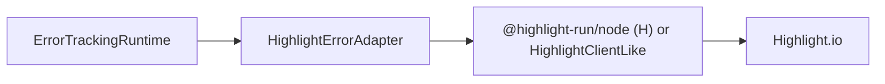

# `@aldok10/nestjs-observe-error-tracking-highlight`

Highlight.io adapter for `@aldok10/nestjs-observe-error-tracking`.

## Overview

`@aldok10/nestjs-observe-error-tracking-highlight` adapts `ObserveErrorEvent` payloads from `@aldok10/nestjs-observe-error-tracking` to `@highlight-run/node` (`H.consumeError`). It forwards exceptions, request IDs, session IDs, trace correlation, and string metadata to Highlight.io.

## Why This Package?

- **Session & trace correlation:** Maps `vendorContext.secureSessionId`, `context.requestId`, and `trace.traceId`/`trace.spanId` into `H.consumeError(...)`.
- **Optional SDK loading:** Loads `@highlight-run/node` dynamically via `OptionalPeerLoader` or accepts a pre-configured `HighlightClientLike`.
- **Vendor-neutral runtime:** Keeps redaction, filtering, and deduplication in `@aldok10/nestjs-observe-error-tracking`.

## Features

- Dynamic loading of `@highlight-run/node` (`^3.0.0 || ^4.0.0`, supporting both direct client and `{ H }` module export) or custom `HighlightClientLike` injection.
- Automatic `client.init(...)` when `projectID` is configured.
- Maps `event.tags`, `event.trace` (`traceId`, `spanId`), `event.source` (`module`, `operation`), and `event.severity` into `Record<string, string>` metadata.
- Extracts `vendorContext['secureSessionId']` and `context?.requestId` as `consumeError` arguments.
- `flush()` and `shutdown()` (flushes then calls `client.stop?.()`).

## Architecture and Responsibilities



## Installation

```bash
pnpm add @aldok10/nestjs-observe-error-tracking-highlight @aldok10/nestjs-observe-error-tracking @highlight-run/node
```

```bash
npm install @aldok10/nestjs-observe-error-tracking-highlight @aldok10/nestjs-observe-error-tracking @highlight-run/node
```

```bash
yarn add @aldok10/nestjs-observe-error-tracking-highlight @aldok10/nestjs-observe-error-tracking @highlight-run/node
```

## Requirements

- **Node.js:** `>=22`
- **Module Formats:** ESM (`import`) and CJS (`require`) with TypeScript declarations (`.d.ts`)
- **Optional Peer Dependencies:**
  - `@highlight-run/node`: `^3.0.0 || ^4.0.0`

## Quick Start

```ts
import { ErrorTrackingModule } from '@aldok10/nestjs-observe-error-tracking';
import { createHighlightAdapter } from '@aldok10/nestjs-observe-error-tracking-highlight';

ErrorTrackingModule.forRoot({
  destinations: [
    {
      name: 'highlight',
      adapter: createHighlightAdapter({
        projectID: process.env.HIGHLIGHT_PROJECT_ID,
        serviceName: 'orders-api',
        environment: process.env.NODE_ENV,
        serviceVersion: '1.0.0',
      }),
    },
  ],
});
```

## Configuration

### `HighlightAdapterOptions`

| Property         | Type                  | Required | Default     | Description                                                                                                       |
| ---------------- | --------------------- | -------- | ----------- | ----------------------------------------------------------------------------------------------------------------- |
| `client`         | `HighlightClientLike` | No       | `undefined` | Custom or pre-loaded Highlight client. If omitted, `@highlight-run/node` is loaded during `initialize()`.         |
| `projectID`      | `string`              | No       | `undefined` | Highlight project ID. When provided and `client.init` exists, `client.init(...)` is called during `initialize()`. |
| `serviceName`    | `string`              | No       | `undefined` | Service name passed to `client.init()`.                                                                           |
| `environment`    | `string`              | No       | `undefined` | Environment name passed to `client.init()`.                                                                       |
| `serviceVersion` | `string`              | No       | `undefined` | Service version passed to `client.init()`.                                                                        |
| `otlpEndpoint`   | `string`              | No       | `undefined` | Custom OTLP endpoint passed to `client.init()`.                                                                   |

## Usage

### Attaching a Highlight Session ID

```ts
await tracker.captureException(error, {
  context: { requestId: 'req-123' },
  vendorContext: { secureSessionId: 'session-abc' },
  tags: { feature: 'checkout' },
});
```

## Advanced Usage

Pass a pre-initialized `HighlightClientLike` (or mock) via `options.client` without `projectID` if `@highlight-run/node` is initialized elsewhere in your application bootstrap.

## API Reference

- `HighlightErrorAdapter` (implements `ErrorTrackingAdapter`, `name = 'highlight'`, `deliveryMode: 'sdk-managed'`)
  - `constructor(options: HighlightAdapterOptions)`
  - `initialize(): void`
  - `capture(event: ObserveErrorEvent): void`
  - `flush(): Promise<void>`
  - `shutdown(): Promise<void>`
- `createHighlightAdapter(options: HighlightAdapterOptions): HighlightErrorAdapter`
- `HighlightClientLike`
- `HighlightAdapterOptions`

## Integration with Other Packages

- Requires `@aldok10/nestjs-observe-core` and `@aldok10/nestjs-observe-error-tracking`.
- Uses `deliveryMode: 'sdk-managed'`, so `ErrorTrackingRuntime` defaults destination `maxRetries` to `0`.

## Dependencies and Optional Integrations

- **Direct dependencies:** `@aldok10/nestjs-observe-core` (`^0.1.1`), `@aldok10/nestjs-observe-error-tracking` (`^0.1.1`).
- **Optional peer dependency:** `@highlight-run/node` (`^3.0.0 || ^4.0.0`).

## Lifecycle and Resource Management

- `initialize()` resolves `@highlight-run/node` (unwrapping `.H` if present) and calls `client.init(...)` when `projectID` is set.
- `flush()` awaits `client.flush?.()`.
- `shutdown()` awaits `flush()` and then `client.stop?.()`.

## Error Handling

- Throws `Invalid @highlight-run/node exports` if the loaded module does not expose `consumeError`.
- Throws `highlight adapter is not initialized` if `capture()` is called before `initialize()`.

## Performance Considerations

- `capture()` invokes `client.consumeError(...)` synchronously; Highlight's SDK handles batching and background export.

## Security Considerations

- Only string metadata (`tags`, `traceId`, `spanId`, `module`, `operation`, `severity`) is forwarded to `consumeError`; events are pre-redacted by `ErrorTrackingRuntime`.

## Testing

```bash
pnpm test
```

```bash
pnpm exec vitest run packages/traces/error-tracking/adapter-highlight
```

## Troubleshooting

- **Missing session link in Highlight UI:** Ensure `vendorContext: { secureSessionId: '...' }` is provided on `captureException`.

## Limitations

- `messages`, `breadcrumbs`, `fingerprinting`, `userContext`, and `profiling` capabilities are `false`.

## Related Packages

- [`@aldok10/nestjs-observe-error-tracking`](../error-tracking/README.md)
- [`@aldok10/nestjs-observe-error-tracking-otlp`](../adapter-otlp/README.md)

## Documentation

- [Highlight Guide](../../../../docs/integrations/error-tracking-providers.md)
- [Configuration](../../../../docs/packages/traces/error-tracking/README.md)

## Contributing

See [CONTRIBUTING.md](../../../../CONTRIBUTING.md).

## License

MIT — see [LICENSE](../../../../LICENSE).
