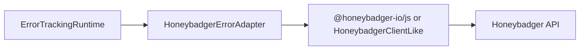

# `@aldok10/nestjs-observe-error-tracking-honeybadger`

Honeybadger adapter for `@aldok10/nestjs-observe-error-tracking`.

## Overview

`@aldok10/nestjs-observe-error-tracking-honeybadger` adapts `ObserveErrorEvent` payloads from `@aldok10/nestjs-observe-error-tracking` to `@honeybadger-io/js` (or a compatible `HoneybadgerClientLike`). It maps component/action, fingerprints, tags, breadcrumbs, and structured context onto Honeybadger notices.

## Why This Package?

- **Safe configuration defaults:** Disables `enableUncaught` and `enableUnhandledRejection` when configuring `@honeybadger-io/js` so `ProcessErrorMonitor` or your app retains control of process-level handlers.
- **Async-first delivery:** Uses `client.notifyAsync` when available, falling back to `client.notify`.
- **Optional peer dependency:** Loads `@honeybadger-io/js` dynamically via `OptionalPeerLoader` or accepts a pre-configured `client`.

## Features

- Dynamic loading of `@honeybadger-io/js` (`^5.0.0 || ^6.0.0`, unwrapping `.default` if present) or custom `HoneybadgerClientLike` injection.
- Optional `client.configure(...)` during `initialize()` when `apiKey` is provided.
- Maps `source.module` -> `component`, `source.operation` -> `action`, `fingerprint` -> `fingerprint.join(':')`, `tags` -> `["key:value"]`, and `breadcrumbs` -> `client.addBreadcrumb(...)`.
- Attaches `context`, `trace`, `user` (`user_id`, `user_email`), `job`, `database`, and `attributes` inside `notice.context`.

## Architecture and Responsibilities



## Installation

```bash
pnpm add @aldok10/nestjs-observe-error-tracking-honeybadger @aldok10/nestjs-observe-error-tracking @honeybadger-io/js
```

```bash
npm install @aldok10/nestjs-observe-error-tracking-honeybadger @aldok10/nestjs-observe-error-tracking @honeybadger-io/js
```

```bash
yarn add @aldok10/nestjs-observe-error-tracking-honeybadger @aldok10/nestjs-observe-error-tracking @honeybadger-io/js
```

## Requirements

- **Node.js:** `>=22`
- **Module Formats:** ESM (`import`) and CJS (`require`) with TypeScript declarations (`.d.ts`)
- **Optional Peer Dependencies:**
  - `@honeybadger-io/js`: `^5.0.0 || ^6.0.0`

## Quick Start

```ts
import { ErrorTrackingModule } from '@aldok10/nestjs-observe-error-tracking';
import { createHoneybadgerAdapter } from '@aldok10/nestjs-observe-error-tracking-honeybadger';

ErrorTrackingModule.forRoot({
  destinations: [
    {
      name: 'honeybadger',
      adapter: createHoneybadgerAdapter({
        apiKey: process.env.HONEYBADGER_API_KEY,
        environment: process.env.NODE_ENV,
        revision: '1.0.0',
      }),
    },
  ],
});
```

## Configuration

### `HoneybadgerAdapterOptions`

| Property      | Type                    | Required | Default     | Description                                                                                                                                                         |
| ------------- | ----------------------- | -------- | ----------- | ------------------------------------------------------------------------------------------------------------------------------------------------------------------- |
| `client`      | `HoneybadgerClientLike` | No       | `undefined` | Custom or pre-configured Honeybadger client. If omitted, `@honeybadger-io/js` is loaded during `initialize()`.                                                      |
| `apiKey`      | `string`                | No       | `undefined` | Honeybadger API key. When provided and `client.configure` exists, calls `client.configure(...)` with `enableUncaught: false` and `enableUnhandledRejection: false`. |
| `environment` | `string`                | No       | `undefined` | Environment name passed to `client.configure()`.                                                                                                                    |
| `revision`    | `string`                | No       | `undefined` | Git SHA or release revision passed to `client.configure()`.                                                                                                         |

## Usage

```ts
import Honeybadger from '@honeybadger-io/js';
import { createHoneybadgerAdapter } from '@aldok10/nestjs-observe-error-tracking-honeybadger';

Honeybadger.configure({ apiKey: process.env.HONEYBADGER_API_KEY });

const adapter = createHoneybadgerAdapter({
  client: Honeybadger,
});
```

## Advanced Usage

Combine `source: { module: 'billing', operation: 'charge' }` and `fingerprint: ['billing', 'charge']` on `captureException()` to populate Honeybadger's `component`, `action`, and `fingerprint` fields cleanly.

## API Reference

- `HoneybadgerErrorAdapter` (implements `ErrorTrackingAdapter`, `name = 'honeybadger'`, `deliveryMode: 'sdk-managed'`)
  - `constructor(options: HoneybadgerAdapterOptions)`
  - `initialize(): void`
  - `capture(event: ObserveErrorEvent): Promise<void>`
- `createHoneybadgerAdapter(options: HoneybadgerAdapterOptions): HoneybadgerErrorAdapter`
- `HoneybadgerClientLike`
- `HoneybadgerAdapterOptions`

## Integration with Other Packages

- Requires `@aldok10/nestjs-observe-core` and `@aldok10/nestjs-observe-error-tracking`.
- Uses `deliveryMode: 'sdk-managed'`, so `ErrorTrackingRuntime` defaults destination `maxRetries` to `0`.

## Dependencies and Optional Integrations

- **Direct dependencies:** `@aldok10/nestjs-observe-core` (`^0.1.0`), `@aldok10/nestjs-observe-error-tracking` (`^0.1.0`).
- **Optional peer dependency:** `@honeybadger-io/js` (`^5.0.0 || ^6.0.0`).

## Lifecycle and Resource Management

- `initialize()` resolves `@honeybadger-io/js` (if `client` is omitted) and calls `client.configure(...)` when `apiKey` is provided.
- Does not implement `flush()` or `shutdown()`.

## Error Handling

- Throws `Invalid @honeybadger-io/js exports` if the loaded module lacks `notify`.
- Throws `honeybadger adapter is not initialized` if `capture()` is called before `initialize()`.

## Performance Considerations

- Prefers `client.notifyAsync(...)` when available so `ErrorTrackingRuntime` awaits notice delivery within its bounded concurrency and timeout policy.

## Security Considerations

- All `context`, `job`, `database`, `attributes`, and `tags` fields are pre-redacted by `ErrorTrackingRuntime` before being passed to Honeybadger.

## Testing

```bash
pnpm test
```

```bash
pnpm exec vitest run packages/traces/error-tracking/adapter-honeybadger
```

## Troubleshooting

- **Missing `component` or `action` in Honeybadger:** Provide `source: { module, operation }` when calling `captureException()`.

## Limitations

- `user` context forwards `user_id` and `user_email` into `notice.context` (`username` and `ipAddress` are not mapped).
- `transactions`, `sessions`, and `profiling` capabilities are `false`.
- Does not implement `flush()` or `shutdown()`.

## Related Packages

- [`@aldok10/nestjs-observe-error-tracking`](../error-tracking/README.md)
- [`@aldok10/nestjs-observe-error-tracking-bugsnag`](../adapter-bugsnag/README.md)
- [`@aldok10/nestjs-observe-error-tracking-rollbar`](../adapter-rollbar/README.md)

## Documentation

- [Honeybadger Guide](../../../../docs/integrations/error-tracking-providers.md)
- [Configuration](../../../../docs/packages/traces/error-tracking/README.md)

## Contributing

See [CONTRIBUTING.md](../../../../CONTRIBUTING.md).

## License

MIT — see [LICENSE](../../../../LICENSE).
