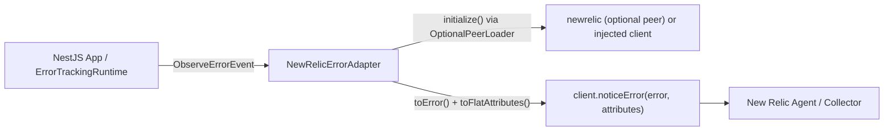

# `@aldok10/nestjs-observe-error-tracking-new-relic`

New Relic Node.js agent adapter for `@aldok10/nestjs-observe-error-tracking`, forwarding normalized error events and flat attributes to `newrelic.noticeError()`.

## Overview

`@aldok10/nestjs-observe-error-tracking-new-relic` connects the vendor-neutral `@aldok10/nestjs-observe-error-tracking` runtime to the New Relic Node.js APM agent (`newrelic`). It converts `ObserveErrorEvent` payloads into `Error` instances with flattened primitive custom attributes and delegates delivery and transaction correlation to the preloaded New Relic agent.

## Why This Package?

- **Transaction correlation**: Automatically associates captured errors with active New Relic transactions via the native `newrelic` agent.
- **Flat primitive attributes**: Maps `severity`, `handled`, resource metadata, trace IDs, request/correlation IDs, job/database context, and `tag.*` entries to New Relic's flat `string | number | boolean` attribute format.
- **Optional peer loading**: Lazily resolves `newrelic` at `initialize()` time or accepts an injected `NewRelicAgentLike` client for testing and custom setups.
- **Controlled shutdown**: Leaves the process-wide New Relic agent running on shutdown by default unless `shutdownAgent: true` is explicitly configured.

## Features

- Implements `ErrorTrackingAdapter` (`name: 'new-relic'`) with `deliveryMode: 'sdk-managed'`.
- Capabilities: `exceptions`, `messages`, `tags`, `traceCorrelation`, `transactions` (`breadcrumbs`, `fingerprinting`, `userContext`, `sessions`, and `profiling` are `false`).
- Supports both preloaded `newrelic` peer resolution (`newrelic` `^11.0.0 || ^12.0.0`) and explicit `client` injection.
- Converts non-`Error` `ObserveErrorEvent` payloads into `Error` instances preserving `name`, `message`, and `stack`.
- Supports graceful agent flushing on `shutdown(timeoutMs)` when `shutdownAgent: true` is enabled.

## Architecture and Responsibilities



- **Adapter (`NewRelicErrorAdapter`)**: Owns peer resolution, event-to-error normalization, flat attribute mapping, and optional shutdown delegation.
- **Core Runtime (`@aldok10/nestjs-observe-error-tracking`)**: Owns NestJS exception capture, enrichment, redaction, deduplication, sampling, and retry/queue orchestration.

## Installation

```bash
pnpm add @aldok10/nestjs-observe-error-tracking-new-relic @aldok10/nestjs-observe-error-tracking @aldok10/nestjs-observe-core
```

```bash
npm install @aldok10/nestjs-observe-error-tracking-new-relic @aldok10/nestjs-observe-error-tracking @aldok10/nestjs-observe-core
```

```bash
yarn add @aldok10/nestjs-observe-error-tracking-new-relic @aldok10/nestjs-observe-error-tracking @aldok10/nestjs-observe-core
```

Install the optional peer dependency when using the native New Relic agent:

```bash
pnpm add newrelic
```

## Requirements

- **Node.js**: `>=22`
- **Peer dependencies**: `newrelic` (`^11.0.0 || ^12.0.0`, optional)
- **Module formats**: Dual ESM (`dist/index.js`) and CommonJS (`dist/index.cjs`) with TypeScript declarations (`dist/index.d.ts`)

## Quick Start

Preload `newrelic` before your application entry point so HTTP, framework, and database drivers are instrumented:

```bash
node -r newrelic dist/main.js
# or for ESM:
node --import newrelic dist/main.js
```

Register the adapter in `ErrorTrackingModule.forRoot()`:

```ts
import { Module } from '@nestjs/common';
import { ErrorTrackingModule } from '@aldok10/nestjs-observe-error-tracking';
import { createNewRelicAdapter } from '@aldok10/nestjs-observe-error-tracking-new-relic';

@Module({
  imports: [
    ErrorTrackingModule.forRoot({
      resource: {
        serviceName: 'orders-api',
        environment: 'production',
        release: '1.0.0',
      },
      destinations: [
        {
          name: 'new-relic',
          adapter: createNewRelicAdapter(),
        },
      ],
    }),
  ],
})
export class AppModule {}
```

## Configuration

`NewRelicAdapterOptions`:

| Property        | Type                | Required | Default     | Description                                                                                                     |
| --------------- | ------------------- | -------- | ----------- | --------------------------------------------------------------------------------------------------------------- |
| `client`        | `NewRelicAgentLike` | No       | `undefined` | Pre-configured New Relic agent or test double; skips `OptionalPeerLoader` when provided.                        |
| `shutdownAgent` | `boolean`           | No       | `false`     | When `true`, `shutdown(timeoutMs)` invokes `client.shutdown({ collectPendingData: true, timeout: timeoutMs })`. |

## Usage

### Direct Adapter Usage

```ts
import { normalizeError } from '@aldok10/nestjs-observe-error-tracking';
import { createNewRelicAdapter } from '@aldok10/nestjs-observe-error-tracking-new-relic';

const adapter = createNewRelicAdapter();
adapter.initialize();

adapter.capture(
  normalizeError(new Error('Payment gateway timeout'), {
    trace: { traceId: '4bf92f3577b34da6a3ce929d0e0e4736', spanId: '00f067aa0ba902b7' },
    tags: { region: 'us-east-1' },
  }),
);
```

### Attribute Mapping

`capture(event)` sends the following custom attributes to `client.noticeError(error, attributes)`:

- Always set: `severity`, `handled`
- Conditionally set when defined: `serviceName`, `environment`, `release`, `traceId`, `spanId`, `requestId`, `correlationId`, `module` (`event.source.module`), `operation` (`event.source.operation`), `job.queueName`, `job.jobId`, `db.system`, `db.operation`
- Tags: Each entry in `event.tags` is mapped as `tag.<key>: <value>`

## Advanced Usage

### Injecting a Custom or Mocked Agent

```ts
import {
  createNewRelicAdapter,
  type NewRelicAgentLike,
} from '@aldok10/nestjs-observe-error-tracking-new-relic';

const customClient: NewRelicAgentLike = {
  noticeError(error, customAttributes) {
    // Forward to a custom or wrapped New Relic instance
  },
  shutdown(options, callback) {
    callback?.();
  },
};

const adapter = createNewRelicAdapter({
  client: customClient,
  shutdownAgent: true,
});
```

## API Reference

- `NewRelicErrorAdapter` — Class implementing `ErrorTrackingAdapter` (`name = 'new-relic'`).
  - `constructor(options?: NewRelicAdapterOptions)`
  - `initialize(): void`
  - `capture(event: ObserveErrorEvent): void`
  - `shutdown(timeoutMs?: number): Promise<void>` (default `timeoutMs = 2000`)
- `createNewRelicAdapter(options?: NewRelicAdapterOptions): NewRelicErrorAdapter` — Factory helper returning a `NewRelicErrorAdapter` instance.
- `NewRelicAdapterOptions` — Configuration interface (`client?`, `shutdownAgent?`).
- `NewRelicAgentLike` — Structural interface for `newrelic` (`noticeError`, optional `addCustomAttributes`, optional `shutdown`).
- `NewRelicAttributeValue` — Type alias `string | number | boolean`.

## Integration with Other Packages

- `@aldok10/nestjs-observe-error-tracking`: Hosts `NewRelicErrorAdapter` as a destination in `ErrorTrackingModule` / `ErrorTrackingRuntime`.
- `@aldok10/nestjs-observe-core`: Provides `OptionalPeerLoader` for lazy resolution of `newrelic`.

## Dependencies and Optional Integrations

- **Runtime dependencies**: `@aldok10/nestjs-observe-core`, `@aldok10/nestjs-observe-error-tracking`
- **Optional peer dependency**: `newrelic` (`^11.0.0 || ^12.0.0`)

## Lifecycle and Resource Management

1. `initialize()` skips peer loading if `options.client` was provided; otherwise it loads `newrelic` via `OptionalPeerLoader` (unwrapping `.default` if present) and validates `noticeError`.
2. `capture(event)` is synchronous (`void`) and throws if `initialize()` has not been called (when `client` was not injected).
3. `shutdown(timeoutMs = 2000)` resolves immediately unless `options.shutdownAgent === true` and `client.shutdown` is defined, in which case it waits for `client.shutdown({ collectPendingData: true, timeout: timeoutMs }, cb)` to invoke its callback.

## Error Handling

- Calling `capture()` before `initialize()` throws `Error('new-relic adapter is not initialized')`.
- If `newrelic` is missing when `initialize()` loads the peer, `OptionalPeerLoader` throws a descriptive missing-peer error.
- If the loaded module does not expose `noticeError`, `initialize()` throws `Error('Invalid newrelic agent exports: missing noticeError')`.

## Performance Considerations

- Event delivery is `sdk-managed` and non-blocking from the adapter's perspective; the New Relic Node.js agent buffers and harvests error traces asynchronously.
- Attribute conversion creates a single flat object per captured event without deep cloning.

## Security Considerations

- Configure redaction in `@aldok10/nestjs-observe-error-tracking` before events reach the adapter; `NewRelicErrorAdapter` forwards `event.message`, `event.stack`, and `event.tags` as-is.
- User PII fields (`event.user`) are not forwarded (`capabilities.userContext` is `false`).

## Testing

Run the workspace test suite or target this package directly with Vitest:

```bash
pnpm test
pnpm exec vitest run packages/traces/error-tracking/adapter-new-relic
```

## Troubleshooting

- **`new-relic adapter is not initialized`**: Ensure `ErrorTrackingModule` finished initializing or call `adapter.initialize()` before `capture()`.
- **Transactions not correlated in New Relic**: Verify `newrelic` is preloaded with `-r newrelic` or `--import newrelic` before importing `@nestjs/core`.

## Limitations

- `breadcrumbs`, `fingerprinting`, `userContext`, `sessions`, and `profiling` are not supported (`false` in `capabilities`).
- `NewRelicAgentLike.addCustomAttributes` is declared on the interface for structural compatibility, but `capture()` only calls `noticeError()`.

## Related Packages

- [`@aldok10/nestjs-observe-error-tracking`](../error-tracking/README.md)
- [`@aldok10/nestjs-observe-error-tracking-testing`](../testing/README.md)
- [`@aldok10/nestjs-observe-core`](../../../core/README.md)
- [`@aldok10/nestjs-observe-tracing`](../../tracing/README.md)
- [`@aldok10/nestjs-observe`](../../../observer/observer/README.md)

## Documentation

- [New Relic Adapter Guide](../../../../docs/integrations/error-tracking-providers.md)
- [Error Tracking Overview](../../../../docs/packages/traces/error-tracking/README.md)
- [Installation Guide](../../../../docs/packages/traces/error-tracking/README.md)
- [Configuration Guide](../../../../docs/packages/traces/error-tracking/README.md)
- [Troubleshooting Guide](../../../../docs/operations/troubleshooting.md)

## Contributing

See [CONTRIBUTING.md](../../../../CONTRIBUTING.md).

## License

[MIT](../../../../LICENSE)
