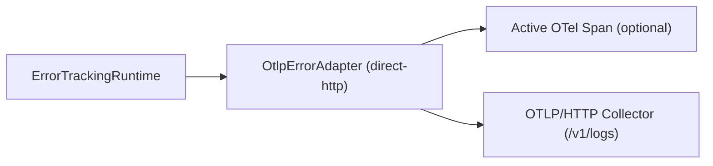

# `@aldok10/nestjs-observe-error-tracking-otlp`

OpenTelemetry OTLP/HTTP error-log and span exception adapter for `@aldok10/nestjs-observe-error-tracking`.

## Overview

`@aldok10/nestjs-observe-error-tracking-otlp` exports `ObserveErrorEvent` payloads directly to an OpenTelemetry collector over OTLP/HTTP JSON (`/v1/logs`) using Node.js's built-in `fetch`, and optionally records exceptions on the active OpenTelemetry span when `@opentelemetry/api` is present.

## Why This Package?

- **Zero vendor SDK required:** Ships OTLP/HTTP JSON log records using native `fetch` with no external OTLP exporter dependency.
- **Unified trace & log correlation:** Optionally records the exception and error status on the active OpenTelemetry span (`recordOnActiveSpan: true` by default) while attaching `traceId`, `spanId`, and `flags` to the OTLP log record.
- **Core-managed retries:** Uses `deliveryMode: 'direct-http'`, so `ErrorTrackingRuntime` handles queuing, timeouts, and retries automatically.

## Features

- Posts OTLP/HTTP JSON `resourceLogs` payloads to `<endpoint>/v1/logs` (preserving `endpoint` if it already ends with `/v1/logs`).
- Maps `ObserveErrorEvent` fields to OpenTelemetry semantic attributes: `service.name`, `service.version`, `deployment.environment`, `host.name`, `exception.type`, `exception.message`, `exception.stacktrace`, `error.handled`, `code.namespace`, `code.function`, `request.id`, and `tag.<key>`.
- Maps `ErrorSeverity` to OTLP severity numbers/text: `info` (`9`/`INFO`), `warning` (`13`/`WARN`), `error` (`17`/`ERROR`), `fatal` (`21`/`FATAL`).
- Supports custom HTTP headers (e.g., `authorization`) and request timeouts (`timeoutMs`, default `3000` ms) with `AbortSignal` propagation.
- Optionally records exceptions and sets status code `2` on the active `@opentelemetry/api` span.

## Architecture and Responsibilities



## Installation

```bash
pnpm add @aldok10/nestjs-observe-error-tracking-otlp @aldok10/nestjs-observe-error-tracking
```

```bash
npm install @aldok10/nestjs-observe-error-tracking-otlp @aldok10/nestjs-observe-error-tracking
```

```bash
yarn add @aldok10/nestjs-observe-error-tracking-otlp @aldok10/nestjs-observe-error-tracking
```

Optional peer dependency for active span exception recording:

```bash
pnpm add @opentelemetry/api
```

## Requirements

- **Node.js:** `>=22`
- **Module Formats:** ESM (`import`) and CJS (`require`) with TypeScript declarations (`.d.ts`)
- **Optional Peer Dependencies:**
  - `@opentelemetry/api`: `^1.10.0`

## Quick Start

```ts
import { ErrorTrackingModule } from '@aldok10/nestjs-observe-error-tracking';
import { createOtlpErrorAdapter } from '@aldok10/nestjs-observe-error-tracking-otlp';

ErrorTrackingModule.forRoot({
  resource: {
    serviceName: 'orders-api',
    serviceVersion: '1.0.0',
    environment: 'production',
  },
  destinations: [
    {
      name: 'otlp',
      adapter: createOtlpErrorAdapter({
        endpoint: 'http://localhost:4318',
        headers: {
          authorization: 'Bearer otlp-token',
        },
      }),
    },
  ],
});
```

## Configuration

### `OtlpErrorAdapterOptions`

| Property             | Type                               | Required | Default     | Description                                                                                                                                       |
| -------------------- | ---------------------------------- | -------- | ----------- | ------------------------------------------------------------------------------------------------------------------------------------------------- |
| `endpoint`           | `string`                           | Yes      | —           | Base OTLP/HTTP collector URL or full `/v1/logs` URL. Trailing slashes are trimmed and `/v1/logs` is appended if not already present.              |
| `headers`            | `Readonly<Record<string, string>>` | No       | `undefined` | Additional HTTP headers merged into the `POST` request alongside `content-type: application/json`.                                                |
| `timeoutMs`          | `number`                           | No       | `3000`      | Request timeout in milliseconds before aborting `fetch`.                                                                                          |
| `recordOnActiveSpan` | `boolean`                          | No       | `true`      | When not `false`, loads `@opentelemetry/api` (if installed) and calls `recordException` and `setStatus({ code: 2, message })` on the active span. |

## Usage

### Direct Collector Endpoint

```ts
import { createOtlpErrorAdapter } from '@aldok10/nestjs-observe-error-tracking-otlp';

const adapter = createOtlpErrorAdapter({
  endpoint: 'https://otel-collector.internal:4318/v1/logs',
  timeoutMs: 5000,
  recordOnActiveSpan: false,
});
```

## Advanced Usage

Combine `OtlpErrorAdapter` with `@aldok10/nestjs-observe-tracing` and `createTraceContextEnricher()` from `@aldok10/nestjs-observe-error-tracking` so every OTLP error log record carries `traceId`, `spanId`, and `flags` for correlation in your observability backend.

## API Reference

- `OtlpErrorAdapter` (implements `ErrorTrackingAdapter`, `name = 'otlp'`, `deliveryMode: 'direct-http'`)
  - `constructor(options: OtlpErrorAdapterOptions)`
  - `capture(event: ObserveErrorEvent, signal?: AbortSignal): Promise<void>`
- `createOtlpErrorAdapter(options: OtlpErrorAdapterOptions): OtlpErrorAdapter`
- `OtlpErrorAdapterOptions`

## Integration with Other Packages

- Requires `@aldok10/nestjs-observe-core` (`tryLoadOptionalPeer`) and `@aldok10/nestjs-observe-error-tracking`.
- Because `deliveryMode` is `'direct-http'`, `ErrorTrackingRuntime` defaults destination `maxRetries` to `1` and manages queuing/concurrency.

## Dependencies and Optional Integrations

- **Direct dependencies:** `@aldok10/nestjs-observe-core` (`^0.1.0`), `@aldok10/nestjs-observe-error-tracking` (`^0.1.0`).
- **Optional peer dependency:** `@opentelemetry/api` (`^1.10.0`).

## Lifecycle and Resource Management

- Stateless HTTP adapter; no `initialize()`, `flush()`, or `shutdown()` hooks are needed.
- Timeout timers created during `capture()` call `timer.unref()` and are cleared in `finally`, along with external `AbortSignal` listeners.

## Error Handling

- Throws `Error("OTLP error export failed with HTTP <status>")` on any non-2xx HTTP response, allowing `ErrorTrackingRuntime` to retry or record failure diagnostics.
- Aborts the request if either `timeoutMs` expires or the runtime's `AbortSignal` fires.

## Performance Considerations

- Sends one JSON HTTP `POST` per captured event (`fetch`); use `ErrorTrackingRuntime`'s `sampling`, `deduplication`, and `delivery.maxConcurrent` options to control export volume.

## Security Considerations

- Pass authentication tokens via `options.headers`.
- Events are redacted by `ErrorTrackingRuntime` before `buildOtlpLogsPayload(event)` serializes attributes and stack traces.

## Testing

```bash
pnpm test
```

```bash
pnpm exec vitest run packages/traces/error-tracking/adapter-otlp
```

## Troubleshooting

- **HTTP 404 from collector:** Ensure your collector has the OTLP/HTTP receiver enabled (typically port `4318`) and accepts `/v1/logs`.
- **Timeout errors:** Increase `timeoutMs` in `OtlpErrorAdapterOptions` and `delivery.timeoutMs` in `ErrorTrackingOptions` if your collector is behind high-latency networks.

## Limitations

- Uses OTLP/HTTP JSON (`content-type: application/json`) rather than OTLP/gRPC or Protobuf.
- `breadcrumbs`, `fingerprinting`, `userContext`, `transactions`, `sessions`, and `profiling` capabilities are `false`.

## Related Packages

- [`@aldok10/nestjs-observe-error-tracking`](../error-tracking/README.md)
- [`@aldok10/nestjs-observe-tracing`](../../tracing/README.md)
- [`@aldok10/nestjs-observe-error-tracking-highlight`](../adapter-highlight/README.md)

## Documentation

- [OTLP Guide](../../../../docs/integrations/error-tracking-providers.md)
- [Configuration](../../../../docs/packages/traces/error-tracking/README.md)

## Contributing

See [CONTRIBUTING.md](../../../../CONTRIBUTING.md).

## License

MIT — see [LICENSE](../../../../LICENSE).
