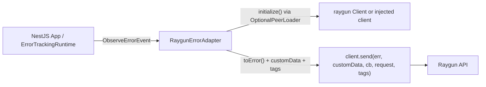

# `@aldok10/nestjs-observe-error-tracking-raygun`

Raygun Node.js SDK adapter for `@aldok10/nestjs-observe-error-tracking`, sending normalized errors, custom data, and tags via `raygun`.

## Overview

`@aldok10/nestjs-observe-error-tracking-raygun` integrates `@aldok10/nestjs-observe-error-tracking` with the Raygun Node.js SDK (`raygun`). During `initialize()`, it resolves `raygun` (or uses an injected `RaygunClientLike` instance) and optionally initializes it with `apiKey` and `batch`. During `capture()`, it sends exceptions, `customData`, optional `vendorContext.request`, and `key:value` tags via `client.send()`.

## Why This Package?

- **Managed Raygun client**: Supports both `apiKey`-based initialization (with `reportUncaughtExceptions: false` and configurable `batch`) and direct `client` injection.
- **Callback-to-Promise bridging**: Wraps `client.send()`'s callback API in a `Promise<void>` so `@aldok10/nestjs-observe-error-tracking` can track delivery success, failures, and retries.
- **Graceful shutdown**: Calls `client.stop?.()` during `shutdown()`.

## Features

- Implements `ErrorTrackingAdapter` (`name: 'raygun'`) with `deliveryMode: 'sdk-managed'`.
- Capabilities: `exceptions`, `messages`, `tags`, `userContext`, `traceCorrelation` (`breadcrumbs`, `fingerprinting`, `transactions`, `sessions`, and `profiling` are `false`).
- Supports `raygun` `^0.14.0 || ^1.0.0` as an optional peer dependency.
- Maps `severity:<level>` and `event.tags` entries (`<key>:<value>`) into Raygun string tags.
- Forwards `context`, `trace`, `user`, and `attributes` in `customData`, and passes `event.vendorContext?.request` as the request argument.

## Architecture and Responsibilities



- **Adapter (`RaygunErrorAdapter`)**: Owns `raygun` peer loading/initialization, `customData` and tag formatting, callback-to-Promise `send()` wrapping, and `stop()` on shutdown.
- **Core Runtime (`@aldok10/nestjs-observe-error-tracking`)**: Owns NestJS exception capture, enrichment, redaction, deduplication, and retry/queue orchestration.

## Installation

```bash
pnpm add @aldok10/nestjs-observe-error-tracking-raygun @aldok10/nestjs-observe-error-tracking @aldok10/nestjs-observe-core
```

```bash
npm install @aldok10/nestjs-observe-error-tracking-raygun @aldok10/nestjs-observe-error-tracking @aldok10/nestjs-observe-core
```

```bash
yarn add @aldok10/nestjs-observe-error-tracking-raygun @aldok10/nestjs-observe-error-tracking @aldok10/nestjs-observe-core
```

Install the optional peer dependency when using `raygun`:

```bash
pnpm add raygun
```

## Requirements

- **Node.js**: `>=22`
- **Peer dependencies**: `raygun` (`^0.14.0 || ^1.0.0`, optional)
- **Module formats**: Dual ESM (`dist/index.js`) and CommonJS (`dist/index.cjs`) with TypeScript declarations (`dist/index.d.ts`)

## Quick Start

```ts
import { Module } from '@nestjs/common';
import { ErrorTrackingModule } from '@aldok10/nestjs-observe-error-tracking';
import { createRaygunAdapter } from '@aldok10/nestjs-observe-error-tracking-raygun';

@Module({
  imports: [
    ErrorTrackingModule.forRoot({
      resource: {
        serviceName: 'orders-api',
        environment: 'production',
        release: '1.0.0',
      },
      destinations: [
        {
          name: 'raygun',
          adapter: createRaygunAdapter({
            apiKey: process.env.RAYGUN_API_KEY,
          }),
        },
      ],
    }),
  ],
})
export class AppModule {}
```

## Configuration

`RaygunAdapterOptions`:

| Property | Type               | Required | Default     | Description                                                                                                                                         |
| -------- | ------------------ | -------- | ----------- | --------------------------------------------------------------------------------------------------------------------------------------------------- |
| `client` | `RaygunClientLike` | No       | `undefined` | Pre-configured Raygun client or test double; skips `OptionalPeerLoader` when provided.                                                              |
| `apiKey` | `string`           | No       | `undefined` | Raygun API key; when provided and `instance.init` exists, calls `instance.init({ apiKey, batch: batch ?? true, reportUncaughtExceptions: false })`. |
| `batch`  | `boolean`          | No       | `true`      | Passed to `instance.init(...)` during `initialize()` when `apiKey` is provided.                                                                     |

## Usage

### Direct Adapter Usage

```ts
import { normalizeError } from '@aldok10/nestjs-observe-error-tracking';
import { createRaygunAdapter } from '@aldok10/nestjs-observe-error-tracking-raygun';

const adapter = createRaygunAdapter({
  apiKey: process.env.RAYGUN_API_KEY,
});
adapter.initialize();

await adapter.capture(
  normalizeError(new Error('Invoice generation failed'), {
    tags: { env: 'prod' },
    trace: { traceId: 't-1' },
  }),
);

await adapter.shutdown();
```

### Payload Mapping

`capture(event)` invokes `client.send(error, customData, callback, request, tags)` with:

- `error`: `Error` instance (`event.exception` if `instanceof Error`, otherwise synthesized from `event.name`, `event.message`, and `event.stack`)
- `customData`: `{ context, trace, user, attributes }` (each included when defined)
- `request`: `event.vendorContext?.['request']`
- `tags`: `['severity:<event.severity>', ...'<key>:<value>' for each entry in event.tags]`

## Advanced Usage

### Injecting a Pre-Configured Raygun Client

```ts
import raygun from 'raygun';
import { createRaygunAdapter } from '@aldok10/nestjs-observe-error-tracking-raygun';

const client = new raygun.Client().init({
  apiKey: process.env.RAYGUN_API_KEY!,
  batch: false,
});

const adapter = createRaygunAdapter({ client });
```

## API Reference

- `RaygunErrorAdapter` — Class implementing `ErrorTrackingAdapter` (`name = 'raygun'`).
  - `constructor(options: RaygunAdapterOptions)`
  - `initialize(): void`
  - `capture(event: ObserveErrorEvent): Promise<void>`
  - `shutdown(): Promise<void>`
- `createRaygunAdapter(options: RaygunAdapterOptions): RaygunErrorAdapter` — Factory helper returning a `RaygunErrorAdapter` instance.
- `RaygunAdapterOptions` — Configuration interface (`client?`, `apiKey?`, `batch?`).
- `RaygunClientLike` — Structural interface for `raygun` (`send`, optional `init`, optional `stop`).

## Integration with Other Packages

- `@aldok10/nestjs-observe-error-tracking`: Hosts `RaygunErrorAdapter` in `ErrorTrackingModule` / `ErrorTrackingRuntime`.
- `@aldok10/nestjs-observe-core`: Provides `OptionalPeerLoader` for lazy resolution of `raygun`.

## Dependencies and Optional Integrations

- **Runtime dependencies**: `@aldok10/nestjs-observe-core`, `@aldok10/nestjs-observe-error-tracking`
- **Optional peer dependency**: `raygun` (`^0.14.0 || ^1.0.0`)

## Lifecycle and Resource Management

1. `initialize()` skips peer loading if `options.client` is provided; otherwise it loads `raygun` via `OptionalPeerLoader`, unwraps `Client` or `default`, and instantiates/initializes it when a constructor is returned.
2. `capture(event)` returns a `Promise<void>` that resolves or rejects based on the `client.send()` callback.
3. `shutdown()` calls `client.stop?.()` and resolves immediately.

## Error Handling

- Calling `capture()` before `initialize()` throws `Error('raygun adapter is not initialized')`.
- If `raygun` is missing during `initialize()`, `OptionalPeerLoader` throws a missing-peer error.
- If the loaded module does not expose `send` or a `Client` constructor, `initialize()` throws `Error('Invalid raygun exports: missing Client')`.
- If `client.send()` passes a non-null error to its callback, `capture()` rejects with an `Error`.

## Performance Considerations

- Batching is enabled by default (`batch: true`) when `RaygunErrorAdapter` initializes the `raygun` client with `apiKey`.

## Security Considerations

- Supply `apiKey` via environment variables or secret managers; never hardcode API keys in source control.
- Configure redaction in `@aldok10/nestjs-observe-error-tracking` before events reach the adapter so sensitive fields in `user`, `context`, `attributes`, and `tags` are redacted.

## Testing

Run the workspace test suite or target this package directly with Vitest:

```bash
pnpm test
pnpm exec vitest run packages/traces/error-tracking/adapter-raygun
```

## Troubleshooting

- **`raygun adapter is not initialized`**: Ensure `ErrorTrackingModule` has initialized or call `adapter.initialize()` before `capture()`.
- **Events not sent when using `raygun` constructor**: Ensure `apiKey` is provided in `RaygunAdapterOptions` so `instance.init(...)` is called during `initialize()`.

## Limitations

- `breadcrumbs`, `fingerprinting`, `transactions`, `sessions`, and `profiling` are not supported (`false` in `capabilities`).
- Does not implement `flush()` separately from `shutdown()`.

## Related Packages

- [`@aldok10/nestjs-observe-error-tracking`](../error-tracking/README.md)
- [`@aldok10/nestjs-observe-error-tracking-testing`](../testing/README.md)
- [`@aldok10/nestjs-observe-core`](../../../core/README.md)
- [`@aldok10/nestjs-observe-tracing`](../../tracing/README.md)
- [`@aldok10/nestjs-observe`](../../../observer/observer/README.md)

## Documentation

- [Other Error Tracking Providers](../../../../docs/integrations/error-tracking-providers.md)
- [Error Tracking Overview](../../../../docs/packages/traces/error-tracking/README.md)
- [Installation Guide](../../../../docs/packages/traces/error-tracking/README.md)
- [Configuration Guide](../../../../docs/packages/traces/error-tracking/README.md)
- [Troubleshooting Guide](../../../../docs/operations/troubleshooting.md)

## Contributing

See [CONTRIBUTING.md](../../../../CONTRIBUTING.md).

## License

[MIT](../../../../LICENSE)
