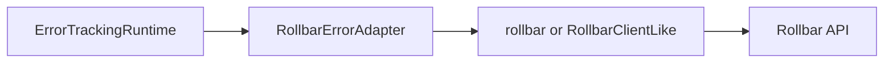

# `@aldok10/nestjs-observe-error-tracking-rollbar`

Rollbar adapter for `@aldok10/nestjs-observe-error-tracking`.

## Overview

`@aldok10/nestjs-observe-error-tracking-rollbar` adapts `ObserveErrorEvent` payloads from `@aldok10/nestjs-observe-error-tracking` to the `rollbar` Node.js SDK (or a compatible `RollbarClientLike`). It maps event severities to Rollbar's `critical`, `error`, `warning`, and `info` methods, attaches custom metadata, and awaits delivery callbacks.

## Why This Package?

- **Safe Rollbar initialization:** When constructing `rollbar` automatically, sets `captureUncaught: false` and `captureUnhandledRejections: false` so process-level error handling remains under your application's control.
- **Severity mapping:** Routes `'fatal'` to `client.critical`, `'warning'` to `client.warning`, `'info'` to `client.info`, and `'error'` (or fallback) to `client.error`.
- **Optional peer dependency:** Loads `rollbar` dynamically via `OptionalPeerLoader` or accepts an existing `RollbarClientLike`.

## Features

- Dynamic loading of `rollbar` (`^2.26.0 || ^3.0.0`) or injection of a custom `RollbarClientLike`.
- Maps `event.tags`, `event.trace`, `event.context`, `event.attributes`, and `event.fingerprint` (joined with `':'`) into Rollbar's `custom` payload.
- Supports both exceptions (`Error`) and `Message` events (passed as strings).
- Promise-based `capture()` and `flush()` (delegating to `client.wait()`).

## Architecture and Responsibilities



## Installation

```bash
pnpm add @aldok10/nestjs-observe-error-tracking-rollbar @aldok10/nestjs-observe-error-tracking rollbar
```

```bash
npm install @aldok10/nestjs-observe-error-tracking-rollbar @aldok10/nestjs-observe-error-tracking rollbar
```

```bash
yarn add @aldok10/nestjs-observe-error-tracking-rollbar @aldok10/nestjs-observe-error-tracking rollbar
```

## Requirements

- **Node.js:** `>=22`
- **Module Formats:** ESM (`import`) and CJS (`require`) with TypeScript declarations (`.d.ts`)
- **Optional Peer Dependencies:**
  - `rollbar`: `^2.26.0 || ^3.0.0`

## Quick Start

```ts
import { ErrorTrackingModule } from '@aldok10/nestjs-observe-error-tracking';
import { createRollbarAdapter } from '@aldok10/nestjs-observe-error-tracking-rollbar';

ErrorTrackingModule.forRoot({
  destinations: [
    {
      name: 'rollbar',
      adapter: createRollbarAdapter({
        accessToken: process.env.ROLLBAR_ACCESS_TOKEN,
        environment: process.env.NODE_ENV,
        codeVersion: '1.0.0',
      }),
    },
  ],
});
```

## Configuration

### `RollbarAdapterOptions`

| Property      | Type                | Required | Default     | Description                                                                                             |
| ------------- | ------------------- | -------- | ----------- | ------------------------------------------------------------------------------------------------------- |
| `client`      | `RollbarClientLike` | No       | `undefined` | Custom or pre-instantiated Rollbar client. If omitted, `rollbar` is instantiated during `initialize()`. |
| `accessToken` | `string`            | No       | `undefined` | Rollbar server access token passed to `new Rollbar(...)` when `client` is omitted.                      |
| `environment` | `string`            | No       | `undefined` | Environment name passed to `new Rollbar(...)`.                                                          |
| `codeVersion` | `string`            | No       | `undefined` | Code version passed to `new Rollbar(...)`.                                                              |

## Usage

```ts
import Rollbar from 'rollbar';
import { createRollbarAdapter } from '@aldok10/nestjs-observe-error-tracking-rollbar';

const rollbar = new Rollbar({
  accessToken: process.env.ROLLBAR_ACCESS_TOKEN,
  captureUncaught: false,
  captureUnhandledRejections: false,
});

const adapter = createRollbarAdapter({ client: rollbar });
```

## Advanced Usage

When `options.client` is provided, `initialize()` returns immediately without overwriting your client configuration. Use `ProcessErrorMonitor` from `@aldok10/nestjs-observe-error-tracking` if you want process-level uncaught/unhandled error capture routed through the unified pipeline.

## API Reference

- `RollbarErrorAdapter` (implements `ErrorTrackingAdapter`, `name = 'rollbar'`, `deliveryMode: 'sdk-managed'`)
  - `constructor(options: RollbarAdapterOptions)`
  - `initialize(): void`
  - `capture(event: ObserveErrorEvent): Promise<void>`
  - `flush(): Promise<void>`
- `createRollbarAdapter(options: RollbarAdapterOptions): RollbarErrorAdapter`
- `RollbarClientLike`
- `RollbarAdapterOptions`

## Integration with Other Packages

- Requires `@aldok10/nestjs-observe-core` and `@aldok10/nestjs-observe-error-tracking`.
- Uses `deliveryMode: 'sdk-managed'`, so `ErrorTrackingRuntime` defaults destination `maxRetries` to `0`.

## Dependencies and Optional Integrations

- **Direct dependencies:** `@aldok10/nestjs-observe-core` (`^0.1.1`), `@aldok10/nestjs-observe-error-tracking` (`^0.1.1`).
- **Optional peer dependency:** `rollbar` (`^2.26.0 || ^3.0.0`).

## Lifecycle and Resource Management

- `initialize()` constructs `new Rollbar({ ..., captureUncaught: false, captureUnhandledRejections: false })` only when `options.client` is not provided.
- `flush()` wraps `client.wait(cb)` in a `Promise<void>`.

## Error Handling

- Throws `Invalid rollbar package exports` if the loaded `rollbar` export is not a constructor.
- Throws `rollbar adapter is not initialized` if `capture()` is called before `initialize()`.
- Rejects the returned `Promise` if the Rollbar callback receives an error.

## Performance Considerations

- `capture()` awaits Rollbar's delivery callback; `ErrorTrackingRuntime` enforces per-destination `timeoutMs` (default `3000` ms) and `maxConcurrent` (default `8`).

## Security Considerations

- Redaction is applied by `ErrorTrackingRuntime` before `custom` payload fields (`tags`, `trace`, `context`, `attributes`) are sent to Rollbar.

## Testing

```bash
pnpm test
```

```bash
pnpm exec vitest run packages/traces/error-tracking/adapter-rollbar
```

## Troubleshooting

- **Events missing in short-lived scripts:** Call `await tracker.flush()` or `await tracker.shutdown()` so `client.wait()` completes before exit.

## Limitations

- Although `ROLLBAR_CAPABILITIES` advertises `breadcrumbs: true` and `userContext: true`, `RollbarErrorAdapter.capture()` currently forwards `tags`, `trace`, `context`, `attributes`, and `fingerprint` in the `custom` object and does not forward `event.breadcrumbs` or `event.user`.
- `transactions`, `sessions`, and `profiling` capabilities are `false`.
- Does not implement `shutdown()`.

## Related Packages

- [`@aldok10/nestjs-observe-error-tracking`](../error-tracking/README.md)
- [`@aldok10/nestjs-observe-error-tracking-bugsnag`](../adapter-bugsnag/README.md)
- [`@aldok10/nestjs-observe-error-tracking-honeybadger`](../adapter-honeybadger/README.md)

## Documentation

- [Rollbar Guide](../../../../docs/integrations/error-tracking-providers.md)
- [Configuration](../../../../docs/packages/traces/error-tracking/README.md)

## Contributing

See [CONTRIBUTING.md](../../../../CONTRIBUTING.md).

## License

MIT — see [LICENSE](../../../../LICENSE).
