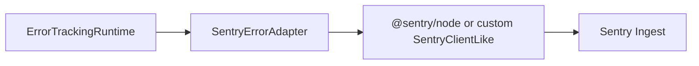

# `@aldok10/nestjs-observe-error-tracking-sentry`

Sentry adapter for `@aldok10/nestjs-observe-error-tracking`.

## Overview

`@aldok10/nestjs-observe-error-tracking-sentry` adapts `ObserveErrorEvent` payloads from `@aldok10/nestjs-observe-error-tracking` to `@sentry/node` (or any compatible `SentryClientLike` instance). It maps severity, tags, extras, user context, fingerprints, trace/observe/source/job/database contexts, and breadcrumbs onto a Sentry scope.

## Why This Package?

- **Clean decoupling:** Keep application code vendor-neutral while leveraging Sentry's SDK features, scope isolation, and transport.
- **Zero forced SDK lock-in:** `@sentry/node` is an optional peer dependency loaded dynamically via `OptionalPeerLoader`—or you can inject a pre-initialized `client`.
- **Full capability mapping:** Supports exceptions, messages, breadcrumbs, fingerprinting, tags, user context, trace correlation, transactions, sessions, and profiling.

## Features

- Dynamic loading of `@sentry/node` (`^8.0.0 || ^9.0.0 || ^10.0.0`) or injection of a custom `SentryClientLike`.
- Optional automatic `client.init(...)` when `dsn` is provided.
- Scoped event capture via `client.withScope(...)` with fallback to direct capture when `withScope` is absent.
- Maps `ObserveErrorEvent` fields: `severity`, `tags`, `attributes` (extras), `user` (with `ipAddress` mapped to `ip_address`), `fingerprint`, `trace` (`trace_id`, `span_id`, `trace_flags`), `context` (`observe`), `source`, `job`, `database`, and `breadcrumbs` (timestamp converted to Unix seconds).
- Uses `captureMessage` for `Message` events without an underlying `exception`, and `captureException` for all other events.
- `flush(timeoutMs)` and `shutdown(timeoutMs)` delegation with configurable `closeClient`.

## Architecture and Responsibilities



## Installation

```bash
pnpm add @aldok10/nestjs-observe-error-tracking-sentry @aldok10/nestjs-observe-error-tracking @sentry/node
```

```bash
npm install @aldok10/nestjs-observe-error-tracking-sentry @aldok10/nestjs-observe-error-tracking @sentry/node
```

```bash
yarn add @aldok10/nestjs-observe-error-tracking-sentry @aldok10/nestjs-observe-error-tracking @sentry/node
```

## Requirements

- **Node.js:** `>=22`
- **Module Formats:** ESM (`import`) and CJS (`require`) with TypeScript declarations (`.d.ts`)
- **Optional Peer Dependencies:**
  - `@sentry/node`: `^8.0.0 || ^9.0.0 || ^10.0.0`

## Quick Start

```ts
import { ErrorTrackingModule } from '@aldok10/nestjs-observe-error-tracking';
import { createSentryAdapter } from '@aldok10/nestjs-observe-error-tracking-sentry';

ErrorTrackingModule.forRoot({
  destinations: [
    {
      name: 'sentry',
      adapter: createSentryAdapter({
        dsn: process.env.SENTRY_DSN,
        environment: process.env.NODE_ENV,
        release: '1.0.0',
      }),
    },
  ],
});
```

## Configuration

### `SentryAdapterOptions`

| Property              | Type               | Required | Default     | Description                                                                                                 |
| --------------------- | ------------------ | -------- | ----------- | ----------------------------------------------------------------------------------------------------------- |
| `client`              | `SentryClientLike` | No       | `undefined` | Custom or pre-loaded Sentry client. If omitted, `@sentry/node` is loaded dynamically during `initialize()`. |
| `dsn`                 | `string`           | No       | `undefined` | Sentry DSN. When provided and `client.init` exists, `client.init(...)` is called during `initialize()`.     |
| `environment`         | `string`           | No       | `undefined` | Sentry environment name passed to `client.init()`.                                                          |
| `release`             | `string`           | No       | `undefined` | Release identifier passed to `client.init()`.                                                               |
| `sampleRate`          | `number`           | No       | `undefined` | Error sample rate passed to `client.init()`.                                                                |
| `tracesSampleRate`    | `number`           | No       | `undefined` | Performance traces sample rate passed to `client.init()`.                                                   |
| `autoSessionTracking` | `boolean`          | No       | `undefined` | Enables or disables Sentry auto session tracking in `client.init()`.                                        |
| `sendDefaultPii`      | `boolean`          | No       | `undefined` | Controls Sentry `sendDefaultPii` option in `client.init()`.                                                 |
| `closeClient`         | `boolean`          | No       | `true`      | Calls `client.close(timeoutMs)` during `shutdown()` unless set to `false`.                                  |

## Usage

### Using a Pre-Initialized `@sentry/node` Client

If you initialize `@sentry/node` in an instrumentation preload file, pass the client without `dsn` so `initialize()` does not call `client.init()` a second time:

```ts
import * as Sentry from '@sentry/node';
import { createSentryAdapter } from '@aldok10/nestjs-observe-error-tracking-sentry';

const adapter = createSentryAdapter({
  client: Sentry,
  closeClient: false,
});
```

## Advanced Usage

`SentryErrorAdapter` accepts optional `name` (default `'sentry'`) and `capabilities` constructor arguments, allowing subclasses or wrappers to customize destination identity and capability metadata.

## API Reference

- `SentryErrorAdapter` (implements `ErrorTrackingAdapter`, `deliveryMode: 'sdk-managed'`)
  - `constructor(options: SentryAdapterOptions, name?: string, capabilities?: ErrorAdapterCapabilities)`
  - `initialize(): void`
  - `capture(event: ObserveErrorEvent): void`
  - `flush(timeoutMs?: number): Promise<void>` (default `timeoutMs = 2000`)
  - `shutdown(timeoutMs?: number): Promise<void>` (default `timeoutMs = 2000`)
- `createSentryAdapter(options: SentryAdapterOptions): SentryErrorAdapter`
- `SentryClientLike`
- `SentryScopeLike`
- `SentryAdapterOptions`

## Integration with Other Packages

- Requires `@aldok10/nestjs-observe-core` (`OptionalPeerLoader`) and `@aldok10/nestjs-observe-error-tracking`.
- Because `deliveryMode` is `'sdk-managed'`, `ErrorTrackingRuntime` defaults destination `maxRetries` to `0` so retries are managed by `@sentry/node`.

## Dependencies and Optional Integrations

- **Direct dependencies:** `@aldok10/nestjs-observe-core` (`^0.1.1`), `@aldok10/nestjs-observe-error-tracking` (`^0.1.1`).
- **Optional peer dependency:** `@sentry/node` (`^8.0.0 || ^9.0.0 || ^10.0.0`).

## Lifecycle and Resource Management

- `initialize()` resolves `@sentry/node` if `client` is not supplied and calls `client.init(...)` if `dsn` is set.
- `flush(timeoutMs = 2000)` calls `client.flush?.(timeoutMs)`.
- `shutdown(timeoutMs = 2000)` flushes and then calls `client.close?.(timeoutMs)` unless `closeClient === false`.

## Error Handling

- Throws if `@sentry/node` cannot be loaded or lacks `captureException`.
- Throws `<name> adapter is not initialized` if `capture()` is called before `initialize()`.

## Performance Considerations

- `capture()` delegates synchronously to `client.captureException` / `client.captureMessage` using `@sentry/node`'s internal async transport.

## Security Considerations

- Events are redacted by `ErrorTrackingRuntime` before `SentryErrorAdapter.capture()` is invoked.
- `sendDefaultPii` is not forced; configure it explicitly if needed.

## Testing

```bash
pnpm test
```

```bash
pnpm exec vitest run packages/traces/error-tracking/adapter-sentry
```

## Troubleshooting

- **`Invalid @sentry/node exports: missing captureException`:** Verify `@sentry/node` (`^8.0.0 || ^9.0.0 || ^10.0.0`) is installed in your application's `node_modules`.
- **Events not sent before process exit:** Ensure NestJS shutdown hooks are enabled (`app.enableShutdownHooks()`) or call `await tracker.shutdown()`.

## Limitations

- `capture()` requires `initialize()` to have run first when `client` is not passed in `options`.
- When `dsn` is omitted, `client.init()` is not called automatically.

## Related Packages

- [`@aldok10/nestjs-observe-error-tracking`](../error-tracking/README.md)
- [`@aldok10/nestjs-observe-error-tracking-glitchtip`](../adapter-glitchtip/README.md)
- [`@aldok10/nestjs-observe-error-tracking-bugsink`](../adapter-bugsink/README.md)

## Documentation

- [Sentry Guide](../../../../docs/integrations/error-tracking-providers.md)
- [Configuration](../../../../docs/packages/traces/error-tracking/README.md)
- [Multi-Destination](../../../../docs/packages/traces/error-tracking/README.md)

## Contributing

See [CONTRIBUTING.md](../../../../CONTRIBUTING.md).

## License

MIT — see [LICENSE](../../../../LICENSE).
