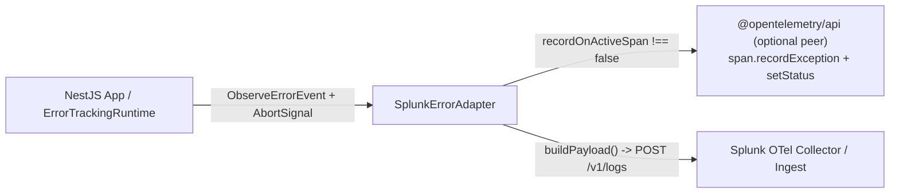

# `@aldok10/nestjs-observe-error-tracking-splunk`

Splunk Observability Cloud OTLP/HTTP logs and OpenTelemetry active-span adapter for `@aldok10/nestjs-observe-error-tracking`.

## Overview

`@aldok10/nestjs-observe-error-tracking-splunk` exports normalized `ObserveErrorEvent` payloads as OTLP/HTTP JSON log records (`resourceLogs`) to a Splunk OpenTelemetry Collector or Splunk Observability Cloud ingest endpoint (`/v1/logs`) using Node.js `fetch`. When `@opentelemetry/api` is installed and an active span is present, it also records the exception and error status on the active span.

## Why This Package?

- **Direct OTLP/HTTP delivery**: Sends OTLP `resourceLogs` payloads directly over HTTP with optional `X-SF-Token` authentication.
- **OpenTelemetry span correlation**: Optionally records exceptions on the active `@opentelemetry/api` span (`recordException` + `setStatus({ code: 2 })`) for trace correlation.
- **Collector or direct ingest**: Works with a local/remote OpenTelemetry Collector (e.g. `http://localhost:4318`) or Splunk Observability ingest URLs.

## Features

- Implements `ErrorTrackingAdapter` (`name: 'splunk'`) with `deliveryMode: 'direct-http'`.
- Capabilities: `exceptions`, `messages`, `tags`, `traceCorrelation`, `transactions` (`breadcrumbs`, `fingerprinting`, `userContext`, `sessions`, and `profiling` are `false`).
- Normalizes `endpoint` by trimming trailing slashes and appending `/v1/logs` if not already present.
- Sends `accessToken` via the `x-sf-token` HTTP header when configured.
- Maps `ErrorSeverity` (`info`, `warning`, `error`, `fatal`) to OTLP `severityNumber` (`9`, `13`, `17`, `21`) and `severityText` (`INFO`, `WARN`, `ERROR`, `FATAL`).
- Supports request timeout (`timeoutMs`, default `3000`) and external `AbortSignal` cancellation.

## Architecture and Responsibilities



- **Adapter (`SplunkErrorAdapter`)**: Owns `/v1/logs` URL resolution, OTLP `resourceLogs` payload construction, optional active-span exception recording, and HTTP POST delivery with timeout/abort handling.
- **Core Runtime (`@aldok10/nestjs-observe-error-tracking`)**: Owns NestJS exception capture, enrichment, redaction, deduplication, and retry/queue orchestration.

## Installation

```bash
pnpm add @aldok10/nestjs-observe-error-tracking-splunk @aldok10/nestjs-observe-error-tracking @aldok10/nestjs-observe-core
```

```bash
npm install @aldok10/nestjs-observe-error-tracking-splunk @aldok10/nestjs-observe-error-tracking @aldok10/nestjs-observe-core
```

```bash
yarn add @aldok10/nestjs-observe-error-tracking-splunk @aldok10/nestjs-observe-error-tracking @aldok10/nestjs-observe-core
```

Optional peer dependencies:

```bash
pnpm add @opentelemetry/api
# and optionally, if using Splunk's Node.js OTel distribution:
pnpm add @splunk/otel
```

## Requirements

- **Node.js**: `>=22`
- **Peer dependencies**: `@opentelemetry/api` (`^1.10.0`, optional), `@splunk/otel` (`^2.0.0 || ^3.0.0`, optional)
- **Module formats**: Dual ESM (`dist/index.js`) and CommonJS (`dist/index.cjs`) with TypeScript declarations (`dist/index.d.ts`)

## Quick Start

```ts
import { Module } from '@nestjs/common';
import { ErrorTrackingModule } from '@aldok10/nestjs-observe-error-tracking';
import { createSplunkAdapter } from '@aldok10/nestjs-observe-error-tracking-splunk';

@Module({
  imports: [
    ErrorTrackingModule.forRoot({
      resource: {
        serviceName: 'orders-api',
        environment: 'production',
        release: '1.0.0',
      },
      destinations: [
        {
          name: 'splunk',
          adapter: createSplunkAdapter({
            endpoint: 'http://localhost:4318',
            accessToken: process.env.SPLUNK_ACCESS_TOKEN,
          }),
        },
      ],
    }),
  ],
})
export class AppModule {}
```

## Configuration

`SplunkAdapterOptions`:

| Property             | Type                               | Required | Default     | Description                                                                                                              |
| -------------------- | ---------------------------------- | -------- | ----------- | ------------------------------------------------------------------------------------------------------------------------ |
| `endpoint`           | `string`                           | Yes      | —           | Splunk OTel Collector or ingest URL (e.g. `http://localhost:4318` or full `/v1/logs` URL).                               |
| `accessToken`        | `string`                           | No       | `undefined` | Splunk ingest access token sent in the `x-sf-token` header.                                                              |
| `headers`            | `Readonly<Record<string, string>>` | No       | `undefined` | Additional HTTP headers merged into the OTLP POST request.                                                               |
| `timeoutMs`          | `number`                           | No       | `3000`      | Request timeout in milliseconds before aborting the `fetch` call.                                                        |
| `recordOnActiveSpan` | `boolean`                          | No       | `true`      | When not `false`, records the exception and error status (`code: 2`) on the active `@opentelemetry/api` span if present. |

## Usage

### Direct Adapter Usage

```ts
import { normalizeError } from '@aldok10/nestjs-observe-error-tracking';
import { createSplunkAdapter } from '@aldok10/nestjs-observe-error-tracking-splunk';

const adapter = createSplunkAdapter({
  endpoint: 'http://localhost:4318',
  accessToken: process.env.SPLUNK_ACCESS_TOKEN,
});

await adapter.capture(
  normalizeError(new Error('Payment webhook failed'), {
    tags: { provider: 'stripe' },
  }),
);
```

### Endpoint Resolution

The constructor trims trailing slashes from `endpoint`. If it already ends with `/v1/logs`, it is used as-is; otherwise `/v1/logs` is appended.

## Advanced Usage

### Custom Headers and AbortSignal

```ts
import { normalizeError } from '@aldok10/nestjs-observe-error-tracking';
import { createSplunkAdapter } from '@aldok10/nestjs-observe-error-tracking-splunk';

const adapter = createSplunkAdapter({
  endpoint: 'https://ingest.us1.signalfx.com/v2/datapoint/otlp',
  accessToken: process.env.SPLUNK_ACCESS_TOKEN,
  timeoutMs: 5000,
  recordOnActiveSpan: false,
  headers: {
    'x-tenant': 'core',
  },
});

const controller = new AbortController();
await adapter.capture(normalizeError(new Error('Downstream timeout')), controller.signal);
```

## API Reference

- `SplunkErrorAdapter` — Class implementing `ErrorTrackingAdapter` (`name = 'splunk'`).
  - `constructor(options: SplunkAdapterOptions)`
  - `capture(event: ObserveErrorEvent, signal?: AbortSignal): Promise<void>`
- `createSplunkAdapter(options: SplunkAdapterOptions): SplunkErrorAdapter` — Factory helper returning a `SplunkErrorAdapter` instance.
- `SplunkAdapterOptions` — Configuration interface (`endpoint`, `accessToken?`, `headers?`, `timeoutMs?`, `recordOnActiveSpan?`).

## Integration with Other Packages

- `@aldok10/nestjs-observe-error-tracking`: Hosts `SplunkErrorAdapter` in `ErrorTrackingModule` / `ErrorTrackingRuntime`.
- `@aldok10/nestjs-observe-core`: Provides `tryLoadOptionalPeer` for safely probing `@opentelemetry/api`.

## Dependencies and Optional Integrations

- **Runtime dependencies**: `@aldok10/nestjs-observe-core`, `@aldok10/nestjs-observe-error-tracking`
- **Optional peer dependencies**: `@opentelemetry/api` (`^1.10.0`), `@splunk/otel` (`^2.0.0 || ^3.0.0`)

Note: `SplunkErrorAdapter` only loads `@opentelemetry/api` directly; `@splunk/otel` is listed as an optional peer for applications that preload Splunk's OpenTelemetry distribution.

## Lifecycle and Resource Management

- No `initialize()`, `flush()`, or `shutdown()` hooks are required; the adapter is ready immediately after construction.
- Each `capture()` call creates an `AbortController` with an unref'd timeout timer (`timer.unref()`) and cleans up both the timer and external `AbortSignal` listener in a `finally` block.

## Error Handling

- Non-2xx HTTP responses throw `Error('Splunk OTLP export failed with HTTP <status>')`.
- Timeouts abort the underlying `fetch` call with `Error('Splunk OTLP timed out')`.

## Performance Considerations

- Uses native Node.js `fetch` with a bounded default timeout (`3000` ms) and `timer.unref()`.
- Each `capture()` call serializes a single OTLP `resourceLogs` JSON payload.

## Security Considerations

- Supply `accessToken` via environment variables or secret managers; never hardcode tokens in source control.
- Configure redaction in `@aldok10/nestjs-observe-error-tracking` before events reach the adapter to avoid sending sensitive data in `exception.message`, `exception.stacktrace`, or `tag.*` attributes.

## Testing

Run the workspace test suite or target this package directly with Vitest:

```bash
pnpm test
pnpm exec vitest run packages/traces/error-tracking/adapter-splunk
```

## Troubleshooting

- **HTTP 401 / 403 from Splunk**: Verify `accessToken` is a valid Splunk ingest token and matches the target realm/collector.
- **No span exception recorded**: Ensure `@opentelemetry/api` is installed and an active span is bound to the current async context.

## Limitations

- `breadcrumbs`, `fingerprinting`, `userContext`, `sessions`, and `profiling` are not supported (`false` in `capabilities`).
- Does not batch multiple events into a single HTTP request; each `capture()` call sends one OTLP log record.

## Related Packages

- [`@aldok10/nestjs-observe-error-tracking`](../error-tracking/README.md)
- [`@aldok10/nestjs-observe-error-tracking-testing`](../testing/README.md)
- [`@aldok10/nestjs-observe-core`](../../../core/README.md)
- [`@aldok10/nestjs-observe-tracing`](../../tracing/README.md)
- [`@aldok10/nestjs-observe`](../../../observer/observer/README.md)

## Documentation

- [Other Error Tracking Providers](../../../../docs/integrations/error-tracking-providers.md)
- [Error Tracking Overview](../../../../docs/packages/traces/error-tracking/README.md)
- [Installation Guide](../../../../docs/packages/traces/error-tracking/README.md)
- [Configuration Guide](../../../../docs/packages/traces/error-tracking/README.md)
- [Troubleshooting Guide](../../../../docs/operations/troubleshooting.md)

## Contributing

See [CONTRIBUTING.md](../../../../CONTRIBUTING.md).

## License

[MIT](../../../../LICENSE)
