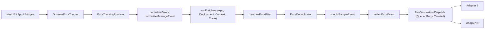

# `@aldok10/nestjs-observe-error-tracking`

Vendor-neutral error tracking runtime, NestJS exception filter and interceptor, enrichers, redaction, deduplication, and bridges for `nestjs-observe`.

## Overview

`@aldok10/nestjs-observe-error-tracking` provides a vendor-neutral error tracking pipeline for NestJS and Node.js applications. It normalizes thrown errors and non-error values into a canonical `ObserveErrorEvent`, enriches events with resource, deployment, execution context, and OpenTelemetry trace metadata, applies filtering, deduplication, sampling, and secret redaction, and fans out delivery to one or more isolated `ErrorTrackingAdapter` destinations.

## Why This Package?

- **Vendor neutrality:** Switch or combine error tracking backends (Sentry, GlitchTip, Bugsink, Highlight, Bugsnag, Rollbar, Honeybadger, OTLP, or custom adapters) without rewriting application code.
- **Safety by default:** Built-in redaction masks sensitive keys, credential URLs, and Bearer/Basic tokens before events leave your process, and optional enricher failures never block error capture.
- **Fault isolation:** Each destination runs with its own queue, concurrency limit, timeout, retry policy, filter, and sample rate so one failing vendor never breaks others.
- **First-class NestJS & domain integration:** Includes `ErrorTrackingModule`, `ObserveExceptionFilter`, `ErrorTrackingInterceptor`, `ProcessErrorMonitor`, background job helpers, database error helpers, and `./bridges` for logging and tracing.

## Features

- Error normalization for `Error` instances, nested `cause` chains (up to 8 levels, cycle-safe), `AggregateError` (up to 25 entries), strings, and arbitrary objects.
- Configurable breadcrumb ring buffer (`maxBreadcrumbs` defaults to `50`).
- Built-in enrichers: `createApplicationEnricher`, `createDeploymentEnricher`, `createContextEnricher`, and `createTraceContextEnricher`.
- Event filtering by minimum severity, ignored error names/messages (`string | RegExp`), environments, modules, or custom predicates.
- Instance and windowed signature/fingerprint deduplication (`ErrorDeduplicator`).
- Sampling (`ErrorSamplingOptions`) that preserves `fatal` events by default unless `sampleFatal: true` is set.
- Recursive secret redaction (`redactErrorEvent`) with denylist/allowlist keys, URL credential masking, Bearer/Basic token masking, depth limits, string truncation, and optional stack frame stripping.
- Per-destination bounded queues, concurrency limits, timeouts, retries, health checks, and diagnostics (`ErrorTrackingDiagnosticsReport`).
- Subpath export `@aldok10/nestjs-observe-error-tracking/bridges` for log transport and OpenTelemetry span exception bridges.

## Architecture and Responsibilities



## Installation

```bash
pnpm add @aldok10/nestjs-observe-error-tracking @nestjs/common @nestjs/core reflect-metadata
```

```bash
npm install @aldok10/nestjs-observe-error-tracking @nestjs/common @nestjs/core reflect-metadata
```

```bash
yarn add @aldok10/nestjs-observe-error-tracking @nestjs/common @nestjs/core reflect-metadata
```

Optional peer dependencies:

```bash
pnpm add @opentelemetry/api rxjs
```

## Requirements

- **Node.js:** `>=22`
- **Module Formats:** ESM (`import`) and CJS (`require`) with TypeScript declarations (`.d.ts`)
- **Required Peer Dependencies:**
  - `@nestjs/common`: `^10.0.0 || ^11.0.0 || ^12.0.0`
  - `@nestjs/core`: `^10.0.0 || ^11.0.0 || ^12.0.0`
  - `reflect-metadata`: `^0.1.12 || ^0.2.0`
- **Optional Peer Dependencies:**
  - `@opentelemetry/api`: `^1.10.0`
  - `rxjs`: `^7.0.0`

## Quick Start

```ts
import { Module } from '@nestjs/common';
import {
  ErrorTrackingModule,
  ObserveExceptionFilter,
} from '@aldok10/nestjs-observe-error-tracking';
import { APP_FILTER } from '@nestjs/core';

@Module({
  imports: [
    ErrorTrackingModule.forRoot({
      resource: {
        serviceName: 'orders-api',
        environment: 'production',
        serviceVersion: '1.0.0',
      },
      destinations: [
        // Add one or more ErrorTrackingAdapter instances
      ],
    }),
  ],
  providers: [
    {
      provide: APP_FILTER,
      useClass: ObserveExceptionFilter,
    },
  ],
})
export class AppModule {}
```

## Configuration

### `ErrorTrackingOptions`

| Property            | Type                                | Required | Default                                                                                                                                         | Description                                                                                                                      |
| ------------------- | ----------------------------------- | -------- | ----------------------------------------------------------------------------------------------------------------------------------------------- | -------------------------------------------------------------------------------------------------------------------------------- |
| `resource`          | `ResourceMetadata`                  | No       | `undefined`                                                                                                                                     | Service metadata (`serviceName`, `environment`, `serviceVersion`, `serviceInstanceId`) attached via `createApplicationEnricher`. |
| `destinations`      | `readonly ErrorDestinationConfig[]` | No       | `[]`                                                                                                                                            | Destination adapters and per-destination filter, sampling, and delivery settings.                                                |
| `enrichers`         | `readonly ErrorEnricher[]`          | No       | `[]`                                                                                                                                            | Custom or built-in enrichers executed sequentially before filtering.                                                             |
| `filter`            | `ErrorFilter`                       | No       | `undefined`                                                                                                                                     | Global filter function or `ErrorFilterOptions` applied before deduplication.                                                     |
| `redaction`         | `ErrorRedactionOptions`             | No       | `{}` (enabled)                                                                                                                                  | Controls secret redaction, denylist/allowlist keys, depth, and string truncation.                                                |
| `sampling`          | `ErrorSamplingOptions`              | No       | `undefined` (100%)                                                                                                                              | Global sampling rate (`0` to `1`) and `sampleFatal` flag.                                                                        |
| `deduplication`     | `ErrorDeduplicationOptions`         | No       | `{ enabled: true, windowMs: 5000, maxEntries: 1000 }`                                                                                           | Instance and signature-window deduplication settings.                                                                            |
| `delivery`          | `ErrorDeliveryPolicy`               | No       | `{ maxQueueSize: 500, overflowPolicy: 'drop-oldest', maxRetries: 1 (0 for sdk-managed), retryDelayMs: 100, timeoutMs: 3000, maxConcurrent: 8 }` | Global default delivery policy for destinations.                                                                                 |
| `maxBreadcrumbs`    | `number`                            | No       | `50`                                                                                                                                            | Maximum number of breadcrumbs retained in the ring buffer.                                                                       |
| `shutdownTimeoutMs` | `number`                            | No       | `3000`                                                                                                                                          | Default timeout in milliseconds for `flush()` and `shutdown()`.                                                                  |
| `diagnostics`       | `DiagnosticsSink`                   | No       | `NoopDiagnosticsSink`                                                                                                                           | Diagnostics sink for adapter initialization, delivery, and shutdown warnings/errors.                                             |
| `global`            | `boolean`                           | No       | `true`                                                                                                                                          | Registers `ErrorTrackingModule` as a global NestJS module.                                                                       |

### `ErrorRedactionOptions`

| Property           | Type                | Required | Default                             | Description                                                    |
| ------------------ | ------------------- | -------- | ----------------------------------- | -------------------------------------------------------------- |
| `enabled`          | `boolean`           | No       | `true`                              | Enables or disables redaction.                                 |
| `replacement`      | `string`            | No       | `'[REDACTED]'`                      | Replacement string for redacted values and credentials.        |
| `denylistKeys`     | `readonly string[]` | No       | `[]` (merged with 27 built-in keys) | Additional case-insensitive key substrings to redact.          |
| `allowlistKeys`    | `readonly string[]` | No       | `[]`                                | Case-insensitive keys exempt from redaction.                   |
| `maxDepth`         | `number`            | No       | `6`                                 | Maximum object traversal depth before emitting `'[MaxDepth]'`. |
| `maxStringLength`  | `number`            | No       | `2048`                              | Maximum string length before appending `...[TRUNCATED]`.       |
| `stripStackFrames` | `boolean`           | No       | `false`                             | Removes `stack` from the event when `true`.                    |

## Usage

### Injecting `ObserveErrorTracker`

```ts
import { Injectable } from '@nestjs/common';
import { InjectErrorTracker, ObserveErrorTracker } from '@aldok10/nestjs-observe-error-tracking';

@Injectable()
export class PaymentService {
  constructor(@InjectErrorTracker() private readonly tracker: ObserveErrorTracker) {}

  async charge(orderId: string): Promise<void> {
    this.tracker.addBreadcrumb({
      message: 'Starting payment charge',
      category: 'payment',
      data: { orderId },
    });

    try {
      // ...
    } catch (error) {
      await this.tracker.captureException(error, {
        severity: 'error',
        source: { component: 'PaymentService', operation: 'charge' },
        tags: { orderId },
      });
      throw error;
    }
  }
}
```

### Async Module Registration

```ts
ErrorTrackingModule.forRootAsync({
  useFactory: () => ({
    resource: { serviceName: 'api', environment: process.env.NODE_ENV },
    destinations: [],
  }),
});
```

`ErrorTrackingModule.forRootAsync` supports `useFactory`, `useClass` (`ErrorTrackingOptionsFactory`), or `useExisting`.

### Background Jobs & Database Helpers

```ts
import {
  captureDatabaseError,
  captureJobError,
  withDatabaseErrorTracking,
  withJobErrorTracking,
} from '@aldok10/nestjs-observe-error-tracking';

await withJobErrorTracking(
  tracker,
  { queueName: 'emails', jobId: 'job-1', attemptsMade: 3, maxAttempts: 3 },
  async () => {
    // job handler
  },
  { reportOnFinalAttemptOnly: true },
);

await withDatabaseErrorTracking(
  tracker,
  { system: 'postgresql', operation: 'SELECT', pool: 'primary' },
  async () => {
    // db query
  },
);
```

## Advanced Usage

### Bridges (`@aldok10/nestjs-observe-error-tracking/bridges`)

- `createErrorTrackingLogTransport(tracker, options?)`: Creates a log transport (`name: 'error-tracking-bridge'`) that forwards log records meeting `minSeverity` (default `'error'`), `channels`, and `excludeChannels` into `tracker.captureException` or `tracker.captureMessage`.
- `createTracingErrorBridge(tracker)`: Returns `{ recordAndCaptureException(span, error, input?) }`, which calls `span.recordException`, sets span status code `2`, extracts `traceId`/`spanId`/`traceFlags` from `span.spanContext()`, and captures the exception.

### Process Error Monitoring

```ts
import { ProcessErrorMonitor } from '@aldok10/nestjs-observe-error-tracking';

const monitor = new ProcessErrorMonitor(tracker);
monitor.start();
// Later: monitor.stop();
```

`ProcessErrorMonitor` listens to `uncaughtException` and `unhandledRejection` and reports them with `severity: 'fatal'` and `handled: false`.

## API Reference

### Main Entrypoint (`@aldok10/nestjs-observe-error-tracking`)

- **Module & DI:** `ErrorTrackingModule` (`forRoot`, `forRootAsync`), `ObserveErrorTracker`, `ErrorTrackingRuntime`, `ErrorTrackingLifecycleService`, `InjectErrorTracker`, `ERROR_TRACKING_OPTIONS`, `ERROR_TRACKING_RUNTIME`, `OBSERVE_ERROR_TRACKER`.
- **NestJS Integrations:** `ObserveExceptionFilter` (`ObserveExceptionFilterOptions`), `ErrorTrackingInterceptor`, `ProcessErrorMonitor`.
- **Enrichers:** `createApplicationEnricher`, `createDeploymentEnricher`, `createContextEnricher`, `createTraceContextEnricher`, `runEnrichers`.
- **Pipeline & Redaction:** `normalizeError`, `normalizeMessageEvent`, `redactErrorEvent`, `sanitizeString`, `matchesErrorFilter`, `shouldSampleEvent`, `ErrorDeduplicator`.
- **Domain Helpers:** `captureJobError`, `withJobErrorTracking`, `captureDatabaseError`, `withDatabaseErrorTracking`.
- **Contracts:** `ErrorSeverity`, `ErrorDeliveryMode`, `ObserveErrorEvent`, `ErrorTrackingAdapter`, `ErrorAdapterCapabilities`, `ErrorEnricher`, `ErrorFilter`, `ErrorFilterOptions`, `ErrorRedactionOptions`, `ErrorSamplingOptions`, `ErrorDeduplicationOptions`, `ErrorDeliveryPolicy`, `ErrorDestinationConfig`, `ErrorDestinationDiagnostics`, `ErrorTrackingDiagnosticsReport`, `ErrorTrackingOptions`, `CaptureErrorInput`, `ErrorBreadcrumb`, `ErrorCauseInfo`, `ErrorSourceContext`, `ErrorExecutionContext`, `ErrorTraceContext`, `ErrorUserContext`, `ErrorRequestContext`, `ErrorJobContext`, `ErrorDatabaseContext`, `JobErrorTrackingOptions`.

### Bridges Entrypoint (`@aldok10/nestjs-observe-error-tracking/bridges`)

- `createErrorTrackingLogTransport` (`LogRecordLike`, `LogTransportBridgeOptions`)
- `createTracingErrorBridge` (`SpanLike`)

## Integration with Other Packages

- Uses `@aldok10/nestjs-observe-core` for `BoundedExecution`, `NoopDiagnosticsSink`, `ObserveContextStore`, `ResourceMetadata`, `ComponentHealth`, `LifecycleParticipant`, `tryLoadOptionalPeer`, and `InvalidConfigurationException`.
- Pairs with any `@aldok10/nestjs-observe-error-tracking-*` adapter package and `@aldok10/nestjs-observe-error-tracking-testing` for in-memory testing.
- Bridges to logging and tracing via `@aldok10/nestjs-observe-error-tracking/bridges`.

## Dependencies and Optional Integrations

- **Direct dependency:** `@aldok10/nestjs-observe-core` (`^0.1.1`)
- **Optional `@opentelemetry/api`:** Used by `createTraceContextEnricher` when no custom provider is passed to read the active span context.
- **Optional `rxjs`:** Used by `ErrorTrackingInterceptor` (`tap`) to observe observable stream errors without adding a hard runtime dependency.

## Lifecycle and Resource Management

- `ErrorTrackingRuntime.initialize()` initializes all enabled destinations concurrently (`Promise.allSettled`). If an adapter fails to initialize, `initError` is recorded and that destination is skipped while other destinations continue working.
- `ErrorTrackingLifecycleService` implements `OnModuleDestroy` and `OnApplicationShutdown` with a shared `shutdownOnce()` promise so `runtime.shutdown()` runs once during NestJS teardown.
- `flush(timeoutMs)` drains per-destination queues and calls `adapter.flush?.(timeoutMs)`. `shutdown(timeoutMs)` sets `shuttingDown = true`, flushes, and calls `adapter.shutdown?.(timeoutMs)`.

## Error Handling

- Enricher errors are caught inside `runEnrichers` so failing enrichers never drop error events.
- Destination delivery errors are retried according to the resolved `ErrorDeliveryPolicy`, then recorded in `failedCount`, `lastError`, `lastFailureAt`, and emitted to `DiagnosticsSink`.
- `ErrorTrackingModule.forRootAsync` throws `InvalidConfigurationException` if none of `useFactory`, `useClass`, or `useExisting` is provided.

## Performance Considerations

- Deduplication uses a `WeakSet<object>` for exact exception instances and a bounded `Map<string, number>` (`maxEntries: 1000`, `windowMs: 5000`) with oldest-entry eviction.
- Per-destination queues (`maxQueueSize: 500`, `maxConcurrent: 8`) bound memory and in-flight work under error spikes.
- Retry timers call `.unref()` so pending retries do not keep the Node.js event loop alive.

## Security Considerations

- Redaction is enabled by default (`ErrorRedactionOptions.enabled !== false`) and masks 27 built-in sensitive key patterns (including `password`, `secret`, `token`, `authorization`, `cookie`, `dsn`, `api_key`, `private_key`, `credit_card`, `ssn`), URLs with embedded `user:pass@`, and `Bearer`/`Basic` credentials.
- `ObserveExceptionFilter` passes request headers, query, URL, and IP through the pipeline where `redactErrorEvent` sanitizes them before dispatch.

## Testing

Run the workspace test suite or target this package directly:

```bash
pnpm test
```

```bash
pnpm exec vitest run packages/traces/error-tracking/error-tracking
```

## Troubleshooting

- **Events not reaching a destination:** Call `await tracker.getDiagnostics()` to inspect `initError`, `available`, `failedCount`, `droppedCount`, `totalFiltered`, `totalDeduplicated`, and `totalSampledOut`.
- **`ErrorTrackingInterceptor` does not capture errors:** Ensure `rxjs` (`^7.0.0`) is installed; without `rxjs`, `ErrorTrackingInterceptor` passes the stream through untouched.
- **Duplicate log + trace error reports:** Using both `createTracingErrorBridge` and `createErrorTrackingLogTransport` for the same `Error` instance within `deduplication.windowMs` (default `5000` ms) is automatically deduplicated by `ErrorDeduplicator`.

## Limitations

- `ErrorTrackingInterceptor` requires `rxjs` as an optional peer dependency to tap observable errors.
- `ErrorTrackingRuntime` is in-memory; queued events are not persisted across process crashes.
- `ProcessErrorMonitor` attaches listeners to `process` but does not terminate the process or flush asynchronously before exit on `uncaughtException`.

## Related Packages

- [`@aldok10/nestjs-observe-core`](../../../core/README.md)
- [`@aldok10/nestjs-observe-tracing`](../../tracing/README.md)
- [`@aldok10/nestjs-observe`](../../../observer/observer/README.md)
- [`@aldok10/nestjs-observe-error-tracking-testing`](../testing/README.md)

## Documentation

- [Overview](../../../../docs/packages/traces/error-tracking/README.md)
- [Installation](../../../../docs/packages/traces/error-tracking/README.md)
- [Configuration](../../../../docs/packages/traces/error-tracking/README.md)
- [NestJS Exceptions](../../../../docs/packages/traces/error-tracking/README.md)
- [Context Enrichment](../../../../docs/packages/traces/error-tracking/README.md)
- [Redaction](../../../../docs/operations/security-and-redaction.md)
- [Multi-Destination](../../../../docs/packages/traces/error-tracking/README.md)
- [Background Jobs](../../../../docs/packages/traces/error-tracking/README.md)
- [Troubleshooting](../../../../docs/operations/troubleshooting.md)

## Contributing

See [CONTRIBUTING.md](../../../../CONTRIBUTING.md).

## License

MIT — see [LICENSE](../../../../LICENSE).
