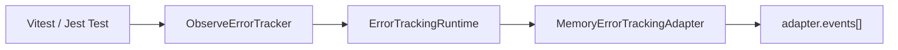

# `@aldok10/nestjs-observe-error-tracking-testing`

In-memory test adapter and helper factory for `@aldok10/nestjs-observe-error-tracking`.

## Overview

`@aldok10/nestjs-observe-error-tracking-testing` provides `MemoryErrorTrackingAdapter` and `createTestErrorTracker` so you can test NestJS error tracking, enrichment, redaction, deduplication, and failure isolation without network calls or third-party SDKs.

## Why This Package?

- **Zero external dependencies:** Test your error pipeline locally with no Sentry, Bugsnag, or collector setup.
- **Deterministic assertions:** Inspect captured `ObserveErrorEvent` objects directly from `adapter.events`.
- **Failure simulation:** Toggle `failOnCapture` or call `setFailOnCapture(true)` to test retry, diagnostics, and multi-destination isolation behavior.

## Features

- `MemoryErrorTrackingAdapter` implementing `ErrorTrackingAdapter` with `deliveryMode: 'core-managed'`.
- Full capability flags enabled for `exceptions`, `messages`, `breadcrumbs`, `fingerprinting`, `tags`, `userContext`, and `traceCorrelation` (`transactions`, `sessions`, and `profiling` are `false`).
- `createTestErrorTracker(options?)` factory returning `{ adapter, runtime, tracker }` wired together.
- `clear()` and `setFailOnCapture(fail)` helpers for test isolation and failure injection.

## Architecture and Responsibilities



## Installation

```bash
pnpm add -D @aldok10/nestjs-observe-error-tracking-testing @aldok10/nestjs-observe-error-tracking
```

```bash
npm install -D @aldok10/nestjs-observe-error-tracking-testing @aldok10/nestjs-observe-error-tracking
```

```bash
yarn add -D @aldok10/nestjs-observe-error-tracking-testing @aldok10/nestjs-observe-error-tracking
```

## Requirements

- **Node.js:** `>=22`
- **Module Formats:** ESM (`import`) and CJS (`require`) with TypeScript declarations (`.d.ts`)
- **Dependencies:** `@aldok10/nestjs-observe-error-tracking` (`^0.1.0`)

## Quick Start

```ts
import { createTestErrorTracker } from '@aldok10/nestjs-observe-error-tracking-testing';

const { adapter, runtime, tracker } = createTestErrorTracker();

await runtime.initialize();
await tracker.captureException(new Error('test failure'));

console.log(adapter.events.length); // 1
adapter.clear();
await runtime.shutdown();
```

## Configuration

### `MemoryErrorAdapterOptions`

| Property        | Type      | Required | Default    | Description                                                             |
| --------------- | --------- | -------- | ---------- | ----------------------------------------------------------------------- |
| `name`          | `string`  | No       | `'memory'` | Adapter instance name.                                                  |
| `failOnCapture` | `boolean` | No       | `false`    | When `true`, `capture()` throws `Error("Simulated failure in <name>")`. |

## Usage

### Testing NestJS Modules

```ts
import { Test } from '@nestjs/testing';
import { ErrorTrackingModule, ObserveErrorTracker } from '@aldok10/nestjs-observe-error-tracking';
import { MemoryErrorTrackingAdapter } from '@aldok10/nestjs-observe-error-tracking-testing';

const memoryAdapter = new MemoryErrorTrackingAdapter();

const moduleRef = await Test.createTestingModule({
  imports: [
    ErrorTrackingModule.forRoot({
      destinations: [{ name: 'memory', adapter: memoryAdapter }],
    }),
  ],
}).compile();

await moduleRef.init();
const tracker = moduleRef.get(ObserveErrorTracker);
await tracker.captureMessage('hello');
await moduleRef.close();
```

### Simulating Delivery Failures

```ts
const { adapter, runtime, tracker } = createTestErrorTracker({
  delivery: { maxRetries: 0 },
});

await runtime.initialize();
adapter.setFailOnCapture(true);
await tracker.captureException(new Error('boom'));

const diagnostics = await tracker.getDiagnostics();
// diagnostics.status === 'unhealthy'
```

## Advanced Usage

Pass any `ErrorTrackingOptions` (except `destinations`) into `createTestErrorTracker(options)` to test custom `enrichers`, `filter`, `redaction`, `sampling`, `deduplication`, `delivery`, or `resource` settings against `adapter.events`.

## API Reference

- `MemoryErrorTrackingAdapter`:
  - `readonly name: string`
  - `readonly capabilities: ErrorAdapterCapabilities`
  - `readonly events: ObserveErrorEvent[]`
  - `setFailOnCapture(fail: boolean): void`
  - `capture(event: ObserveErrorEvent): void`
  - `clear(): void`
- `MemoryErrorAdapterOptions`: `{ readonly name?: string; readonly failOnCapture?: boolean }`
- `createTestErrorTracker(options?: Omit<ErrorTrackingOptions, 'destinations'>): { adapter: MemoryErrorTrackingAdapter; runtime: ErrorTrackingRuntime; tracker: ObserveErrorTracker }`

## Integration with Other Packages

- Built specifically for `@aldok10/nestjs-observe-error-tracking`.

## Dependencies and Optional Integrations

- **Direct dependency:** `@aldok10/nestjs-observe-error-tracking` (`^0.1.0`).
- No optional peer dependencies.

## Lifecycle and Resource Management

- `MemoryErrorTrackingAdapter` holds events in memory (`events: ObserveErrorEvent[]`). Call `adapter.clear()` between test cases and `await runtime.shutdown()` at the end of each test.

## Error Handling

- When `failOnCapture` is `true`, `capture()` synchronously throws `new Error(\`Simulated failure in \${this.name}\`)`, which `ErrorTrackingRuntime` catches and records in destination diagnostics.

## Performance Considerations

- `adapter.events` is an unbounded in-memory array intended for test suites; call `adapter.clear()` in `beforeEach` or `afterEach` hooks.

## Security Considerations

- Intended for development and automated testing only. Do not register `MemoryErrorTrackingAdapter` in production unless you explicitly want unbounded in-memory retention.

## Testing

```bash
pnpm test
```

```bash
pnpm exec vitest run packages/traces/error-tracking/testing
```

## Troubleshooting

- **`adapter.events` is empty after `captureException`:** Check whether `filter`, `sampling`, or `deduplication` suppressed the event, or inspect `await tracker.getDiagnostics()`.

## Limitations

- Does not implement `initialize()`, `flush()`, `shutdown()`, or `health()` hooks on the adapter itself.
- Sets `transactions`, `sessions`, and `profiling` capabilities to `false`.

## Related Packages

- [`@aldok10/nestjs-observe-error-tracking`](../error-tracking/README.md)

## Documentation

- [Overview](../../../../docs/packages/traces/error-tracking/README.md)
- [Troubleshooting](../../../../docs/operations/troubleshooting.md)

## Contributing

See [CONTRIBUTING.md](../../../../CONTRIBUTING.md).

## License

MIT — see [LICENSE](../../../../LICENSE).
