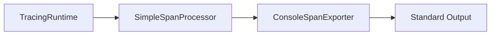

# `@aldok10/nestjs-observe-tracing-exporter-console`

Console trace exporter and `SimpleSpanProcessor` factory for `@aldok10/nestjs-observe-tracing`.

## Overview

`@aldok10/nestjs-observe-tracing-exporter-console` provides minimal factory functions around `@opentelemetry/sdk-trace`'s `ConsoleSpanExporter` and `SimpleSpanProcessor` for local development and debugging.

## Why This Package?

- **Zero-config local output**: Print finished spans to stdout without setting up an OpenTelemetry Collector.
- **Consistent factory pattern**: Matches the exporter package conventions across `@aldok10/nestjs-observe-*`.

## Features

- `createConsoleTraceExporter()` returning a `ConsoleSpanExporter`.
- `createConsoleSpanProcessor()` returning a `SimpleSpanProcessor` backed by `ConsoleSpanExporter`.

## Architecture and Responsibilities



- **`createConsoleTraceExporter`**: Instantiates `ConsoleSpanExporter`.
- **`createConsoleSpanProcessor`**: Wraps `createConsoleTraceExporter()` in a `SimpleSpanProcessor` and returns it typed as `SpanProcessor`.

## Installation

```bash
pnpm add @aldok10/nestjs-observe-tracing-exporter-console @aldok10/nestjs-observe-tracing
```

```bash
npm install @aldok10/nestjs-observe-tracing-exporter-console @aldok10/nestjs-observe-tracing
```

```bash
yarn add @aldok10/nestjs-observe-tracing-exporter-console @aldok10/nestjs-observe-tracing
```

## Requirements

- **Node.js**: `>=22`
- **Peer Dependencies**: None
- **Module Formats**: ESM (`import`), CJS (`require`), and TypeScript declarations (`.d.ts`).

## Quick Start

```ts
import { bootstrapTracing, ObserveTracer } from '@aldok10/nestjs-observe-tracing';
import { createConsoleSpanProcessor } from '@aldok10/nestjs-observe-tracing-exporter-console';

const runtime = bootstrapTracing({
  resource: { serviceName: 'local-dev' },
  spanProcessors: [createConsoleSpanProcessor()],
});

const tracer = new ObserveTracer(runtime);
await tracer.withSpan('hello.world', async () => 'done');
await runtime.shutdown();
```

## Configuration

Neither `createConsoleTraceExporter()` nor `createConsoleSpanProcessor()` takes configuration parameters.

| Function                       | Parameters | Return Type           | Description                                                   |
| ------------------------------ | ---------- | --------------------- | ------------------------------------------------------------- |
| `createConsoleTraceExporter()` | None       | `ConsoleSpanExporter` | Creates an OpenTelemetry `ConsoleSpanExporter`.               |
| `createConsoleSpanProcessor()` | None       | `SpanProcessor`       | Creates a `SimpleSpanProcessor` with a `ConsoleSpanExporter`. |

## Usage

### With NestJS `TracingModule`

```ts
import { Module } from '@nestjs/common';
import { TracingModule } from '@aldok10/nestjs-observe-tracing';
import { createConsoleSpanProcessor } from '@aldok10/nestjs-observe-tracing-exporter-console';

@Module({
  imports: [
    TracingModule.forRoot({
      resource: { serviceName: 'orders-api' },
      spanProcessors: [createConsoleSpanProcessor()],
    }),
  ],
})
export class AppModule {}
```

## Advanced Usage

If you want batched console output instead of immediate `SimpleSpanProcessor` output, pass `createConsoleTraceExporter()` into OpenTelemetry's `BatchSpanProcessor`:

```ts
import { BatchSpanProcessor } from '@opentelemetry/sdk-trace';
import { createConsoleTraceExporter } from '@aldok10/nestjs-observe-tracing-exporter-console';

const processor = new BatchSpanProcessor({ exporter: createConsoleTraceExporter() });
```

## API Reference

- `createConsoleTraceExporter(): ConsoleSpanExporter`
- `createConsoleSpanProcessor(): SpanProcessor`

## Integration with Other Packages

Pass `createConsoleSpanProcessor()` into `spanProcessors` on [`@aldok10/nestjs-observe-tracing`](../tracing/README.md).

## Dependencies and Optional Integrations

- **Runtime dependencies**: `@opentelemetry/sdk-trace`.

## Lifecycle and Resource Management

- When attached to `TracingRuntime`, `runtime.shutdown()` shuts down the `SimpleSpanProcessor` and `ConsoleSpanExporter`.
- When created standalone, call `await processor.shutdown()` / `await exporter.shutdown()` during teardown.

## Error Handling

- Delegates directly to OpenTelemetry's `ConsoleSpanExporter` and `SimpleSpanProcessor`.

## Performance Considerations

- `SimpleSpanProcessor` exports each span synchronously as it ends, which is ideal for local debugging but not recommended for high-throughput production workloads. Use [`@aldok10/nestjs-observe-tracing-exporter-otlp`](../exporter-otlp/README.md) in production.

## Security Considerations

- Console output prints span names, attributes, and events directly to stdout. Avoid recording sensitive PII or secrets in span attributes.

## Testing

```bash
pnpm test
```

```bash
pnpm exec vitest run packages/traces/exporter-console
```

## Troubleshooting

- **No spans printed**: Confirm `span.end()` is called (or use `ObserveTracer.withSpan`) and that the sampler is not set to `always_off`.

## Limitations

- No formatting or filtering options are exposed; output uses OpenTelemetry's default `ConsoleSpanExporter` format.

## Related Packages

- [`@aldok10/nestjs-observe-tracing`](../tracing/README.md)
- [`@aldok10/nestjs-observe-tracing-exporter-otlp`](../exporter-otlp/README.md)
- [`@aldok10/nestjs-observe-metrics-exporter-console`](../../metrics/exporter-console/README.md)

## Documentation

- [Traces Domain Guide](../../../docs/packages/traces/README.md)
- [Architecture Overview](../../../docs/architecture/overview.md)

## Contributing

See [CONTRIBUTING.md](../../../CONTRIBUTING.md).

## License

MIT — see [LICENSE](../../../LICENSE).
