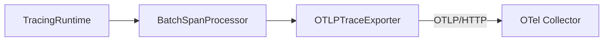

# `@aldok10/nestjs-observe-tracing-exporter-otlp`

OTLP/HTTP trace exporter and `BatchSpanProcessor` factory for `@aldok10/nestjs-observe-tracing`.

## Overview

`@aldok10/nestjs-observe-tracing-exporter-otlp` wraps `@opentelemetry/exporter-trace-otlp-http` and `@opentelemetry/sdk-trace` with typed factory functions for creating an `OTLPTraceExporter` and a pre-wired `BatchSpanProcessor`.

## Why This Package?

- **Clean factory API**: Construct an `OTLPTraceExporter` or `BatchSpanProcessor` with explicit, readonly TypeScript options.
- **Production-ready batching**: `createOtlpTraceSpanProcessor()` wires `OTLPTraceExporter` directly into OpenTelemetry's `BatchSpanProcessor` with optional batch tuning.

## Features

- `createOtlpTraceExporter(options?)` returning an `OTLPTraceExporter` instance.
- `createOtlpTraceSpanProcessor(options?)` returning a `BatchSpanProcessor` configured with the created exporter and optional `batch` settings.

## Architecture and Responsibilities



- **`createOtlpTraceExporter`**: Builds `@opentelemetry/exporter-trace-otlp-http`'s `OTLPTraceExporter` from `OtlpTraceExporterOptions`.
- **`createOtlpTraceSpanProcessor`**: Combines `createOtlpTraceExporter(options)` with `BatchSpanProcessor` and optional `BatchSpanProcessorOptions` (excluding `exporter`).

## Installation

```bash
pnpm add @aldok10/nestjs-observe-tracing-exporter-otlp @aldok10/nestjs-observe-tracing
```

```bash
npm install @aldok10/nestjs-observe-tracing-exporter-otlp @aldok10/nestjs-observe-tracing
```

```bash
yarn add @aldok10/nestjs-observe-tracing-exporter-otlp @aldok10/nestjs-observe-tracing
```

## Requirements

- **Node.js**: `>=22`
- **Peer Dependencies**: None
- **Module Formats**: ESM (`import`), CJS (`require`), and TypeScript declarations (`.d.ts`).

## Quick Start

```ts
import { Module } from '@nestjs/common';
import { TracingModule } from '@aldok10/nestjs-observe-tracing';
import { createOtlpTraceSpanProcessor } from '@aldok10/nestjs-observe-tracing-exporter-otlp';

@Module({
  imports: [
    TracingModule.forRoot({
      resource: { serviceName: 'orders-api' },
      spanProcessors: [
        createOtlpTraceSpanProcessor({
          url: 'http://localhost:4318/v1/traces',
        }),
      ],
    }),
  ],
})
export class AppModule {}
```

## Configuration

### `OtlpTraceExporterOptions`

| Property           | Type                               | Required | Default      | Description                                                            |
| ------------------ | ---------------------------------- | -------- | ------------ | ---------------------------------------------------------------------- |
| `url`              | `string`                           | No       | OTel default | OTLP/HTTP trace endpoint URL (e.g. `http://localhost:4318/v1/traces`). |
| `headers`          | `Readonly<Record<string, string>>` | No       | `undefined`  | Custom HTTP headers sent with export requests (e.g. auth tokens).      |
| `timeoutMillis`    | `number`                           | No       | OTel default | Export request timeout in milliseconds.                                |
| `concurrencyLimit` | `number`                           | No       | OTel default | Maximum concurrent export requests.                                    |

### `createOtlpTraceSpanProcessor` Additional Option

| Property | Type                                          | Required | Default     | Description                                                    |
| -------- | --------------------------------------------- | -------- | ----------- | -------------------------------------------------------------- |
| `batch`  | `Omit<BatchSpanProcessorOptions, 'exporter'>` | No       | `undefined` | Batching options passed to OpenTelemetry `BatchSpanProcessor`. |

## Usage

### Using `createOtlpTraceSpanProcessor`

```ts
import { bootstrapTracing } from '@aldok10/nestjs-observe-tracing';
import { createOtlpTraceSpanProcessor } from '@aldok10/nestjs-observe-tracing-exporter-otlp';

const runtime = bootstrapTracing({
  resource: { serviceName: 'checkout-service' },
  spanProcessors: [
    createOtlpTraceSpanProcessor({
      url: 'http://collector:4318/v1/traces',
      headers: { authorization: 'Bearer token' },
      timeoutMillis: 5000,
    }),
  ],
});
```

## Advanced Usage

### Custom Batch Settings or Direct Exporter

```ts
import { SimpleSpanProcessor } from '@opentelemetry/sdk-trace';
import {
  createOtlpTraceExporter,
  createOtlpTraceSpanProcessor,
} from '@aldok10/nestjs-observe-tracing-exporter-otlp';

const batchedProcessor = createOtlpTraceSpanProcessor({
  url: 'http://localhost:4318/v1/traces',
  batch: {
    maxQueueSize: 2048,
    maxExportBatchSize: 512,
    scheduledDelayMillis: 5000,
  },
});

// Or wrap the exporter in a custom processor
const exporter = createOtlpTraceExporter({ url: 'http://localhost:4318/v1/traces' });
const simpleProcessor = new SimpleSpanProcessor({ exporter });
```

## API Reference

- `createOtlpTraceExporter(options?: OtlpTraceExporterOptions): OTLPTraceExporter`
- `createOtlpTraceSpanProcessor(options?: OtlpTraceExporterOptions & { readonly batch?: Omit<BatchSpanProcessorOptions, 'exporter'> }): BatchSpanProcessor`
- `OtlpTraceExporterOptions` (interface)

## Integration with Other Packages

Pass the returned `BatchSpanProcessor` to `TracingModule.forRoot({ spanProcessors: [...] })` or `bootstrapTracing({ spanProcessors: [...] })` in [`@aldok10/nestjs-observe-tracing`](../tracing/README.md).

## Dependencies and Optional Integrations

- **Runtime dependencies**: `@opentelemetry/exporter-trace-otlp-http`, `@opentelemetry/sdk-trace`.

## Lifecycle and Resource Management

- When registered in `TracingRuntime`'s `spanProcessors`, `TracingRuntime.shutdown()` calls `TracerProvider.shutdown()`, which flushes and shuts down the `BatchSpanProcessor` and underlying `OTLPTraceExporter`.
- If you instantiate a processor or exporter standalone, call `await processor.shutdown()` and `await exporter.shutdown()` on teardown.

## Error Handling

- Network/collector export errors are handled internally by OpenTelemetry's `BatchSpanProcessor` and `OTLPTraceExporter`.

## Performance Considerations

- `BatchSpanProcessor` buffers spans and exports them asynchronously in batches, minimizing impact on request latency. Tune `batch.maxQueueSize`, `batch.maxExportBatchSize`, and `batch.scheduledDelayMillis` to match your throughput.

## Security Considerations

- Use HTTPS endpoints and pass authentication tokens via `headers` when exporting to remote collectors. Avoid hardcoding credentials in source files.

## Testing

```bash
pnpm test
```

```bash
pnpm exec vitest run packages/traces/exporter-otlp
```

## Troubleshooting

- **Spans not arriving at collector**: Verify the `url` includes `/v1/traces` for OTLP/HTTP and that `TracingRuntime.flush()` or `TracingRuntime.shutdown()` is awaited before process exit.

## Limitations

- Supports OTLP/HTTP only (`@opentelemetry/exporter-trace-otlp-http`); gRPC (`@opentelemetry/exporter-trace-otlp-grpc`) is not included.

## Related Packages

- [`@aldok10/nestjs-observe-tracing`](../tracing/README.md)
- [`@aldok10/nestjs-observe-tracing-exporter-console`](../exporter-console/README.md)
- [`@aldok10/nestjs-observe-metrics-exporter-otlp`](../../metrics/exporter-otlp/README.md)

## Documentation

- [Traces Domain Guide](../../../docs/packages/traces/README.md)
- [Architecture Overview](../../../docs/architecture/overview.md)

## Contributing

See [CONTRIBUTING.md](../../../CONTRIBUTING.md).

## License

MIT — see [LICENSE](../../../LICENSE).
