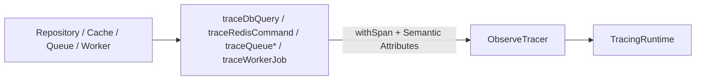

# `@aldok10/nestjs-observe-tracing-instrumentation-data`

Semantic-convention tracing helpers for database, Redis, queue, and worker operations.

## Overview

`@aldok10/nestjs-observe-tracing-instrumentation-data` provides lightweight, typed wrapper functions around `ObserveTracer.withSpan()` that apply OpenTelemetry `SpanKind` values and semantic attributes for database queries, Redis commands, queue producers/consumers, and background worker jobs.

## Why This Package?

- **Consistent span naming & attributes**: Avoids ad-hoc span names and attribute keys across repositories, caches, queues, and workers.
- **Zero monkey-patching**: Explicit function wrappers work with any database driver, Redis client, or queue library without fragile runtime patching.

## Features

- `traceDbQuery`: `SpanKind.CLIENT` span named `db.<system>.<operation>`.
- `traceRedisCommand`: `SpanKind.CLIENT` span named `redis.<command>`.
- `traceQueueProducer`: `SpanKind.PRODUCER` span named `queue.publish <queueName>`.
- `traceQueueConsumer`: `SpanKind.CONSUMER` span named `queue.process <queueName>`.
- `traceWorkerJob`: `SpanKind.INTERNAL` span named `worker.<jobName>`.

## Architecture and Responsibilities



Each helper delegates to `tracer.withSpan(name, fn, { kind, attributes })`, inheriting automatic span lifecycle, exception recording, and `SpanStatusCode.OK`/`ERROR` handling from `ObserveTracer`.

## Installation

```bash
pnpm add @aldok10/nestjs-observe-tracing-instrumentation-data @aldok10/nestjs-observe-tracing
```

```bash
npm install @aldok10/nestjs-observe-tracing-instrumentation-data @aldok10/nestjs-observe-tracing
```

```bash
yarn add @aldok10/nestjs-observe-tracing-instrumentation-data @aldok10/nestjs-observe-tracing
```

## Requirements

- **Node.js**: `>=22`
- **Peer Dependencies**: None
- **Module Formats**: ESM (`import`), CJS (`require`), and TypeScript declarations (`.d.ts`).

## Quick Start

```ts
import { ObserveTracer, bootstrapTracing } from '@aldok10/nestjs-observe-tracing';
import { traceDbQuery } from '@aldok10/nestjs-observe-tracing-instrumentation-data';

const runtime = bootstrapTracing({ resource: { serviceName: 'orders-api' } });
const tracer = new ObserveTracer(runtime);

const rows = await traceDbQuery(
  tracer,
  { system: 'postgresql', operation: 'SELECT', namespace: 'app' },
  async () => ['row1'],
);
```

## Configuration

### `DbSpanOptions`

| Property     | Type         | Required | Default     | Description                                                   |
| ------------ | ------------ | -------- | ----------- | ------------------------------------------------------------- |
| `system`     | `string`     | Yes      | —           | Database system name (`db.system.name`), e.g. `'postgresql'`. |
| `operation`  | `string`     | Yes      | —           | Operation name (`db.operation.name`), e.g. `'SELECT'`.        |
| `namespace`  | `string`     | No       | `undefined` | Database/schema name (`db.namespace`).                        |
| `attributes` | `Attributes` | No       | `undefined` | Extra attributes merged onto the span.                        |

### `RedisSpanOptions`

| Property     | Type         | Required | Default     | Description                                                |
| ------------ | ------------ | -------- | ----------- | ---------------------------------------------------------- |
| `command`    | `string`     | Yes      | —           | Redis command (`db.operation.name`), e.g. `'GET'`.         |
| `dbIndex`    | `number`     | No       | `undefined` | Redis logical DB index stored as string in `db.namespace`. |
| `attributes` | `Attributes` | No       | `undefined` | Extra attributes merged onto the span.                     |

### `QueueSpanOptions`

| Property     | Type         | Required | Default     | Description                                            |
| ------------ | ------------ | -------- | ----------- | ------------------------------------------------------ |
| `queueName`  | `string`     | Yes      | —           | Queue/destination name (`messaging.destination.name`). |
| `messageId`  | `string`     | No       | `undefined` | Message identifier (`messaging.message.id`).           |
| `attributes` | `Attributes` | No       | `undefined` | Extra attributes merged onto the span.                 |

### `WorkerSpanOptions`

| Property     | Type         | Required | Default     | Description                            |
| ------------ | ------------ | -------- | ----------- | -------------------------------------- |
| `jobName`    | `string`     | Yes      | —           | Job name (`worker.job.name`).          |
| `jobId`      | `string`     | No       | `undefined` | Job identifier (`worker.job.id`).      |
| `attributes` | `Attributes` | No       | `undefined` | Extra attributes merged onto the span. |

## Usage

```ts
import {
  traceQueueConsumer,
  traceQueueProducer,
  traceRedisCommand,
  traceWorkerJob,
} from '@aldok10/nestjs-observe-tracing-instrumentation-data';

await traceRedisCommand(tracer, { command: 'GET', dbIndex: 0 }, () => cache.get('k'));
await traceQueueProducer(tracer, { queueName: 'emails', messageId: 'm1' }, () => queue.publish());
await traceQueueConsumer(tracer, { queueName: 'emails', messageId: 'm1' }, () => handleEmail());
await traceWorkerJob(tracer, { jobName: 'invoice-pdf', jobId: 'j1' }, () => renderPdf());
```

## Advanced Usage

Pass custom attributes via `options.attributes` to enrich spans with table names, batch sizes, or retry counts without mutating the active span manually.

## API Reference

- `traceDbQuery<T>(tracer: ObserveTracer, options: DbSpanOptions, fn: () => Promise<T> | T): Promise<T>`
- `traceRedisCommand<T>(tracer: ObserveTracer, options: RedisSpanOptions, fn: () => Promise<T> | T): Promise<T>`
- `traceQueueProducer<T>(tracer: ObserveTracer, options: QueueSpanOptions, fn: () => Promise<T> | T): Promise<T>`
- `traceQueueConsumer<T>(tracer: ObserveTracer, options: QueueSpanOptions, fn: () => Promise<T> | T): Promise<T>`
- `traceWorkerJob<T>(tracer: ObserveTracer, options: WorkerSpanOptions, fn: () => Promise<T> | T): Promise<T>`
- Types: `DbSpanOptions`, `RedisSpanOptions`, `QueueSpanOptions`, `WorkerSpanOptions`

## Integration with Other Packages

- Requires an [`ObserveTracer`](../tracing/README.md) instance from `@aldok10/nestjs-observe-tracing`.
- Pair with [`DataMetricsCollector`](../../metrics/instrumentation/README.md) for matching database, Redis, queue, and worker metrics.

## Dependencies and Optional Integrations

- **Runtime dependencies**: `@aldok10/nestjs-observe-tracing`, `@opentelemetry/api`, `@opentelemetry/semantic-conventions`.

## Lifecycle and Resource Management

- Stateless helper functions; span lifecycle and runtime teardown are owned by `ObserveTracer` and `TracingRuntime`.

## Error Handling

- Exceptions thrown or rejected by `fn` are recorded on the span and rethrown by `ObserveTracer.withSpan()`.

## Performance Considerations

- Overhead is limited to one `ObserveTracer.withSpan()` call per wrapped operation.

## Security Considerations

- Do not pass raw SQL queries with unparameterized user input or sensitive payload contents in `options.attributes`.

## Testing

```bash
pnpm test
```

```bash
pnpm exec vitest run packages/traces/instrumentation-data
```

## Troubleshooting

- **Missing spans**: Ensure `ObserveTracer` is backed by an initialized `TracingRuntime` with at least one `SpanProcessor`.

## Limitations

- Does not automatically extract/inject trace context headers on queue messages; only wraps execution in a span.

## Related Packages

- [`@aldok10/nestjs-observe-tracing`](../tracing/README.md)
- [`@aldok10/nestjs-observe-metrics-instrumentation`](../../metrics/instrumentation/README.md)

## Documentation

- [Traces Domain Guide](../../../docs/packages/traces/README.md)
- [Architecture Overview](../../../docs/architecture/overview.md)

## Contributing

See [CONTRIBUTING.md](../../../CONTRIBUTING.md).

## License

MIT — see [LICENSE](../../../LICENSE).
