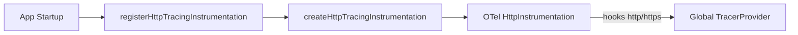

# `@aldok10/nestjs-observe-tracing-instrumentation-http`

Optional Node.js HTTP auto-instrumentation for `@aldok10/nestjs-observe-tracing`.

## Overview

`@aldok10/nestjs-observe-tracing-instrumentation-http` wraps `@opentelemetry/instrumentation` and `@opentelemetry/instrumentation-http` with simple URL ignore filters (string substring or `RegExp`) and an idempotent global registration guard.

## Why This Package?

- **Noise filtering**: Easily exclude health-check endpoints (`/health`, `/metrics`) or OTLP collector URLs from HTTP span generation.
- **Duplicate-registration guard**: `registerHttpTracingInstrumentation()` tracks module-level registration state so repeated calls return the existing unregister handle instead of double-patching Node's `http`/`https` modules.

## Features

- `createHttpTracingInstrumentation(options?)` for building a configured `HttpInstrumentation` instance.
- `registerHttpTracingInstrumentation(options?)` for idempotently registering `HttpInstrumentation` with OpenTelemetry and returning an `unregister()` callback.
- Incoming and outgoing request URL ignore matching via strings or `RegExp`s.
- Pass-through support for `headersToSpanAttributes` from `@opentelemetry/instrumentation-http`.

## Architecture and Responsibilities



- **`createHttpTracingInstrumentation`**: Translates `ignoreIncomingRequestUrls` (`request.url`) and `ignoreOutgoingRequestUrls` (`request.path`) into OpenTelemetry hooks.
- **`registerHttpTracingInstrumentation`**: Registers the instrumentation globally once and returns a cleanup function that unregisters and resets the guard.

## Installation

```bash
pnpm add @aldok10/nestjs-observe-tracing-instrumentation-http
```

```bash
npm install @aldok10/nestjs-observe-tracing-instrumentation-http
```

```bash
yarn add @aldok10/nestjs-observe-tracing-instrumentation-http
```

## Requirements

- **Node.js**: `>=22`
- **Peer Dependencies**: None
- **Module Formats**: ESM (`import`), CJS (`require`), and TypeScript declarations (`.d.ts`).

## Quick Start

```ts
import { bootstrapTracing } from '@aldok10/nestjs-observe-tracing';
import { registerHttpTracingInstrumentation } from '@aldok10/nestjs-observe-tracing-instrumentation-http';

const runtime = bootstrapTracing({ resource: { serviceName: 'api-gateway' } });
const unregisterHttp = registerHttpTracingInstrumentation({
  ignoreIncomingRequestUrls: ['/health'],
  ignoreOutgoingRequestUrls: [/localhost:4318/],
});

// On shutdown:
unregisterHttp();
await runtime.shutdown();
```

## Configuration

### `HttpTracingInstrumentationOptions`

| Property                    | Type                                                   | Required | Default     | Description                                                                                          |
| --------------------------- | ------------------------------------------------------ | -------- | ----------- | ---------------------------------------------------------------------------------------------------- |
| `ignoreIncomingRequestUrls` | `readonly (string \| RegExp)[]`                        | No       | `undefined` | Matches against incoming `request.url ?? ''` (substring check for strings, `.test()` for `RegExp`).  |
| `ignoreOutgoingRequestUrls` | `readonly (string \| RegExp)[]`                        | No       | `undefined` | Matches against outgoing `request.path ?? ''` (substring check for strings, `.test()` for `RegExp`). |
| `headersToSpanAttributes`   | `HttpInstrumentationConfig['headersToSpanAttributes']` | No       | `undefined` | Forwarded directly to `HttpInstrumentation` to capture selected HTTP headers as span attributes.     |

## Usage

### Creating Instrumentation Without Global Registration

```ts
import { registerInstrumentations } from '@opentelemetry/instrumentation';
import { createHttpTracingInstrumentation } from '@aldok10/nestjs-observe-tracing-instrumentation-http';

const httpInstrumentation = createHttpTracingInstrumentation({
  ignoreIncomingRequestUrls: ['/health', /^\/internal\//],
});

const unregister = registerInstrumentations({
  instrumentations: [httpInstrumentation],
});
```

## Advanced Usage

### Capturing Request/Response Headers

```ts
import { registerHttpTracingInstrumentation } from '@aldok10/nestjs-observe-tracing-instrumentation-http';

const unregister = registerHttpTracingInstrumentation({
  headersToSpanAttributes: {
    server: { requestHeaders: ['x-request-id'] },
    client: { responseHeaders: ['x-upstream-id'] },
  },
});
```

## API Reference

- `createHttpTracingInstrumentation(options?: HttpTracingInstrumentationOptions): HttpInstrumentation`
- `registerHttpTracingInstrumentation(options?: HttpTracingInstrumentationOptions): () => void`
- `HttpTracingInstrumentationOptions` (interface)

## Integration with Other Packages

- Requires an active global OpenTelemetry `TracerProvider` (e.g., via [`@aldok10/nestjs-observe-tracing`](../tracing/README.md) with `registerGlobal: true`).
- Register before importing or initializing HTTP servers/clients when possible so module patching applies cleanly.

## Dependencies and Optional Integrations

- **Runtime dependencies**: `@opentelemetry/instrumentation`, `@opentelemetry/instrumentation-http`.

## Lifecycle and Resource Management

- `registerHttpTracingInstrumentation()` returns an idempotent `unregister()` function. Calling `unregister()` calls OpenTelemetry's unregister callback and resets the module-level `registered` flag so it can be re-registered later (e.g., between tests).

## Error Handling

- Any errors during instrumentation hooks are handled by `@opentelemetry/instrumentation-http`.

## Performance Considerations

- Use `ignoreIncomingRequestUrls` and `ignoreOutgoingRequestUrls` to skip high-frequency health checks, readiness probes, and telemetry export traffic (such as OTLP `/v1/traces` calls).

## Security Considerations

- Only list non-sensitive header names in `headersToSpanAttributes`. Never capture `authorization`, `cookie`, or `set-cookie` headers into span attributes.

## Testing

```bash
pnpm test
```

```bash
pnpm exec vitest run packages/traces/instrumentation-http
```

## Troubleshooting

- **Duplicate calls return the same handle with new options ignored**: If `registerHttpTracingInstrumentation()` is already active, subsequent calls return the existing `unregister` handle without re-creating the instrumentation. Call `unregister()` first if you need to change options.
- **Outgoing URL ignore pattern not matching host**: `ignoreOutgoingRequestUrls` checks `request.path ?? ''`, not the full `http://host:port/path` URL.

## Limitations

- `ignoreOutgoingRequestUrls` matches against `request.path` only (not protocol/host).
- Registration state is tracked in a module-level singleton.

## Related Packages

- [`@aldok10/nestjs-observe-tracing`](../tracing/README.md)
- [`@aldok10/nestjs-observe-tracing-instrumentation-data`](../instrumentation-data/README.md)

## Documentation

- [Traces Domain Guide](../../../docs/packages/traces/README.md)
- [Architecture Overview](../../../docs/architecture/overview.md)

## Contributing

See [CONTRIBUTING.md](../../../CONTRIBUTING.md).

## License

MIT — see [LICENSE](../../../LICENSE).
